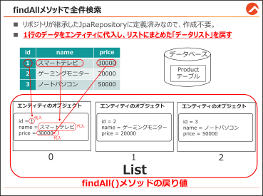

# 3.4. 全件検索



## 【作業手順①】 findAll メソッドで全件データ取得

```{.java filename="…/controller/ProductController.java"}

@Controller
@RequestMapping("/product")
public class ProductController {
     @Autowired
	private ProductRepository prodRepo;

	@GetMapping("/findAll")
	public String showProductList(Model model) {
		List<Product> list = prodRepo.findAll();
		System.out.println(list);
		model.addAttribute("products", list);
		return "product/list";
	}
}
```
