<!-- 元PDF 15〜30ページ。Java 21・Spring Boot 4.0.2対応版。 -->

::: {#page-15 .source-page}

::: {#p015-b01 .heading}

[&#32;1]{.s005}

:::

::: {#p015-b02 .heading}

[第1章&#32;]{.s001}[Spring Boot と開発環境の概要]{.s001}

:::

::: {#p015-b03 .heading}

[章の目標]{.s002}

:::

::: {#p015-b04 .heading}

[◼&#32;]{.s003}[フレームワークとSpring Framework について理解する]{.s004}

:::

::: {#p015-b05 .heading}

[◼&#32;]{.s003}[Spring Boot の基本概念と特徴を把握する]{.s004}

:::

::: {#p015-b06 .heading}

[◼&#32;]{.s003}[Maven を用いてライブラリのインストールができる]{.s004}

:::

:::

::: {#page-16 .source-page}

:::

::: {#page-17 .source-page}

::: {#p017-b01 .heading}

[章の概要]{.s008}

:::

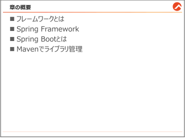{#p017-f01}

::: {#p017-b02 .paragraph}

[この章では、Java でのWeb 開発における、フレームワークの概念とそのフレームワークの中]{.s009}\
[でもよく活用されるSpring Boot の基本概念について学習します。]{.s009}

:::

::: {#p017-b03 .paragraph}

[続いて、Spring Boot のプロジェクトの作成方法について学習します。Spring Boot は、プロジ]{.s009}\
[ェクトを作成する時、しっかり設定をすることで、元々はややこしい環境設定を簡単にできるよう]{.s009}\
[になるので、しっかり習得する必要があります。]{.s009}

:::

::: {#p017-b04 .paragraph}

[そして、フレームワークの環境設定で欠かせないビルドツールである、Maven についてもご]{.s009}\
[紹介します。Maven を学ぶことにより、ライブラリの導入と、ビルドを効率化することができます。]{.s009}

:::

:::

::: {#page-18 .source-page}

::: {#p018-b01 .heading}

[1\.1.&#32;]{.s004}[フレームワークとは]{.s004}

:::

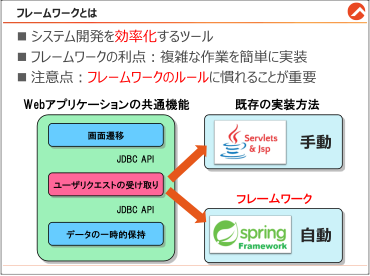{#p018-f02}

::: {#p018-b02 .heading}

[フレームワークとは]{.s010}

:::

::: {#p018-b03 .paragraph}

[フレームワークは、システム開発の世界でよく使われるツールの一種です。このフレームワ]{.s009}\
[ークを使うと、]{.s009}[特定の種類のシステムをより速く、効率的に作ることができます。]{.s011}

:::

::: {#p018-b04 .paragraph}

[例えば、Web アプリケーションを作る時、画面を切り替えたり、ユーザのリクエストを受け取っ]{.s009}\
[たり、データを一時的に保持したりすることがよくあります。これらは、どんなWeb アプリケーショ]{.s009}\
[ンにも必要な基本的な機能です。]{.s009}

:::

::: {#p018-b05 .paragraph}

[以前は、サーブレットという技術を使ってこれらの機能を実装していましたが、ちょっと複雑]{.s009}\
[で時間がかかる作業でした。ですが、フレームワークを使うと、これらの作業を簡単なコードや]{.s009}\
[キーワードで実装できるようになります。つまり、フレームワークは開発者の作業効率を高めて]{.s009}\
[くれます。]{.s009}

:::

{#illustration-expansion-2026-framework-foundation}

::: {#illustration-expansion-2026-framework-foundation-caption .paragraph}

共通機能をフレームワークに任せ、開発者はアプリケーション固有の処理を組み立てます。

:::

::: {#p018-b06 .heading}

[フレームワークの注意点]{.s010}

:::

::: {#p018-b07 .paragraph}

[フレームワークは便利ですが、フレームワークによって]{.s009}[定められたルールや方法に従って作]{.s011}\
[業する必要]{.s011}[があります。最初は、これらのルールに慣れることに集中しましょう。また、エラーが]{.s009}\
[発生した時の対処方法も、フレームワークを使いこなす上で大切です。エラーメッセージを見]{.s009}\
[て、何が問題なのかを理解し、解決する力を身につけましょう。もし、問題が発生した場合は、]{.s009}\
[本書付録の「よく起きるエラーまとめ」を参考にしてください。]{.s009}

:::

:::

::: {#page-19 .source-page}

::: {#p019-b01 .heading}

[1\.2.&#32;]{.s004}[Spring Framework]{.s004}

:::

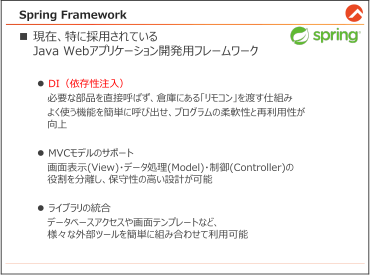{#p019-f03}

::: {#p019-b02 .heading}

[Java Web アプリケーションの歴史とSpring Framework]{.s010}

:::

::: {#p019-b03 .paragraph}

[「Spring Framework」、通称「Spring」は、Java 言語を使用してエンタープライズアプリケーショ]{.s009}\
[ン全体を開発するためのフレームワークです。Web アプリケーションの開発もその中の一部で]{.s009}\
[した。]{.s009}

:::

::: {#p019-b04 .paragraph}

[1995 年にJava が公開され、その後の1990 年代後半には、サーブレットとJSP を活用した]{.s009}\
[Web アプリケーション開発の時代が始まりました。サーブレット&JSP はJava Web アプリケーショ]{.s009}\
[ンの開発の基盤となりましたが、これらの技術だけでは複雑なアプリケーションの開発が難し]{.s009}\
[く、冗長な作業が増えることが課題となりました。]{.s009}

:::

::: {#p019-b05 .paragraph}

[2000 年代に入ると、この課題を解決するためのフレームワークがいくつか登場しました。]{.s009}\
[Struts はApache Software Foundation から公開され、初期の頃の主要なMVC フレームワーク]{.s009}\
[として広く採用されました。一方、2002 年にはSpring Framework がRod Johnson 氏によって初]{.s009}\
[めて公開されました。Seasar2 などの他のフレームワークもこの時期に登場しました。]{.s009}

:::

::: {#p019-b06 .paragraph}

[2010 年代に入ると、多くのJava フレームワークの中でもSpring はその柔軟性、拡張性、そし]{.s009}\
[て豊富なサブプロジェクト（例: Spring Boot, Spring Data）のおかげで非常に人気があり、多く]{.s009}\
[の企業やプロジェクトで採用されるようになりました。その結果、多くのJava のフレームワークの]{.s009}\
[中で、]{.s009}[Spring は特に注目される存在]{.s011}[となりました。]{.s009}

:::

:::

::: {#page-20 .source-page}

::: {#p020-b01 .heading}

[Spring の特徴]{.s010}

:::

::: {#p020-b02 .heading}

[1\.&#32;]{.s012}[DI（依存性注入）]{.s012}

:::

::: {#p020-b03 .paragraph}

[Spring では、「DI」という概念を使って、異なるクラス間の繋がり(依存関係)を効率よく管理で]{.s009}\
[きます。A クラスからB クラスを直接呼び出すのではなく、B クラスと繋がるリモコンを予め倉庫]{.s009}\
[に入れておいて、必要な時にそのリモコンをA クラスに渡す。というイメージに近いです。]{.s009}\
[&#32;A クラスは渡されたリモコンの「スイッチ（メソッド）」を押すだけで機能を使えます。]{.s009}

:::

{#illustration-figure-cards-2026-di-remote-intro}

::: {#illustration-figure-cards-2026-di-remote-intro-caption .paragraph}

DIコンテナから渡されたリモコンを使い、AクラスがBクラスの機能を呼び出します。

:::

::: {#p020-b04 .paragraph}

[この仕組みのおかげで、]{.s009}[よく使われるクラスを簡単に呼び出し、プログラムの柔軟性と再利]{.s011}\
[用性を高める]{.s011}[ことができます。DI については、3 章でご説明します。]{.s009}

:::

::: {#p020-b05 .heading}

[2\.&#32;]{.s012}[MVC モデルの設計理念]{.s012}

:::

::: {#p020-b06 .paragraph}

[Spring はMVC（Model-View-Controller）モデルを基にしたアプリケーション開発をサポート]{.s009}\
[します。これにより、画面の表示（View）、データの処理（Model）、そしてユーザの入力と画面]{.s009}\
[表示の制御（Controller）といったプログラムの役割を明確に分けることができ、より管理しやす]{.s009}\
[いコードを作成できます。2 章からMVC パターンを活用した実装の仕方を学習します。]{.s009}

:::

::: {#p020-b07 .heading}

[3\.&#32;]{.s012}[ライブラリの統合]{.s012}

:::

::: {#p020-b08 .paragraph}

[Spring は他の多くのフレームワークやライブラリと組み合わせて利用することが可能です。例]{.s009}\
[えば、ビューテンプレートに「Thymeleaf」、データベースアクセスに「Hibernate」、ログ出力に]{.s009}\
[「Apache Log4j」といった様々なツールを組み合わせることができます。次の節で詳しくご説明]{.s009}\
[します。]{.s009}

:::

::: {#p020-b09 .paragraph}

[以上の特徴により、Spring はJava のWeb アプリケーション開発をより効率的かつ柔軟にする]{.s009}\
[ための強力なツールとなっています。]{.s009}

:::

::: {#p020-b10 .paragraph}

[本書では、Spring Framework 7.0.3を利用します。]{.s011}

:::

:::

::: {#page-21 .source-page}

::: {#p021-b01 .heading}

[1\.3.&#32;]{.s004}[Spring Boot とは]{.s004}

:::

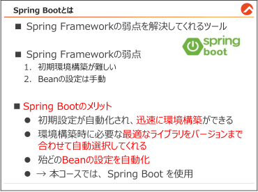{#p021-f04}

::: {#p021-b02 .heading}

[Spring Boot とは]{.s010}

:::

::: {#p021-b03 .paragraph}

[Spring Framework]{.s007}[&#32;は機能が豊富なフレームワークですが、アプリケーションの開発を始める]{.s009}\
[際には、]{.s009}[環境構築の手順が複雑で難しい]{.s011}[というデメリットがありました。]{.s009}

:::

::: {#p021-b04 .paragraph}

[この課題を解決するために、]{.s009}[Spring Boot]{.s007}[&#32;が開発されました。当コースでは、]{.s009}[Spring Boot]{.s007}[&#32;を]{.s009}\
[使用し、研修を進めます。]{.s009}[Spring Boot]{.s007}[&#32;は、]{.s009}[Spring Framework]{.s007}[&#32;をより簡単に使えるようにするツ]{.s009}\
[ールのようなものです。]{.s009}

:::

::: {#p021-b05 .paragraph}

[Spring Boot]{.s007}[&#32;は、開発者が簡単に&#32;]{.s009}[Web]{.s007}[&#32;アプリケーションを作成できるように設計されていま]{.s009}\
[す。以下にその主なメリットを紹介します。]{.s009}

:::

:::

::: {#page-22 .source-page}

::: {#p022-b01 .heading}

[1\.&#32;]{.s011}[セットアップが簡単]{.s011}

:::

::: {#p022-b02 .paragraph}

[Spring Boot]{.s007}[&#32;は、多くの設定を自動で行ってくれるため、開発を始めるための準備が簡単で]{.s009}\
[す。そのおかげで、プログラミングの初心者でも迅速にプロジェクトを立ち上げることができま]{.s009}\
[す。]{.s009}[Spring Boot]{.s007}[&#32;によって作成されたプロジェクトは、自動で以下のようなフォルダ構成になりま]{.s009}\
[す。]{.s009}

:::

::: {#p022-b03 .heading}

[＜Spring Boot プロジェクトの構成＞]{.s011}

:::

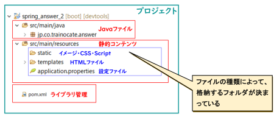{#p022-f05}

::: {#p022-b04 .paragraph}

[Spring Boot では、ファイルの種類によって、]{.s011}[決まったフォルダに格納しないと、正常動作し]{.s013}\
[ません。]{.s013}[spring\_answer\_2 プロジェクトを展開して、ファイルの構成を確認してください。]{.s011}

:::

::: {#p022-b05 .heading}

[2\.&#32;]{.s011}[依存ライブラリの簡単な管理]{.s011}

:::

::: {#p022-b06 .paragraph}

[Spring Boot の次のメリットは、ライブラリのバージョン管理を自動で行ってくれることです。]{.s009}

:::

::: {#p022-b07 .paragraph}

[通常、複数のライブラリを組み合わせて開発する場合、「どのライブラリの、どのバージョン同]{.s009}\
[士なら競合せずに動くか」を調整するのは非常に手間がかかります。しかし&#32;]{.s009}[Spring Boot]{.s007}[&#32;では、]{.s009}\
[初期環境構築時にベースとなる「Spring Boot のバージョン」を決めるだけで、それに最適な]{.s011}\
[関連ライブラリのバージョンを自動で選択してくれます。]{.s011}

:::

::: {#p022-b08 .paragraph}

[以下の画像は、Maven により必要なライブラリが自動導入されている様子です。開発者はバ]{.s009}\
[ージョンの相性に悩まされることなく、スムーズに開発を始めることができます。]{.s009}

:::

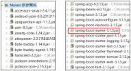{#p022-f06}

:::

::: {#page-23 .source-page}

::: {#p023-b01 .heading}

[3\.&#32;]{.s011}[Bean の自動設定]{.s011}

:::

::: {#p023-b02 .paragraph}

[Spring Framework では、アプリケーションの多くの機能が]{.s009}[「Bean」]{.s011}[と呼ばれる特別なオブジェ]{.s009}\
[クトとして管理されます。Bean は、先ほどDI（依存性の注入）で例えた「予め倉庫（DI コンテナ）]{.s009}\
[に準備されている、リモコン本体」のことです。]{.s009}

:::

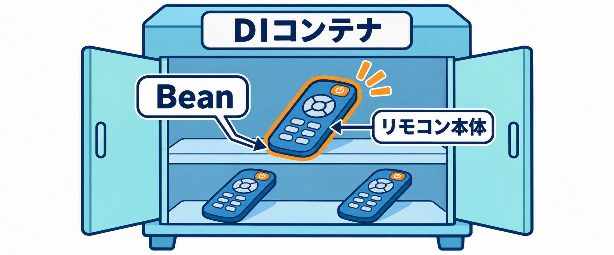{#illustration-expansion-2026-bean-auto-configuration}

::: {#illustration-expansion-2026-bean-auto-configuration-caption .paragraph}

Beanは、DIコンテナに準備されているリモコン本体に相当します。

:::

::: {#p023-b03 .paragraph}

[通常、この&#32;]{.s009}[Bean]{.s007}[&#32;を倉庫（]{.s009}[DI]{.s007}[&#32;コンテナ）に登録・管理するためには、以下のように手動で一つ]{.s009}\
[一つ設定を書く必要があります。]{.s009}

:::

::: {#p023-b04 .code}

```java
@Configuration
public class AppConfig {
  //myService をBean に登録すると便利だが、登録に手間がかかる
        @Bean
        public MyServiceImpl myService() {
               return new MyServiceImpl();
        }
}
```

:::

::: {#p023-b05 .paragraph}

[ただし、]{.s009}[Bean の数が多くなると、それぞれの設定が複雑になり、管理が難しくなります。]{.s011}\
[Spring Boot は、多くの一般的なBean を、最初から自動でDI コンテナに準備・設定してくれま]{.s011}\
[す。]{.s011}

:::

::: {#p023-b06 .paragraph}

[開発者が手動で&#32;]{.s009}[Bean]{.s007}[&#32;を設定する手間が大幅に減るため、アプリケーションの本来の目的]{.s009}\
[（ビジネスロジック）の実装により集中できるようになります。]{.s009}

:::

::: {#p023-b07 .paragraph}

[このように、]{.s009}[Spring Boot]{.s007}[&#32;は&#32;]{.s009}[Spring Framework]{.s007}[&#32;の機能を拡張し、開発プロセスを簡略化して、]{.s009}\
[より効率的にするための大変便利なツールとなっています。]{.s009}

:::

:::

::: {#page-24 .source-page}

::: {#p024-b01 .heading}

[1\.4.&#32;]{.s004}[Maven でライブラリ管理]{.s004}

:::

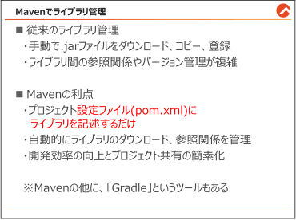{#p024-f07}

::: {#p024-b02 .heading}

[Maven でライブラリ管理]{.s010}

:::

::: {#p024-b03 .paragraph}

[Spring Boot では、Maven などのビルドツールを使ってライブラリの管理をするのが一般的で]{.s009}\
[す。]{.s009}[Mavenを使うと、従来は複雑なライブラリの管理を簡単に行うことができる]{.s011}[ようになります。]{.s009}

:::

::: {#p024-b04 .paragraph}

[Java Web]{.s007}[&#32;プロジェクトを開発する際、データベースの接続やその他の多くの機能を実装する]{.s009}\
[ために、外部ライブラリの利用はほぼ必須です。しかし、従来の方法では以下のような手順が]{.s009}\
[必要でした。]{.s009}

:::

::: {#p024-b05 .heading}

[【参考】従来のライブラリ導入方法]{.s011}

:::

::: {#p024-b06 .paragraph}

[１．&#32;]{.s009}[インターネットから適切な]{.s009}[.jar]{.s007}[&#32;ファイル]{.s009}[(]{.s007}[例：]{.s009}[mysql-connector-j.jar)]{.s007}[を探し出し、]{.s009}\
[ダウンロードする。]{.s009}

:::

::: {#p024-b07 .paragraph}

[２．&#32;]{.s009}[ダウンロードした]{.s009}[.jar]{.s007}[&#32;ファイルをプロジェクトの特定のフォルダにコピーする。]{.s009}

:::

::: {#p024-b08 .paragraph}

[３．&#32;]{.s009}[プロジェクトのビルドパスにこれらの]{.s009}[.jar]{.s007}[&#32;ファイルを登録する。]{.s009}

:::

::: {#p024-b09 .paragraph}

[手動でのライブラリ管理は、時間がかかるだけでなく、ライブラリ間の参照関係やバージョン]{.s009}\
[の整合性を手動で管理する必要があり、非常に面倒です。さらに、プロジェクトを他の開発者と]{.s009}\
[共有する際も、全てのライブラリファイルを含める必要があるため、非効率です。]{.s009}

:::

:::

::: {#page-25 .source-page}

::: {#p025-b01 .paragraph}

[「Maven」や「Gradle」といったビルドツールを利用することで、問題を解決できます。これらの]{.s009}\
[ツールを使うと、]{.s009}[必要なライブラリをプロジェクトの設定ファイルに記述するだけで、ツールが]{.s011}\
[自動的にライブラリをダウンロードし、参照関係を管理]{.s011}[してくれます。このおかげで、プロジェ]{.s009}\
[クトの設定と共有が簡単になり、開発効率が大幅に向上します。]{.s009}

:::

::: {#p025-b02 .heading}

[Maven を利用し、ライブラリを導入する手順]{.s010}

:::

::: {#p025-b03 .step}

[1\.&#32;]{.s007}[インターネットから、導入したいライブラリ名を検索し、]{.s009}[\[Maven Repository\]]{.s007}[に接続する。]{.s009}

:::

::: {#p025-b04 .paragraph}

[(]{.s007}[今回の例では、]{.s009}[MySQL Connector J]{.s007}[&#32;と検索しました。]{.s009}[)]{.s007}

:::

::: {#p025-b05 .paragraph}

[(]{.s007}[https://mvnrepository.com/artifact/com.mysql/mysql-connector-j]{.s017}[)]{.s007}

:::

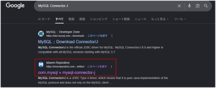{#p025-f08}

::: {#p025-b06 .step}

[2\.&#32;]{.s007}[導入したいバージョン名をクリックする。]{.s009}\
[（よくわからない場合は、]{.s009}[Usages]{.s007}[&#32;が一番多い方を選ぶ）]{.s009}

:::

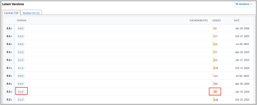{#p025-f09}

:::

::: {#page-26 .source-page}

::: {#p026-b01 .step}

[3\.&#32;]{.s007}[利用するビルドツールに合わせて、タブを切り替えする。表示されたテキストをコピーして]{.s009}\
[おく。]{.s009}

:::

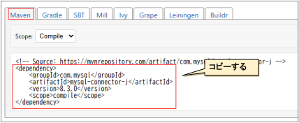{#p026-f10}

::: {#p026-b02 .code}

```xml
<dependency>
    <groupId>com.mysql</groupId>
    <artifactId>mysql-connector-j</artifactId>
    <version>8.3.0</version>
    <scope>compile</scope>
</dependency>
```

:::

::: {#p026-b03 .step}

[4\.&#32;]{.s009}[Eclipse 上の\[spring\_exercise\_1\_3\]プロジェクトをダブルクリックし、\[pom.xml\]ファイルをダブ]{.s009}\
[ルクリックする。]{.s009}

:::

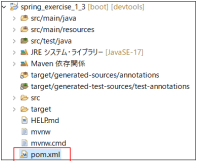{#p026-f11}

::: {#p026-b04 .step}

[5\.&#32;]{.s007}[\<dependencies\>と、\</dependencies\>の間の任意の場所]{.s013}[に、手順&#32;]{.s009}[3]{.s007}[&#32;でコピーしたテキスト]{.s009}\
[を貼り付けて、保存する。]{.s009}

:::

:::

::: {#page-27 .source-page}

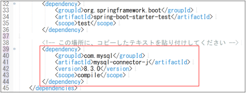{#p027-f12}

::: {#p027-b01 .step}

[6\.&#32;]{.s007}[pom.xml]{.s007}[&#32;の任意の場所を]{.s009}[右クリック→]{.s018}[\[]{.s019}[実行]{.s018}[\]]{.s019}[→]{.s018}[\[Maven install\]]{.s019}[をクリックすると、ライブラリ]{.s009}\
[の導入が完了する。]{.s009}

:::

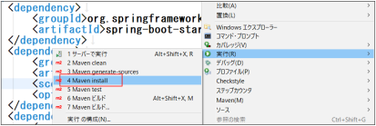{#p027-f13}

::: {#p027-b02 .step}

[7\.&#32;]{.s007}[コンソール上で、ダウンロードとインストールのログが流れる。]{.s009}

:::

::: {#p027-b03 .paragraph}

[以下のように、]{.s009}[\[BUILD SUCCESS\]]{.s020}[が表示されると、完了。]{.s009}

:::

::: {#p027-b04 .paragraph}

[※]{.s009}[\[FAILED\]]{.s019}[になった際は、誤字を確認して修正後、再度試す。]{.s009}

:::

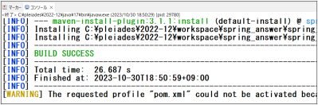{#p027-f14}

:::

::: {#page-28 .source-page}

::: {#p028-b01 .heading}

[Maven によるライブラリ管理の利点]{.s010}

:::

::: {#p028-b02 .paragraph}

[以上が、]{.s009}[Maven]{.s007}[&#32;を利用したライブラリの適用方法です。]{.s009}[Maven]{.s007}[&#32;を使用する最大のメリット]{.s009}\
[は、「プロジェクトを他の人と共有するのが非常に簡単になること」です。]{.s009}

:::

::: {#p028-b03 .paragraph}

[通常、作成したプロジェクトを第三者に渡す際、使用している重いライブラリ（部品）のフ]{.s009}\
[ァイルを一つ一つセットにして渡す必要があります。しかし&#32;]{.s009}[Maven]{.s007}[&#32;を使えば、ライブラリの]{.s009}\
[「お買い物リスト」である]{.s009}[&#32;pom.xml&#32;]{.s007}[ファイルだけを渡せば済みます。]{.s009}

:::

::: {#p028-b04 .paragraph}

[プロジェクトを受け取った人が]{.s009}[&#32;maven install&#32;]{.s007}[を実行すると、リストに書かれた「全く同じ]{.s009}\
[バージョンのライブラリ」がインターネットから自動的にダウンロードされ、インストールされ]{.s009}\
[ます。]{.s009}

:::

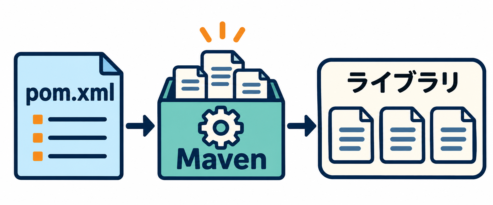{#illustration-2026-maven-libraries}

::: {#illustration-2026-maven-libraries-caption .paragraph}

pom.xmlの指定をもとに、Mavenが必要なライブラリをそろえます。

:::

::: {#p028-b05 .paragraph}

[これにより、「]{.s009}[A]{.s007}[&#32;さんのパソコンでは動くのに、]{.s009}[B]{.s007}[&#32;さんのパソコンでは動かない」といった環]{.s009}\
[境のズレを防ぎ、チーム全員が同じ環境で効率よく開発を進めることができます。]{.s009}

:::

:::

::: {#page-29 .source-page}

::: {#p029-b01 .heading}

[章のまとめ]{.s004}

:::

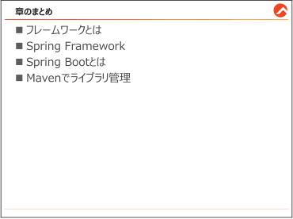{#p029-f15}

::: {#p029-b02 .paragraph}

[この章では、フレームワークの概念とその必要性を理解しました。特に、]{.s009}[Java]{.s007}[&#32;の開発で広く]{.s009}\
[利用されている&#32;]{.s009}[Spring Framework]{.s007}[&#32;の特徴と強みについて学びました。また、]{.s009}[Spring Boot]{.s007}[&#32;の導]{.s009}\
[入によって、]{.s009}[Spring Framework]{.s007}[&#32;の開発をより手軽に始められる方法について説明しました。最]{.s009}\
[後に、]{.s009}[Maven]{.s007}[を使った効率的なライブラリ管理の方法を学び、プロジェクトの構築と管理がいか]{.s009}\
[に簡単になるかを理解できました。]{.s009}

:::

::: {#p029-b03 .paragraph}

[これで&#32;]{.s009}[Spring Boot]{.s007}[&#32;での&#32;]{.s009}[Web]{.s007}[&#32;アプリケーション開発への第一歩を踏み出す準備が整いまし]{.s009}\
[たので、次の章から本格的に]{.s009}[Spring Boot]{.s007}[&#32;を使った]{.s009}[Web]{.s007}[&#32;アプリケーションの開発に挑戦しましょ]{.s009}\
[う。]{.s009}

:::

:::

::: {#page-30 .source-page}

:::
