<!-- 元PDF 31〜62ページ。Java 21・Spring Boot 4.0.2対応版。 -->

::: {#page-31 .source-page}

::: {#p031-b01 .heading}

[&#32;2]{.s005}

:::

::: {#p031-b02 .heading}

[第2章&#32;]{.s001}[Spring Web アプリケーション]{.s001}

:::

::: {#p031-b03 .heading}

[章の目標]{.s002}

:::

::: {#p031-b04 .heading}

[◼&#32;]{.s003}[Web アプリケーションの基本的な流れを理解できる]{.s004}

:::

::: {#p031-b05 .heading}

[◼&#32;]{.s003}[Controller を作成し、利用できる]{.s004}

:::

::: {#p031-b06 .heading}

[◼&#32;]{.s003}[View からController へのリクエストパラメータを取得できる]{.s004}

:::

::: {#p031-b07 .heading}

[◼&#32;]{.s003}[Form クラスを使用してリクエストパラメータを取得できる]{.s004}

:::

::: {#p031-b08 .heading}

[◼&#32;]{.s003}[Model を通じてController からView にデータを表示できる]{.s004}

:::

:::

::: {#page-32 .source-page}

:::

::: {#page-33 .source-page}

::: {#p033-b01 .heading}

[章の概要]{.s008}

:::

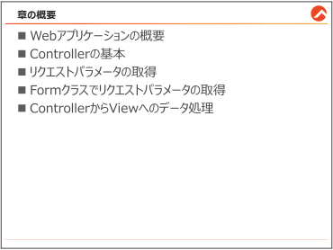{#p033-f01}

::: {#p033-b02 .paragraph}

[この章では、インターネットを介したアプリケーションの基本的な概念であるWeb アプリケー]{.s009}\
[ションについて学びます。]{.s009}

:::

::: {#p033-b03 .paragraph}

[まず、Web アプリケーションの基本的な構造と機能について理解を深め、次に、Spring]{.s009}\
[Framework を使用したWeb アプリケーション開発におけるController の基本について学習し]{.s009}\
[ます。その後、Web アプリケーションにおけるリクエストパラメータの受け渡しについて学びま]{.s009}\
[す。最後に、「Thymeleaf」というテンプレートエンジンを使って、サーバー側で処理されたデー]{.s009}\
[タをWeb ページにどのように表示するかについても学びます。]{.s009}

:::

::: {#p033-b04 .paragraph}

[この章を通して、Web アプリケーションの基礎的な概念とSpring Framework を使ったWeb]{.s009}\
[アプリケーション開発の基本を理解し、実際にWeb アプリケーションを構築するための基本的]{.s009}\
[なスキルを身につけてみましょう。]{.s009}

:::

:::

::: {#page-34 .source-page}

::: {#p034-b01 .heading}

[2\.1.&#32;]{.s004}[Web アプリケーションの概要]{.s004}

:::

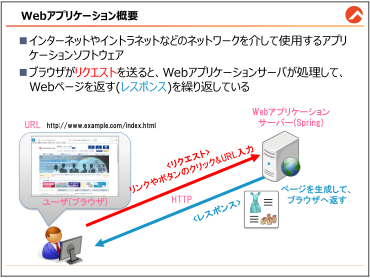{#p034-f02}

::: {#p034-b02 .heading}

[Web アプリケーションとは？]{.s010}

:::

::: {#p034-b03 .paragraph}

[Spring でWeb アプリケーションの作成を学ぶ前に、まずはWeb アプリケーションについてご]{.s009}\
[説明します。]{.s009}

:::

::: {#p034-b04 .paragraph}

[Web アプリケーションは、インターネットやイントラネットを介して使用されるソフトウェアです。]{.s009}\
[日常的に使っているウェブサイト（例えば、ニュースサイトやオンラインショッピング、SNS など）]{.s009}\
[は、実はすべてWeb アプリケーションの一部です。]{.s009}\
[&#32;Web アプリケーションは、ブログや記事のようなWeb ページと異なり、ユーザの入力に応じて]{.s009}\
[動的にコンテンツを変更したり、データベースと連携して情報を更新したりすることができます。]{.s009}

:::

::: {#p034-b05 .heading}

[リクエストとレスポンスのプロセス]{.s010}

:::

::: {#p034-b06 .paragraph}

[Web アプリケーションの基本的な動作は、]{.s009}[「リクエスト」]{.s011}[と]{.s012}[「レスポンス」]{.s013}[のやり取りによって成]{.s009}\
[り立っています。ここでの「リクエスト」とは、皆様がブラウザを通じてサーバーに対して行う要求]{.s009}\
[のことで、例えば]{.s009}[特定のページを表示]{.s012}[したい、あるいはフォームに]{.s009}[入力したデータを送信]{.s012}[した]{.s009}\
[いといったことが含まれます。]{.s009}

:::

::: {#p034-b07 .paragraph}

[一方で、「レスポンス」とはサーバーがリクエストに応じてブラウザに返す応答のことを指しま]{.s009}\
[す。これは通常、HTML 形式のWeb ページとして表示され、ユーザに情報が送られます。]{.s009}

:::

:::

::: {#page-35 .source-page}

::: {#p035-b01 .paragraph}

[例えば、オンラインの服のショッピングサイトを訪れて、特定のブランドの服や靴を探してい]{.s009}\
[るとします。検索ボックスに「夏のファッション」と入力して検索ボタンをクリックします。これが「リ]{.s009}\
[クエスト」です。]{.s009}

:::

::: {#p035-b02 .paragraph}

[このリクエストは、Web アプリケーションサーバーに送信され、Web アプリケーションはユーザ]{.s009}\
[が入力したブランド名に基づいて商品のデータベースを検索します。検索結果として、そのブ]{.s009}\
[ランドの商品一覧が見つかります。この商品一覧がWeb ページとして整形され、ユーザのブラ]{.s009}\
[ウザに送り返されます。これが「レスポンス」です。]{.s009}

:::

::: {#p035-b03 .paragraph}

[その結果、のブラウザ上には求めていたブランドの商品一覧が表示されます。この一連のプ]{.s009}\
[ロセスが、リクエストとレスポンスによって成り立っているのです。]{.s009}

:::

::: {#p035-b04 .heading}

[Spring でのWeb アプリケーション開発]{.s010}

:::

::: {#p035-b05 .paragraph}

[Spring Framework を利用すると、このリクエストとレスポンスのプロセスを簡単かつ効率的に]{.s009}\
[扱うことが可能になります。Spring は記載したJava コードを基にして、ブラウザからのリクエスト]{.s009}\
[に適切に応答し、必要な処理を行い、適切なレスポンスを生成します。]{.s009}

:::

::: {#p035-b06 .paragraph}

[この章では、Spring を使った基本的なWeb アプリケーションの構築方法について学びます。]{.s009}\
[それでは、Spring を使ったWeb アプリケーション開発の魅力的な世界へ一緒に踏み込んでい]{.s009}\
[きましょう。]{.s009}

:::

:::

::: {#page-36 .source-page}

::: {#p036-b01 .heading}

[2\.1.1.&#32;]{.s004}[【参考】サーブレットについて]{.s004}

:::

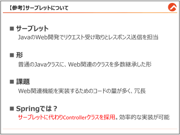{#p036-f03}

::: {#p036-b02 .heading}

[【参考】サーブレットについて]{.s010}

:::

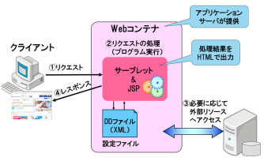{#p036-f04}

::: {#p036-b03 .paragraph}

[サーブレットは、Java におけるWeb アプリケーション開発の基礎を提供する技術の一つで]{.s009}\
[す。サーブレットはWeb サーバー上で動作し、クライアントからのリクエストを受け取り、適切な]{.s009}\
[レスポンスを生成して返す役割を持つクラスです。]{.s009}

:::

:::

::: {#page-37 .source-page}

::: {#p037-b01 .heading}

[【参考】サーブレットの基本]{.s014}

:::

::: {#p037-b02 .code}

```java
 1:import java.io.IOException;
 2:
 3:import jakarta.servlet.RequestDispatcher;
 4:import jakarta.servlet.ServletException;
 5:import jakarta.servlet.annotation.WebServlet;
 6:import jakarta.servlet.http.HttpServlet;
 7:import jakarta.servlet.http.HttpServletRequest;
 8:import jakarta.servlet.http.HttpServletResponse;
 9:
10:@WebServlet(urlPatterns = "/index") //URL マッピング
11:public class Sample1 extends HttpServlet { //HttpServlet の継承必要
12:
13: //メソッド単位のURL マッピング不可
14: protected void doGet(HttpServletRequest request,
15: HttpServletResponse response)
16: throws ServletException, IOException {
17:
18: //index.jsp へ遷移のための長いコード
19: RequestDispatcher dispatcher =
20:
        request.getRequestDispatcher("/index.jsp");
21: dispatcher.forward(request, response);
22: }
23:}
```
:::

::: {#p037-b03 .paragraph}

[サーブレットの開発では、リクエストの処理やレスポンスの生成のために、比較的冗長なコー]{.s009}\
[ドを書く必要がありました。サーブレットはWeb アプリケーションの中でコントローラーとしての]{.s009}\
[役割を果たし、クライアントとサーバー間のデータのやり取りを管理します。]{.s009}

:::

::: {#p037-b04 .paragraph}

[一方、Spring Framework では、]{.s009}[サーブレットクラスの代わりに]{.s012}[、よりシンプルで効率的な]{.s009}\
[Controller クラス]{.s012}[を提供しています。Spring のController クラスは、サーブレットの機能を簡潔]{.s009}\
[に実装するためのアノテーションやツールを提供し、開発者がWeb アプリケーションのロジック]{.s009}\
[により集中できるように設計されています。]{.s009}

:::

:::

::: {#page-38 .source-page}

::: {#p038-b01 .heading}

[2\.1.2.&#32;]{.s004}[【参考】MVC パターンとSpring アプリケーションの流れ]{.s004}

:::

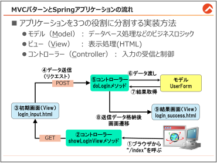{#p038-f05}

::: {#p038-b02 .heading}

[MVC パターンについて]{.s010}

:::

::: {#p038-b03 .paragraph}

[この章では、複数のJava メソッドと、HTML ファイルを作成します。そして、「MVC パターン」]{.s009}\
[と呼ばれる開発手法で実装を進めていきます。]{.s009}

:::

::: {#p038-b04 .paragraph}

[MVC パターンでは、Model・View・Controller で役割を分割します。]{.s009}

:::

::: {#p038-b05 .paragraph}

[このパターンは、明確に役割が分かれていて、保守性が高いプログラムを作ることができます。]{.s009}\
[サーブレット/JSP の開発の際も多く使われていて、Spring では基本的にMVC パターンに基づ]{.s009}\
[いた実装する前提で設計されました。]{.s009}

:::

::: {#p038-b06 .heading}

[Spring アプリケーションのMVC パターン]{.s010}

:::

::: {#p038-b07 .paragraph}

[上の図には、Spring アプリケーションの典型的な流れが表現されています。]{.s009}

:::

::: {#p038-b08 .paragraph}

[2章で扱うファイル名も載ってありますので、]{.s009}[2章の途中で必要であれば、随時このページに]{.s012}\
[戻って、現在どこを説明しているかをご確認ください。]{.s012}

:::

::: {#p038-b09 .paragraph}

[それでは、次のページでコントローラーについてご説明します。]{.s009}

:::

:::

::: {#page-39 .source-page}

::: {#p039-b01 .heading}

[2\.2.&#32;]{.s004}[Controller の基本]{.s004}

:::

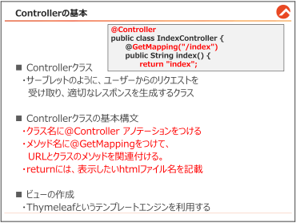{#p039-f06}

::: {#p039-b02 .heading}

[【参考】controller パッケージの作成]{.s010}

:::

::: {#p039-b03 .paragraph}

[Spring でクラスを作成する際は、クラスに役割によって、異なるパッケージの中に作成]{.s012}[をし]{.s009}\
[ます。今からは、コントローラーの役割をする、]{.s009}[IndexController]{.s007}[&#32;クラスを作成する予定ですの]{.s009}\
[で、]{.s009}[\[controller\]]{.s007}[というパッケージを作成します。]{.s009}

:::

::: {#p039-b04 .paragraph}

[パッケージの作成方法は、プロジェクトを展開し、]{.s009}[src/main/java]{.s007}[&#32;のパッケージを右クリック→]{.s009}\
[\[]{.s007}[新規]{.s009}[\]]{.s007}[→]{.s009}[\[]{.s007}[パッケージ]{.s009}[\]]{.s007}[→]{.s009}[\[]{.s007}[名前]{.s009}[\]]{.s007}[フォームに、]{.s009}[既存のパスを消さずに、\[.controller\]を追加すると]{.s012}\
[作成されます。]{.s012}

:::

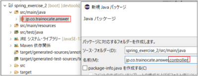{#p039-f07}

:::

::: {#page-40 .source-page}

::: {#p040-b01 .heading}

[【参考】Controller クラス作成]{.s010}

:::

::: {#p040-b02 .paragraph}

[Controller]{.s007}[&#32;クラスを作成する際は、]{.s009}[controller]{.s007}[&#32;パッケージに、]{.s009}[main]{.s007}[&#32;メソッドを持たないクラスを]{.s009}\
[作成します。]{.s009}

:::

::: {#p040-b03 .paragraph}

[作成された]{.s009}[\[controller\]]{.s007}[パッケージを右クリック→]{.s009}[\[]{.s007}[新規]{.s009}[\]]{.s007}[→]{.s009}[\[]{.s007}[クラス]{.s009}[\]]{.s007}[→]{.s009}[\[]{.s007}[名前]{.s009}[\]]{.s007}[に]{.s009}\
[「]{.s009}[IndexController]{.s007}[」と入力し、]{.s009}[\[]{.s007}[完了]{.s009}[\]]{.s007}[をクリック。]{.s009}

:::

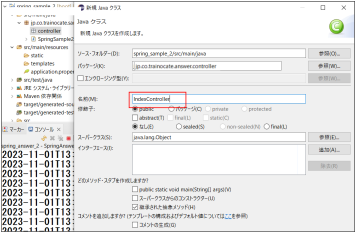{#p040-f08}

:::

::: {#page-41 .source-page}

::: {#p041-b01 .paragraph}

[…/controller/IndexController.java]{.s012}

:::

::: {#p041-b02 .heading}

[【作業手順①】 Controller クラスの作成]{.s010}

:::

::: {#p041-b03 .code}

```java
 1:package jp.co.trainocate.answer.controller;
 2:
 3:import org.springframework.stereotype.Controller;
 4:import org.springframework.web.bind.annotation.GetMapping;
 5:
 6:@Controller
 7:public class IndexController {
 8: @GetMapping("/index")
 9: public String index() {
10: return "index";
11: }
12:}
```

:::

::: {#p041-b04 .paragraph}

[上記の]{.s009}[IndexController]{.s007}[が、一番基本となる]{.s009}[Controller]{.s007}[の形です。前の節で確認した、サーブ]{.s009}\
[レットと比べて、とても簡略で短いコードになっています。]{.s009}

:::

::: {#p041-b05 .heading}

[@Controller アノテーション]{.s010}

:::

::: {#p041-b06 .paragraph}

[サーブレットで、Controller の役割をするためには、予めWeb 関連のクラスを継承するなど、]{.s009}\
[冗長なコードを書かないといけませんでしたが、Spring では、]{.s009}[クラス名の上に、@Controller を]{.s012}\
[つけるだけ]{.s012}[で、Controller としての役割を付与することができます。]{.s009}

:::

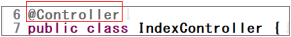{#p041-f09}

::: {#p041-b07 .paragraph}

[サーブレットのように、HttpServlet を継承して、HttpServletRequest とHttpServletResponse]{.s009}\
[を設定する必要はありません。]{.s009}

:::

:::

::: {#page-42 .source-page}

::: {#p042-b01 .heading}

[リクエストマッピング]{.s010}

:::

::: {#p042-b02 .paragraph}

[Controllerクラスには、プログラムの開始点となるmainメソッドはありません。では、Controller]{.s009}\
[のメソッドはいつどのように実行されるのでしょうか？]{.s009}

:::

::: {#p042-b03 .paragraph}

[実は、Controller のメソッドは「]{.s009}[リクエストが来るまで待機]{.s012}[」しています。リクエストは、ユーザ]{.s009}\
[がWeb ページ上でリンクやボタンをクリックしたときにURL として送信されます。]{.s009}

:::

::: {#p042-b04 .paragraph}

[このリクエストはSpring 環境のアプリケーションサーバーに届きます。サーバーは、登録され]{.s009}\
[ている全てのController を調べ、リクエストされたURL に対応するメソッドを探します。]{.s009}

:::

::: {#p042-b05 .paragraph}

[URL を対応させる方法は、後述する「@GetMapping」アノテーションを、メソッド名の上につ]{.s012}\
[けるだけです。]{.s012}

:::

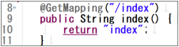{#p042-f10}

::: {#p042-b06 .paragraph}

[対応するURL を見つけると、そのURL にマッピングされたController のメソッドが実行]{.s012}[され]{.s009}\
[ます。今回の例では、ユーザーがブラウザで&#32;]{.s009}[http://ドメイン/index]{.s012}[&#32;にアクセスすると、このメソ]{.s009}\
[ッドが呼び出されます。]{.s009}

:::

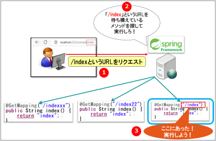{#p042-f11}

:::

::: {#page-43 .source-page}

::: {#p043-b01 .heading}

[【参考】 サーブレットでURL を対応させるコード]{.s012}

:::

::: {#p043-b02 .code}

```java
@WebServlet(urlPatterns = "/index")
public class Sample1 extends HttpServlet{
```

:::

::: {#p043-b03 .paragraph}

[&#32;&#32;サーブレットの@WebServlet(urlPatterns)アノテーションと似たような役割をすると覚えると]{.s009}\
[良いでしょう。ただ、サーブレットのURL 対応と決定的な異なる部分は、]{.s009}[サーブレットではク]{.s012}\
[ラス単位]{.s012}[でしたが、]{.s009}[Spring の@GetMapping では、メソッド単位でURL をマッピング]{.s012}[することが]{.s009}\
[できるということです。サーブレットでは、機能ごと1 つずつのクラスを作らないといけません]{.s009}\
[でしたが、Spring では1 つのクラス内に、複数の機能を実装できるので非常に便利です。]{.s009}

:::

::: {#p043-b04 .heading}

[index メソッドの解説]{.s010}

:::

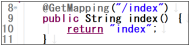{#p043-f12}

::: {#p043-b05 .paragraph}

[・9 行 public String index()]{.s012}\
[public は、このメソッドが外部からアクセス可能であることを意味します。String は、メソッド]{.s009}\
[が文字列を返すことを示しています。index() はメソッド名で、このメソッドが何をするのかを]{.s009}\
[表します。]{.s009}[Controller の中のメソッドは、通常は戻り値をString にします。]{.s012}

:::

::: {#p043-b06 .paragraph}

[・10 行&#32;]{.s012}[return “index”;]{.s011}\
[return には文字列を指定します。通常、この文字列は表示させたいhtml ファイル名を指定]{.s009}\
[します。]{.s009}

:::

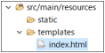{#p043-f13}

::: {#p043-b07 .paragraph}

[Spring Boot では、ビュー(html)の名前を単純にreturn 文で返すだけで、適切なHTML 画面が]{.s012}\
[表示]{.s012}[されます。つまり、この場合は 「index.html」 という名前のページがユーザーに表示さ]{.s009}\
[れます。]{.s009}[.html は省略しないといけません。]{.s012}

:::

::: {#p043-b08 .heading}

[【参考】 サーブレットでindex.jsp を表示するためには]{.s010}

:::

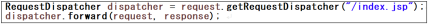{#p043-f14}

::: {#p043-b09 .paragraph}

[今回のreturn は、サーブレットのrequest.getRequestDispatcher と似た役割をするコードだと]{.s009}\
[覚えると良いでしょう。]{.s009}

:::

:::

::: {#page-44 .source-page}

::: {#p044-b01 .paragraph}

[Spring のreturn は、正確にはforward をしているのではなく、「指定したHTML ページを呼び]{.s009}\
[出す」に近いですが、MVC パターンでの画面出力という観点では似ています。]{.s009}

:::

::: {#p044-b02 .paragraph}

[Spring Boot の方がより簡潔で直感的なコードを書くことが可能になり、開発者の負担が軽減]{.s009}\
[されます。]{.s009}

:::

::: {#p044-b03 .heading}

[【作業手順②】ビューの作成と構成]{.s010}

:::

::: {#p044-b04 .paragraph}

[Web アプリケーションにおいて、ユーザが見る画面を形作るファイルを「ビュー(View)」と称し]{.s009}\
[ます。View は、HTML やJSP ファイルで構成されていることが一般的です。本書では、Java の]{.s009}\
[Web アプリケーション開発で広く用いられる「Thymeleaf（タイムリーフ）」というテンプレートエン]{.s009}\
[ジンを利用します。]{.s009}

:::

::: {#p044-b05 .paragraph}

[テンプレートエンジンとは、HTML ファイルに数値や文字列などを動的に埋め込むことがで]{.s009}\
[きる特別なライブラリのことです。このテンプレートエンジンを使用することにより、ユーザの名]{.s009}\
[前をページに表示したり、商品一覧をリストアップしたりするような動的な処理が可能になりま]{.s009}\
[す。]{.s009}

:::

::: {#p044-b06 .paragraph}

[では、Controller のindex メソッドから遷移するビューをどのように作成するかをご紹介します。]{.s009}

:::

::: {#p044-b07 .paragraph}

[…/resources/templates/index.html]{.s012}

:::

::: {#p044-b08 .code}

```java
 1:<!DOCTYPE html>
 2:<html xmlns:th="http://www.thymeleaf.org">
 3:<head>
 4: <meta charset="UTF-8" />
 5: <meta name="viewport" content="width=device-width,
initial-scale=1.0" />
 6: <title>2 章 サンプル1</title>
 7:</head>
 8:
 9:<body>
10: <div>トップページ</div>
11:</body>
12:</html>
```

:::

::: {#p044-b09 .paragraph}

[このビューの特徴として、2 行目に注目してください。ここでは、Spring Boot と相性が良いテ]{.s009}\
[ンプレートエンジン「Thymeleaf」を使用するという宣言をしています。]{.s009}\
[xmlns:th を記載することで、HTML ファイル内でThymeleaf の機能が利用可能になります。]{.s009}

:::

::: {#p044-b10 .paragraph}

[\[トップページ\]と表示される部分（10 行目）からは、ユーザに見える画面の内容が入ります。]{.s009}\
[今後、さまざまな情報やデザイン要素を追加していくことになります。]{.s009}

:::

:::

::: {#page-45 .source-page}

::: {#p045-b01 .heading}

[【作業手順③】Spring Boot アプリケーションの実行]{.s010}

:::

::: {#p045-b02 .paragraph}

[IndexController のindex メソッドをブラウザからリクエストすることで、実行してみましょう。以]{.s009}\
[下の手順に従ってください。]{.s009}

:::

::: {#p045-b03 .step}

[1\.&#32;]{.s009}[IndexController に誤字がないか確認し、保存します。]{.s009}

:::

::: {#p045-b04 .step}

[2\.&#32;]{.s009}[Eclipse の上段メニューから、緑の「]{.s009}[⏻]{.s019}[」ボタンをクリックします。]{.s009}

:::

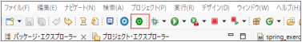{#p045-f15}

::: {#p045-b05 .step}

[3\.&#32;]{.s009}[local の部分をダブルクリックし、展開します。]{.s009}

:::

::: {#p045-b06 .step}

[4\.&#32;]{.s009}[\[spring\_exercise\_2\]プロジェクトを右クリックし、]{.s009}[\[(再)起動\]を選択]{.s012}[します。]{.s009}

:::

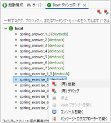{#p045-f16}

::: {#p045-b07 .paragraph}

[※ポップアップが出る際は、全て「許可」します。]{.s009}

:::

::: {#p045-b08 .step}

[5\.&#32;]{.s009}[任意のブラウザ（Chrome、Edge など）のアドレスバーに以下のURL を入力します。]{.s009}\
[http://localhost:8080/]{.s020}[index]{.s021}

:::

::: {#p045-b09 .step}

[6\.&#32;]{.s009}[以下のように、「トップページ」と表示されたら、実行成功です。]{.s009}

:::

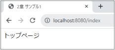{#p045-f17}

:::

::: {#page-46 .source-page}

::: {#p046-b01 .heading}

[【参考】 application.properties ファイルについて]{.s010}

:::

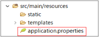{#p046-f18}

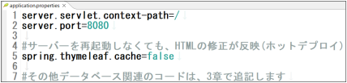{#p046-f19}

::: {#p046-b02 .paragraph}

[Spring Boot アプリケーションでは、application.properties ファイルが非常に重要です。この]{.s009}\
[ファイルは、アプリケーションの設定情報を保持し、アプリケーションの振る舞いをカスタマイズ]{.s009}\
[するために使用されます。application.properties ファイルは、プロジェクトの]{.s009}\
[src/main/resources ディレクトリ内に配置]{.s012}[されます。]{.s009}

:::

::: {#p046-b03 .paragraph}

[このファイルを修正すると、データベースの接続情報、サーバーのポート番号、コンテキス]{.s012}\
[トパスなど、さまざまな設定を行うことができます]{.s012}[。特に開発時には、アプリケーションの動作]{.s009}\
[環境に合わせて、これらの設定を調整することが一般的です。]{.s009}

:::

::: {#p046-b04 .paragraph}

[以下は、application.properties ファイルに記載される可能性のある設定の例です。]{.s009}

:::

::: {#p046-b05 .paragraph}

[⚫&#32;]{.s022}[server.servlet.context-path=]{.s023}[/sample]{.s024}\
[この設定により、アプリケーションは /sample というコンテキストパスでアクセスされま]{.s009}\
[す。つまり、アプリケーションのURL の一部として /sample が含まれるようになります。]{.s009}

:::

::: {#p046-b06 .paragraph}

[⚫&#32;]{.s022}[server.port=]{.s023}[2222]{.s024}\
[この設定により、アプリケーションはポート番号 2222 でリッスンします。デフォルトのポ]{.s009}\
[ート番号 8080 ではなく、別の番号を使用することで、他のアプリケーションとの衝突を]{.s009}\
[避けることができます。]{.s009}

:::

::: {#p046-b07 .paragraph}

[⚫&#32;]{.s022}[spring.thymeleaf.cache=]{.s023}[false]{.s024}\
[この設定により、Thymeleaf テンプレートのキャッシュが無効になります。開発中には、]{.s009}\
[テンプレートの変更が即座に反映されるようにするために便利です。]{.s009}

:::

::: {#p046-b08 .paragraph}

[このように、application.properties ファイルを適切に設定することで、アプリケーションの振る]{.s009}\
[舞いを柔軟に制御し、開発プロセスをスムーズに進めることができます。]{.s009}

:::

:::

::: {#page-47 .source-page}

::: {#p047-b01 .heading}

[2\.3.&#32;]{.s004}[データ送信とパラメータの取得]{.s004}

:::

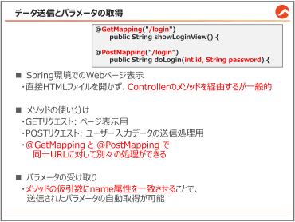{#p047-f20}

::: {#p047-b02 .heading}

[Web ページにおけるデータ送信の概要]{.s010}

:::

::: {#p047-b03 .paragraph}

[Web]{.s007}[&#32;ページの大きな利点の一つは、ユーザがフォームにデータを入力して送信できる機能]{.s009}\
[を持っている点です。以下のログインフォームの例のように、ユーザは情報を入力し、]{.s009}\
[\[]{.s007}[ログイン]{.s009}[\]]{.s007}[ボタンをクリックすることでそのデータをアプリケーションサーバーに送信することが]{.s009}\
[可能です。]{.s009}

:::

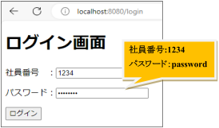{#p047-f21}

::: {#p047-b04 .paragraph}

[サーブレットでは、直接このページを開くことができましたが、]{.s009}[Spring では、直接HTML ペー]{.s012}\
[ジを開くのではなく、Controller のメソッドを経由させます。]{.s012}[よって、実装時は&#32;]{.s009}[HTML]{.s007}[&#32;ファイルよ]{.s009}\
[り先に、画面遷移の処理のみを持つメソッドを作成する必要があります。]{.s009}

:::

:::

::: {#page-48 .source-page}

::: {#p048-b01 .heading}

[【作業手順①】ログイン画面を表示するメソッドの作成]{.s010}

:::

::: {#p048-b02 .paragraph}

[まずは、ログイン処理用のController クラスを作成します。Spring では、画面ごとにController]{.s009}\
[クラスを作成するのが一般的です。]{.s009}

:::

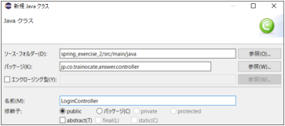{#p048-f22}

::: {#p048-b03 .paragraph}

[従って、controller パッケージに、LoginController クラスを作成します。]{.s009}

:::

::: {#p048-b04 .paragraph}

[…/controller/LoginController.java]{.s012}

:::

::: {#p048-b05 .code}

```java
 1:package jp.co.trainocate.answer.controller;
 2:
 3:import org.springframework.stereotype.Controller;
 4:import org.springframework.web.bind.annotation.GetMapping;
 5:
 6:@Controller
 7:public class LoginController {
 8:
 9: //Spring 環境では、html ページを直接より、
10: //遷移用のメソッドを経由する方法が一般的です
11:
12: @GetMapping("/login")
13: public String showLoginView() {
14: return "login_input";
15: }
```

:::

::: {#p048-b06 .paragraph}

[\[showLoginView()\]は、ログインフォームのビュー（HTML ページ）を表示するためのメソッドで]{.s009}\
[す。このメソッドは処理を何もせず、単にView 名をreturn しています。]{.s009}\
[/login というURL がリクエストされたら、login\_input.html をユーザへ表示してくれます。]{.s025}

:::

::: {#p048-b07 .paragraph}

[一般的に、Spring では、コントローラーのメソッドを経由してHTML ページを呼び出します。]{.s012}\
[この手法により、URL とビューとの間に明確な対応関係を持たせ、アプリケーションの構造を整]{.s009}

:::

:::

::: {#page-49 .source-page}

::: {#p049-b01 .paragraph}

[理しやすくなります。また、必要に応じて追加のデータ処理やビジネスロジックをメソッド内に組]{.s009}\
[み込むことが可能です。]{.s009}

:::

::: {#p049-b02 .heading}

[【作業手順②】入力フォームがあるHTML の作成]{.s010}

:::

::: {#p049-b03 .paragraph}

[…/resources/templates/login\_input.html]{.s012}

:::

::: {#p049-b04 .code}

```java
 1:<!DOCTYPE html>
 2:<html xmlns:th="http://www.thymeleaf.org">
 3:<head>
 4:<meta charset="UTF-8"/>
 5:<meta name="viewport" content="width=device-width,
initial-scale=1.0"/>
 6:<title>Insert title here</title>
 7:</head>
 8:<body>
 9:<h1>ログイン画面</h1>

    <!--送信先を「/login」というURL に設定-->
10: <form th:action = "@{/login}" method="POST">
11:<p>社員番号 ：<input type = "text" name = "id"/></p>
12:<p>パスワード：<input type = "password" name = "password"/></p>
13:<input type = "submit" value = "ログイン">
14:</form>
15:</body>
16:</html>
```

:::

::: {#p049-b05 .paragraph}

[・10 行目 \<form th:action = “@\{/login\}” method = “POST”\>]{.s012}

:::

::: {#p049-b06 .paragraph}

[\<form\>要素を用いてデータ送信のためのフォームを作成します。この要素のth:action 属性]{.s009}\
[は、フォームデータが送信されるサーバー上のURL を指定できます。Thymeleaf では、ただの]{.s009}\
[action ではなく、]{.s009}[th:action]{.s012}[&#32;を使うことで、]{.s009}[実行環境に変化があってもURL を正しく解決]{.s012}[できま]{.s009}\
[す。]{.s009}[「@」は、アプリケーションのコンテキストパス(基本URL）を、自動生成]{.s012}[してくれます。URL]{.s009}\
[が異なるサーバーで実行しても、影響がなくなる効果があります。]{.s009}\
[&#32;ここでは/login がそのURL として指定されています。通常、]{.s009}[th:action 属性のURL 先は、]{.s012}\
[@Controller のメソッドを指定]{.s012}[します。そして、method という属性がありますが、この属性は一般]{.s009}\
[的なGET 方式の送信ではなく、POST 方式の送信をするという意味です。POST 方式にする]{.s009}\
[と、パスワードがURL に表示されないなどのメリットがあり、隠したいデータを送信する時によく]{.s009}\
[使われます。]{.s009}

:::

:::

::: {#page-50 .source-page}

::: {#p050-b01 .paragraph}

[・11 行・12 行目 \<input type = “text” name = “パラメータ名”\>]{.s012}

:::

::: {#p050-b02 .paragraph}

[\<input\>要素はユーザがデータを入力するためのフィールドを提供します。type="text"を指]{.s009}\
[定することでテキスト入力フィールドが、type="password"を指定することでパスワード入力フィ]{.s009}\
[ールドがそれぞれ生成されます。ここで、このフォームのデータは、社員番号という日本語で認]{.s009}\
[識されるのではなく、]{.s009}[name 属性の値で認識されます。今回は、「id」と「password」というname]{.s012}\
[でデータが送られるということを覚えてください。]{.s012}

:::

::: {#p050-b03 .paragraph}

[・13 行目 \<input type = "submit" value = "ログイン"\>]{.s012}

:::

::: {#p050-b04 .paragraph}

[\<input type="submit"\>は送信ボタンを表します。このボタンをクリックすると、フォーム内のデ]{.s009}\
[ータがth:action 属性で指定されたURL に送信されます。value 属性はボタン上に表示される]{.s009}\
[テキストを定義します。]{.s009}

:::

::: {#p050-b05 .paragraph}

[では、送信したデータを、アプリケーションサーバー側では、どう受け取っているのでしょう]{.s009}\
[か？&#32;]{.s009}[アプリケーションサーバー側では、このフォームからの送信データを受け取る準備をし]{.s012}\
[ておく必要があります。]{.s012}

:::

:::

::: {#page-51 .source-page}

::: {#p051-b01 .heading}

[【作業手順③】ログインデータの受信と処理]{.s010}

:::

::: {#p051-b02 .paragraph}

[ユーザーがログインフォームに入力した情報をサーバー側で受け取るには、HTML フォー]{.s009}\
[ムから送信されるデータを扱うためのコントローラーのメソッドを定義する必要があります。ここ]{.s009}\
[では、ログインフォームのデータを処理するSpring のコントローラーメソッドの実装例を見てい]{.s009}\
[きます。]{.s009}

:::

::: {#p051-b03 .paragraph}

[…/controller/LoginController.java]{.s012}

:::

::: {#p051-b04 .code}

```java
 1://【省略】
 2:
 3:@GetMapping("/login")
 4:public String showLoginView() {
 5: return "login_input";
 6:}
 7:
 8://同じ「login」というURL でも、
 9://Get かPost かによって、異なるメソッドが実行されます
10:@PostMapping("/login")
11:public String doLogin(int id, String password) {
12: //仮引数を記載するだけで、自動的にデータが格納されます
13: System.out.println(id);
14: System.out.println(password);
15: return "index";
```

:::

::: {#p051-b05 .paragraph}

[LoginController クラスのdoLogin メソッドは、ログインフォームから送信されたデータを受け]{.s009}\
[取るために使用されます。]{.s009}

:::

::: {#p051-b06 .paragraph}

[・10 行目 @PostMapping("/login")]{.s012}

:::

::: {#p051-b07 .paragraph}

[@PostMapping は、POST リクエストが送られた際に、このメソッドが実行されることを示してい]{.s009}\
[ます。3 行でも同じ/login というURL を待ち受けていますが、普通のGet 方式での呼び出しが]{.s009}\
[あった場合は、showLoginView()メソッドが実行され、Post 方式の呼び出しがあった場合は、こ]{.s009}\
[ちらのdoLogin メソッドが実行されます。]{.s009}

:::

::: {#p051-b08 .paragraph}

[・11 行目 仮引数 int id, String password]{.s012}

:::

::: {#p051-b09 .paragraph}

[login\_input.html から送信したデータのname 属性に対応する値を受け取るために使用され]{.s009}\
[ています。]{.s009}[Spring では、Controller のメソッドの仮引数をhtml のname 属性の値と合わせるだ]{.s012}\
[けで、パラメータを受け取ることができます。]{.s012}[login\_input.html では、「id」と「password」のデータ]{.s009}\
[が送られるので、引数名も、int id, String password に合わせます。]{.s009}

:::

:::

::: {#page-52 .source-page}

::: {#p052-b01 .heading}

[【参考】サーブレットでパラメータを受け取る方法]{.s012}

:::

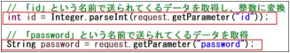{#p052-f23}

::: {#p052-b02 .paragraph}

[サーブレットでは、上記のような冗長なコードが必要でしたが、Spring ではメソッドの引数に変]{.s009}\
[数を入れておくだけで取得できるので、とても便利だというのがわかります。]{.s009}

:::

::: {#p052-b03 .paragraph}

[・13 行、14 行目の出力]{.s012}

:::

::: {#p052-b04 .paragraph}

[本当にid とpassword のデータを取得できたのか、コンソールに出力することで、検証をして]{.s009}\
[います。結果は、以下の画像のように、入力した値を問題なく取得できているのがわかります。]{.s009}

:::

::: {#p052-b05 .heading}

[動作確認]{.s010}

:::

::: {#p052-b06 .paragraph}

[http://localhost:8080/]{.s023}[login]{.s024}

:::

::: {#p052-b07 .paragraph}

[社員番号：1234]{.s009}\
[パスワード：password]{.s009}

:::

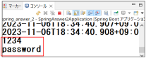{#p052-f24}

::: {#p052-b08 .paragraph}

[このように、Spring ではメソッドの仮引数を入力値の型に合わせて記載するだけで、自動的]{.s009}\
[にリクエストパラメータからのデータの取得をしてくれます。]{.s009}

:::

::: {#p052-b09 .paragraph}

[そして、同じURL に対して異なるHTTP メソッド（GET やPOST）を用いることで、異なる処理を]{.s009}\
[行うメソッドを分けて定義することができます。これにより、フォームの表示とフォームからのデ]{.s009}\
[ータ受信を別々のメソッドで扱うことができます。]{.s009}

:::

::: {#p052-b10 .paragraph}

[Spring を使った開発は、このように「決まったルール通り」命名をすれば、後ろで自動的にや]{.s009}\
[ってくれるので、便利です。しかし、その反面、]{.s009}[1 文字でもルール通り命名しないと、思い通り]{.s012}\
[に動かないこともありますので、変数名やメソッド名を命名する時は、注意が必要]{.s012}[です。]{.s009}

:::

:::

::: {#page-53 .source-page}

::: {#p053-b01 .heading}

[2\.4.&#32;]{.s004}[Form クラスでパラメータ取得]{.s004}

:::

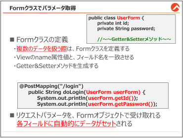{#p053-f25}

::: {#p053-b02 .heading}

[Form クラスを使用する目的]{.s010}

:::

::: {#p053-b03 .paragraph}

[Web]{.s007}[&#32;アプリケーションではユーザがフォームに複数の情報を入力する場面が頻繁にありま]{.s009}\
[す。例えば、登録フォームに名前、住所、電話番号など、多くのフィールドを記入する場合、こ]{.s009}\
[れらの個別の情報を&#32;]{.s009}[Controller]{.s007}[&#32;のメソッドで一つずつ引数として取り扱うのは煩雑であり、コー]{.s009}\
[ドの複雑さを増加させます。]{.s009}[Controller]{.s007}[のメソッドの引数をまとめて管理するために、]{.s009}[Form]{.s007}[クラス]{.s009}\
[を利用できます。]{.s009}

:::

::: {#p053-b04 .heading}

[【作業手順①】 UserForm クラスの作成]{.s010}

:::

::: {#p053-b05 .paragraph}

[まず、]{.s009}[spring\_exercise\_2]{.s007}[&#32;を右クリックし、]{.s009}[\[form\]]{.s007}[というパッケージを作成します。]{.s009}

:::

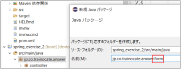{#p053-f26}

:::

::: {#page-54 .source-page}

::: {#p054-b01 .paragraph}

[その後、]{.s009}[\[form\]]{.s007}[パッケージに、]{.s009}[\[UserForm\]]{.s007}[というクラスを作成します。]{.s009}

:::

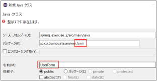{#p054-f27}

::: {#p054-b02 .paragraph}

[UserForm]{.s007}[&#32;クラスには、]{.s009}[View から送られるデータをフィールドして記載し、Getter&Setter メソッ]{.s012}\
[ドを定義]{.s012}[します。今回の例では、]{.s009}[2]{.s007}[&#32;つのフィールドしか記載していませんが、複数のデータを扱]{.s009}\
[うある場合は、全て記載します。]{.s009}

:::

::: {#p054-b03 .paragraph}

[ここで注意点は、]{.s009}[フィールド名は、必ずView からのname 属性値と一致させる]{.s012}[ことです。]{.s009}

:::

::: {#p054-b04 .paragraph}

[…/form/UserForm.java]{.s012}

:::

::: {#p054-b05 .code}

```java
 1:package jp.co.trainocate.answer.form;
 2:
 3:public class UserForm {
 4: private int id;
 5: private String password;
 6:
 7: public int getId() {
 8: return id;
 9: }
10: public void setId(int id) {
11: this.id = id;
12: }
13: public String getPassword() {
14: return password;
15: }
16: public void setPassword(String password) {
17: this.password = password;
18: }
19:}
```

:::

:::

::: {#page-55 .source-page}

::: {#p055-b01 .heading}

[【参考】 Getter&Setter メソッドをEclipse で簡単に生成する方法]{.s010}

:::

::: {#p055-b02 .paragraph}

[Getter&Setter]{.s007}[&#32;メソッドは、定型文ですので、]{.s009}[Eclipse]{.s007}[&#32;で簡単に生成する機能があります。]{.s009}

:::

::: {#p055-b03 .paragraph}

[Form]{.s007}[&#32;クラス内のフィールドの定義が終わったら、以下の手順に従ってください。]{.s009}\
[\[]{.s007}[右クリック]{.s009}[\]]{.s007}[→]{.s009}[\[]{.s007}[ソース]{.s009}[\]]{.s007}[→]{.s009}[\[Getter]{.s007}[&#32;および&#32;]{.s009}[Setter]{.s007}[&#32;の生成]{.s009}[\]]{.s007}

:::

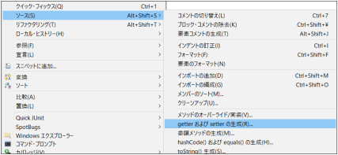{#p055-f28}

::: {#p055-b04 .paragraph}

[フィールドにチェックを入れて、]{.s009}[\[]{.s007}[生成]{.s009}[\]]{.s007}[をクリックすると、メソッドが生成されます。]{.s009}

:::

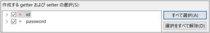{#p055-f29}

:::

::: {#page-56 .source-page}

::: {#p056-b01 .heading}

[【作業手順②】Form クラスのオブジェクトでパラメータを取得]{.s010}

:::

::: {#p056-b02 .paragraph}

[それでは、この&#32;]{.s009}[Form]{.s007}[&#32;クラスを利用して、複数のリクエストパラメータを受け取るように、既存の]{.s009}\
[LoginController]{.s007}[&#32;を修正します。]{.s009}[(]{.s007}[サンプルは、]{.s009}[LoginController2)]{.s007}

:::

::: {#p056-b03 .paragraph}

[…/controller/LoginController2.java]{.s012}

:::

::: {#p056-b04 .code}

```java
1://【省略】
2:
3:@PostMapping("/login2")
4: public String doLogin(UserForm userForm) {
5: //仮引数にForm クラスを記載するだけで、
6: //自動的にデータがフィールドにセットされます
7: System.out.println(userForm.getId());
8: System.out.println(userForm.getPassword());
9: return "index";
10: }
```

:::

::: {#p056-b05 .paragraph}

[・4 行目 doLogin(UserForm userForm)]{.s012}

:::

::: {#p056-b06 .paragraph}

[doLogin メソッドの仮引数に、UserForm のオブジェクトを入れています。Spring では、]{.s009}[仮引数]{.s012}\
[にForm クラスのオブジェクトを入れるだけで、リクエストパラメータがUserForm オブジェクト]{.s012}\
[の対応するフィールド(id, password)に自動的にセットされます。]{.s012}\
[よって、各リクエストパラメータを個別に取得するためのコードを書く必要がなくなります。]{.s009}

:::

::: {#p056-b07 .paragraph}

[・7-8 行目]{.s012}

:::

::: {#p056-b08 .paragraph}

[UserForm クラスに予め作成しておいた、getId()とgetPassword()メソッドを呼び出すことで、]{.s009}\
[userForm オブジェクトにバインドされたID とパスワードを取得し、コンソールに出力します。]{.s009}

:::

::: {#p056-b09 .heading}

[動作確認]{.s010}

:::

::: {#p056-b10 .paragraph}

[以下のURL から、動作確認をすると、同じようにView からのリクエストパラメータを取得してコ]{.s009}\
[ンソール上に出力できているのがわかります。]{.s009}

:::

::: {#p056-b11 .paragraph}

[http://localhost:8080/login2]{.s026}

:::

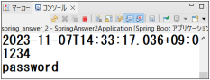{#p056-f30}

:::

::: {#page-57 .source-page}

::: {#p057-b01 .heading}

[2\.5.&#32;]{.s004}[Controller からView へのデータ処理]{.s004}

:::

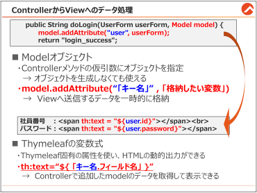{#p057-f31}

::: {#p057-b02 .paragraph}

[前の節では、View からのリクエストパラメータを、Controller で受け取る方法についてご説明]{.s009}\
[しました。]{.s009}

:::

::: {#p057-b03 .paragraph}

[この節では、逆にController からView へデータを送り、画面上に表示する方法についてご]{.s009}\
[説明します。]{.s009}

:::

:::

::: {#page-58 .source-page}

::: {#p058-b01 .heading}

[【作業手順③】 model オブジェクトにデータを格納]{.s010}

:::

::: {#p058-b02 .paragraph}

[Spring Controller から、View へデータを送るためには、サーブレットと同じくリクエストスコー]{.s009}\
[プを利用します。リクエストスコープは、別の場所にデータを送るために、]{.s009}[一時的にデータを入]{.s012}\
[れておく箱]{.s012}[だと思ってください。]{.s009}

:::

::: {#p058-b03 .paragraph}

[…/controller/LoginController3.java]{.s012}

:::

::: {#p058-b04 .code}

```java
 1://省略
 2:import org.springframework.ui.Model;
 3:
 4:@Controller
 5:public class LoginController3 {
 6:
 7: @GetMapping("/login3")
 8: public String showLoginView() {
 9: return "login_input3";
10: }
11:
12: @PostMapping("/login3")
13: public String doLogin(UserForm userForm, Model model) {
14: //リクエストスコープに、userForm のデータを格納
15: model.addAttribute("user", userForm);
16:
17: return "login_success";
18: }
19:}
```

:::

::: {#p058-b05 .paragraph}

[Spring フレームワークでは、Model オブジェクトを使用して、Controller からView にデータを渡]{.s009}\
[します。]{.s009}[ModelオブジェクトのaddAttribute メソッドを使うと、Model という箱に、データを一時保]{.s012}\
[管できます]{.s012}[。サーブレットのrequest.setAttribute()に相当しますが、より洗練された方法です。]{.s009}

:::

::: {#p058-b06 .paragraph}

[・13 行目 doLogin(UserForm userForm,&#32;]{.s012}[Model model]{.s011}[)]{.s012}

:::

::: {#p058-b07 .paragraph}

[UserForm オブジェクトは、フォームから送信されたデータを受け取り、]{.s009}\
[リクエストスコープのオブジェクト(データ一時保管用の箱)を生み出すため、Model オブジェ]{.s009}\
[クトをメソッドの仮引数に入れます。]{.s009}

:::

::: {#p058-b08 .paragraph}

[UserForm の時と同様に、]{.s009}[Spring ではメソッドの仮引数にオブジェクト名を書くと、オブジェク]{.s012}\
[トを生成しなくても、使うことができます。]{.s012}

:::

:::

::: {#page-59 .source-page}

::: {#p059-b01 .paragraph}

[・14-15 行目&#32;]{.s012}[model.addAttribute("user", userForm);]{.s011}

:::

::: {#p059-b02 .paragraph}

[この行は、UserForm オブジェクトを"user"というキーでモデルに追加しています。]{.s009}\
[第1 引数：キー名]{.s009}\
[第2 引数：格納したい変数]{.s009}

:::

::: {#p059-b03 .paragraph}

[これにより、return で呼び出すlogin\_success.html でも、userForm オブジェクトのデータが使]{.s009}\
[用可能になります。]{.s009}

:::

::: {#p059-b04 .heading}

[【参考】 サーブレットでリクエストデータを格納するコード]{.s012}

:::

::: {#p059-b05 .code}

```java
request.setAttribute("id", id);
request.setAttribute("password", password);
```

:::

::: {#p059-b06 .paragraph}

[サーブレットのrequest.setAttribute と役割も、使い方は同じですので、参考にしてください。]{.s009}

:::

::: {#p059-b07 .paragraph}

[・17 行 return "login\_success";]{.s012}

:::

::: {#p059-b08 .paragraph}

[モデルに格納されたデータと共に、login\_success.html を呼び出します。]{.s009}

:::

::: {#p059-b09 .paragraph}

[このようにModel オブジェクトを使うと、Controller からView へデータを「一時的に入れておく]{.s009}\
[箱」としてリクエストスコープを利用することができ、Spring のMVC パターンに沿った方法でデ]{.s009}\
[ータを渡すことができます。]{.s009}

:::

::: {#p059-b10 .heading}

[【作業手順④】&#32;]{.s010}[Thymeleaf を利用したデータ出力]{.s012}

:::

::: {#p059-b11 .paragraph}

[Thymeleaf は、Spring Framework と組み合わせて使用されるモダンなサーバーサイドJava テン]{.s009}\
[プレートエンジンです。]{.s009}[Thymeleaf を利用することで、Controller から送信されたデータを]{.s012}\
[HTML 内で動的に表示することができます。]{.s012}

:::

::: {#p059-b12 .paragraph}

[…/resources/templates/login\_success.html]{.s012}

:::

::: {#p059-b13 .code}

```java
1:<!DOCTYPE html>
2:<html xmlns:th="http://www.thymeleaf.org">
3:<head>
4:<meta charset="UTF-8"/>
5:<meta name="viewport" content="width=device-width, initial-scale=1.0"/>
6:<title>2 章 ログイン成功サンプル1</title>
7:</head>
8:<body>
```

:::

:::

::: {#page-60 .source-page}

::: {#p060-b01 .code}

```java
 9:    <h1>ログイン成功</h1>
10:    社員番号 ：<span th:text = "${user.id}"></span><br>
11:    パスワード：<span th:text = "${user.password}"></span>
12:</body>
13:</html>
```

:::

::: {#p060-b02 .paragraph}

[Thymeleaf の&#32;]{.s009}[th:text 属性は、指定された変数の値をHTML タグのテキスト内容として埋め]{.s012}\
[込む]{.s012}[ために使用されます。]{.s009}

:::

::: {#p060-b03 .paragraph}

[変数式は$\{...\}という形で記述され、スコープ内にある変数の値を参照するために使われま]{.s009}\
[す。変数名は大文字・小文字を区別するため、Model に追加されたキー名と正確に一致する]{.s009}\
[必要があります。]{.s009}

:::

::: {#p060-b04 .paragraph}

[・2 行目 \<html xmlns:th="http://www.thymeleaf.org"\>]{.s012}

:::

::: {#p060-b05 .paragraph}

[10 行と、11 行には、th:text というthymeleaf 固有の属性が登場していますが、そのためには、]{.s009}\
[予め宣言をする必要があります。]{.s009}

:::

::: {#p060-b06 .paragraph}

[・10 行目 \<span&#32;]{.s012}[th:text = "$\{user.id\}"]{.s011}[\>\</span\>]{.s012}

:::

::: {#p060-b07 .paragraph}

[この部分はThymeleaf 独自のスクレプト文法の一つの、th:text 属性を使用しています。]{.s009}

:::

::: {#p060-b08 .paragraph}

[Controller からModel に格納した「user」というキーの後ろに、「.フィールド名」を記載すること]{.s009}\
[で、id の値を出力できます。]{.s009}\
[例えば、user.id が1234 であれば、出力は\<span\>1234\</span\>となります。]{.s009}

:::

::: {#p060-b09 .heading}

[【参考】 JSP でデータを表示する出力するコード]{.s012}

:::

::: {#p060-b10 .code}

```xml
<%
        int id = (Integer) request.getAttribute("id");
        String password = (String) request.getAttribute("password");
 %>
    <p>社員番号 : <%= id %></p>
    <p>パスワード: <%= password %></p>
```

:::

::: {#p060-b11 .paragraph}

[JSP では、上記のようにrequest.getAttribute の記述と、\<% %\>という複雑な書き方をする必要]{.s009}\
[がありましたが、th:text を使うことで、それがかなり簡略化されました。]{.s009}

:::

::: {#p060-b12 .paragraph}

[・11 行目]{.s012}

:::

::: {#p060-b13 .paragraph}

[ここでもth:text属性を使い、userオブジェクトのpasswordフィールドの値を表示しています。]{.s009}\
[変数式を使用することで、動的に内容をWeb ページに埋め込むことができます。]{.s009}

:::

:::

::: {#page-61 .source-page}

::: {#p061-b01 .heading}

[動作確認]{.s012}

:::

::: {#p061-b02 .paragraph}

[http://localhost:8080/login3]{.s026}\
[社員番号と、パスワードを入力してください。]{.s009}

:::

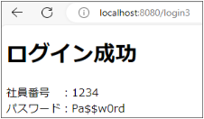{#p061-f32}

::: {#p061-b03 .paragraph}

[このようにThymeleaf テンプレートを使用すると、モデルに格納された属性をHTML ページ]{.s009}\
[内で簡単に参照し、出力することができます。]{.s009}

:::

::: {#p061-b04 .paragraph}

[別の章で紹介しますが、th:text の他にもThymeleaf は条件分岐、ループ処理、属性の変更]{.s009}\
[など、多くの便利な機能を提供しています。]{.s009}

:::

::: {#p061-b05 .paragraph}

[これにより、サーバーサイド(Controller)のロジックとView(HTML)の表示を分離しながら、動]{.s009}\
[的なWeb ページを作成することが可能になります。]{.s009}

:::

:::

::: {#page-62 .source-page}

::: {#p062-b01 .heading}

[章のまとめ]{.s004}

:::

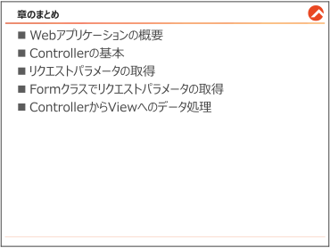{#p062-f33}

::: {#p062-b02 .paragraph}

[この章では、]{.s009}[Controller]{.s007}[&#32;と&#32;]{.s009}[View]{.s007}[&#32;の作成方法と、データの受け渡しについてご説明しました。]{.s009}

:::

:::
