<!-- 元PDF 63〜132ページ。Java 21・Spring Boot 4.0.2対応版。 -->

::: {#page-63 .source-page}

::: {#p063-b01 .heading}

[&#32;3]{.s005}

:::

::: {#p063-b02 .heading}

[第3章&#32;]{.s001}[Spring Data JPA]{.s001}

:::

::: {#p063-b03 .heading}

[章の目標]{.s002}

:::

::: {#p063-b04 .heading}

[◼&#32;]{.s003}[Spring Data JPA の基本概念を理解できる]{.s004}

:::

::: {#p063-b05 .heading}

[◼&#32;]{.s003}[エンティティとリポジトリを実装できる]{.s004}

:::

::: {#p063-b06 .heading}

[◼&#32;]{.s003}[全件検索・条件検索ができる]{.s004}

:::

::: {#p063-b07 .heading}

[◼&#32;]{.s003}[登録・更新・削除ができる]{.s004}

:::

:::

::: {#page-64 .source-page}

:::

::: {#page-65 .source-page}

::: {#p065-b01 .heading}

[章の概要]{.s008}

:::

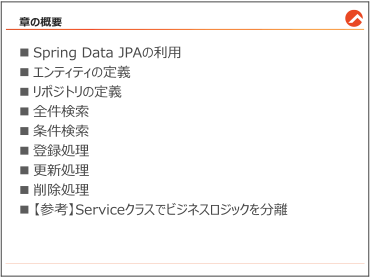{#p065-f01}

::: {#p065-b02 .paragraph}

[第3 章では、Spring Data JPA の活用方法に焦点を当てて、Spring とデータベースを連携す]{.s009}\
[るWeb アプリケーションを構築する方法を学びます。]{.s009}

:::

::: {#p065-b03 .paragraph}

[初めに、Spring Data JPA とは何か、そしてその利用のメリットについて理解を深めます。続]{.s009}\
[いて、データを表現するためのエンティティの定義方法について説明し、データへのアクセス]{.s009}\
[を抽象化するリポジトリの作成技術を学習します。さらに、データベースから情報を全件検索]{.s009}\
[する方法、さまざまな条件を用いた検索方法についてもご説明します。その後、データの登]{.s009}\
[録、更新、削除といったCRUD 操作の基本的なプロセスについて学ぶことで、Spring Data JPA]{.s009}\
[を用いた効率的なデータ管理手法をマスターしていきましょう。]{.s009}

:::

:::

::: {#page-66 .source-page}

::: {#p066-b01 .heading}

[3\.1.&#32;]{.s004}[Spring Data JPA の利用]{.s004}

:::

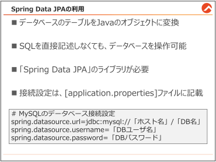{#p066-f02}

::: {#p066-b02 .heading}

[Spring Data JPA とは]{.s010}

:::

::: {#p066-b03 .paragraph}

[Web]{.s007}[&#32;アプリケーションの開発では、データの保存や取得のためにデータベースとの連携が]{.s009}\
[不可欠です。一般的に、データベースと連携するプログラミングは、以下のようにある程度パタ]{.s009}\
[ーン化されています。]{.s009}

:::

::: {#p066-b04 .paragraph}

[「データベースへの接続→データの検索→結果を取得→データベースからの切断」]{.s011}

:::

::: {#p066-b05 .paragraph}

[このようなパターンは一見シンプルに思えますが、]{.s009}[Spring Framework]{.s007}[&#32;などのツールを使わな]{.s009}\
[いと、膨大な量のコードを書く必要があります。]{.s009}

:::

::: {#p066-b06 .paragraph}

[Spring Framework]{.s007}[&#32;は、このような繰り返し行われる作業を効率化することに強みがあり、さま]{.s009}\
[ざまな支援ツールを提供しています。本書では、特にデータベース操作を簡単にできる]{.s009}\
[「]{.s009}[Spring Data JPA(Jakarta Persistence API)]{.s007}[」に注目します。]{.s009}

:::

::: {#p066-b07 .paragraph}

[通常、データベースに命令を出すためには、]{.s009}[SQL]{.s007}[&#32;という特別な言語を使う必要があります]{.s009}\
[が、]{.s009}[Spring Data JPA を使うと、予めデータベース情報をJava のオブジェクトに変換すること]{.s011}\
[で、テーブルの1 行のデータをJava の1 つのインスタンスとして扱うことができます。]{.s011}

:::

::: {#p066-b08 .paragraph}

[そのおかげで、]{.s009}[SQL 文を書かなくても、データベースの操作をすることが可能になります。]{.s011}\
[この節では、]{.s009}[Spring Data JPA]{.s007}[&#32;を使って、データを効果的に管理する方法について学びます。]{.s009}

:::

:::

::: {#page-67 .source-page}

::: {#p067-b01 .heading}

[【参考】 サンプルデータベースの定義]{.s010}

:::

::: {#p067-b02 .paragraph}

[本書では、以下のデータベースの情報を基にします。]{.s009}

:::

::: {#p067-table01 .table has-header="false"}

|  |  |
| --- | --- |
| RDBMS 名 | MySQL8.0 |
| データベース名 | spring\_sample |
| ユーザ名 | spring\_sample\_user |
| パスワード | trainocate |

:::

::: {#p067-b03 .paragraph}

[3 章では、\[Product\]テーブルのみ使用します。]{.s009}

:::

::: {#p067-b04 .heading}

[\<Product テーブル\>]{.s010}

:::

::: {#p067-table02 .table has-header="true"}

| No | 論理名称 | 物理名称 | データ型 | 桁数 | 制約 | 備考 |
| --- | --- | --- | --- | --- | --- | --- |
| 1 | 商品番号 | id | INT | - | PRIMARY KEY<br>AUTO\_INCREMENT | 自動採番 |
| 2 | 商品名 | name | VARCHAR | 255 | - | - |
| 3 | 価格 | price | INT | - | - | - |

:::

::: {#p067-b05 .paragraph}

[\[product\]テーブルには、9 行のデータが格納されています。]{.s009}

:::

::: {#p067-table03 .table has-header="true"}

| 商品番号 | 商品名 | 価格 |
| --- | --- | --- |
| 1 | スマートテレビ | 30000 |
| 2 | ゲーミングモニター | 20000 |
| 3 | ノートパソコン | 50000 |
| 4 | 2 ドア冷蔵庫 | 50000 |
| 5 | コンパクト冷蔵庫 | 15000 |
| 6 | ワインクーラー | 30000 |
| 7 | 全自動洗濯機 | 25000 |
| 8 | 乾燥機能付き洗濯機 | 40000 |
| 9 | 洗濯乾燥機 | 60000 |

:::

:::

::: {#page-68 .source-page}

::: {#p068-b01 .heading}

[【参考】既存のJDBC 接続(Java+MySQL)方法と問題]{.s010}

:::

::: {#p068-b02 .paragraph}

[既存のJava データベースプログラミングにおいての、MySQL との接続方法を説明します。]{.s009}

:::

::: {#p068-b03 .heading}

[1\.&#32;]{.s015}[事前にmysql-connector-j.jar ファイルを入手し、プロジェクトのビルドパスに追加する]{.s015}

:::

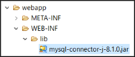{#p068-f03}

{#p068-f04}

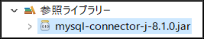{#p068-f05}

::: {#p068-b04 .heading}

[2\.&#32;]{.s015}[クラスに接続情報を記載する]{.s015}

:::

::: {#p068-b05 .code}

```java
String jdbcUrl =
      "jdbc:mysql://localhost/spring_sample?serverTimezone=Asia/Tokyo";
String userId = "spring_sample_user";
String password = "trainocate";
```

:::

::: {#p068-b06 .heading}

[3\.&#32;]{.s015}[DriverManager.getConnction(「DB URL」, 「ユーザ名」、「パスワード」)メソッドを実行]{.s015}

:::

::: {#p068-b07 .heading}

[4\.&#32;]{.s015}[SQL を実行するための処理を記載（例外処理必須）]{.s015}

:::

::: {#p068-b08 .code}

```java
try (Connection con =
             DriverManager.getConnection(jdbcUrl, userId, password)) {
               //データベース処理
        } catch (SQLException e) {
               e.printStackTrace();
        }
```

:::

::: {#p068-b09 .paragraph}

[既存のJDBC 接続方法にはいくつかの欠点があります。そして、Spring Data JPA はその欠]{.s009}\
[点を大きく改善しています。以下は、その比較表です。]{.s009}

:::

:::

::: {#page-69 .source-page}

::: {#p069-table01 .table has-header="true"}

| 要素 | JDBC | Spring Data JPA |
| --- | --- | --- |
| 外部ライブラリ<br>の依存 | JDBC ドライバー(mysql-connector-j.jar）を<br>手動でプロジェクトに追加する必要があ<br>る。ダウンロードやビルドパスの設定など<br>の追加作業が伴う。 | Maven で必要なライブラリが自動的に管理<br>される。手動での追加作業は不要。 |
| ハードコーディ<br>ング | 接続情報（URL、ユーザー名、パスワード）<br>がソースコード内に直接書かれることが多<br>く、セキュリティリスクになり得る。環境の変<br>更があるたびにコードの変更が必要。 | 接続情報は外部の設定ファイル<br>（application.properties）に記載するため、<br>セキュリティが向上し、環境に応じた変更も<br>容易。 |
| 冗長なコード | 接続や例外処理などのために冗長なコー<br>ドが必要。読みにくく、エラーが発生しやす<br>い。 | JPA リポジトリインターフェースを使用するこ<br>とで、冗長なコードを大幅に削減。よりシン<br>プルで読みやすい。 |
| 例外処理の必<br>要性 | DriverManager.getConnectionメソッドが<br>接続失敗時にSQLException をスローする<br>ため、追加の例外処理コードが必要。 | RuntimeExceptionを使用するため、明示<br>的な例外処理が不要になる場合が多いの<br>で、コードがシンプル。 |
| リソース管理 | 開いたデータベース接続を適切に閉じる責<br>任が開発者にある。これを怠るとリソース<br>リークのリスクがある。 | リソース管理をフレームワークが行うため、<br>開発者はリソースリークを気にする必要が<br>少ない。 |

:::

::: {#p069-b01 .paragraph}

[Spring Data JPAを使うと、データベースを操作するためのコードを短く書けます。]{.s009}

:::

:::

::: {#page-70 .source-page}

::: {#p070-b01 .heading}

[【作業手順①】Spring Data JPA と、MySQL ドライバーの導入]{.s010}

:::

::: {#p070-b02 .paragraph}

[第1 章でご説明した通り、Maven を利用すると簡単にライブラリを追加できます。]{.s009}

:::

::: {#p070-b03 .paragraph}

[第3 章で必要なライブラリは、]{.s009}[「Spring Data JPA」と、「MySQL Driver」、「Lombok」]{.s011}[です。]{.s009}

:::

::: {#p070-b04 .paragraph}

[または、Spring プロジェクトを作成する時、同時にインストールしたいライブラリを選択する方法]{.s009}\
[もあります。]{.s009}

:::

::: {#p070-b05 .paragraph}

[新規でプロジェクトを作成する際は、必要なライブラリを必ず導入してから進めてください。]{.s009}

:::

::: {#migration-03-jpa-pom .code}

```xml
<dependency>
    <groupId>org.springframework.boot</groupId>
    <artifactId>spring-boot-starter-data-jpa</artifactId>
</dependency>
<dependency>
    <groupId>com.mysql</groupId>
    <artifactId>mysql-connector-j</artifactId>
    <scope>runtime</scope>
</dependency>
<dependency>
    <groupId>org.projectlombok</groupId>
    <artifactId>lombok</artifactId>
    <optional>true</optional>
</dependency>
```

:::

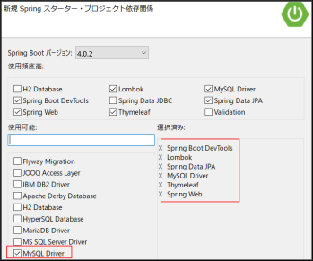{#p070-f06}

:::

::: {#page-71 .source-page}

::: {#p071-b01 .heading}

[【作業手順②】接続情報の設定]{.s010}

:::

::: {#p071-b02 .paragraph}

[Spring Data JPA を使う場合、]{.s009}[データベースとの接続情報は、クラスに記載する必要はなく、]{.s011}\
[「application.properties」ファイルに記載をします。]{.s011}[そうすると、全クラスがこの設定ファイルを参]{.s009}\
[照することになりますので、管理がしやすくなります。]{.s009}

:::

{#p071-f07}

::: {#p071-b03 .code}

```properties
spring.thymeleaf.cache=false

# MySQL のデータベース接続設定
spring.datasource.url=jdbc:mysql://localhost/spring_sample?serverTimezone=Asia/Tokyo
spring.datasource.username=spring_sample_user
spring.datasource.password=trainocate

# JPA/Hibernate の追加設定（開発環境ではお勧め）
spring.jpa.show-sql=true
```
:::

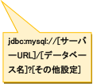{#p071-f08}

::: {#p071-b04 .paragraph}

[追記した各設定は以下の情報を表しています。]{.s009}

:::

::: {#p071-b05 .table table-role="properties"}

| 設定項目 | 意味 |
| --- | --- |
| spring.datasource.url | データベースの URL(サーバー名/データベース名が含まれます) |
| spring.datasource.username | データベースに接続するユーザ名 |
| spring.datasource.password | データベースに接続するためのパスワード |
| spring.jpa.show-sql=true | 生成したSQL 文をログで確認可能 |

:::

::: {#p071-b09 .paragraph}

[最後の1 行は、本番環境では使うべきではありませんが、開発時は役に立つ設定です。]{.s009}

:::

::: {#p071-b10 .paragraph}

[この設定は、あくまでMySQL 専用の書き方であり、Oracle やPostgreSQL などのRDBMS と]{.s009}\
[接続する場合は、別途調査が必要です。]{.s009}

:::

::: {#p071-b11 .paragraph}

[設定完了後は、必ず\[実行\]→\[maven install\]をしないと反映されませんので、ご注意くださ]{.s011}\
[い。]{.s011}

:::

:::

::: {#page-72 .source-page}

::: {#p072-b01 .heading}

[3\.2.&#32;]{.s004}[エンティティの定義]{.s004}

:::

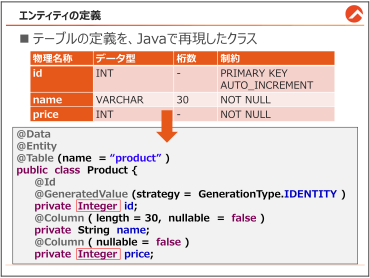{#p072-f09}

::: {#p072-b02 .heading}

[&#32;エンティティ(Entity)とは？]{.s010}

:::

::: {#p072-b03 .paragraph}

[Spring Data JPA]{.s007}[&#32;を使用する際には、]{.s009}[データベース内の各テーブルをJava のクラスで表現]{.s011}\
[することが重要です。このクラスを「エンティティ」と呼びます。エンティティは実質的にデータベ]{.s009}\
[ースのテーブルの各行をオブジェクトとして扱うためのものです。つまり、]{.s009}[テーブルの1 行がエ]{.s011}\
[ンティティの1 インスタンス（オブジェクト）に対応します。]{.s011}

:::

::: {#p072-b04 .paragraph}

[エンティティの作成を学ぶことは、データベースをプログラムで扱うための最初のステップで]{.s009}\
[す。例として、もし「]{.s009}[product]{.s007}[」という名前のテーブルがある場合、それに対応するエンティティを]{.s009}\
[「]{.s009}[Product]{.s007}[」というクラスとして作成します。このクラスには、テーブルの列に対応するフィールドが]{.s009}\
[含まれ、データベースの行の情報を保持できるようになります。]{.s009}

:::

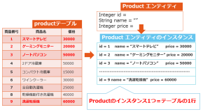{#p072-f10}

:::

::: {#page-73 .source-page}

::: {#p073-b01 .heading}

[Entity クラスの作成]{.s010}

:::

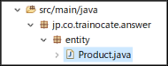{#p073-f11}

::: {#p073-b02 .paragraph}

[Entity]{.s007}[&#32;クラスは、通常テーブルの名前と同じようなクラス名を付けます。]{.s009}

:::

::: {#p073-b03 .paragraph}

[Controller]{.s007}[&#32;クラスを、]{.s009}[controller]{.s007}[&#32;パッケージに作成したのと同じく、]{.s009}[Entity]{.s007}[&#32;クラスは、]{.s009}[entity]{.s007}[&#32;パッケー]{.s009}\
[ジの中に作成します。]{.s009}

:::

::: {#p073-b04 .heading}

[【参考】\<Product テーブル\>]{.s010}

:::

::: {#p073-table01 .table has-header="true"}

| No | 論理名称 | 物理名称 | データ型 | 桁数 | 制約 | 備考 |
| --- | --- | --- | --- | --- | --- | --- |
| 1 | 商品番号 | id | INT | - | PRIMARY KEY<br>AUTO\_INCREMENT | 自動採番 |
| 2 | 商品名 | name | VARCHAR | 30 | NOT NULL | - |
| 3 | 価格 | price | INT | - | NOT NULL | - |

:::

::: {#p073-b05 .paragraph}

[それでは、]{.s009}[Product]{.s007}[&#32;テーブルを、]{.s009}[Java]{.s007}[&#32;のクラスで再現してみます。理解のため、全体のソース]{.s009}\
[コードをお見せする前に、作業順でご説明します。]{.s009}

:::

::: {#p073-b06 .heading}

[【作業手順①】 テーブルの列名と型をJava のフィールドで表現する]{.s011}

:::

::: {#p073-b07 .paragraph}

[基本的に、]{.s009}[JavaBean]{.s007}[&#32;クラスを作る感覚]{.s014}[と似ていますので、]{.s009}[product]{.s007}[&#32;テーブルで使われるデー]{.s009}\
[タを、一つずつ定義していきましょう。]{.s009}

:::

::: {#p073-b08 .paragraph}

[…/entity/Product.java]{.s011}

:::

::: {#p073-b09 .code}

```java
@Entity
@Table(name = "product")
public class Product {
    private Integer id;
    private String name;
    private Integer price;
}
```

:::

:::

::: {#page-74 .source-page}

::: {#p074-b01 .paragraph}

[このコードにおいて、]{.s009}[@Entity]{.s007}[&#32;アノテーションはこのクラスがエンティティクラスであることを示]{.s009}\
[し、]{.s009}[@Table]{.s007}[&#32;アノテーションは実際のテーブル名を指定します。その後、テーブルの各列を型に]{.s009}\
[合わせて定義します。この例では、]{.s009}[id]{.s007}[、]{.s009}[name]{.s007}[、]{.s009}[price]{.s007}[&#32;が該当します。]{.s009}

:::

::: {#p074-b02 .paragraph}

[フィールドの型についてですが、]{.s009}[int]{.s007}[&#32;ではなく、]{.s009}[Integer]{.s007}[&#32;の型が推奨されます。その理由は、デ]{.s009}\
[ータベースの&#32;]{.s009}[int]{.s007}[&#32;列には、]{.s009}[null]{.s007}[&#32;を格納できても、]{.s009}[Java]{.s007}[&#32;の&#32;]{.s009}[int]{.s007}[&#32;型には&#32;]{.s009}[null]{.s007}[&#32;を入れることができない]{.s009}\
[ためです。]{.s009}

:::

::: {#p074-b03 .paragraph}

[そして、]{.s009}[JavaBean]{.s007}[&#32;と同様にデータのやり取りを行うクラスなので、当然&#32;]{.s009}[Getter&Setter]{.s007}[&#32;メソッド]{.s009}\
[や、初期化のためのコンストラクタ、より完成度を上げるため&#32;]{.s009}[toString]{.s007}[&#32;メソッド、]{.s009}[equals]{.s007}[&#32;メソッド、]{.s009}\
[hashcode]{.s007}[&#32;メソッドを定義するのが理想です。]{.s009}

:::

::: {#p074-b04 .paragraph}

[しかし、それを全て書くと、開発効率が落ちるため、]{.s009}[lombok]{.s007}[ライブラリの]{.s009}[@Data]{.s007}[アノテーションを]{.s009}\
[付けると便利です。]{.s009}

:::

::: {#p074-b05 .heading}

[【作業手順②】 Lombok の@Data アノテーションを付与]{.s011}

:::

::: {#p074-b06 .paragraph}

[…/entity/Product.java]{.s011}

:::

::: {#p074-b07 .code}

```java
import lombok.Data;

@Entity
@Table(name = "product")
@Data
public class Product {
    private Integer id;
    private String name;
    private Integer price;
}
```

:::

::: {#p074-b08 .paragraph}

[@Data アノテーションを付与するだけで、Getter&Setter、コンストラクタ、toString、]{.s011}\
[hashcode、equals メソッドが自動生成]{.s011}[されますので、非常に便利になります。]{.s009}

:::

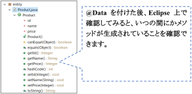{#p074-f12}

:::

::: {#page-75 .source-page}

::: {#p075-b01 .heading}

[【作業手順③】 制約をアノテーションで表現]{.s011}

:::

::: {#p075-b02 .paragraph}

[次は、]{.s009}[制約についても、定義]{.s011}[する必要があります。]{.s009}

:::

::: {#p075-b03 .paragraph}

[…/entity/Product.java]{.s011}

:::

::: {#p075-b04 .code}

```java
@Id //Primary Key 制約
@GeneratedValue(strategy = GenerationType.IDENTITY)//auto_increment 制約
private Integer id;

@Column(length = 30, nullable = false)   //桁数30, NOT NULL 制約
private String name;

@Column(nullable = false) //NOT NULL 制約
private Integer price;
```

:::

::: {#p075-b05 .paragraph}

[Primary Key 制約は、「@Id」アノテーションで表現します。普通の列については、「@Column」を]{.s011}\
[付けます。]{.s011}

:::

::: {#p075-b06 .paragraph}

[新規登録をするたびに、自動的に番号が割り当てられる、自動採番の&#32;]{.s009}[AUTO\_INCREMENT]{.s007}\
[制約は、「]{.s009}[@GeneratedValue(strategy = GenerationType.IDENTITY)]{.s007}[」で表現します。]{.s009}

:::

::: {#p075-b07 .paragraph}

[入力値の長さや、]{.s009}[NOT NULL]{.s007}[&#32;制約の有無なども、表現できます。]{.s009}

:::

::: {#p075-b08 .paragraph}

[完成された&#32;]{.s009}[Product]{.s007}[&#32;クラスは、下記となります。]{.s009}

:::

::: {#p075-b09 .paragraph}

[…/entity/Product.java]{.s011}

:::

::: {#p075-b10 .code}

```java
 1:package jp.co.trainocate.answer.entity;
 2:
 3:import jakarta.persistence.Column;
 4:import jakarta.persistence.Entity;
 5:import jakarta.persistence.GeneratedValue;
 6:import jakarta.persistence.GenerationType;
 7:import jakarta.persistence.Id;
 8:import jakarta.persistence.Table;
 9:import lombok.Data;
10:
11:@Data
12:@Entity
13:@Table(name = "Product")
```

:::

:::

::: {#page-76 .source-page}

::: {#p076-b01 .code}

```java
14:public class Product {
15:
16:    @Id
17:    @GeneratedValue(strategy = GenerationType.IDENTITY)
18:    private Integer id;
19:
20:    @Column(length = 30, nullable = false)
21:    private String name;
22:
23:    @Column(nullable = false)
24:    private Integer price;
25:
26:    // lombok がコンストラクタと以下のメソッドを自動生成
27:    //Getter()&Setter()
28:    //equals()
29:    //hashCode()
30:    //toString()
31:}
```

:::

::: {#p076-b02 .paragraph}

[以上が、エンティティクラスの作成方法でした。エンティティは、全く言語が異なる、データベー]{.s009}\
[スを&#32;]{.s009}[Java]{.s007}[&#32;の世界に再現したものです。]{.s009}

:::

::: {#p076-b03 .paragraph}

[データベースの各行はエンティティの&#32;]{.s009}[Java]{.s007}[&#32;オブジェクトとして扱われ、]{.s009}[SQL]{.s007}[&#32;を直接書くことなく]{.s009}\
[データベースとのやり取りが可能になります。]{.s009}

:::

::: {#p076-b04 .paragraph}

[今回は一般的なエンティティクラスの書き方をご説明しましたが、]{.s009}[Oracle]{.s007}[&#32;などの異なる]{.s009}\
[RDBMS]{.s007}[&#32;の独自の機能を再現する際は、書き方が変わる場合がありますので、それぞれ調査]{.s009}\
[が必要です。]{.s009}

:::

:::

::: {#page-77 .source-page}

::: {#p077-b01 .heading}

[3\.3.&#32;]{.s004}[リポジトリの定義]{.s004}

:::

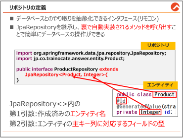{#p077-f13}

::: {#p077-b02 .heading}

[リポジトリ（Repository）とは？]{.s010}

:::

::: {#p077-b03 .paragraph}

[リポジトリは&#32;]{.s009}[Spring Data JPA]{.s007}[&#32;において、データベースとのやり取りを抽象化することができる]{.s009}\
[インターフェースです。簡単に言うと、]{.s009}[データベースを操作できるリモコンのようなもの]{.s011}[です。]{.s009}

:::

::: {#p077-b04 .paragraph}

[エンティティとリポジトリを組み合わせることで、]{.s009}[複雑なSQL クエリを書くことなく、Java を通じ]{.s011}\
[てデータベース操作を行うことができます]{.s011}[。リポジトリインターフェースを定義するだけで、]{.s009}\
[Spring Data JPA]{.s007}[&#32;は実行時にその実装を裏で自動的に生成し、開発者がデータベース操作に]{.s009}\
[集中できるようにします。]{.s009}\
[まるで、]{.s009}[リモコンに最初からついているボタンを押せば、テレビを簡単に操作できるのと似て]{.s011}\
[います。]{.s011}[この節では、リポジトリの作成と基本的な使用方法について詳しく説明していきます。]{.s009}

:::

:::

::: {#page-78 .source-page}

::: {#p078-b01 .heading}

[【作業手順①】 リポジトリの作成]{.s010}

:::

::: {#p078-b02 .paragraph}

[エンティティと同様に、別途パッケージを作成します。]{.s009}\
[クラスではなく、インターフェースですので、インターフェースとして作成します。]{.s009}\
[名前は通常、エンティティ名の後ろに、\[Repository\]を結合することが多いです。]{.s009}

:::

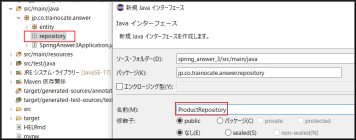{#p078-f14}

::: {#p078-b03 .paragraph}

[…/repository/ProductRepository.java]{.s011}

:::

::: {#p078-b04 .code}

```java
package jp.co.trainocate.answer.repository;

import org.springframework.data.jpa.repository.JpaRepository;
import jp.co.trainocate.answer.entity.Product;

public interface ProductRepository extends JpaRepository<Product, Integer>{ }
```

:::

::: {#p078-b05 .paragraph}

[リポジトリを定義する際には、]{.s009}[JpaRepository という既存のインターフェースをextends で拡]{.s011}\
[張]{.s011}[（継承）させます。]{.s009}

:::

::: {#p078-b06 .paragraph}

[JpaRepository には、データベースのデータを検索したり保存したりするためのメソッドが最]{.s009}\
[初から用意されています。それを]{.s009}[継承するだけで、開発者はSQL を記述しなくても、便利にデ]{.s011}\
[ータベースの操作ができるようになります。]{.s011}[これはまるで、「リモコンによく使う電源On/Off や]{.s009}\
[チャンネル・音量調整ボタンが最初から付いているため、テレビの中の複雑な処理を知らなく]{.s009}\
[ても簡単に操作できる」のと同じイメージです。]{.s009}

:::

{#illustration-expansion-2026-repository-implementation}

::: {#illustration-expansion-2026-repository-implementation-caption .paragraph}

宣言したRepositoryインターフェースに対し、Spring Data JPAが実装オブジェクトを用意します。

:::

::: {#p078-b07 .paragraph}

[extends JpaRepository の後ろには、ジェネリクス（\< \>）を記載します。 \<Product, Integer\>のよ]{.s009}\
[うに、]{.s009}[第1 引数にはエンティティ名を、第2 引数にはそのエンティティの@Id アノテーションを付]{.s011}\
[けた主キーの型名]{.s011}[を記載します。]{.s009}

:::

::: {#p078-b08 .paragraph}

[今までの内容をまとめると、Product というエンティティクラスがデータベースのテーブルを表]{.s009}\
[し、そのクラスに対応するリポジトリを作ることで、テーブルのデータを簡単に追加、取得、更]{.s009}\
[新、削除できるようになるわけです。]{.s009}\
[&#32;&#32;作成したリポジトリを実際の処理で使うためには、「依存性の注入」が必要になります。]{.s009}

:::

:::

::: {#page-79 .source-page}

::: {#p079-b01 .heading}

[3\.3.1.&#32;]{.s004}[依存性の注入]{.s004}

:::

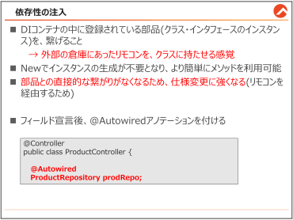{#p079-f15}

::: {#p079-b02 .heading}

[依存性の注入とは]{.s010}

:::

::: {#p079-b03 .paragraph}

[コントローラーからリポジトリを使用してDB 操作を行うためには、リポジトリを使えるようにする]{.s009}\
[「依存性の注入」]{.s011}[という準備が必要です。依存性の注入とは、]{.s009}[Spring のDI コンテナ（待機室）]{.s011}\
[の中で待機しているクラスやインターフェースのインスタンスを、使いたいクラスに繋げること]{.s011}\
[です。]{.s009}

:::

::: {#p079-b04 .paragraph}

[通常、Java プログラミングでA クラスのインスタンスをB クラスで使うためには、]{.s009}\
[B クラス内で「A a = new A();」]{.s009}\
[というオブジェクト生成の式を書く必要があります。しかし、]{.s009}[依存性の注入を行うことで、この]{.s011}\
[New 生成式を書かなくてもインスタンスを繋げて利用できる]{.s011}[ようになります。]{.s009}

:::

::: {#p079-b05 .paragraph}

[第1 章で、Spring Boot のDI コンテナの中には「Bean（部品）」が自動で登録されていると説]{.s009}\
[明しました。リポジトリのインスタンスもBean として自動登録されるため、必要な時にいつでもク]{.s009}\
[ラスに繋げることができます。]{.s009}

:::

::: {#p079-b06 .paragraph}

[メリットはそれだけではなく、クラスのインスタンスを直接呼ばず、外部からのリモコンを使うだ]{.s009}\
[けなので、直接的な繋がりがなくなり、]{.s009}[部品の仕様変更にも強く柔軟なプログラムを実現でき]{.s011}\
[るようになります。]{.s011}

:::

::: {#p079-b07 .paragraph}

[では、具体的な注入方法を説明します。]{.s009}

:::

::: {#p079-b08 .code}

```java
@Autowired
ProductRepository prodRepo;
```

:::

:::

::: {#page-80 .source-page}

::: {#p080-b01 .paragraph}

[Spring では、いくつかの依存性の注入方法があります。一番簡単な方法は、上記のように、フ]{.s009}\
[ィールドへ直接注入する方法があります。]{.s009}

:::

::: {#p080-b02 .paragraph}

[インターフェースのフィールドを記載し、その上に\[@Autowired\]アノテーションを付けるだけで]{.s009}\
[依存性の注入が完了し、そのインターフェースに紐づいているメソッドが使えるようになります。]{.s009}\
[&#32;イメージとしては、]{.s009}[クラスに「ProductRepository 型」の「prodRepo」という名前のリモコンを持]{.s011}\
[たせてあげた状態]{.s011}[です。]{.s009}

:::

{#revision-di-remote}

::: {#revision-di-caption .paragraph}

**左のDIコンテナ**が用意した**リポジトリ（リモコン）**を、**中央のController**が受け取って使い、**右のDB**を操作するイメージです。テレビの操作に似た図で、依存性の注入と利用の関係を表しています。

:::

::: {#p080-b03 .heading}

[【参考】 その他の依存性の注入方法]{.s011}

:::

::: {#p080-b04 .paragraph}

[フィールドに@Autowired をつける方法は、とても便利ですが、単体テストの際に不便だとい]{.s009}\
[うデメリットがあります。]{.s009}

:::

::: {#p080-b05 .paragraph}

[ですので、下記の方法で書くこともあります。]{.s009}

:::

::: {#p080-b06 .heading}

[依存性の注入方法②]{.s011}

:::

::: {#p080-b07 .code}

```java
public class ProductController {
    private final ProductRepository prodRepo;

    @Autowired
    public ProductController(ProductRepository prodRepo) {
        this.prodRepo = prodRepo;
    }
```

:::

::: {#p080-b08 .paragraph}

[このように、フィールドを定数に変えた後に、コンストラクタを作成し、コンストラクタに]{.s009}\
[@Autowired アノテーションを付ける依存性の注入の書き方もあります。こちらは単体テスト時も]{.s009}\
[大丈夫ですので、よく使われます。]{.s009}

:::

::: {#p080-b09 .paragraph}

[しかし、フィールドに指定する方法より、可読性が悪くなるため、]{.s009}\
[下記のように、]{.s009}[lombok ライブラリを使って、簡略化させることも可能]{.s011}[です。]{.s009}

:::

::: {#p080-b10 .heading}

[依存性の注入方法③]{.s011}

:::

::: {#p080-b11 .code}

```java
import lombok.RequiredArgsConstructor;

@Controller
@RequiredArgsConstructor
public class ProductController {
    private final ProductRepository prodRepo;
```

:::

::: {#p080-b12 .paragraph}

[@RequiredArgsConstructor アノテーションを、クラス名に付けるだけで]{.s009}[依存性の注入のための]{.s011}\
[コンストラクタのコードを省略できます。]{.s011}

:::

:::

::: {#page-81 .source-page}

::: {#p081-b01 .heading}

[3\.3.2.&#32;]{.s004}[コントローラーの基本URL 設定]{.s004}

:::

::: {#p081-b02 .paragraph}

[今までは、メソッド単位でマッピングする&#32;]{.s009}[URL]{.s007}[&#32;を指定していましたが、通常、]{.s009}[Spring]{.s007}[&#32;プロジェクト]{.s009}\
[には、複数の異なる機能を持つ、コントローラーが存在します。]{.s009}

:::

::: {#p081-b03 .paragraph}

[例えば、]{.s009}[商品に関する機能を集めたコントローラーと、ユーザに関連する機能を持つコントロ]{.s011}\
[ーラーは、URL も区別しておかないと、URL の管理が難しくなります。]{.s011}

:::

::: {#p081-b04 .paragraph}

[そこで、コントローラーに基本&#32;]{.s009}[URL]{.s007}[&#32;を指定しておくことで、]{.s009}[URL]{.s007}[&#32;の管理を便利にすることができ]{.s009}\
[ます。]{.s009}

:::

::: {#p081-b05 .heading}

[ProductController の作成]{.s010}

:::

::: {#p081-b06 .paragraph}

[&#32;まずは、controller パッケージに\[ProductController\]クラスを作成します。]{.s009}

:::

::: {#p081-b07 .paragraph}

[…/controller/ProductController.java]{.s011}

:::

::: {#p081-b08 .code}

```java
@Controller
@RequestMapping("/product")
public class ProductController {
```

:::

::: {#p081-b09 .paragraph}

[class ProductController の上に、@RequestMapping(“URL”)というコードが書かれています。]{.s009}

:::

::: {#p081-b10 .paragraph}

[これは、ProductController クラス全体に基本URL「/product」を設定しているコードです。]{.s009}\
[RequestMapping でURL を指定すると、この]{.s009}[コントローラー内のすべてのメソッドは、基本URL]{.s011}\
[に基づいてアクセスされます]{.s011}[。]{.s009}\
[たとえば、ProductController クラスに作成されるメソッドのURL は、以下のように呼び出される]{.s009}\
[ことになります。]{.s009}

:::

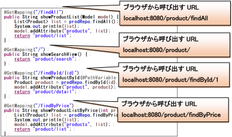{#p081-f16}

:::

::: {#page-82 .source-page}

::: {#p082-b01 .heading}

[【参考】既存の全件検索方法]{.s004}

:::

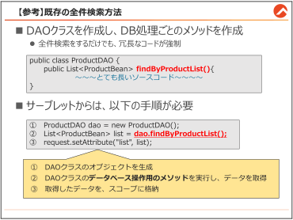{#p082-f17}

::: {#p082-b02 .paragraph}

[データベースのアクセス情報を記載し、エンティティとリポジトリの定義まで終わったら、いよ]{.s009}\
[いよデータベース操作を開始できます。]{.s009}

:::

::: {#p082-b03 .paragraph}

[では、本格的な説明の前に、まずは既存の&#32;]{.s009}[Java]{.s007}[&#32;データベースプログラミングとサーブレット]{.s009}\
[での書き方を確認しておきましょう。]{.s009}

:::

::: {#p082-b04 .heading}

[【参考】サーブレットでデータベースの操作(全件検索)]{.s010}

:::

::: {#p082-b05 .paragraph}

[サーブレットで、データベースから検索をするためには、別途DAO クラスを作成し、その中に]{.s009}\
[データベース操作をするためのメソッドを作成する必要がありました。]{.s009}

:::

::: {#p082-b06 .code}

```java
public class ProductDAO {

        public List<ProductBean> findByProductList(){
                String jdbcUrl = "jdbc:mysql://localhost/spring_sample?"
                        + "serverTimezone=Asia/Tokyo";
               String userId = "spring_sample_user";
               String password = "trainocate";
```
:::

:::

::: {#page-83 .source-page}

::: {#p083-b01 .code}

```java
        PreparedStatement pst = null;
        ResultSet rs = null;
        ArrayList list = new ArrayList();

        try (Connection con =
        DriverManager.getConnection(jdbcUrl, userId, password)) {
               String sql = "SELECT * FROM product";
               pst = con.prepareStatement(sql);
               rs = pst.executeQuery();
               while(rs.next()) {
                       ProductBean product = new ProductBean();
                       product.setId(rs.getInt("id"));
                       product.setName(rs.getString("name"));
                       product.setPrice(rs.getInt("price"));
                       list.add(product);
               }
        } catch (SQLException e) {
               e.printStackTrace();
        }
        return list;
}
```

:::

::: {#p083-b02 .paragraph}

[一番簡単なSELECT 文なのに、これほどのソースコードが必要でした。]{.s009}

:::

::: {#p083-b03 .paragraph}

[次は、サーブレット側のソースコードです。]{.s009}

:::

::: {#p083-b04 .code}

```java
@WebServlet("/Sample5")
public class Sample5 extends HttpServlet {
    protected void doGet(HttpServletRequest request,
        HttpServletResponse response)
        throws ServletException, IOException {

        //Product のDB 操作用クラスのProductDAO のオブジェクト生成
        ProductDAO dao = new ProductDAO();

        //複数行を取得するので、リスト型でデータを取得
        List<ProductBean> list = dao.findByProductList();
```

:::

:::

::: {#page-84 .source-page}

::: {#p084-b01 .code}

```java
        //取得したデータをJSP に送るため、リクエストスコープに格納
        request.setAttribute("list", list);

        //list.jsp へ遷移
        RequestDispatcher dispatcher =
            request.getRequestDispatcher("/index.jsp");
        dispatcher.forward(request, response);
    }
```

:::

::: {#p084-b02 .paragraph}

[サーブレットでは、以下の手順が必須でした。]{.s009}

:::

::: {#p084-b03 .paragraph}

[① DAO クラスのオブジェクトを生成する。]{.s009}

:::

::: {#p084-b04 .paragraph}

[② DAO クラスに定義されている]{.s009}[データベース操作用のメソッド]{.s011}[を実行し、データを取得する。]{.s009}

:::

::: {#p084-b05 .paragraph}

[③ 取得したデータを、スコープに格納。]{.s009}

:::

::: {#p084-b06 .paragraph}

[④ JSP へ遷移。]{.s009}

:::

::: {#p084-b07 .paragraph}

[サーブレットの処理コード自体は、多くはないのですが、全件検索をするための、DAO クラス]{.s009}\
[のメソッドのソースコードがかなりの量ですので、時間がかかっていました。]{.s009}

:::

::: {#p084-b08 .paragraph}

[では、Spring Data JPA を使うと、どれほど簡単になるのか、今からご説明いたします。]{.s009}

:::

:::

::: {#page-85 .source-page}

::: {#p085-b01 .heading}

[3\.4.&#32;]{.s004}[全件検索]{.s004}

:::

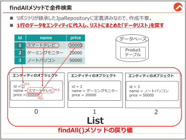{#p085-f18}

::: {#p085-b02 .heading}

[【作業手順①】 findAll メソッドで全件データ取得]{.s010}

:::

::: {#p085-b03 .paragraph}

[…/controller/ProductController.java]{.s011}

:::

::: {#p085-b04 .code}

```java
 1:
 2:@Controller
 3:@RequestMapping("/product")
 4:public class ProductController {
 5:    @Autowired
 6:    private ProductRepository prodRepo;
 7:
 8:    @GetMapping("/findAll")
 9:    public String showProductList(Model model) {
10:        List<Product> list = prodRepo.findAll();
11:        System.out.println(list);
12:        model.addAttribute("products", list);
13:        return "product/list";
14:    }
15:}
```

:::

:::

::: {#page-86 .source-page}

::: {#p086-b01 .step}

[3\.3.2 で作成したProductController に、全件データの検索処理用のメソッドとして、]{.s009}

:::

::: {#p086-b02 .paragraph}

[\[showProductList\]メソッドを作成します。]{.s009}

:::

::: {#p086-b03 .paragraph}

[5-6 行目]{.s011}

:::

::: {#p086-b04 .code}

```java
5:    @Autowired
6:    private ProductRepository prodRepo;
```

:::

::: {#p086-b05 .paragraph}

[全件検索をするためには、ProductRepository から利用できる「findAll」メソッドを呼び出さない]{.s009}\
[といけません。]{.s009}[ProductRepository のメソッドを簡単に利用できるように、ProductRepository の]{.s011}\
[フィールドを宣言して、@Autowired で依存性の注入を]{.s011}[しておきましょう。]{.s009}\
[&#32;この2 行のコードを書いておけば、 \[prodRepo\]を使って、findAll メソッドを呼び出せます。]{.s009}

:::

::: {#p086-b06 .paragraph}

[10 行目 List\<Product\> list = prodRepo.findAll();]{.s011}

:::

::: {#p086-b07 .paragraph}

[findAll メソッドを実行すると、Product テーブル内の全データを、List\<Product\>の形で取得でき]{.s009}\
[ます。]{.s009}[List のImport 先は「java.util」ですので、ご注意ください。]{.s031}

:::

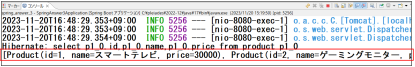{#p086-f19}

::: {#p086-b08 .paragraph}

[SELECT のSQL 文は、どこにも書いていませんが、データベースのproduct テーブルから商品]{.s009}\
[データをしっかり取得しているのが確認できます。これがSpring Data JPA の凄いところです。]{.s009}\
[エンティティにテーブルを忠実に再現した結果、]{.s009}[findAll というメソッドを実行するだけで、自動]{.s011}\
[でデータの格納まで完了したリストを取得できます。]{.s011}

:::

::: {#p086-b09 .paragraph}

[12-13 行目]{.s011}

:::

::: {#p086-b10 .code}

```java
12:        model.addAttribute("products", list);
13:        return "product/list";
```

:::

::: {#p086-b11 .paragraph}

[最後は、データの塊である、list をView へ出力させるために、model に格納します。]{.s009}\
[このリストは、product が複数入っているので、キーは\[products\]にしました。]{.s009}\
[遷移先は、product フォルダの、list.html を指しています。]{.s009}

:::

:::

::: {#page-87 .source-page}

::: {#p087-b01 .heading}

[【作業手順②】 Thymeleaf でリストの出力]{.s010}

:::

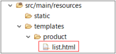{#p087-f20}

::: {#p087-b02 .paragraph}

[showProductList]{.s007}[&#32;メソッドの&#32;]{.s009}[return]{.s007}[&#32;が]{.s009}[\[“product/list”\]]{.s014}[ですので、合わせてフォルダとファイルを]{.s009}\
[作成します。]{.s009}

:::

::: {#p087-b03 .paragraph}

[…/resources/templates/product/list.html]{.s011}

:::

::: {#p087-b04 .code}

```java
 1:<h1>商品一覧</h1>
 2:<table>
 3:    <tr>
 4:        <th>商品番号</th>
 5:        <th>商品名</th>
 6:        <th>価格</th>
 7:    </tr>
 8:    <tr th:each="product: ${products}">
 9:        <td th:text="${product.id}"></td>
10:        <td th:text="${product.name}"></td>
11:        <td th:text="${product.price}"></td>
12:    </tr>
13:</table>
```

:::

::: {#p087-b05 .paragraph}

[8 行目 \<tr th:each="product: $\{products\}"\>]{.s011}

:::

::: {#p087-b06 .paragraph}

[th:each は、]{.s009}[Java の拡張for 文と似た使い方]{.s011}[をします。指定されたコレクション（ここでは]{.s009}\
[products リスト）の各要素に対して、\<tr\> タグ（テーブルの行）を繰り返し生成します。]{.s009}

:::

::: {#p087-b07 .paragraph}

[今回は、全部で9 個のデータがproducts リストの中に入っているので、products リストの要]{.s009}\
[素が product 変数に9 回代入されます]{.s009}[。:を中心にして、右はController のmodel で格納した]{.s011}\
[キー名、左はリストの中に格納されているものを意味する変数名を使います。]{.s011}\
[今回は、リストの中に、複数のproduct インスタンスが格納されているため、「product」としまし]{.s009}\
[た。]{.s009}

:::

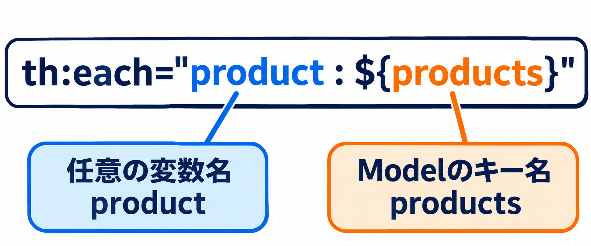{#illustration-review-v4-each-variable-key}

::: {#illustration-review-v4-each-variable-key-caption .paragraph}

「:」の右側はModelに格納したキー名、左側は繰り返しで使う任意の変数名です。

:::

:::

::: {#page-88 .source-page}

::: {#p088-b01 .paragraph}

[9-11 行目 \<td th:text="$\{product.id\}"\>、\<td th:text="$\{product.name\}"\>～～]{.s011}

:::

::: {#p088-b02 .paragraph}

[&#32;product 変数に1 行～9 行までのデータが順番に格納されていますので、「product.フィー]{.s009}\
[ルド名」でデータを出力することができます。つまり、各product オブジェクトの id、name、]{.s009}\
[price を\<td\>の中に9 回出力するソースコードが生成されます。]{.s009}

:::

::: {#p088-b03 .code}

```xml
<tr th:each="product: ${products}">
      <td th:text="${product.id}"></td>
      <td th:text="${product.name}"></td>
      <td th:text="${product.price}"></td>
</tr>
```

:::

::: {#p088-b04 .paragraph}

[\<th:each\>と\<th:text\>によって実際に生成されるHTML は、以下のようになります。]{.s009}

:::

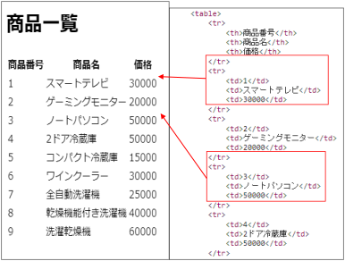{#p088-f21}

::: {#p088-b05 .paragraph}

[このテンプレートは、Spring Boot アプリケーションの ProductController のshowProductList]{.s009}\
[メソッドによって返された products リストの内容を、ブラウザ上で見やすい表形式で表示する]{.s009}\
[ために使用されます。Thymeleaf のth:each を使用することで、リストの各要素に対してテーブ]{.s009}\
[ルの行が自動的に生成され、リスト内のデータが簡単かつ効率的に表示されます。]{.s009}

:::

:::

::: {#page-89 .source-page}

::: {#p089-b01 .heading}

[動作確認]{.s010}

:::

::: {#p089-b02 .heading}

[http://localhost:8080/product/findAll]{.s032}

:::

::: {#p089-b03 .paragraph}

[Controller のURL マッピングが、\[/product\]]{.s009}\
[メソッドのURL マッピングが\[/findAll\] になっているため、このようなURL を指定します。]{.s009}

:::

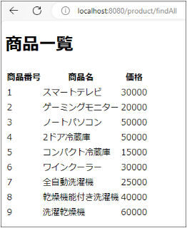{#p089-f22}

::: {#p089-b04 .paragraph}

[th:each により、\<tr\>全体が繰り返しされるため、findAll メソッドで取得してView に送られてきた]{.s009}\
[リストを1 行ずつ出力することができます。]{.s009}

:::

:::

::: {#page-90 .source-page}

::: {#p090-b01 .heading}

[3\.5.&#32;]{.s004}[主キーによる条件検索]{.s004}

:::

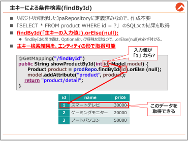{#p090-f23}

::: {#p090-b02 .paragraph}

[前の節では、]{.s009}[findAll()]{.s007}[メソッドを使って、全件検索ができるという内容をご説明しました。]{.s009}

:::

::: {#p090-b03 .paragraph}

[この節では「]{.s009}[SELECT \* FROM WHERE id = ?]{.s007}[」&#32;]{.s009}[の&#32;]{.s009}[SQL]{.s007}[&#32;文のような、主キーを使った条件検]{.s009}\
[索の仕方について説明します。]{.s009}

:::

:::

::: {#page-91 .source-page}

::: {#p091-b01 .heading}

[検索用ページ作成]{.s010}

:::

::: {#p091-b02 .paragraph}

[まずは、検索する&#32;]{.s009}[ID]{.s007}[&#32;を入力してもらうためのページを作成します。]{.s009}

:::

::: {#p091-b03 .paragraph}

[そのためには、ページへ遷移させるためのメソッドを作成する手順が先です。]{.s009}

:::

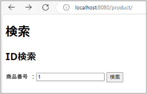{#p091-f24}

::: {#p091-b04 .heading}

[【作業手順①】]{.s010}[&#32;遷移用のメソッド作成]{.s011}

:::

::: {#p091-b05 .paragraph}

[…/controller/ProductController.java]{.s011}

:::

::: {#p091-b06 .code}

```java
//showProductList メソッドの下に追記

@GetMapping("/")
        public String showSearchView() {
               return "product/search";
        }
```

:::

::: {#p091-b07 .paragraph}

[/product]{.s007}[&#32;を&#32;]{.s009}[URL]{.s007}[&#32;で入力すると、呼び出されるページ遷移用のメソッドを作成しましょう。]{.s009}

:::

::: {#p091-b08 .paragraph}

[遷移先は、]{.s009}[/product/search.html]{.s007}[&#32;ですので、次は&#32;]{.s009}[product]{.s007}[&#32;フォルダ内に、]{.s009}[search.html]{.s007}[&#32;を作成しま]{.s009}\
[す。]{.s009}

:::

:::

::: {#page-92 .source-page}

::: {#p092-b01 .heading}

[【作業手順②】]{.s010}[&#32;検索入力View の作成]{.s011}

:::

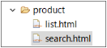{#p092-f25}

::: {#p092-b02 .paragraph}

[…/resources/templates/product/search.html]{.s011}

:::

::: {#p092-b03 .code}

```xml
<!-- 省略 -->
<body>
    <h1>検索</h1>
    <h2>ID 検索</h2>
    <form th:action="@{/product/findById}">
        商品番号：<input type="text" name="id" />
        <input type="submit" value="検索">
    </form>
</body>
```

:::

::: {#p092-b04 .paragraph}

[submit]{.s007}[&#32;ボタンをクリックすると、]{.s009}[\[/product/findById\]]{.s007}[のメソッドを呼び出すように記載します。]{.s009}

:::

::: {#p092-b05 .paragraph}

[送られる商品番号の&#32;]{.s009}[name]{.s007}[&#32;は、]{.s009}[\[id\]]{.s007}[です。]{.s009}

:::

::: {#p092-b06 .heading}

[【作業手順③】]{.s010}[&#32;主キー検索メソッドを作成]{.s011}

:::

::: {#p092-b07 .paragraph}

[…/controller/ProductController.java]{.s011}

:::

::: {#p092-b08 .code}

```java
1://ProductController クラスのshowSearchView メソッドの下に追記
2:
3:@GetMapping("/findById")
 4:public String showProductById(int id, Model model) {
 5:    Product product = prodRepo.findById(id).orElse(null);
 6:    System.out.println(product);
 7:    model.addAttribute("product", product);
 8:    return "product/detail";
 9:}
```

:::

::: {#p092-b09 .paragraph}

[4 行目 showProductById(]{.s011}[int id,]{.s031}[&#32;Model model)]{.s011}

:::

::: {#p092-b10 .paragraph}

[View から送信される主キーのname 属性が「id」ですので、引数名を一致させることで、リクエス]{.s009}\
[トパラメータを取得します。]{.s009}

:::

:::

::: {#page-93 .source-page}

::: {#p093-b01 .paragraph}

[5 行目 Product product = prodRepo.]{.s011}[findById(id).orElse(null);]{.s031}

:::

::: {#p093-b02 .paragraph}

[findById メソッドは、findAll と同じく、継承したJpaRepository の親に定義されているメソッドで]{.s009}\
[す。]{.s009}[引数には主キーを入れて、後ろに.orElse(null)を付けることで、主キー検索による、1 行の]{.s031}\
[結果を取得]{.s031}[することができます。]{.s009}\
[.findById メソッドの戻り値は「Optional」という特殊な戻り値ですので、.orElse(null)をつけない]{.s011}\
[とデータを取得できません。ご注意ください。]{.s011}

:::

::: {#p093-b03 .paragraph}

[※.orElse(null)の代わりに、.get()]{.s011}[&#32;というメソッドもありますが、検索結果がない場合はnull で]{.s009}\
[はなく、例外を出してアプリケーションを強制終了されてしまうので、お勧めしません。]{.s009}

:::

::: {#p093-b04 .paragraph}

[findAll は、全件検索だったため、複数行が取得されることの前提でした。よって]{.s009}\
[List\<Product\>型で受け取りました。]{.s009}\
[主キー検索は、必ず1 行のみ取得できるので、List での取得よりは、エンティティ単位での]{.s011}\
[\[Product product\]で受け取るのが一般的です。]{.s011}

:::

::: {#p093-b05 .paragraph}

[6 行目 System.out.println(product);]{.s011}

:::

::: {#p093-b06 .paragraph}

[検索する商品番号に「1」を入れて実行させてみると、以下のように1 行のデータを取得できて]{.s009}\
[いるのがわかります。]{.s009}

:::

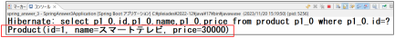{#p093-f26}

::: {#p093-b07 .paragraph}

[7 行目 model.addAttribute("product", product);]{.s011}

:::

::: {#p093-b08 .paragraph}

[取得した1 行のデータは、Product エンティティの中に格納されているので、Viewに出力させる]{.s009}\
[ため、model に格納します。]{.s009}

:::

::: {#p093-b09 .heading}

[【作業手順④】]{.s010}[&#32;商品詳細ページの作成]{.s011}

:::

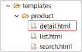{#p093-f27}

::: {#p093-b10 .paragraph}

[product フォルダに、\[detail.html\]を作成します。]{.s009}

:::

:::

::: {#page-94 .source-page}

::: {#p094-b01 .paragraph}

[…/resources/templates/product/detail.html]{.s011}

:::

::: {#p094-b02 .code}

```xml
<h1>商品詳細</h1>
        <table>
               <tr>
                       <th>商品番号</th>
                       <th>商品名</th>
                       <th>価格</th>
               </tr>
               <tr>
                       <td th:text="${product.id}"></td>
                       <td th:text="${product.name}"></td>
                       <td th:text="${product.price}"></td>
               </tr>
        </table>
```

:::

::: {#p094-b03 .paragraph}

[showProductById メソッドのmodel に追加したキー名は、「product」ですので、th:text で各項目]{.s009}\
[を表示させます。]{.s009}

:::

::: {#p094-b04 .paragraph}

[Model に格納されているのは、複数のデータではなく、商品1 個分のデータですので、th:each]{.s011}\
[を使う必要なく、そのままmodel のキー名で出力できます。]{.s011}

:::

::: {#p094-b05 .heading}

[動作確認]{.s010}

:::

::: {#p094-b06 .paragraph}

[http://localhost:8080/product/&#32;&#32;]{.s033}[]{.s034}[product の後ろに必ず/を付けてください。]{.s031}

:::

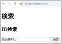{#p094-f28}

::: {#p094-b07 .paragraph}

[商品番号に、「1」と入力し、検索ボタンをクリックします。]{.s009}

:::

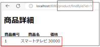{#p094-f29}

::: {#p094-b08 .paragraph}

[商品詳細画面へ遷移し、商品番号1 番のデータが出力されたら、OK です。]{.s009}

:::

:::

::: {#page-95 .source-page}

::: {#p095-b01 .heading}

[3\.5.1.&#32;]{.s004}[主キーではない列による条件検索]{.s004}

:::

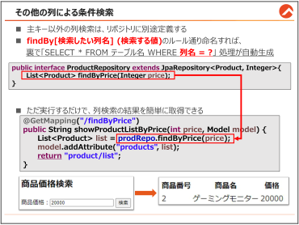{#p095-f30}

::: {#p095-b02 .heading}

[主キー以外の列による検索について]{.s010}

:::

::: {#p095-b03 .paragraph}

[主キーは、汎用的に「]{.s009}[id]{.s007}[」という名称で使われますので「]{.s009}[findBy]{.s007}[Id]{.s035}[」というメソッド名が既に定]{.s009}\
[義されていますが、主キー以外の普通の列による検索をする時を考えてみましょう。主キー以]{.s009}\
[外の列名の検索は、列名を組み合わせたメソッドを開発者側から定義します。]{.s009}

:::

::: {#p095-b04 .paragraph}

[Spring Data JPA]{.s007}[&#32;を作った人は、利用者がどんな列名で検索をして来るかまでは予想できま]{.s009}\
[せん。よって、]{.s009}[利用者自身がメソッド名に、それぞれの列名(正確には、エンティティ内のフィー]{.s011}\
[ルド名)を付けることで、条件検索ができる]{.s011}[環境をリポジトリに用意しています。]{.s009}

:::

::: {#p095-b05 .paragraph}

[この節では、]{.s009}[任意の列における検索メソッドであるfindBy○ooo メソッドをリポジトリに追記]{.s011}\
[する方法についてご説明します。]{.s009}

:::

:::

::: {#page-96 .source-page}

::: {#p096-b01 .heading}

[【作業手順①】 価格による検索フォームの追加]{.s011}

:::

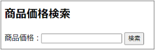{#p096-f31}

::: {#p096-b02 .paragraph}

[…/resources/templates/product/search.html]{.s011}

:::

::: {#p096-b03 .code}

```xml
<!--ID 検索の下に追記  -->

<h2>商品価格検索</h2>
        <form th:action="@{/product/findByPrice}">
               商品価格：<input type="text" name="price" />
               <input type="submit" value="検索">
        </form>
```

:::

::: {#p096-b04 .paragraph}

[前の節で作成した、]{.s009}[search.html]{.s007}[&#32;に、今度は商品価格検索フォームを追加しましょう。]{.s009}

:::

::: {#p096-b05 .paragraph}

[リクエストパラメータは、]{.s009}[price]{.s007}[&#32;になり、]{.s009}[submit]{.s007}[&#32;ボタンをクリックすると、「]{.s009}[/product/findByPrice]{.s007}[」を]{.s009}\
[URL]{.s007}[&#32;マッピングしている&#32;]{.s009}[Controller]{.s007}[&#32;側のメソッドが実行されます。]{.s009}

:::

::: {#p096-b06 .heading}

[【作業手順②】]{.s010}[&#32;price 列で条件検索をするメソッドをリポジトリに追加]{.s011}

:::

::: {#p096-b07 .paragraph}

[…/repository/ProductRepository.java]{.s011}

:::

::: {#p096-b08 .code}

```java
//Product のimport に注意してください。
public interface ProductRepository extends JpaRepository<Product, Integer>{
        List<Product> findByPrice(Integer price);
}
```

:::

::: {#p096-b09 .paragraph}

[次は、リポジトリに抽象メソッドを書き込みます。]{.s009}

:::

::: {#p096-b10 .paragraph}

[一見、インターフェースに抽象メソッドを記載しただけに見えますが、]{.s009}[リポジトリは、決まった]{.s011}\
[ルール通りのメソッド名を合わせるだけで、本当にその処理をするメソッドを裏で作ってくれま]{.s011}\
[す。]{.s011}

:::

:::

::: {#page-97 .source-page}

::: {#p097-b01 .paragraph}

[例えば]{.s009}[「]{.s037}[findBy\[]{.s035}[エンティティのフィールド名]{.s037}[\](]{.s035}[入力値の変数]{.s037}[)]{.s035}[」]{.s037}[というルールに合わせれば、]{.s009}

:::

::: {#p097-b02 .paragraph}

[SELECT \* FROM product WHERE price =&#32;]{.s007}[〇〇]{.s009}[;]{.s007}

:::

::: {#p097-b03 .paragraph}

[という&#32;]{.s009}[SQL]{.s007}[&#32;処理をするメソッドの処理が自動で完成されます。]{.s009}

:::

::: {#p097-b04 .paragraph}

[product]{.s007}[&#32;テーブルには]{.s009}[同じ価格を持つ商品が複数存在する可能性があるため、このメソッド]{.s011}\
[の戻り値はリスト形式]{.s011}[になっています。もし、検索結果が複数行にならない条件検索をしたい]{.s009}\
[なら、戻り値を「]{.s009}[Product]{.s007}[」のような、エンティティにすれば良いです。]{.s009}[出力の形を、戻り値を使っ]{.s011}\
[て選べる]{.s011}[ということです。]{.s009}

:::

::: {#p097-b05 .paragraph}

[findBy 列名 のメソッドを定義する際に注意しないといけないのは、]{.s038}[エンティティに定義され]{.s031}\
[ているフィール名と列名に1 文字でも誤字があったら、アプリケーションが起動しなくなります]{.s031}\
[ので、特にリポジトリを定義する時は、小文字・大文字や誤字に注意しましょう。]{.s038}

:::

::: {#p097-b06 .paragraph}

[例）findByprice / findbyPrice /FindByPrice / findByPlice→ NG]{.s031}

:::

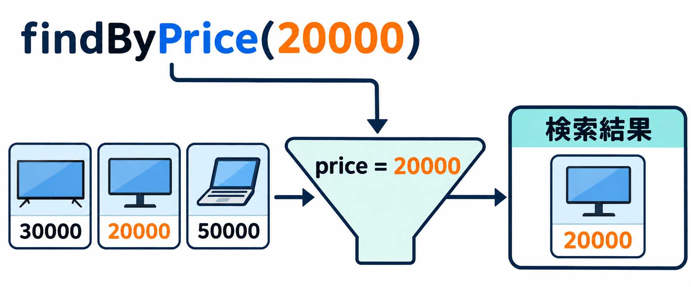{#illustration-expansion-2026-query-method-name}

::: {#illustration-expansion-2026-query-method-name-caption .paragraph}

findByPrice(20000)は、Productのpriceが20000のデータを検索します。

:::

::: {#p097-b07 .heading}

[【作業手順③】]{.s010}[&#32;showProductListByPrice メソッドを作成し、findByPrice のメソッドを実行]{.s011}

:::

::: {#p097-b08 .paragraph}

[…/controller/ProductController.java]{.s011}

:::

::: {#p097-b09 .code}

```java
1://showProductById メソッドの下に追記
2:
3:@GetMapping("/findByPrice")
4: public String showProductListByPrice(int price, Model model) {
5: List<Product> list = prodRepo.findByPrice(price);
6: System.out.println(list);
7: model.addAttribute("products", list);
8: return "product/list";
9: }
```

:::

::: {#p097-b10 .paragraph}

[5 行では、リクエストパラメータprice の値を取得し、prodRepo.findByPrice メソッドを実行しま]{.s011}\
[した。]{.s011}

:::

::: {#p097-b11 .paragraph}

[findAll メソッドを実行した時と、出力結果は同じくList になるメソッドですので、6 行以降は]{.s009}\
[showProductList メソッドと全く同じです。]{.s009}

:::

:::

::: {#page-98 .source-page}

::: {#p098-b01 .heading}

[動作確認]{.s010}

:::

::: {#p098-b02 .paragraph}

[http://localhost:8080/product/&#32;&#32;]{.s033}[]{.s034}[product の後ろに必ず/を付けてください。]{.s031}

:::

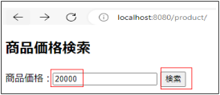{#p098-f32}

::: {#p098-b03 .paragraph}

[商品価格フォームに、\[20000\]と入力し、検索ボタンをクリックします。]{.s031}

:::

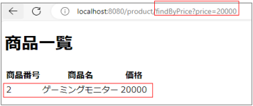{#p098-f33}

::: {#p098-b04 .paragraph}

[商品一覧画面へ遷移し、価格が20000 のデータが出力されたら、OK です。]{.s009}

:::

:::

::: {#page-99 .source-page}

::: {#p099-b01 .heading}

[3\.5.2.&#32;]{.s004}[複数の列による条件検索]{.s004}

:::

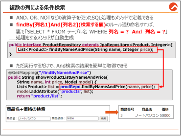{#p099-f34}

::: {#p099-b02 .heading}

[複数の列による検索について]{.s010}

:::

::: {#p099-b03 .paragraph}

[Spring Data JPA]{.s007}[&#32;では、「]{.s009}[AND]{.s007}[」や「]{.s009}[OR]{.s007}[」「]{.s009}[NOT]{.s007}[」などの演算子を使った]{.s009}[SELECT]{.s007}[&#32;文もメソッドと]{.s009}\
[して定義できるようになっています。]{.s009}

:::

::: {#p099-b04 .paragraph}

[では、「複数の列検索用のメソッド」を定義する方法についてご説明します。]{.s009}

:::

::: {#p099-b05 .paragraph}

[findBy\[]{.s007}[エンティティのフィールド名]{.s009}[\]]{.s007}[と同様に、リポジトリに追記しましょう。]{.s009}

:::

:::

::: {#page-100 .source-page}

::: {#p100-b01 .heading}

[【作業手順①】]{.s010}[&#32;商品名と価格の検索フォームの追加]{.s011}

:::

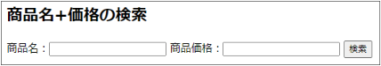{#p100-f35}

::: {#p100-b02 .paragraph}

[…/resources/templates/product/search.html]{.s011}

:::

::: {#p100-b03 .code}

```xml
<!--商品価格検索の下に追記 -->

<h2>商品名+価格の検索</h2>
        <form th:action="@{/product/findByNameAndPrice}">
               商品名：<input type="text" name="name" />
               商品価格：<input type="text" name="price" />
               <input type="submit" value="検索">
        </form>
```

:::

::: {#p100-b04 .paragraph}

[前の節で作成した、]{.s009}[search.html]{.s007}[&#32;に、今度は商品名と商品価格両方を使った検索フォームを]{.s009}\
[追加しましょう。]{.s009}

:::

::: {#p100-b05 .paragraph}

[リクエストパラメータは、]{.s009}[name]{.s007}[&#32;と&#32;]{.s009}[price]{.s007}[&#32;になり、]{.s009}[submit]{.s007}[&#32;ボタンをクリックすると、]{.s009}\
[「]{.s009}[/product/findByNameAndPrice]{.s007}[」を&#32;]{.s009}[URL]{.s007}[&#32;マッピングしている&#32;]{.s009}[Controller]{.s007}[&#32;側のメソッドが実行され]{.s009}\
[ます。]{.s009}

:::

::: {#p100-b06 .heading}

[【作業手順②】]{.s010}[&#32;name とprice 列で条件検索をするメソッドをリポジトリに追加]{.s011}

:::

::: {#p100-b07 .paragraph}

[…/repository/ProductRepository.java]{.s011}

:::

::: {#p100-b08 .code}

```java
public interface ProductRepository extends JpaRepository<Product, Integer>{
        List<Product> findByPrice(Integer price);
        List<Product> findByNameAndPrice(String name, Integer price);
}
```

:::

::: {#p100-b09 .paragraph}

[次は、リポジトリに追加の抽象メソッドを書き込みます。]{.s009}

:::

::: {#p100-b10 .paragraph}

[今回のルールは、「]{.s037}[findBy\[]{.s035}[エンティティのフィールド名&#32;]{.s037}[1\]And]{.s035}\
[\[]{.s035}[エンティティのフィールド名&#32;]{.s037}[2\](]{.s035}[入力値&#32;]{.s037}[1]{.s035}[&#32;の変数]{.s038}[,&#32;]{.s035}[入力値&#32;]{.s037}[2]{.s035}[&#32;の変数]{.s038}[)]{.s035}[」です。]{.s037}

:::

::: {#p100-b11 .paragraph}

[SELECT \* FROM product WHERE name =&#32;]{.s007}[〇〇]{.s009}[&#32;AND&#32;&#32;price =&#32;]{.s007}[△△]{.s009}[;]{.s007}

:::

::: {#p100-b12 .paragraph}

[という&#32;]{.s009}[SQL]{.s007}[&#32;処理をするメソッドが裏で完成されます。]{.s009}

:::

:::

::: {#page-101 .source-page}

::: {#p101-b01 .paragraph}

[product]{.s007}[&#32;テーブルには同じ名前で同じ価格を持つ商品が複数存在する可能性があるため、]{.s009}\
[このメソッドの戻り値はリスト形式になっています。もし、検索結果が複数行にならない条件検]{.s009}\
[索をしたいなら、戻り値を「]{.s009}[Product]{.s007}[」のような、エンティティ型にすれば良いです。]{.s009}

:::

::: {#p101-b02 .heading}

[【作業手順③】]{.s010}[&#32;showProductListByNameAndPrice メソッドを作成し、findByNameAndPrice]{.s011}

:::

::: {#p101-b03 .paragraph}

[メソッドを実行]{.s011}

:::

::: {#p101-b04 .paragraph}

[…/controller/ProductController.java]{.s011}

:::

::: {#p101-b05 .code}

```java
1://showProductListByPrice メソッドの下に追記
2:
3:@GetMapping("/findByNameAndPrice")
4: public String showProductListByNameAndPrice(String name, int price,
                 Model model) {
5: List<Product> list = prodRepo.findByNameAndPrice(name, price);
6: System.out.println(list);
7: model.addAttribute("products", list);
8: return "product/list";
9: }
```

:::

::: {#p101-b06 .paragraph}

[5 行では、リクエストパラメータname とprice の値を取得し、prodRepo. findByNameAndPrice メ]{.s009}\
[ソッドを実行しました。]{.s009}

:::

::: {#p101-b07 .paragraph}

[もし、入力値が更に増えるなら、Form クラスを使ってパラメータ取得しても良いでしょう。]{.s009}

:::

::: {#p101-b08 .paragraph}

[6 行以降はshowProductList メソッドと全く同じです。]{.s009}

:::

::: {#p101-b09 .paragraph}

[このようなAND 検索は、ログインID とパスワードのチェックの時、非常に使われる検索の仕方]{.s009}\
[ですので、是非活用してください。]{.s009}

:::

::: {#p101-b10 .paragraph}

[AND 以外にも、OR やNOT も同じ方法でメソッドを定義すれば、その処理のメソッドが裏で自]{.s011}\
[動生成されますので、とても便利です。]{.s011}

:::

::: {#p101-b11 .paragraph}

[参考として、以下のように複数の演算子を組み合わせるのもできます。]{.s009}

:::

::: {#p101-b12 .paragraph}

[例：ｆindByNameOrPriceAndId]{.s011}

:::

:::

::: {#page-102 .source-page}

::: {#p102-b01 .heading}

[動作確認]{.s010}

:::

::: {#p102-b02 .paragraph}

[http://localhost:8080/product/&#32;&#32;]{.s033}[]{.s034}[product の後ろに必ず/を付けてください。]{.s031}

:::

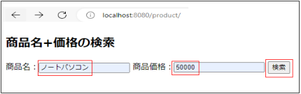{#p102-f36}

::: {#p102-b03 .paragraph}

[フォームに、\[ノートパソコン\]と、\[50000\]と入力し、検索ボタンをクリックします。]{.s031}

:::

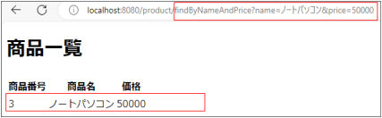{#p102-f37}

::: {#p102-b04 .paragraph}

[商品一覧画面へ遷移し、入力値が商品名と価格に一致しているデータが出力されたら、OK]{.s009}\
[です。]{.s009}

:::

:::

::: {#page-103 .source-page}

::: {#p103-b01 .heading}

[3\.5.3.&#32;]{.s004}[その他の条件検索]{.s004}

:::

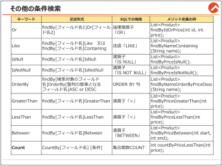{#p103-f38}

::: {#p103-b02 .paragraph}

[Spring Data JPA]{.s007}[&#32;で使用できるメソッドの命名規則を表形式でまとめると、以上のようになりま]{.s009}\
[す。これらの規則を使うことで、]{.s009}[Java]{.s007}[&#32;のメソッド名を通じて&#32;]{.s009}[SQL]{.s007}[&#32;クエリに相当する機能を実現で]{.s009}\
[きます。]{.s009}

:::

::: {#p103-b03 .paragraph}

[最後の行の&#32;]{.s009}[Count]{.s007}[&#32;については、]{.s009}[findBy]{.s007}[～ではない定義方法です。該当の条件での検索結]{.s009}\
[果が何件なのか、整数で取得できます。]{.s009}

:::

::: {#p103-b04 .paragraph}

[関数を使うなど、普通の]{.s009}[SELECT]{.s007}[文のとは異なる場合は、必ずしも]{.s009}[findBy]{.s007}[で始まるわけでは]{.s009}\
[なく、他にも色んな種類の定義方法がありますので、調べましょう。]{.s009}

:::

::: {#p103-b05 .paragraph}

[※]{.s009}[Like]{.s007}[&#32;の場合、]{.s009}[findBy\[]{.s007}[列名]{.s009}[\]Like]{.s007}[&#32;と定義して呼び出しの際は、引数の前後に「]{.s009}[%]{.s007}[」のようなワ]{.s009}\
[イルドカードを付ける必要があります。]{.s009}

:::

::: {#p103-b06 .paragraph}

[例）List\<Product\> list = prodRepo.findByNameLike(]{.s011}["%"]{.s031}[&#32;+ name +&#32;]{.s011}["%"]{.s031}[);]{.s011}

:::

::: {#p103-b07 .paragraph}

[%]{.s007}[を前後に付けないと不具合が起きるため、]{.s009}[Spring]{.s007}[&#32;公式ドキュメントでは、]{.s009}\
[findBy\[]{.s007}[列名]{.s009}[\]Containing]{.s007}[&#32;を推奨しています。]{.s009}

:::

::: {#p103-b08 .paragraph}

[※全件検索を価格順]{.s009}[(]{.s007}[降順]{.s009}[)]{.s007}[で並び替えする時]{.s009}

:::

::: {#p103-b09 .paragraph}

[例）List\<Product\> list = prodRepo.findAllByOrderByPriceDesc();]{.s011}

:::

:::

::: {#page-104 .source-page}

::: {#p104-b01 .heading}

[その他のメソッドの例]{.s010}

:::

::: {#p104-b02 .code}

```java
public interface ProductRepository extends JpaRepository<Product,
Integer>{
        List<Product> findByPrice(Integer price);
        List<Product> findByNameAndPrice(String name, Integer price);

        // その他のメソッドの例

        // SQL: SELECT * FROM product WHERE id = ? OR price = ?;
        List<Product> findByIdOrPrice(int id, int price);
        // SQL: SELECT * FROM product WHERE name <> ?;
        List<Product> findByNameNot(String name);
        // SQL: SELECT * FROM product WHERE name LIKE ?;
        List<Product> findByNameLike(String name);
        // SQL: SELECT * FROM product WHERE price IS NULL;
        List<Product> findByPriceIsNull();
        // SQL: SELECT * FROM product WHERE price IS NOT NULL;
        List<Product> findByPriceIsNotNull();
        // SQL: SELECT * FROM product WHERE name = ? ORDER BY price DESC;
        List<Product> findByNameOrderByPriceDesc(String name);
        // SQL: SELECT * FROM product WHERE price > ?;
        List<Product> findByPriceGreaterThan(int price);
        // SQL: SELECT * FROM product WHERE price < ?;
        List<Product> findByPriceLessThan(int price);
        // SQL: SELECT * FROM product WHERE price BETWEEN ? AND ?;
        List<Product> findByPriceBetween(int start, int end);
        // SQL: SELECT COUNT(*) FROM product WHERE price < ?;
        int countByPriceLessThan (int price);

}
```

:::

::: {#p104-b03 .paragraph}

[どんな列を使い、どんな条件を使うかを考えて、自由自在の組み合わせで、異なる&#32;]{.s009}[SQL]{.s007}[&#32;処]{.s009}\
[理を作成できますので、単純なデータベースの操作に使う場合は、高い作業効率を期待でき]{.s009}\
[ます。]{.s009}

:::

::: {#p104-b04 .paragraph}

[しかし、結合やサブクエリなどを使う複雑な]{.s009}[SQL]{.s007}[&#32;文については、]{.s009}[JPQL]{.s007}[&#32;や]{.s009}[MyBatis]{.s007}[&#32;のような別]{.s009}\
[のライブラリを利用して、]{.s009}[SQL]{.s007}[&#32;文を直接実行する方法を採用する場合もありますので、参考に]{.s009}\
[してください。]{.s009}

:::

:::

::: {#page-105 .source-page}

::: {#p105-b01 .heading}

[3\.6.&#32;]{.s004}[登録処理]{.s004}

:::

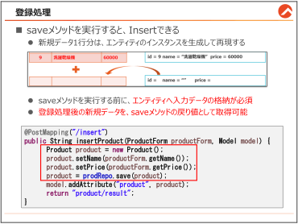{#p105-f39}

::: {#p105-b02 .heading}

[新規データ登録について]{.s010}

:::

::: {#p105-b03 .paragraph}

[今までは、検索関連のデータベース操作を行う方法について学びました。次は、データを]{.s009}\
[新しく登録する方法について学びます。]{.s009}

:::

::: {#p105-b04 .paragraph}

[既存のデータベースプログラミングだと、登録も手間がかかるのですが、Form クラスと、]{.s009}\
[Spring Data JPA の「save」メソッド使うことで、より簡単に登録作業ができます。]{.s009}

:::

:::

::: {#page-106 .source-page}

::: {#p106-b01 .heading}

[データ入力フォーム作成]{.s010}

:::

::: {#p106-b02 .paragraph}

[まずは、ユーザから登録データを入力してもらうためのView を作成するところからです。]{.s009}

:::

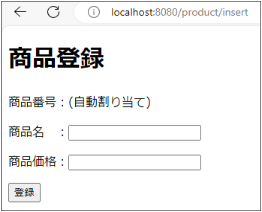{#p106-f40}

::: {#p106-b03 .heading}

[【作業手順①】]{.s010}[&#32;入力View 遷移用メソッドの定義]{.s011}

:::

::: {#p106-b04 .paragraph}

[…/controller/ProductController.java]{.s011}

:::

::: {#p106-b05 .code}

```java
//findByNameAndPrice メソッドの下に追記

@GetMapping("/insert")
        public String showProductInsertView() {
               return "product/insert";
        }
```

:::

::: {#p106-b06 .paragraph}

[まず、product フォルダのinsert.html へ遷移させるだけの、View 遷移用メソッドを作成しま]{.s009}\
[す。product/insert のURL がリクエストされると、このメソッドにより、入力ページへ遷移するよう]{.s009}\
[にします。]{.s009}

:::

:::

::: {#page-107 .source-page}

::: {#p107-b01 .heading}

[【作業手順②】]{.s010}[&#32;入力View 作成]{.s011}

:::

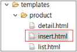{#p107-f41}

::: {#p107-b02 .paragraph}

[…/resources/templates/product/insert.html]{.s011}

:::

::: {#p107-b03 .code}

```xml
<!--<body>前は省略-->
<body>
        <h1>商品登録</h1>
        <form th:action = "@{/product/insert}" method = "POST">
        <p>商品番号：(自動割り当て)</p>
        <p>商品名 ：<input type = "text" name = "name"></p>
        <p>商品価格：<input type = "text" name = "price"></p>
        <input type = "submit" value = "登録">
        </form>
</body>
```

:::

::: {#p107-b04 .paragraph}

[th:action 属性値にご注目ください。Ｖｉｅｗへ遷移する時も、「/product/insert」で、submit ボ]{.s009}\
[タンをクリックした時も、「/product/insert」にしていますが、POST 形式でリクエストを送っている]{.s009}\
[ため、別々のメソッドを呼び出すことができます。]{.s009}

:::

::: {#p107-b05 .paragraph}

[商品登録(id)は、自動割り当てになっているため、入力しないようにします。]{.s009}

:::

:::

::: {#page-108 .source-page}

::: {#p108-b01 .heading}

[【作業手順③】]{.s010}[&#32;ProductForm の定義]{.s011}

:::

::: {#p108-b02 .paragraph}

[登録データは、通常複数のデータを扱うため、2 章でご紹介しましたForm クラスを利用すると]{.s009}\
[便利です。現在、Product エンティティはあるものの、ProductForm が定義されていませんの]{.s009}\
[で、定義します。]{.s009}

:::

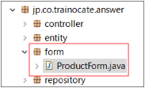{#p108-f42}

::: {#p108-b03 .paragraph}

[…/form/ProductForm.java]{.s011}

:::

::: {#p108-b04 .code}

```java
1:package jp.co.trainocate.answer.form;
2:
3:import lombok.Data;
4:
5:@Data
6:public class ProductForm {
7: private Integer id; //商品番号
8: private String name; //商品名
9: private Integer price; //商品価格
10:}
```

:::

::: {#p108-b05 .paragraph}

[商品関連のデータを扱うために、\[id\]と、\[name\], \[price\]をフィールドとして持つForm クラスを]{.s009}\
[作成しました。\[id\]は登録時には使われませんが、他の処理で使われるので、書くべきです。]{.s009}

:::

::: {#p108-b06 .paragraph}

[5 行の@Data ですが、エンティティの定義の際にご説明しました通り、]{.s009}**[@Data アノテーションをつ]{.s014}**\
**[けると、Getter&Setter メソッドは勿論、equals やtoString、hashCode メソッドが自動生成され]{.s014}**\
**[ますので、とても便利です。]{.s014}**

:::

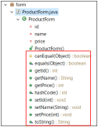{#p108-f43}

:::

::: {#page-109 .source-page}

::: {#p109-b01 .heading}

[【作業手順④】]{.s010}[&#32;登録処理メソッドの定義]{.s011}

:::

::: {#p109-b02 .paragraph}

[…/controller/ProductController.java]{.s011}

:::

::: {#p109-b03 .code}

```java
1://showProductInsertView()の下に追記
2:
3:@PostMapping("/insert")
4:public String insertProduct(ProductForm productForm, Model model) {
5:    Product product = new Product();
6:    product.setName(productForm.getName());
7:    product.setPrice(productForm.getPrice());
8:    product = prodRepo.save(product);
9:    model.addAttribute("product", product);
10:    return "/product/result";
11:}
```
:::

::: {#p109-b04 .paragraph}

[・]{.s015}[4 行目: public String insertProduct(ProductForm productForm) \{]{.s011}

:::

::: {#p109-b05 .paragraph}

[ユーザからの複数の入力値を受け取るために、productForm クラスをメソッドの引数に入れ]{.s009}\
[ます。リクエストデータは、Form クラスのフィールドに自動でセットされます。]{.s009}

:::

::: {#p109-b06 .paragraph}

[・5 行目: Product product = new Product();]{.s011}

:::

::: {#p109-b07 .paragraph}

[&#32;商品の登録をするためには、]{.s009}[予め商品1 個分をを表す、エンティティのインスタンスを生成]{.s011}\
[する必要があります]{.s011}[ので、new でProduct のオブジェクトを生成します。]{.s009}

:::

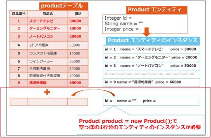{#p109-f44}

:::

::: {#page-110 .source-page}

::: {#p110-b01 .paragraph}

[・8 行目: product = prodRepo.save(product);]{.s011}

:::

::: {#p110-b02 .paragraph}

[&#32;先に説明します。Insert のSQL 文を実行させるためには、findAll と同じく、既にリポジトリに定]{.s009}\
[義されている、\[save\]メソッドを実行すれば、登録処理が完了します。]{.s009}

:::

::: {#p110-b03 .paragraph}

[しかし、エンティティのインスタンスであるproduct は、5 行でオブジェクト生成はしたものの、]{.s011}\
[データを入れないと、空っぽの状態のままになってしまいます。ユーザからのデータを受け取]{.s011}\
[っているのは、product ではなく、4 行のProductForm の方ですので、データをコピーする必要]{.s011}\
[があります。]{.s011}

:::

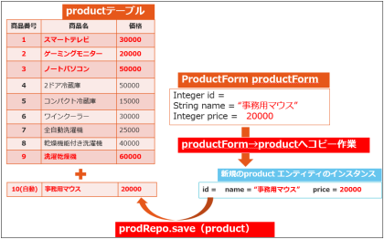{#p110-f45}

::: {#p110-b04 .paragraph}

[・6～7 行目: product.setName(productForm.getName());]{.s011}\
[product.setPrice(productForm.getPrice());]{.s011}

:::

::: {#p110-b05 .paragraph}

[save メソッドの実行前に、Form インスタンス内のデータを、product へコピーさせます。]{.s009}

:::

::: {#p110-b06 .paragraph}

[この作業により、空っぽだったproduct にも、ユーザからのデータが格納されました。]{.s009}

:::

::: {#p110-b07 .paragraph}

[・8-9 行目:&#32;]{.s011}[product]{.s031}[&#32;= prodRepo.save(product);]{.s011}\
[model.addAttribute("product", product);]{.s011}

:::

::: {#p110-b08 .paragraph}

[戻り値としては、登録完了した商品情報をエンティティのインスタンスとして取得]{.s011}[できます。ここ]{.s009}\
[には、自動割り当てされたid も含まれます。結果画面へ表示するため、model に格納します。]{.s009}

:::

::: {#p110-b09 .paragraph}

[・10 行目: return "/product/result";]{.s011}\
[本当に登録が完了したのか確認するために、商品データを出力する結果画面を表示させま]{.s009}\
[す。]{.s009}

:::

:::

::: {#page-111 .source-page}

::: {#p111-b01 .paragraph}

[…/resources/templates/product/result.html]{.s011}

:::

::: {#p111-b02 .code}

```java
1:<h1>商品・更新結果画面</h1>
 2: <table>
 3: <tr>
 4: <th>商品番号</th>
 5: <th>商品名</th>
 6: <th>価格</th>
 7: </tr>
 8: <tr>
 9: <td th:text="${product.id}"></td>
10: <td th:text="${product.name}"></td>
11: <td th:text="${product.price}"></td>
12: </tr>
13: </table>
14: <a th:href="@{/product/findAll}">商品一覧へ</a>
15:</body>
```

:::

::: {#p111-b03 .paragraph}

[9 行目のproduct.id に注目してください。save メソッドの戻り値には、自動採番により割り当てさ]{.s009}\
[れたID 番号も含まれているので、表示できます。]{.s009}

:::

::: {#p111-b04 .heading}

[動作確認]{.s010}

:::

::: {#p111-b05 .paragraph}

[http://localhost:8080/product/insert]{.s033}

:::

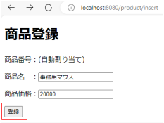{#p111-f46}

::: {#p111-b06 .paragraph}

[任意の値を入力し、\[登録\]ボタンをクリックすると、登録後の全件検索結果が表示されます。]{.s009}

:::

:::

::: {#page-112 .source-page}

{#p112-f47}

::: {#p112-b01 .paragraph}

[「商品一覧」をクリックすると、一覧画面に遷移します。]{.s009}

:::

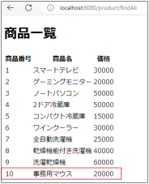{#p112-f48}

::: {#p112-b02 .paragraph}

[一覧でも新規データを確認できます。]{.s009}

:::

:::

::: {#page-113 .source-page}

::: {#p113-b01 .heading}

[【参考】 ModelMapper で「Form→Entity のデータコピー」を簡単にする方法]{.s010}

:::

::: {#p113-b02 .paragraph}

[今回の例では、入力値が2 つのみでしたので、コピー作業も2 行で終わりましたが、]{.s009}\
[例えば、会員登録ページとかなら、10 個以上の値を扱います。]{.s009}\
[その結果、10 行以上コードを書くことになり、冗長なコードになってしまいます。]{.s009}

:::

::: {#p113-b03 .paragraph}

[その問題を解決するために、「ModelMapper」という外部ライブラリを利用すると便利です。]{.s009}

:::

{#p113-f49}

::: {#p113-b04 .code}

```xml
<dependency>
    <groupId>org.modelmapper</groupId>
    <artifactId>modelmapper</artifactId>
    <version>3.2.6</version>
</dependency>
```
:::

::: {#p113-b05 .paragraph}

[まず、Maven を使って、ModelMapper を導入します。]{.s009}

:::

::: {#p113-b06 .paragraph}

[…/controller/ProductController.java]{.s011}

:::

::: {#p113-b07 .code}

```java
@PostMapping("/insert2")
public String insertProduct2(ProductForm productForm, Model model) {
    ModelMapper modelMapper = new ModelMapper();
    Product product = modelMapper.map(productForm, Product.class);
    product = prodRepo.save(product);
    model.addAttribute("product", product);
    return "product/result";
}
```
:::

{#p113-f50}

::: {#p113-b08 .paragraph}

[ModelMapper を利用するために、メソッドに上記のようにModelMapper のインスタンスを生成し]{.s009}\
[た後、]{.s009}\
[modelMapper.map(Form 名, Entity 名.class)]{.s011}[&#32;を実行した結果をエンティティの変数に代入する]{.s009}\
[と、]{.s009}[自動でForm クラス内のフィールド名と一致するエンティティ内のフィールドにコピーが行わ]{.s011}\
[れます。]{.s011}

:::

::: {#p113-b09 .paragraph}

[扱う入力値が多くなったら、是非こちらの方法を活用してみてください。]{.s009}

:::

:::

::: {#page-114 .source-page}

::: {#p114-b01 .heading}

[3\.7.&#32;]{.s004}[更新処理]{.s004}

:::

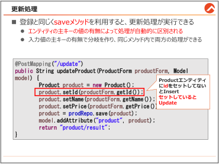{#p114-f51}

::: {#p114-b02 .heading}

[save メソッドは更新処理も可能]{.s010}

:::

::: {#p114-b03 .paragraph}

[登録と更新処理におけるSpring Data JPA の使い勝手の良さの一つは、両方の操作が同じ]{.s009}\
[save メソッドを使っていることです。]{.s009}

:::

::: {#p114-b04 .paragraph}

[save メソッドを使用することで、新しいレコードの挿入（登録）だけでなく、既存レコードの変]{.s009}\
[更（更新）も簡単に行えます。この柔軟性の秘密は、]{.s009}[エンティティの主キーの値の有無によっ]{.s011}\
[て処理が自動的に区別される]{.s011}[点にあります。]{.s009}

:::

::: {#p114-b05 .paragraph}

[登録（INSERT）処理：]{.s011}\
[新しいオブジェクト（エンティティ）を作成し、そのオブジェクトに主キーがまだ割り当てられてい]{.s009}\
[ない場合（null またはデフォルト値）、save メソッドは新しいレコードをデータベースに挿入する]{.s009}\
[SQL INSERT 文を実行します。]{.s009}

:::

::: {#p114-b06 .paragraph}

[更新（UPDATE）処理：]{.s011}\
[主キーが割り当てられているエンティティをsave メソッドの引数に渡すと、Spring Data JPA は]{.s009}\
[UPDATE 文を実行します。ここで重要なのは、主キーがすでに割り当てられているエンティテ]{.s009}\
[ィは、データベースにすでに存在しているとみなされるため、更新処理が行われます。]{.s009}

:::

:::

::: {#page-115 .source-page}

::: {#p115-b01 .paragraph}

[このアプローチは、コードの再利用性を高め、データベース処理をより直感的に行えるよう]{.s009}\
[にします。特に、]{.s009}[開発者が明示的にINSERT やUPDATE を意識する必要がなく、エンティティ]{.s011}\
[の状態に応じてSpring が適切な処理を自動的に行ってくれるため、開発効率が大幅に向上]{.s011}\
[します。エンティティのライフサイクル管理がこれほどシンプルになると、データモデルとビジネ]{.s009}\
[スロジックにより集中することができ、より洗練されたアプリケーションの開発が可能になります。]{.s009}

:::

::: {#p115-b02 .paragraph}

[では、本格的な実装の前に、まずは流れを把握しましょう。]{.s009}

:::

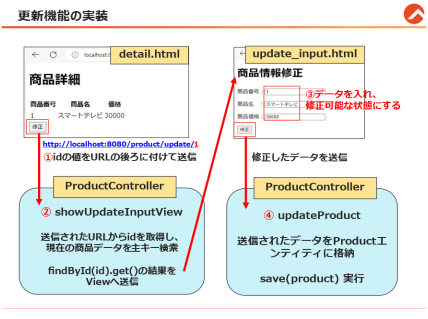{#p115-f52}

::: {#p115-b03 .paragraph}

[③の修正画面を開いた時、フォームには]{.s009}[現在の商品データが入力されている状態]{.s011}[です。それ]{.s009}\
[は、何もしなくても入力されているわけではなく、]{.s009}[事前に手順①と②を行った結果]{.s011}[です。]{.s009}

:::

::: {#p115-b04 .heading}

[更新処理は、他の処理とは違い、事前準備が必要だということを、是非理解した上]{.s010}

:::

::: {#p115-b05 .heading}

[で、進んでください。]{.s010}

:::

:::

::: {#page-116 .source-page}

::: {#p116-b01 .heading}

[【作業手順①】]{.s010}[&#32;詳細画面に、更新ボタンを実装するように修正]{.s011}

:::

::: {#p116-b02 .paragraph}

[更新処理は、まず更新させたい対象を絞る必要があります。]{.s009}[対象を絞る時は、主キーのデー]{.s011}\
[タがあれば特定できますので、主キーのデータをもらう必要があります。]{.s011}[その方法の一つとし]{.s009}\
[て、本書では、検索から遷移できる「詳細画面」にボタンを配置させました。]{.s009}

:::

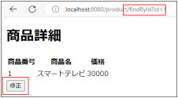{#p116-f53}

::: {#p116-b03 .paragraph}

[…/resources/templates/product/detail.html]{.s011}

:::

::: {#p116-b04 .code}

```xml
<!--</table>の下に追加 -->

<form th:action="@{/product/update/}+${product.id}">
        <input type = "submit" value = "修正">
</form>
```

:::

::: {#p116-b05 .paragraph}

[URL にご注目ください。/product/update/ の後ろに、+ でproduct.id を付加しています。こ]{.s009}\
[のように、Controller から取得した]{.s009}[データ（例えば、商品のID）をURL に組み込む]{.s011}[ことができま]{.s009}\
[す。これにより、特定の商品に関連したURL を動的に生成することが可能になります。]{.s009}

:::

::: {#p116-b06 .paragraph}

[その結果、submit ボタンをクリックすると、以下のような&#32;]{.s009}[URL が動的に生成]{.s011}[されますので、どの]{.s009}\
[商品を更新するかをController のメソッドへ明確に伝えることができます。]{.s009}

:::

::: {#p116-b07 .paragraph}

[http://localhost:8080/product/update/]{.s042}[1]{.s031}

:::

::: {#p116-b08 .paragraph}

[では、Controller のメソッドで商品番号1 を取得する方法についてご説明します。]{.s009}

:::

:::

::: {#page-117 .source-page}

::: {#p117-b01 .heading}

[【作業手順②】]{.s010}[&#32;更新対象データの既存データ取得]{.s011}

:::

::: {#p117-b02 .paragraph}

[…/controller/ProductController.java]{.s011}

:::

::: {#p117-b03 .code}

```java
1://insertProduct メソッドの下に追加
2:
3:@GetMapping("update/{id}")
4:public String showUpdateInputView(@PathVariable int id, Model model) {
5: Product product = prodRepo.findById(id).orElse(null);
6: model.addAttribute("product", product);
7: return "product/update_input";
8:}
```

:::

::: {#p117-b04 .paragraph}

[・3 行目: @GetMapping("update]{.s043}[/\{id\}]{.s031}[")]{.s043}\
[View から動的URL が送られる場合、同じく動的パラメータを指定する必要があります。]{.s044}\
[書き方は、\{ パラメータ名 \} で記載します。]{.s044}

:::

::: {#p117-b05 .paragraph}

[・4 行目: public String showUpdateInputView(]{.s043}[@PathVariable]{.s031}[&#32;int id, Model model) \{]{.s043}

:::

::: {#p117-b06 .paragraph}

[3 行で指定した動的URLの文字列と一致する引数名に]{.s044}[@PathVariable アノテーションをつけ]{.s043}\
[ると、動的URL の値を取得]{.s043}[することができます。動的URL は、\{id\}なので、int id で合わせま]{.s044}\
[す。]{.s044}

:::

::: {#p117-b07 .paragraph}

[5 行からは、更新対象の既存の値をfindById メソッドで取得+Model に格納し、]{.s044}\
[update\_input.html へ遷移させています。]{.s044}

:::

:::

::: {#page-118 .source-page}

::: {#p118-b01 .heading}

[【作業手順③】]{.s010}[&#32;修正フォーム（update\_input.html）の作成]{.s011}

:::

{#p118-f54}

::: {#p118-b02 .paragraph}

[showUpdateInputView メソッドのreturn により、既存のデータが表示されている画面へ遷移しま]{.s009}\
[す。]{.s009}

:::

::: {#p118-b03 .paragraph}

[…/resources/templates/product/update\_input.html]{.s011}

:::

::: {#p118-b04 .code}

```xml
<h1>商品情報修正</h1>
<form th:action = "@{/product/update}" method = "POST">
<p>商品番号：
<input type = "text" name = "id" th:value = "${product.id}" readonly></input></p>
<p>商品名 ：
<input type = "text" name = "name" th:value = "${product.name}"></p>
<p>商品価格：
<input type = "text" name = "price" th:value = "${product.price}"></p>
<input type = "submit" value = "修正">
</form>
```

:::

::: {#p118-b05 .paragraph}

[初めての構文として、「th:value」が登場しました。]{.s009}

:::

::: {#p118-b06 .paragraph}

[th:value は、Controller のmodel に格納されているデータをHTML 上で取得して、フォーム内]{.s011}\
[に表示]{.s011}[するThymeleaf 独自の属性です。間違えて、ただの「value=“”」にすると、値を取得する]{.s009}\
[ことができませんので、ご注意ください。]{.s009}

:::

::: {#p118-b07 .paragraph}

[商品番号は主キーであり、変更してはいけませんので、readonly の属性を付与して、修正不可]{.s009}\
[にしました。]{.s009}

:::

::: {#p118-b08 .paragraph}

[「修正」のsubmit ボタンをクリックすると、フォーム内の入力データ値が全てリクエストパラメータ]{.s009}\
[として/product/update のURL へ送信されます。]{.s009}

:::

:::

::: {#page-119 .source-page}

::: {#p119-b01 .heading}

[【作業手順④】]{.s010}[&#32;修正処理メソッドの定義]{.s011}

:::

::: {#p119-b02 .paragraph}

[…/controller/ProductController.java]{.s011}

:::

::: {#p119-b03 .code}

```java
1:@PostMapping("/update")
2:public String updateProduct(ProductForm productForm, Model model) {
3: Product product = new Product();
4: product.setId(productForm.getId());
5: product.setName(productForm.getName());
6: product.setPrice(productForm.getPrice());
7: product = prodRepo.save(product);
8:      model.addAttribute("product", product);
9: return "/product/result";
10:}
```

:::

::: {#p119-b04 .paragraph}

[・4 行目：product.setId(productForm.getId());]{.s011}

:::

::: {#p119-b05 .paragraph}

[&#32;登録の際は、主キーである「id」をProductエンティティ内にセットしていませんでしたが、更新]{.s009}\
[処理の際は、必ず主キーのフィールドをセットさせます。]{.s009}

:::

::: {#p119-b06 .paragraph}

[・7 行目：product = prodRepo.save(product);]{.s011}

:::

::: {#p119-b07 .paragraph}

[&#32;save メソッドの引数に入れたエンティティのフィールドに、主キー(id)の値があったら、新しい]{.s009}\
[値に上書きされる更新処理が実行されます。]{.s009}

:::

::: {#p119-b08 .paragraph}

[その他のコードの解説は、登録と同じですので、割愛します。]{.s009}

:::

:::

::: {#page-120 .source-page}

::: {#p120-b01 .heading}

[動作確認]{.s010}

:::

::: {#p120-b02 .paragraph}

[http://localhost:8080/product/&#32;&#32;]{.s033}[]{.s034}[product の後ろに必ず/を付けてください。]{.s031}

:::

{#p120-f55}

::: {#p120-b03 .paragraph}

[商品番号に、\[2\]を入力し、\[検索\]ボタンをクリックします。]{.s009}

:::

{#p120-f56}

::: {#p120-b04 .paragraph}

[商品番号2 番に対する商品データを確認し、\[修正\]ボタンをクリックします。]{.s009}

:::

{#p120-f57}

::: {#p120-b05 .paragraph}

[商品名と商品価格を任意の値で修正し、\[修正\]ボタンをクリックします。]{.s009}

:::

:::

::: {#page-121 .source-page}

{#p121-f58}

::: {#p121-b01 .paragraph}

[商品一覧ページへ遷移し、2 番の商品が修正されていることを確認します。]{.s009}

:::

::: {#p121-b02 .heading}

[【参考】 登録と更新の処理を一つにする方法]{.s010}

:::

::: {#p121-b03 .paragraph}

[…/controller/ProductController.java]{.s011}

:::

::: {#p121-b04 .code}

```java
 1:@PostMapping("/insertOrUpdate")
 2:public String insertOrUpdateProduct(ProductForm productForm) {
 3: Product product = new Product();
 4:    if (productForm.getId() != null) {
 5:        // ID がある場合は、既存の商品として扱い、そのID を設定
 6:        product.setId(productForm.getId());
 7:    }
 8:    product.setName(productForm.getName());
 9:    product.setPrice(productForm.getPrice());
      // 新しい商品を追加または既存の商品更新
10:    product = prodRepo.save(product);
      // ～～割愛～～
```

:::

::: {#p121-b05 .paragraph}

[上記のコードは、単純の分岐ですが、登録と更新を一つにまとめることができるので、開発効]{.s009}\
[率を高めることができます。]{.s009}

:::

:::

::: {#page-122 .source-page}

::: {#p122-b01 .heading}

[3\.8.&#32;]{.s004}[削除処理]{.s004}

:::

{#p122-f59}

::: {#p122-b02 .paragraph}

[削除については、更新と同じようなコードを使います。]{.s009}

:::

:::

::: {#page-123 .source-page}

::: {#p123-b01 .heading}

[【作業手順①】]{.s010}[&#32;詳細画面に削除ボタンを追加]{.s011}

:::

{#p123-f60}

::: {#p123-b02 .paragraph}

[…/resources/templates/product/detail.html]{.s011}

:::

::: {#p123-b03 .code}

```xml
<!-- detail.html に削除ボタンを追加 -->

<form th:action="@{/product/delete/}+${product.id}">
        <input type = "submit" value = "削除">
</form>
```

:::

::: {#p123-b04 .paragraph}

[Update と同様に、th:action を活用して商品番号をURL に付けて送信します。]{.s009}

:::

::: {#p123-b05 .heading}

[【作業手順②】 削除処理のメソッドを定義]{.s010}

:::

::: {#p123-b06 .paragraph}

[…/controller/ProductController.java]{.s011}

:::

::: {#p123-b07 .code}

```java
//省略

@GetMapping("/delete/{id}")
        public String deleteProduct(@PathVariable int id) {
               prodRepo.deleteById(id);
               return "redirect:/product/findAll";
        }
```

:::

::: {#p123-b08 .paragraph}

[URL からid を取得し、どの商品を削除するかを決めます。]{.s009}

:::

::: {#p123-b09 .paragraph}

[削除用のメソッドは、deleteById(id)を実行すれば、以下の削除SQL 文が実行されます。]{.s009}

:::

::: {#p123-b10 .paragraph}

[「DELETE FROM product WHERE id = ?」]{.s015}

:::

::: {#p123-b11 .paragraph}

[本当に削除が完了したのか確認するために、全件検索ページを呼び出したいところです]{.s009}\
[が、全件検索は、html ファイルではなく、findAll メソッドを実行していました。]{.s009}

:::

:::

::: {#page-124 .source-page}

::: {#p124-b01 .paragraph}

[つまり、]{.s009}[returnでhtmlではなく、メソッドを呼び出すURLを指定する必要がある]{.s011}[ということです。]{.s009}

:::

::: {#p124-b02 .paragraph}

[その時は、]{.s009}[return “redirect:/ \[呼び出したいURL\]”]{.s011}[&#32;の書き方にします。]{.s009}

:::

{#illustration-expansion-2026-redirect-new-request}

::: {#illustration-expansion-2026-redirect-new-request-caption .paragraph}

redirect:で移動先を受け取ったブラウザーが、新しいリクエストで一覧ページを取得します。

:::

::: {#p124-b03 .heading}

[動作確認]{.s010}

:::

::: {#p124-b04 .paragraph}

[http://localhost:8080/product/&#32;&#32;]{.s033}[]{.s034}[product の後ろに必ず/を付けてください。]{.s031}

:::

{#p124-f61}

::: {#p124-b05 .paragraph}

[任意の商品番号を検索します。]{.s009}

:::

{#p124-f62}

::: {#p124-b06 .paragraph}

[削除ボタンをクリックします。]{.s009}

:::

{#p124-f63}

::: {#p124-b07 .paragraph}

[商品が削除されたのを確認できればOK です。]{.s009}

:::

:::

::: {#page-125 .source-page}

::: {#p125-b01 .heading}

[3\.9.&#32;]{.s004}[【参考】 Service クラスでビジネスロジックを分離]{.s004}

:::

{#p125-f64}

::: {#p125-b02 .paragraph}

[これまでの例では、簡単に理解できるように、Controller クラスの中にデータベース処理など]{.s009}\
[のビジネスロジックも書いていました。]{.s009}

:::

::: {#p125-b03 .paragraph}

[しかし、本来Controller の役割は、データのやり取りと画面の移動にあります。より良い保守]{.s009}\
[性を実現するために、実際の開発現場では]{.s009}[「Service インターフェース」と「Service 実装クラ]{.s011}\
[ス」と呼ばれる専門の部品を2 つ作り]{.s011}[、ビジネスロジック（例えば、データベース操作）を集めま]{.s009}\
[す。]{.s009}

:::

::: {#p125-b04 .heading}

[Service クラスの目的と役割]{.s010}

:::

::: {#p125-b05 .paragraph}

[コントローラーは主にHTTP リクエストの受け取りとレスポンスの送信、画面遷移の管理を行い]{.s009}\
[ます。一方で、Service クラスはビジネスロジック（例えば、データの検証、計算、データベース]{.s009}\
[の操作など）を担当します。]{.s009}\
[Service クラスにビジネスロジックを集中させることで、コードの再利用性が高まり、変更や拡張]{.s009}\
[が容易になります。また、コードが整理され、各クラスの役割が明確になるため、保守しやすく]{.s009}\
[なります。]{.s009}

:::

:::

::: {#page-126 .source-page}

::: {#p126-b01 .heading}

[サービスインターフェースとサービス実装クラスを分けるメリット]{.s010}

:::

::: {#p126-b02 .paragraph}

[インターフェースと実装クラスの2 つに分けて作成する理由は、メリットがあるからです。]{.s009}\
[まずは、以下の例えでイメージを持ってください。]{.s009}

:::

::: {#p126-b03 .paragraph}

[例え: テレビのリモコンと本体]{.s011}

:::

::: {#p126-b04 .paragraph}

[◼&#32;]{.s046}[サービスインターフェース: テレビの「リモコン」]{.s011}

:::

::: {#p126-b05 .paragraph}

[テレビの電源をつけたり、音量を調整したりする「入口」。]{.s009}

:::

::: {#p126-b06 .paragraph}

[リモコンの操作方法は変わらない（電源ボタンを押せばテレビがつく）。]{.s009}

:::

::: {#p126-b07 .paragraph}

[◼&#32;]{.s046}[サービス実装クラス: テレビの「本体」]{.s011}

:::

::: {#p126-b08 .paragraph}

[実際に映像や音を出す機械。]{.s009}

:::

::: {#p126-b09 .paragraph}

[本体の仕組みは変わるかもしれない（電源の音が変わるとか）が、リモコンの使い方]{.s009}\
[は変わらない。]{.s009}

:::

::: {#p126-b10 .paragraph}

[メリット➀：柔軟性が高くなる]{.s011}

:::

::: {#p126-b11 .paragraph}

[◼&#32;]{.s046}[分けない場合:]{.s011}\
[実装が変わると、呼び出している全ての場所（Controller など）を修正しないといけな]{.s009}\
[い。]{.s009}

:::

::: {#p126-b12 .paragraph}

[◼&#32;]{.s046}[分けた場合:]{.s011}\
[リモコン（インターフェース）を使って呼び出すため、実装（テレビ本体）が変わってもリ]{.s009}\
[モコンの使い方は変わらない。]{.s009}

:::

::: {#p126-b13 .paragraph}

[メリット➁：実装を切り替えやすい]{.s011}

:::

::: {#p126-b14 .paragraph}

[現場では、以下のような場面で実装を切り替えることがよくあります。]{.s009}

:::

::: {#p126-b15 .paragraph}

[◼&#32;]{.s046}[データベース→外部API: データの取得元を変更したい。]{.s015}

:::

::: {#p126-b16 .paragraph}

[◼&#32;]{.s046}[動作確認用のダミー: テスト環境では、ダミーのデータを返すモッククラスを使いた]{.s015}\
[い。]{.s009}

:::

::: {#p126-b17 .paragraph}

[このような場合、実装クラスを切り替えるだけで、テスト環境や新しい仕様に対応可能になり]{.s009}\
[ますので、インターフェースと実装クラスを分けるわけです。]{.s009}

:::

:::

::: {#page-127 .source-page}

::: {#p127-b01 .heading}

[【作業手順①】サービス]{.s011}[インターフェースの作成]{.s010}

:::

{#p127-f65}

::: {#p127-b02 .paragraph}

[&#32;\[service\]パッケージを作成し、その中に\[ProductService\]]{.s009}[インターフェース]{.s011}[を作成します。]{.s009}

:::

::: {#p127-b03 .paragraph}

[…/service/ProductService.java]{.s011}

:::

::: {#p127-b04 .code}

```java
package jp.co.trainocate.answer.service;

import jp.co.trainocate.answer.entity.Product;

public interface ProductService {
        public Product findProductById(int id);
}
```

:::

::: {#p127-b05 .paragraph}

[&#32;&#32;学習のため、主キー検索の機能をする抽象メソッドのみ実装します。]{.s009}

:::

::: {#p127-b06 .paragraph}

[インターフェースは]{.s009}[リモコンだと思ってください。リモコンにはボタンが必要です。リモコンの]{.s011}\
[ボタンは抽象メソッドとして表現します。]{.s011}

:::

::: {#p127-b07 .paragraph}

[&#32;&#32;ですので、メソッドの書き方は、JPA のリポジトリに検索用のメソッドを定義していた時と似て]{.s009}\
[います。この処理をするためには、どんな引数が必要そうか、どんな戻り値を戻せばいいの]{.s009}\
[かを考えます。]{.s009}

:::

::: {#p127-b08 .paragraph}

[リポジトリのような、メソッド名の規則は特にありません。どんなメソッドなのか意味が通じるメソ]{.s009}\
[ッド名で大丈夫です。]{.s009}

:::

::: {#p127-b09 .paragraph}

[ただのボタンですので、具体的な処理は書かずに、引数と戻り値だけ決めた抽象メソッド]{.s011}\
[として作成]{.s011}[しておきます。]{.s009}

:::

:::

::: {#page-128 .source-page}

::: {#p128-b01 .heading}

[【作業手順②】 サービス実装クラスの作成]{.s011}

:::

{#p128-f66}

::: {#p128-b02 .paragraph}

[サービスインターフェースで、リモコンのボタン(抽象メソッド)の定義が完了したら、]{.s009}[リモコン]{.s011}\
[のボタンを押した時に実際に処理をする側の、「サービス実装クラス」をセットで作成]{.s011}[する必要]{.s009}\
[があります。]{.s009}

:::

::: {#p128-b03 .paragraph}

[JPA のリポジトリは、リモコンのボタンさえ作っておけば、実際の処理をするメソッドは裏で自]{.s009}\
[動生成されましたが、]{.s009}[サービスの場合は、自作で抽象メソッド一つ一つの具体的な実装が必]{.s011}\
[要]{.s011}[です。]{.s009}

:::

::: {#p128-b04 .paragraph}

[サービス実装クラスは、サービスインターフェース名に+「Impl」を追加した名前に合わせるの]{.s009}\
[が一般的です。]{.s009}

:::

::: {#p128-b05 .paragraph}

[…/service/ProductServiceImpl.java]{.s011}

:::

::: {#p128-b06 .code}

```java
 1:import jp.co.trainocate.answer.entity.Product;
 2:import jp.co.trainocate.answer.repository.ProductRepository;
 3:import lombok.RequiredArgsConstructor;
 4:
 5:@Service
 6:@RequiredArgsConstructor
 7:public class ProductServiceImpl implements ProductService{
 8:
 9: //@Autowired は不要
10: private final ProductRepository prodRepo;
11:
12: @Override
13: public Product findProductById(int id) {
14: return prodRepo.findById(id).orElse(null);
15: }
16:}
```

:::

:::

::: {#page-129 .source-page}

::: {#p129-b01 .paragraph}

[・5 行目： @Service]{.s011}\
[サービス実装クラスには、@Service アノテーションを付けます。忘れがちですので、注意して]{.s009}\
[ください。]{.s009}

:::

::: {#p129-b02 .paragraph}

[・6 行目： @RequiredArgsConstructor]{.s011}

:::

::: {#p129-b03 .step}

[3\.3.1「依存性の注入」の【依存性の注入方法③】でご紹介した書き方です。]{.s009}

:::

::: {#p129-b04 .paragraph}

[9-10 行目のコードと連携します。]{.s009}\
[単体テストのしやすさのために、サービス実装クラスではこの方法が推奨されます。]{.s009}

:::

::: {#p129-b05 .paragraph}

[・7 行目： implements ProductService]{.s011}\
[前の手順で作成たサービスインターフェースと繋げるために、implements します。]{.s009}

:::

::: {#p129-b06 .paragraph}

[・9 行-10 行目： private final ProductRepository prodRepo;]{.s011}

:::

::: {#p129-b07 .paragraph}

[DB 処理のためProductRepository を利用したいので、依存性の注入を行います。]{.s009}\
[6 行目と合わせて記載することで、コンストラクタを自動生成できます。]{.s009}

:::

::: {#p129-b08 .paragraph}

[・13 行-14 行目： return prodRepo.findById(id).orElse(null);]{.s011}

:::

::: {#p129-b09 .paragraph}

[Controller に記載していたDB 処理部分だけ分離させ、DB から取得した商品データをその]{.s009}\
[ままreturn しています。ProductService インターフェースで定義した抽象メソッドと同じ呼び]{.s009}\
[方をするように、オーバーライドする必要があります。]{.s009}\
[(リモコンのボタンを押したら、このメソッドの処理が行われるイメージ)]{.s009}

:::

:::

::: {#page-130 .source-page}

::: {#p130-b01 .heading}

[【作業手順③】 Controller からService クラスを経由してDB 操作を行う]{.s010}

:::

{#p130-f67}

::: {#p130-b02 .paragraph}

[Service クラスを経由するController は、混線を避けるため、]{.s009}\
[\[ProductController2\]で新規作成しました。]{.s009}

:::

::: {#p130-b03 .paragraph}

[…/controller/ProductController2.java]{.s011}

:::

::: {#p130-b04 .code}

```java
 1:@Controller
 2:@RequestMapping("product2")
 3:
 4:public class ProductController2 {
 6:    @Autowired
 7: private ProductService prodService;
 8:
 9://～省略～
10:
11: @GetMapping("/findById")
12: public String showProductById(int id, Model model) {
13: Product product = prodService.findProductById(id);
14: model.addAttribute("product", product);
15: return "product/detail";
16:   }
```

:::

::: {#p130-b05 .paragraph}

[・2 行目: @RequestMapping("product2")]{.s011}

:::

::: {#p130-b06 .paragraph}

[&#32;&#32;Controller が変わったので、異なる基本URL を設定します。]{.s009}

:::

::: {#p130-b07 .paragraph}

[・7 行目： private ProductService prodService;]{.s014}

:::

::: {#p130-b08 .paragraph}

[DB処理は、ProductServiceの方で担当]{.s031}[するので、このクラスで利用できるように、依存性の]{.s009}\
[注入を行います。既存のProductRepository の依存性の注入は不要になります。]{.s009}

:::

::: {#p130-b09 .paragraph}

[・13 行目： Product product = prodService.findProductById(id);]{.s011}

:::

::: {#p130-b10 .paragraph}

[&#32;ここが一番大事です。今までは、Controller のメソッドの中で直接「prodRepo.メソッド」を実]{.s009}\
[行する書き方でしたが、今回はServiceクラスに定義されているメソッドを実行させて、その戻]{.s009}\
[り値を利用する書き方になりました。]{.s009}

:::

:::

::: {#page-131 .source-page}

::: {#p131-b01 .paragraph}

[「ProductService」インターフェース型のインスタンスからメソッドを呼び出していますが、]{.s009}\
[「ProductServiceImpl」クラスに具体的な処理がオーバーライドされているので、実際は]{.s009}\
[「ProductServiceImpl」のメソッドがポリモフィズムで実行されるようになります。]{.s009}

:::

::: {#p131-b02 .paragraph}

[このような書き方をすることで、]{.s009}[Controller はあくまでデータの受け渡しの役割に集中させ、]{.s031}\
[ビジネスロジック(DB 処理)はService クラスで行わせます。]{.s031}

:::

{#p131-f68}

::: {#p131-b03 .paragraph}

[※基礎URL がproduct2 になるので、product2 フォルダに同じhtml を格納する必要がありま]{.s015}\
[す。]{.s015}

:::

::: {#p131-b04 .paragraph}

[※その他の例は、\[ProductController2.java\]と、\[ProductService.java\]、]{.s015}\
[\[ProductServiceImpl.java\]を参照してください。]{.s015}

:::

:::

::: {#page-132 .source-page}

::: {#p132-b01 .heading}

[章のまとめ]{.s004}

:::

{#p132-f69}

::: {#p132-b02 .paragraph}

[この章では、]{.s009}[Spring Data JPA]{.s007}[&#32;を使った、データ操作方法についてご説明しました。]{.s009}

:::

:::
