<!-- 元PDF 133〜163ページ。Java 21・Spring Boot 4.0.2対応版。 -->

::: {#page-133 .source-page}

::: {#p133-b01 .heading}

[&#32;4]{.s005}

:::

::: {#p133-b02 .heading}

[第4章&#32;]{.s001}[セッションと入力チェック]{.s001}

:::

::: {#p133-b03 .heading}

[章の目標]{.s002}

:::

::: {#p133-b04 .heading}

[◼&#32;]{.s003}[ID とパスワードによる認証処理を実装できる]{.s004}

:::

::: {#p133-b05 .heading}

[◼&#32;]{.s003}[セッションへのデータ保持と、活用方法について理解できる]{.s004}

:::

::: {#p133-b06 .heading}

[◼&#32;]{.s003}[入力チェックとエラーハンドリングを理解し、実装できる]{.s004}

:::

:::

::: {#page-134 .source-page}

:::

::: {#page-135 .source-page}

::: {#p135-b01 .heading}

[章の概要]{.s008}

:::

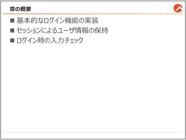{#p135-f01}

::: {#p135-b02 .paragraph}

[この章では、ログイン機能を実装する中で、セッションを活用する方法と、様々な入力チェッ]{.s009}\
[クを簡単にできる方法をご説明します。そして、エラーメッセージの出力を動的に変える方法]{.s009}\
[についてもご紹介します。]{.s009}

:::

:::

::: {#page-136 .source-page}

::: {#p136-b01 .heading}

[4\.1.&#32;]{.s004}[基礎的なログイン機能の実装]{.s004}

:::

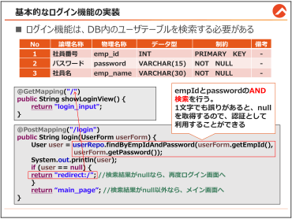{#p136-f02}

::: {#p136-b02 .paragraph}

[今まで学習した内容を踏まえて、ログイン機能を実装してみましょう。ログインには、id とパス]{.s009}\
[ワードの値を持っているテーブルが必要となりますので、新たに「ユーザ」テーブルを利用しま]{.s009}\
[す。テーブルとデータは既にspring\_sample データベースに格納済みです。]{.s009}

:::

::: {#p136-b03 .heading}

[【参考】＜User テーブル＞]{.s010}

:::

::: {#p136-table01 .table has-header="true"}

| No | 論理名称 | 物理名称 | データ型 | 制約 | 備考 |
| --- | --- | --- | --- | --- | --- |
| 1 | 社員番号 | emp\_id | INT | PRIMARY KEY | - |
| 2 | パスワード | password | VARCHAR(15) | NOT NULL | - |
| 3 | 社員名 | emp\_name | VARCHAR(30) | NOT NULL | - |

:::

::: {#p136-b04 .heading}

[【参考】＜初期データ＞]{.s010}

:::

::: {#p136-table02 .table has-header="true"}

| emp\_id | password | emp\_name |
| --- | --- | --- |
| 123456 | pass1234 | 山田太郎 |
| 234567 | pass2345 | 佐藤花子 |
| 345678 | pass3456 | 鈴木一郎 |

:::

:::

::: {#page-137 .source-page}

::: {#p137-b01 .heading}

[【事前準備①】 エンティティの定義]{.s013}

:::

::: {#p137-b02 .paragraph}

[…/enitity/User.java]{.s010}

:::

::: {#p137-b03 .code}

```java
 1:@Data
 2:@Entity
 3:@Table(name = "user")
 4:public class User {
 5:
 6: @Id
 7:    private Integer empId;
 8:
 9:    @Column(length = 15, nullable = false)
10:    private String password;
11:
12:    @Column(name = "emp_name", length = 30, nullable = false)
13:    private String empName;
14:}
```

:::

::: {#p137-b04 .paragraph}

[User テーブルを利用しますので、User エンティティも新しく定義する必要があります。]{.s010}

[エンティティの定義については、前の章のProduct とほぼ同じですが、12 行のname 属性を見]{.s009}\
[てください。テーブル内の列名は\[emp\_name\]ですが、Java&#32;]{.s009}[では通常、変数名の単語ごとの区]{.s009}\
[切りに「アンダースコア(\_)」を入れるよりは、大文字と小文字の組み合わせにする、「キャーメル]{.s009}\
[ケース」を使います。]{.s009}

[よって、テーブル内の列名と変数名に違いが発生したら、明示的にname&#32;]{.s010}[属性をつける必要]{.s010}\
[があります。]{.s010}

:::

::: {#p137-b05 .heading}

[【事前準備②】&#32;]{.s013}[リポジトリの定義]{.s010}

:::

::: {#p137-b06 .paragraph}

[…/repository/UserRepository.java]{.s010}

:::

::: {#p137-b07 .code}

```java
package jp.co.trainocate.answer.repository;

import org.springframework.data.jpa.repository.JpaRepository;
import jp.co.trainocate.answer.entity.User;

public interface UserRepository extends JpaRepository<User, Integer>{

}
```

:::

::: {#p137-b08 .paragraph}

[エンティティの次は、リポジトリです。3章の定義方法と同様ですので、説明は割愛いたします。]{.s009}

:::

:::

::: {#page-138 .source-page}

::: {#p138-b01 .heading}

[【事前準備③】]{.s013}[Form クラス定義]{.s010}

:::

::: {#p138-b02 .paragraph}

[…/form/UserForm.java]{.s010}

:::

::: {#p138-b03 .code}

```java
package jp.co.trainocate.answer.form;

import lombok.Data;

@Data
public class UserForm {

    private Integer empId;
    private String password;
    private String empName;
}
```

:::

::: {#p138-b04 .paragraph}

[複数の値をユーザから入力してもらうため、Form クラスを用意する必要があります。]{.s009}\
[Getter&Setter メソッドや、toString メソッドなどの定義は、lombok ライブラリの@Data をまた利用]{.s009}\
[します。2 章の定義方法と同様ですので、説明は割愛いたします。]{.s009}

:::

::: {#p138-b05 .heading}

[【作業手順①】 LoginController の作成と、ログイン画面遷移用のメソッド作成]{.s013}

:::

::: {#p138-b06 .paragraph}

[…/controller/LoginController.java]{.s010}

:::

::: {#p138-b07 .code}

```java
@Controller
public class LoginController {
        @Autowired
        private UserRepository userRepo;

        @GetMapping("/")
        public String showLoginView() {
               return "login_input";
        }
```

:::

::: {#p138-b08 .paragraph}

[これから、データベースとやり取りをする予定ですので、user テーブルを操作できるように、]{.s009}\
[UserRepository の依存性の注入をしました。]{.s009}

[localhost:8080/]{.s012}[&#32;をブラウザに入力すると、ログイン画面へ遷移します。]{.s009}

:::

:::

::: {#page-139 .source-page}

::: {#p139-b01 .heading}

[【作業手順②】 ログイン画面の作成]{.s013}

:::

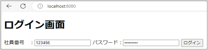{#p139-f03}

::: {#p139-b02 .paragraph}

[…/resources/templates/login\_input.html]{.s010}

:::

::: {#p139-b03 .code}

```xml
<body>
<h1>ログイン画面</h1>

<form th:action = "@{/login}" method = "post">
社員番号 ：<input type = "text" name = "empId"/>
パスワード：<input type = "password" name = "password"/>
<input type = "submit" value = "ログイン">
</form>
</body>
```

:::

::: {#p139-b04 .paragraph}

[2&#32;]{.s009}[章で作成したログイン画面をそのまま使います。社員番号は、UserForm&#32;]{.s009}[のフィールド名と合]{.s009}\
[わせるために、\[empId\]へ修正しました。]{.s009}

:::

::: {#p139-b05 .heading}

[【作業手順③】 リポジトリにID とパスワードのAnd 検索メソッドの定義]{.s013}

:::

::: {#p139-b06 .paragraph}

[…/repository/UserRepository.java]{.s010}

:::

::: {#p139-b07 .code}

```java
public interface UserRepository extends JpaRepository<User, Integer>{
      public User findByEmpIdAndPassword(Integer empId, String password);
}
```

:::

::: {#p139-b08 .paragraph}

[login\_input.html&#32;]{.s009}[で送信した]{.s009}[社員ID&#32;]{.s010}[とパスワードが正しいかどうか判定するため]{.s010}[に、empId&#32;]{.s009}[と]{.s009}\
[password のAnd 検索メソッドを定義します。]{.s009}

[主キー検索を含むため、1&#32;]{.s009}[行しか取得できないメソッドです。よって、戻り値はエンティティ名の]{.s009}\
[User にします。]{.s009}

[引数として、empId とpassword を入れるように定義します。]{.s009}

:::

:::

::: {#page-140 .source-page}

::: {#p140-b01 .heading}

[【作業手順④】&#32;]{.s013}[ログイン認証メソッドの定義]{.s010}

:::

::: {#p140-b02 .paragraph}

[…/controller/LoginController.java]{.s010}

:::

::: {#p140-b03 .code}

```java
1:@PostMapping("/login")
2:public String login(UserForm userForm) {
3: User user = userRepo.findByEmpIdAndPassword(userForm.getEmpId(),
                   userForm.getPassword());
4: System.out.println(user);
5: if (user == null) { //結果がnull なら、再度ログイン画面へ
6: return "redirect:/";
7: }
8: return "main_page";
9:}
```

:::

::: {#p140-b04 .paragraph}

[・3 行目：]{.s010}

[UserRepository&#32;]{.s009}[に予め定義しておいたメソッドを実装しました。login\_input.html&#32;]{.s009}[からのリクエ]{.s009}\
[ストパラメータは、userForm 内に自動格納されているため、getメソッドで取得し、引数に入れま]{.s009}\
[した。]{.s009}[検索結果は、最大1 件ですので、User エンティティで受け取ります。]{.s010}

:::

::: {#p140-b05 .paragraph}

[・5 行のif 文:]{.s010}

[社員ID&#32;]{.s010}[とパスワードが一致したら、社員データを取得]{.s010}[できますが、入力に誤りがあると、何]{.s009}\
[も取得できないので、user 変数は、null のままになります。]{.s009}\
[このif&#32;]{.s009}[文は、]{.s009}[取得できなかった際は、もう一回ログイン画面へ遷移させることで、再入力を促]{.s010}\
[す]{.s010}[コードです。]{.s009}

[5 行のif 文内でreturn されると、即遷移するため、7 行以降が実行されることはありません。]{.s009}

:::

::: {#p140-b06 .paragraph}

[・8 行目 return “main\_page”：]{.s010}

[データを取得できたなら、ログイン成功ですので、main\_page.html へ遷移させます。]{.s009}

[main\_page.html は、下記のように、簡単なhtml ファイルです。]{.s009}

:::

::: {#p140-b07 .paragraph}

[…/resources/templates/main\_page.html]{.s010}

:::

::: {#p140-b08 .code}

```xml
<!--省略-->
<body>
<h1>メイン画面</h1>
ログインに成功しました。
</body>
```

:::

:::

::: {#page-141 .source-page}

::: {#p141-b01 .heading}

[動作確認]{.s013}

:::

::: {#p141-b02 .heading}

[http://localhost:8080/]{.s019}

:::

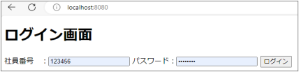{#p141-f04}

::: {#p141-b03 .paragraph}

[① ログイン画面から、以下のように入力し、\[ログイン\]ボタンをクリックします。]{.s009}

:::

::: {#p141-b04 .paragraph}

[社員番号：123456]{.s020}\
[パスワード：pass1234]{.s020}

:::

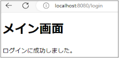{#p141-f05}

::: {#p141-b05 .paragraph}

[② 正しく入力した場合、メイン画面へ遷移できます。]{.s009}

:::

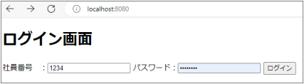{#p141-f06}

::: {#p141-b06 .paragraph}

[③ User&#32;]{.s009}[テーブルに登録されてないId&#32;]{.s009}[とパスワードの組み合わせで誤ったログインすると、ロ]{.s009}\
[グイン画面が再度呼ばれることを確認します。]{.s009}

:::

:::

::: {#page-142 .source-page}

::: {#p142-b01 .heading}

[4\.2.&#32;]{.s004}[セッションによるユーザ情報の保持]{.s004}

:::

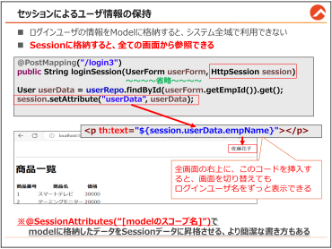{#p142-f07}

::: {#p142-b02 .paragraph}

[前の節では、一番基本となるログイン機能についてご説明しました。]{.s009}

:::

::: {#p142-b03 .paragraph}

[正しいID とパスワードを入力したら、ログインができるわけですが、ログイン成功後は、シス]{.s009}\
[テム内の様々な箇所でユーザの情報を必要とします。]{.s009}

:::

::: {#p142-b04 .paragraph}

[そのため、]{.s009}[ログインが成功したタイミングで、そのユーザの情報をセッションに保持させ、シ]{.s010}\
[ステム全体で参照できるようにすることが大事です。]{.s010}

:::

::: {#p142-b05 .paragraph}

[この節では、セッションにユーザ情報を保持させ、別の画面でそのユーザ情報を参照すると]{.s009}\
[ころについてご説明します。]{.s009}

:::

:::

::: {#page-143 .source-page}

::: {#p143-b01 .heading}

[Model に格納した情報は、画面が変わると消える]{.s013}

:::

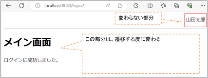{#p143-f08}

::: {#p143-b02 .paragraph}

[Web システムでは、多くの異なる画面があり、ユーザはリンクやボタンをクリックすることで、]{.s009}\
[画面遷移を行います。この時、すべての画面で一貫して表示させたいデータもあります。]{.s009}\
[例えば、上の画像のように、ログインしたユーザの名前が各画面上に常に表示される例は、]{.s009}\
[Web システムにおいて一般的なパターンです。]{.s009}

:::

::: {#p143-b03 .paragraph}

[3 章では、コントローラーからビューへデータを送る方法を学びました。ログイン機能を実装]{.s009}\
[する際には、次のようなコードが使用されます。]{.s009}

:::

::: {#p143-b04 .code}

```java
@PostMapping("/login2")
public String loginNormal(UserForm userForm, Model model) {
        User user = userRepo.findByEmpIdAndPassword(userForm.getEmpId(),
userForm.getPassword());
        System.out.println(user);
        if (user == null) {
               return "redirect:/";
        }
        model.addAttribute("userData", user);
        return "main_page";
}
```

:::

::: {#p143-b05 .paragraph}

[このコードは、ユーザが入力した従業員ID（empId）とパスワードが正しい場合、ユーザ情報]{.s009}\
[をModel オブジェクトに格納しているコードです。]{.s009}[Model はビューへデータを送るために使用さ]{.s010}\
[れますが、さらに画面が変わるとそのデータは保持されません。つまり、ユーザが別の画面]{.s010}\
[に移動すると、先ほどのユーザデータは失われてしまいます。]{.s010}

:::

::: {#p143-b06 .paragraph}

[Model については、3 章の「findAll メソッドでの全件検索」を参照してください。]{.s009}

:::

:::

::: {#page-144 .source-page}

::: {#p144-b01 .heading}

[【作業手順①】 HttpSession 直接利用する方法]{.s013}

:::

::: {#p144-b02 .paragraph}

[Spring でセッションを扱うためには、]{.s009}[HttpSession]{.s010}[&#32;のインスタンスを利用します。]{.s009}\
[この方法は、既存のサーブレット&JSP でセッションを利用する方法でもあります。]{.s009}

:::

::: {#p144-b03 .paragraph}

[…/controller/LoginController.java]{.s010}

:::

::: {#p144-b04 .code}

```java
 1:@GetMapping("/2")
 2:public String showLoginView2() {
 3: return "login_input2";
 4:}
 5:
 6:@PostMapping("/login2")
 7:public String loginSession(UserForm userForm, HttpSession session) {
 8: User user = userRepo.findByEmpIdAndPassword(userForm.getEmpId(),
         userForm.getPassword());
 9: System.out.println(user);
10: if (user == null) {
11: return "redirect:/2";
12: }
13: session.setAttribute("userData", user);
14: return "main_page_session";
15:}
```

:::

::: {#p144-b05 .paragraph}

[・7 行目 (HttpSession session)：]{.s010}

:::

::: {#p144-b06 .paragraph}

[&#32;セッションは、HttpSession のインスタンスを利用することで、データをセッションスコープに格]{.s009}\
[納できたり、セッション情報を消したりできます。&#32;]{.s009}[Spring のController にURL がマッピングされ]{.s010}\
[たメソッドのことを、改めて「ハンドラメソッド」といいます。このハンドラメソッドの引数に]{.s010}\
[HttpSession を指定するだけで、裏でフレームワークが HttpSession のインスタンス生成]{.s010}\
[と、セッション情報の取得を自動で行ってくれます。]{.s010}

:::

::: {#p144-b07 .paragraph}

[・13 行目 session.setAttribute("userData", user)：]{.s010}

:::

::: {#p144-b08 .paragraph}

[&#32;session.setAttribute メソッドは、model.addAttribute と同じような書き方をします。第一引数に]{.s009}\
[は、キーワードを記載して、第二引数には、データを指定します。このコードが実行されると、]{.s009}\
[セッションスコープの中に、"userData"という名前でログインユーザの全情報を保持できるよう]{.s009}\
[になります。このデータは、]{.s009}[画面が変わっても、システム全域で呼び出すことができます。]{.s010}

:::

:::

::: {#page-145 .source-page}

::: {#p145-b01 .heading}

[【作業手順②】 セッションスコープ内のデータを参照する方法]{.s013}

:::

::: {#p145-b02 .paragraph}

[セッションスコープ内のデータを参照する方法について、より詳細に解説します。]{.s009}

:::

::: {#p145-b03 .paragraph}

[まず、session.setAttribute メソッドを用いてデータをセッションに格納できます。]{.s009}

:::

::: {#p145-b04 .paragraph}

[格納したセッションデータは、Thymeleaf テンプレートエンジンを介して簡単にアクセスできま]{.s009}\
[す。以下はその例です。]{.s009}

:::

::: {#p145-b05 .paragraph}

[…/resources/templates/main\_page\_session.html]{.s010}

:::

::: {#p145-b06 .code}

```xml
<body>
<p th:text="${session.userData.empName}" style="margin-left:90%"></p>
<hr>
<h1>メイン画面</h1>
<p>ログインに成功しました。</p>

</body>
```

:::

::: {#p145-b07 .paragraph}

[赤枠で示された部分のように、session.\[キーワード\].\[変数名\]という形式で記述するだけで、]{.s009}\
[セッションスコープのデータを利用できます。この便利さの背景には、Thymeleaf において]{.s009}\
[session が暗黙のオブジェクトとして既に生成されていることがあります。この方法により、]{.s009}\
[HttpSession オブジェクトをどの画面でも直接利用することが可能です。]{.s009}

:::

::: {#p145-b08 .paragraph}

[…/resources/templates/product/list.html]{.s010}

:::

::: {#p145-b09 .code}

```xml
<body>
  <p th:text="${session.userData.empName}" style="margin-left:90%"></p>
    <hr>
    <h1>商品一覧</h1>
    <table>
         <tr>
         <th>商品番号</th>
         <th>商品名</th>
                       <!--省略-->
```

:::

::: {#p145-b10 .paragraph}

[3 章で記述済みの検索リストを表示するという、ログインとは一切関係ないページ]{.s009}\
[(/product/list.html)にも、同じコードを記述しておきます。]{.s009}

:::

:::

::: {#page-146 .source-page}

::: {#p146-b01 .heading}

[動作確認]{.s013}

:::

::: {#p146-b02 .heading}

[http://localhost:8080/2]{.s019}[&#32;\<--こちらのURL へアクセスします。]{.s013}

:::

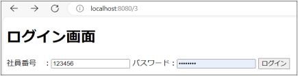{#p146-f09}

::: {#p146-b03 .paragraph}

[① ログイン画面から、以下のように入力し、\[ログイン\]ボタンをクリックします。]{.s009}

:::

::: {#p146-b04 .paragraph}

[社員番号：123456]{.s020}\
[パスワード：pass1234]{.s020}

:::

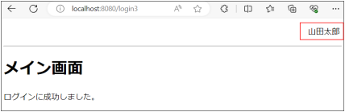{#p146-f10}

::: {#p146-b05 .paragraph}

[② 画面の右上に、ログインしたユーザ名が表示されていることを確認します。]{.s009}

:::

::: {#p146-b06 .paragraph}

[③&#32;]{.s009}[http://localhost:8080/product/findAll]{.s024}[&#32;\<--こちらのURL へアクセスします。]{.s010}

:::

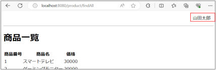{#p146-f11}

::: {#p146-b07 .paragraph}

[④ 同じコードを書いた、list.html でも、ログインしたユーザ名が確認できます。]{.s009}

:::

:::

::: {#page-147 .source-page}

::: {#p147-b01 .heading}

[【参考】 @ SessionAttributes を利用する方法]{.s010}

:::

::: {#p147-b02 .paragraph}

[model に格納したデータと、全く同じデータをセッションにも格納しておきたい場面もあります。]{.s009}\
[その時に活用できる、より簡潔で保守性が高い@SessionAttributes を使う方法についてご紹介]{.s009}\
[します。]{.s009}

:::

::: {#p147-b03 .paragraph}

[…/controller/LoginController.java]{.s010}

:::

::: {#p147-b04 .code}

```java
@Controller
@RequiredArgsConstructor
@SessionAttributes("userData")
public class LoginController {
    private final UserRepository userRepo;
              //省略
    @PostMapping("/login3")
    public String loginNormal(UserForm userForm, Model model) {
          User user = userRepo.findByEmpIdAndPassword(userForm.getEmpId(),
userForm.getPassword());
           System.out.println(user);
           if (user == null) {
                   return "redirect:/3";
           }
           model.addAttribute("userData", user);
           return "main_page_session";
  }
```

:::

::: {#p147-b05 .paragraph}

[上記のソースコードは、model を使ったデータの送信のコードとほぼ同じです。]{.s009}

:::

::: {#p147-b06 .paragraph}

[クラス名の上に付与している、]{.s009}[@SessionAttributes("userData")]{.s010}[の部分にご注目ください。]{.s009}

:::

::: {#p147-b07 .paragraph}

[“userData”は、model にuserData を格納する際に使ったキーワードです。@SessionAttributes]{.s009}\
[は、model スコープに格納しているデータを、セッションデータとしても利用できるようにします。]{.s009}

:::

::: {#p147-b08 .paragraph}

[HttpSession を直接使うより、コードが簡潔になり、キー名も統一できますので、こちらの方法を]{.s009}\
[推奨します。]{.s009}

:::

::: {#p147-b09 .paragraph}

[※]{.s009}[「Spring Security API」]{.s010}[を一緒に使うことで、セッションハイジャックなどの脆弱性対策もできま]{.s009}\
[す。]{.s009}

:::

:::

::: {#page-148 .source-page}

::: {#p148-b01 .heading}

[4\.3.&#32;]{.s004}[ログイン時の入力チェック]{.s004}

:::

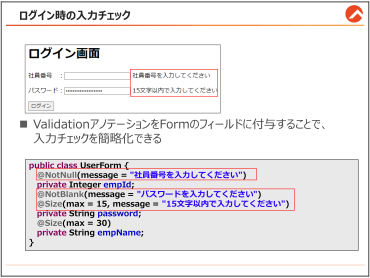{#p148-f12}

::: {#p148-b02 .paragraph}

[Spring では、フォームに入力した値が想定された形式や文字列であるかをチェックする機]{.s009}\
[能を提供しています。その機能のことを「入力チェック（Validation）」と呼びます。この節では]{.s009}\
[Spring のValidation API を活用した、入力チェックの仕方についてご説明いたします。]{.s009}

:::

:::

::: {#page-149 .source-page}

::: {#p149-b01 .heading}

[【参考】既存の入力チェックのコード]{.s013}

:::

::: {#p149-b02 .code}

```java
public String validate() {
    if (empId == null) {
        return "社員番号を入力してください";
    }

    if (password == null || password.trim().isEmpty()) {
        return "パスワードを入力してください";
    }

    if (password.length() > 15) {
        return " 15 文字以下で入力してください";
    }

    // 他のフィールドに対するバリデーションも同様に追加

    return null; // 問題がなければnull を返す
}
```

:::

::: {#p149-b03 .paragraph}

[Validation API を使わない、サーブレットなどの場合、入力される値に対して、個別に条件文を]{.s009}\
[作成しておかないといけませんでした。この方法は、記述に時間もかかりますし、保守もしづら]{.s009}\
[い問題がありました。]{.s009}

:::

::: {#p149-b04 .heading}

[【事前準備】 Validation API を利用する]{.s013}

:::

{#p149-f13}

::: {#p149-b05 .code}

```xml
<dependency>
               <groupId>org.springframework.boot</groupId>
               <artifactId>spring-boot-starter-validation</artifactId>
</dependency>
```

:::

::: {#p149-b06 .paragraph}

[Spring のValidation API をインストールすると、]{.s009}[Form クラスのフィールド名に特定のアノテーシ]{.s010}\
[ョンをつけるだけで、入力チェック用のコードを省略できるようになります。]{.s010}

:::

:::

::: {#page-150 .source-page}

::: {#p150-b01 .heading}

[【作業手順①】 Form クラスにValidation のアノテーションを付与]{.s013}

:::

::: {#p150-b02 .paragraph}

[…/form/UserForm.java]{.s010}

:::

::: {#p150-b03 .code}

```java
 1:package jp.co.trainocate.answer.form;
 2:
 3:import jakarta.validation.constraints.NotBlank;
 4:import jakarta.validation.constraints.NotNull;
 5:import jakarta.validation.constraints.Size;
 6:import lombok.Data;
 7:
 8:@Data
 9:public class UserForm {
10:
11: @NotNull(message = "社員番号を入力してください")
12:    private Integer empId;
13:
14: @NotBlank(message = "パスワードを入力してください")
15: @Size(max = 15, message = "15 文字以内で入力してください")
16:    private String password;
17:
18: private String empName;
19:}
```

:::

::: {#p150-b04 .paragraph}

[・3-5 行目：]{.s010}

:::

::: {#p150-b05 .paragraph}

[&#32;Validationのバージョンによりますが、最新のValidation API は、jakarta.validation.constraints]{.s009}\
[パッケージの方を利用することが推奨されています。]{.s009}

:::

::: {#p150-b06 .paragraph}

[・10 行目 @NotNull：]{.s010}

:::

::: {#p150-b07 .paragraph}

[&#32;このアノテーションを付与したフィールドに、]{.s009}[入力値がない場合は、入力エラーだと検知]{.s010}[して]{.s009}\
[くれます。]{.s009}[Integerのフィールドは、@NotNull]{.s010}[を付与します。]{.s009}[message属性は、出力するメッセー]{.s010}\
[ジをカスタマイズ]{.s010}[することができます。]{.s009}

:::

::: {#p150-b08 .paragraph}

[・14-15 行 ＠NotBlank、@Size(max = 15):]{.s010}\
[&#32;＠NotNull と似ていますが、こちらは]{.s009}[文字列の入力有無チェックに特化]{.s010}[されています。未入力]{.s009}\
[はもちろん、]{.s009}[空文字(“”)まで検知]{.s010}[することができます。]{.s009}\
[&#32;@Size は、]{.s009}[文字列の文字数制限]{.s010}[を設定できます。Max で最大文字数、min で最小文字数の]{.s009}\
[設定ができます。]{.s009}

:::

:::

::: {#page-151 .source-page}

::: {#p151-b01 .heading}

[【作業手順②】&#32;]{.s013}[ログイン入力ページ遷移用のメソッド定義]{.s010}

:::

::: {#p151-b02 .paragraph}

[…/controller/LoginController.java]{.s010}

:::

::: {#p151-b03 .code}

```java
@GetMapping("/4")
        public String showLoginView4(UserForm userForm) {
               return "validation_login_input";
        }
```

:::

::: {#p151-b04 .paragraph}

[入力チェック機能をつける場合は、]{.s009}[必ず入力画面遷移用メソッドの引数にも、Form クラスを入]{.s010}\
[れておく必要]{.s010}[があります。]{.s009}[Form のデータがないと、エラーが出るからです。]{.s010}\
[よく忘れることが多いので、ご注意ください。]{.s009}

:::

::: {#p151-b05 .heading}

[【作業手順③】 入力チェック用メソッドの定義]{.s013}

:::

::: {#p151-b06 .paragraph}

[…/controller/LoginController.java]{.s010}

:::

::: {#p151-b07 .code}

```java
1://省略
2:@PostMapping("/login4")
3:public String loginValidation(@Valid UserForm userForm, BindingResult
bdResult) {

4: if (bdResult.hasErrors()) {
5: return "validation_login_input";
6:   }
7: return "main_page";
8:}
```

:::

::: {#p151-b08 .paragraph}

[・3 行目 @Valid：]{.s010}

:::

::: {#p151-b09 .paragraph}

[&#32;@Valid アノテーションは、対象のオブジェクト（この場合は UserForm）が持つValidation アノ]{.s009}\
[テーション（例えば @Size、@NotNull など）に基づいて]{.s009}[入力チェックを実行するために使用]{.s010}[さ]{.s009}\
[れます。]{.s009}

:::

::: {#p151-b10 .paragraph}

[・3 行目 BindingResult:]{.s010}

:::

::: {#p151-b11 .paragraph}

[BindingResult は、@Valid アノテーションによる入力チェックの結果を保持するオブジェクトで]{.s009}\
[す。入力チェックエラーの詳細を取得するために使用されます。通常、メソッドの引数として渡]{.s009}\
[されます。]{.s009}[必ず、@Valid をつけた直後(ここでは、第2 引数)に記載しないといけないルールが]{.s027}\
[あります]{.s027}[ので、ご注意ください。]{.s009}

:::

:::

::: {#page-152 .source-page}

::: {#p152-b01 .paragraph}

[・4 行目 bdResult.hasErrors()：]{.s010}

:::

::: {#p152-b02 .paragraph}

[&#32;BindingResult の&#32;]{.s009}[hasErrors メソッドは、入力チェック中にエラーが発生したかどうかを確認]{.s010}\
[するために使用されます。エラーが存在する場合は true を、そうでない場合は false を返]{.s010}\
[します。]{.s010}[このメソッドを利用して条件分岐を行い、エラーがある場合は入力フォームに戻り、エ]{.s009}\
[ラーメッセージをユーザに表示します。]{.s009}

:::

::: {#p152-b03 .heading}

[【作業手順④】&#32;]{.s013}[ログイン入力ページの修正]{.s010}

:::

::: {#p152-b04 .paragraph}

[…/resources/templates/validation\_login\_input.html]{.s010}

:::

::: {#p152-b05 .code}

```java
 1:<body>
 2:<h1>ログイン画面</h1>
 3:
 4:<form th:action="@{/login4}" method="post" th:object="${userForm}">
 5:
 6:<p>社員番号 ：<input type = "text" th:field="*{empId}"/>
 7: <span th:errors="*{empId}"></span></p>
 8:
 9:<p>パスワード：<input type="password" th:field="*{password}" />
10: <span th:errors="*{password}"></span></p>
11:
12:<input type="submit" value="ログイン">
13:
14:</form>
15:</body>
```

:::

::: {#p152-b06 .paragraph}

[・4 行目 th:object="$\{userForm\}":]{.s010}

:::

::: {#p152-b07 .paragraph}

[th:object 属性は、]{.s009}[「選択対象オブジェクト」]{.s010}[と呼ばれ、フォームのデータをController のオブ]{.s009}\
[ジェクト（この場合は UserForm オブジェクト）にバインド（結びつけ）するために使用されま]{.s009}\
[す。]{.s009}

:::

::: {#p152-b08 .paragraph}

[formタグに記述することで、フォームの入力フィールドの値が、UserForm オブジェクトの対応]{.s010}\
[するプロパティに自動的に格納されます。]{.s010}\
[つまり、Controller のメソッド内でModel にデータを格納しなくても、Form タグの中で、]{.s010}\
[Thymeleaf 上でデータを受け取れるということです。]{.s010}

:::

::: {#p152-b09 .paragraph}

[フォーム内では、]{.s009}[\*\{...\}]{.s010}[という選択式を使用して、userForm オブジェクトのプロパティに簡潔にア]{.s009}\
[クセスできます。]{.s009}[userForm.empId ではなく、\*\{empId\}だけでアクセスできるように]{.s010}[なります。]{.s009}

:::

:::

::: {#page-153 .source-page}

::: {#p153-b01 .paragraph}

[・6 行目 th:field="\*\{empId\}":]{.s010}

:::

::: {#p153-b02 .paragraph}

[th:field 属性]{.s010}[は、対応するフィールドの&#32;]{.s009}[name, id, および value 属性を自動的に生成]{.s010}[しま]{.s009}\
[す。ですので、name、id、value を省略できます。]{.s009}

:::

::: {#p153-b03 .paragraph}

[自動生成されるvalue 属性により、フォーム送信後に入力チェックエラーが発生した場合でも、]{.s009}\
[ユーザが入力した値がフィールドに保持されます]{.s010}[。これにより、ユーザは入力値を再度入力す]{.s009}\
[る手間を省くことができます。]{.s009}

:::

::: {#p153-b04 .paragraph}

[なお、\*\{empId\}は、userForm オブジェクトのempId プロパティを参照しています。]{.s009}

:::

::: {#p153-b05 .paragraph}

[・7 行目 \<span&#32;]{.s010}[th:errors="\*\{empId\}"]{.s027}[\>\</span\>:]{.s010}

:::

::: {#p153-b06 .paragraph}

[&#32;このコードは、empId フィールドに関連する入力チェックエラーがある場合に]{.s009}[エラーメッセ]{.s010}\
[ージを表示]{.s010}[するために使われます。エラーがない場合は、何も表示されません。]{.s009}

:::

::: {#p153-b07 .paragraph}

[フォームを送信したとき、もし empId フィールドの値が入力チェックのルールに違反していれ]{.s009}\
[ば（例えば、必須フィールドが空である、など）、 \<span\> タグの中に入力チェックごとのエラー]{.s009}\
[メッセージが表示されます。]{.s009}

:::

::: {#p153-b08 .heading}

[動作確認]{.s013}

:::

::: {#p153-b09 .paragraph}

[http://localhost:8080/4]{.s024}

:::

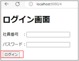{#p153-f14}

::: {#p153-b10 .paragraph}

[① 何も入力せずに、\[ログイン\]ボタンをクリックします。]{.s009}

:::

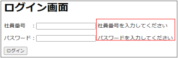{#p153-f15}

:::

::: {#page-154 .source-page}

::: {#p154-b01 .paragraph}

[② 入力エラーメッセージが表示されます。]{.s009}

:::

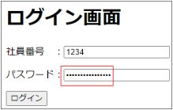{#p154-f16}

::: {#p154-b02 .paragraph}

[③ パスワードに16 文字以上の文字列を入力し、\[ログイン\]ボタンをクリックします。]{.s009}

:::

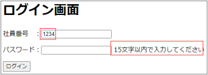{#p154-f17}

::: {#p154-b03 .paragraph}

[④ 社員番号はそのまま値が入っている状態で、文字数制限エラーが表示されるか確認しま]{.s009}\
[す。]{.s009}

:::

:::

::: {#page-155 .source-page}

::: {#p155-b01 .heading}

[【参考】 ログイン機能の最終版のソースコード]{.s013}

:::

::: {#p155-b02 .paragraph}

[この章では、ログインについて、以下の実装方法についてご説明しました。]{.s009}

:::

::: {#p155-b03 .paragraph}

[①&#32;]{.s009}[入力したID とパスワードをUser テーブル内でAnd 検索し、正しいかどうかチェック]{.s009}

:::

::: {#p155-b04 .paragraph}

[② ログインユーザのユーザ情報をセッションに格納し、システム全域で活用]{.s009}

:::

::: {#p155-b05 .paragraph}

[③ Validation アノテーションを使った、入力チェック]{.s009}

:::

::: {#p155-b06 .paragraph}

[では、①②③を全て使った最終版のコードを以下に記述します。]{.s028}

:::

::: {#p155-b07 .paragraph}

[…/resources/templates/login\_input\_final.html]{.s010}

:::

::: {#p155-b08 .code}

```xml
<body>
<h1>ログイン画面</h1>

<form th:action="@{/login5}" method="post" th:object="${userForm}">

<p th:if="${loginError}" th:text="${loginError}"></p> <!--5.1.2 参考-->

<p>社員番号 ：<input type = "text" th:field="*{empId}"/>
                       <span th:errors="*{empId}"></span></p>

<p>パスワード：<input type="password" th:field="*{password}" />
                       <span th:errors="*{password}"></span></p>

<input type="submit" value="ログイン">

</form>
</body>
```

:::

:::

::: {#page-156 .source-page}

::: {#p156-b01 .paragraph}

[…/controller/LoginController.java]{.s010}

:::

::: {#p156-b02 .code}

```java
@GetMapping("/5")
public String showLoginView5(UserForm userForm) {
        return "login_input_final";
}

@PostMapping("/login5")
public String loginFinal(@Valid UserForm userForm, BindingResult bdResult,
HttpSession session, Model model) {
        //入力エラーチェック
        if (bdResult.hasErrors()) {
                 return "login_input_final";
        }

        User user = userRepo.findByEmpIdAndPassword(userForm.getEmpId(),
userForm.getPassword());
        //DB 照会後のID&パスワードのチェック
        if (user == null) {
        model.addAttribute("loginError", "社員番号またはパスワードが誤っています。"); // エラーメッセージを追加
        return "login_input_final";
    }

        //正しい入力の場合、ユーザ情報をセッションに格納
        session.setAttribute("userData", user);

        return "main_page_session";
}
```
:::

::: {#p156-b03 .paragraph}

[…/resources/templates/main\_page\_session.html]{.s010}

:::

::: {#p156-b04 .code}

```xml
<body>
<p th:text="${session.userData.empName}" style="margin-left:90%"></p>
<hr>
<h1>メイン画面</h1>
<p>ログインに成功しました。</p>
</body>
```

:::

:::

::: {#page-157 .source-page}

::: {#p157-b01 .heading}

[4\.3.1.&#32;]{.s004}[【参考】その他のValidation アノテーション]{.s004}

:::

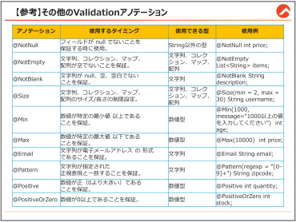{#p157-f18}

::: {#p157-b02 .paragraph}

[今回の例文で紹介された@NotNull や、@NotBlank、@Size 以外にも、便利なValidation アノ]{.s009}\
[テーションが用意されています。この表に書かれているアノテーションだけでも、一般的なWeb]{.s009}\
[システムで使われる入力チェックをケアすることができます。]{.s009}

:::

::: {#p157-b03 .paragraph}

[注意しないといけないのは、上記の表のように、]{.s009}[アノテーションごと「使用できる型」が異なる]{.s010}\
[ということです。例えば、数値のデータに@NotBlank を指定するとエラーが出ます。]{.s010}

:::

::: {#p157-b04 .paragraph}

[@NotNull については、String 型に適用できないわけではありませんが、@NotBlank の方が]{.s009}\
[空文字や空白のケアができるのでより適切です。]{.s009}

:::

::: {#p157-b05 .paragraph}

[複雑な入力条件は、@Pattern アノテーションで「正規表現」を使うことで、細かく設定できま]{.s009}\
[すので、参考にしてください。]{.s009}

:::

:::

::: {#page-158 .source-page}

:::

::: {#page-159 .source-page}

::: {#p159-b01 .heading}

[4\.3.2.&#32;]{.s004}[【参考】メッセージのカスタマイズ]{.s004}

:::

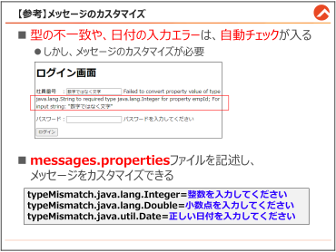{#p159-f19}

::: {#p159-b02 .paragraph}

[前の節で、色んな入力チェック用のアノテーションをご説明しましたが、Integer の型に、文字]{.s009}\
[列を入れてしまった時のような、「型の不一致」や、「日付の整合性チェック」についてのアノテ]{.s009}\
[ーションがないことに気づいた方もいらっしゃるでしょう。]{.s009}

:::

::: {#p159-b03 .paragraph}

[基本的に、型の不一致による入力チェックエラーと、日付関連のエラーは、th:error が自動的]{.s010}\
[にチェックしてくれます。]{.s010}

:::

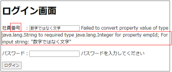{#p159-f20}

::: {#p159-b04 .paragraph}

[しかし、]{.s009}[自動チェックですので、他のアノテーションのように、message 属性を使った、エラーメ]{.s010}\
[ッセージの設定ができません。]{.s010}

:::

::: {#p159-b05 .paragraph}

[Spring では、メッセージをカスタマイズできるファイルを別途作成できます。]{.s009}

:::

:::

::: {#page-160 .source-page}

::: {#p160-b01 .heading}

[messages.properties の作成]{.s013}

:::

::: {#p160-b02 .paragraph}

[メッセージプロパティのファイルを活用することで、メッセージのカスタマイズができます。]{.s009}

:::

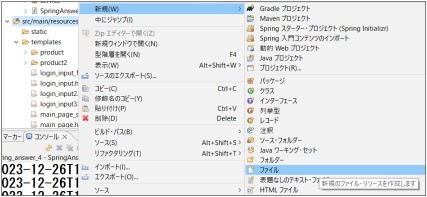{#p160-f21}

::: {#p160-b03 .paragraph}

[/src/main/resources に、\[ファイル\]を新規作成します。]{.s009}

:::

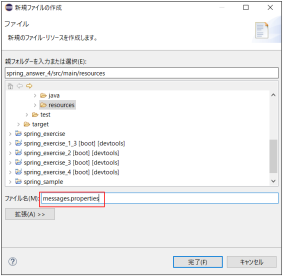{#p160-f22}

::: {#p160-b04 .paragraph}

[ファイル名は、\[messages.properties\]にします。]{.s009}

:::

:::

::: {#page-161 .source-page}

::: {#p161-b01 .heading}

[messages.properties にカスタマイズしたいメッセージを記入]{.s013}

:::

{#p161-f24}

::: {#p161-b02 .code}

```properties
typeMismatch.java.lang.Integer=整数を入力してください
typeMismatch.java.lang.Double=小数点を入力してください
typeMismatch.java.util.Date=正しい日付を入力してください
```
:::

::: {#p161-b03 .paragraph}

[messages.properties の中に、エラーメッセージについての表示を変更することができます。]{.s009}

:::

::: {#p161-b04 .paragraph}

[上の例のように、整数と小数点はもちろん、日付についての入力チェックについても、表示さ]{.s009}\
[れるメッセージを再定義することができます。]{.s009}

:::

::: {#p161-b05 .paragraph}

`messages.properties` を保存し、アプリケーションを再起動してエラーメッセージを確認します。依存を変更していなければ `install` は不要です。日本語のファイルはUTF-8で保存してください。
:::

::: {#p161-b06 .paragraph}

[外部アプリケーションサーバーで運用するシステムの場合は、必ずサーバーの再起動が必要]{.s009}\
[です。]{.s009}

:::

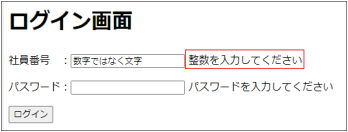{#p161-f23}

::: {#p161-b07 .paragraph}

[エラーメッセージが修正されたことを確認できます。]{.s009}

:::

:::

::: {#page-162 .source-page}

::: {#p162-b01 .heading}

[章のまとめ]{.s008}

:::

{#p162-f25}

::: {#p162-b02 .paragraph}

[この章では、ログイン機能に必要なセッションや、Validation API の使い方についてご説明しま]{.s009}\
[した。]{.s009}

:::

:::

::: {#page-163 .source-page}

:::
