<!-- 元PDF 164〜191ページ。Java 21・Spring Boot 4.0.2対応版。 -->

::: {#page-164 .source-page}

::: {#p164-b01 .heading}

[&#32;5]{.s005}

:::

::: {#p164-b02 .heading}

[第5章&#32;]{.s001}[Thymeleaf とWeb ページデザイン]{.s001}

:::

::: {#p164-b03 .heading}

[章の目標]{.s002}

:::

::: {#p164-b04 .heading}

[◼&#32;]{.s003}[Thymeleaf の基本構文について理解できる]{.s004}

:::

::: {#p164-b05 .heading}

[◼&#32;]{.s003}[Thymeleaf からCSS やJavaScript を活用できる]{.s004}

:::

::: {#p164-b06 .heading}

[◼&#32;]{.s003}[レイアウト機能について理解できる]{.s004}

:::

:::

::: {#page-165 .source-page}

:::

::: {#page-166 .source-page}

::: {#p166-b01 .heading}

[章の概要]{.s008}

:::

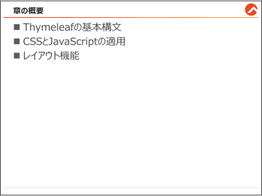{#p166-f01}

::: {#p166-b02 .paragraph}

[今まで、thymeleaf のタグについて、いくつか例文の中でご紹介しました。この章では、改め]{.s009}\
[てthymeleaf の文法をメインの内容にし、CSS とJavaScript を連携する方法についてご説明し]{.s009}\
[ます。そして、保守性と効率を高めるレイアウト機能についてもご説明します。]{.s009}

:::

:::

::: {#page-167 .source-page}

::: {#p167-b01 .heading}

[5\.1.&#32;]{.s004}[Thymeleaf の基本構文]{.s004}

:::

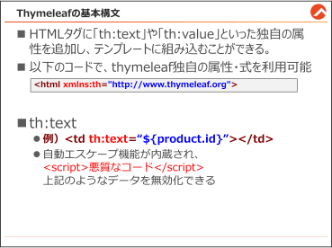{#p167-f02}

::: {#p167-b02 .heading}

[Thymeleaf について]{.s010}

:::

::: {#p167-b03 .paragraph}

[「Thymeleaf」は、JSP と同様に、Java の「テンプレートエンジン」の一種で、HTML5 形式のテ]{.s009}\
[ンプレートを変換し、Web ブラウザでの表示を可能にするライブラリです。Thymeleaf は、コント]{.s009}\
[ローラーからのデータを受け取ることができますので、コンテンツの動的な変更が実現できま]{.s009}\
[す。Thymeleaf の主要な記述方式は以下の通りです。]{.s009}

:::

::: {#p167-b04 .paragraph}

[・属性記述：HTML タグに「th:text」や「th:value」といった独自の属性を追加し、テンプレート]{.s009}\
[に組み込むことができる。]{.s009}

:::

::: {#p167-b05 .paragraph}

[・式記述：属性の値を「$\{\}」や「@\{\}」の形式で表現し、動的なデータの挿入ができる。]{.s009}

:::

::: {#p167-b06 .paragraph}

[Thymeleaf はSpring Framework との統合が容易であり、Spring アプリケーションでの使用に]{.s009}\
[特に適しています。HTML の中に自然にデータを組み込むことができるため、可読性も高いで]{.s009}\
[す。さらに、Thymeleaf はセキュリティ面での配慮もなされており、XSS（クロスサイトスクリプティ]{.s009}\
[ング）対策などのセキュリティ機能を内蔵しています。]{.s009}

:::

:::

::: {#page-168 .source-page}

::: {#p168-b01 .heading}

[Thymeleaf を使うための事前準備]{.s010}

:::

::: {#p168-b02 .paragraph}

[HTML ファイル内で、Thymeleaf の属性や式を使うためには、以下のようなコードを記載してお]{.s009}\
[く必要があります。]{.s009}

:::

::: {#p168-b03 .code}

```xml
1:<!DOCTYPE html>
2:<html xmlns:th="http://www.thymeleaf.org">
3:
4:<head>
5:<meta charset="UTF-8" />
6:<meta name="viewport" content="width=device-width, initial-scale=1.0" />
```

:::

::: {#p168-b04 .paragraph}

[・2 行 \<html xmlns:th="http://www.thymeleaf.org"\>:]{.s014}

:::

::: {#p168-b05 .paragraph}

[Thymeleaf テンプレートで使われる HTML の宣言です。この宣言により、Thymeleaf のル]{.s009}\
[ールが HTML ページに追加されます。それによって、Thymeleaf の特有の属性や構文が]{.s009}\
[HTML タグ内で認識され、正しく処理されます。]{.s009}

:::

::: {#p168-b06 .paragraph}

[・6 行 \<meta name="viewport" content="width=device-width, initial-scale=1.0" /\>：]{.s014}

:::

::: {#p168-b07 .paragraph}

[&#32;この宣言は、Thymeleaf の構文ではありませんが、Web ページがモバイルデバイスで表示さ]{.s009}\
[れる際のビューポート（表示領域）の設定に使われます。デバイスがどのような画面サイズを持]{.s009}\
[っていても、Web ページはそれに適応するように表示されます。]{.s009}

:::

::: {#p168-b08 .heading}

[th:text について]{.s010}

:::

::: {#p168-b09 .code}

```xml
<td th:text="${product.id}">[データがあったら、置き換えられる]</td>
<td th:text="${product.name}">[データがあったら、置き換えられる]</td>
<td th:text="${product.price}">[データがあったら、置き換えられる]</td>
```

:::

::: {#p168-b10 .paragraph}

[一番基本となる、th:text は、HTML の要素に動的なテキスト内容を挿入するために使用さ]{.s009}\
[れます。主に、サーバー側で処理されるデータ（例えば、データベースから取得した情報やユ]{.s009}\
[ーザ入力）をWeb ページに表示する際に用います。]{.s009}\
[\<td\>\</td\> タグ内のテキストは、th:text 属性に指定された式の結果によって置き換えられま]{.s014}\
[す。]{.s014}

:::

:::

::: {#page-169 .source-page}

::: {#p169-b01 .paragraph}

[th:text の特徴の一つは、クロスサイトスクリプティング（XSS）の対策です。例えば、ユーザが]{.s009}\
[「\<script\>悪質なJavaScript コード\</script\>」]{.s018}[&#32;というデータを入力した場合、XSS対策が施され]{.s009}\
[ていないと、この悪意のあるJavaScriptコードがHTML 内に組み込まれ、不特定多数のユーザ]{.s009}\
[に被害を及ぼす可能性があります。]{.s009}

:::

::: {#p169-b02 .paragraph}

[その対策として、th:text を使用すると、入力データは自動的にエスケープ処理されます。こ]{.s009}\
[れにより、‘\<’ や ‘\>’ のような文字はHTML タグとしてではなく、ただの文字列として扱われ]{.s009}\
[ます。結果として、悪意のあるJavaScript コードが実行される心配はなくなります。]{.s009}

:::

:::

::: {#page-170 .source-page}

::: {#p170-b01 .heading}

[5\.1.1.&#32;]{.s004}[動的にイメージとリンク生成(th:attr)]{.s004}

:::

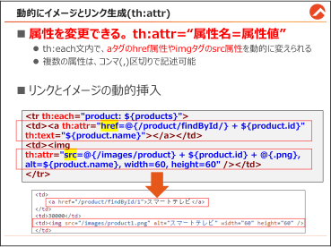{#p170-f03}

::: {#p170-b02 .paragraph}

[Thymeleaf の th:attr 属性を使用することで、HTML 要素の属性を動的に変更することが可]{.s009}\
[能です。データベースから取得したデータに基づいて異なる属性値を設定することができます]{.s009}\
[ので、]{.s009}[Form タグ内のid やclass 属性を動的で割り当てることができますし、画像のsrc 属性]{.s014}\
[やリンクのhref 属性などを動的に変えることもできます。]{.s014}

:::

:::

::: {#page-171 .source-page}

::: {#p171-b01 .heading}

[イメージの動的挿入]{.s010}

:::

::: {#p171-b02 .paragraph}

[【振り返り】＜Spring Boot プロジェクトの構成＞]{.s014}

:::

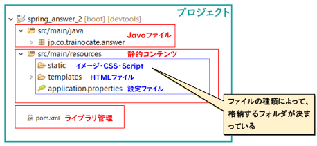{#p171-f04}

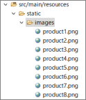{#p171-f05}

::: {#p171-b03 .paragraph}

[Spring Boot 環境では、イメージのような静的ファイルをsrc/main/resources/]{.s009}[static]{.s019}[&#32;フォルダに]{.s009}\
[格納する必要があります。今回は、予めimages フォルダに、商品ごとのイメージを格納してお]{.s009}\
[きました。product の後ろの番号は、商品番号に合わせています。]{.s009}

:::

::: {#p171-b04 .paragraph}

[…/resources/templates/product/list.html]{.s014}

:::

::: {#p171-b05 .code}

```xml
<table>
<tr>
        <th>商品番号</th>
        <th>商品名</th>
        <th>価格</th>
        <th>イメージ</th>
```

:::

:::

::: {#page-172 .source-page}

::: {#p172-b01 .code}

```xml
</tr>
<tr th:each="product: ${products}">
        <td th:text="${product.id}"></td>
        <td th:text="${product.name}"></td>
        <td th:text="${product.price}"></td>
        <td></td>
</tr>
```

:::

::: {#p172-b02 .paragraph}

[既存のfindByAll のサンプルのlist.html に、th:attr のコードを追記しました。]{.s009}

:::

::: {#p172-b03 .paragraph}

[th:attr の構文は&#32;]{.s009}[th:attr="属性名=属性値"]{.s020}[&#32;という形で、属性値を動的に設定できます。]{.s009}\
[通常、イメージを挿入する際は \ として src 属性にURLを指定し]{.s009}\
[ますが、]{.s009}[th:attr を使用すると \ のように書き換えるこ]{.s014}\
[とができます]{.s014}[。]{.s009}

:::

::: {#p172-b04 .paragraph}

[この例では、product.id を用いて商品ごとに異なるイメージURL を生成しています。th:attr]{.s009}\
[を使用する際に複数の属性を指定したい場合は、コンマ（,）で区切ることで設定できます。]{.s009}\
[alt 属性はイメージの表示が失敗した時の代替テキストとして機能し、ここでは商品名を出力し]{.s009}\
[ています。また、width と height 属性を指定することでイメージの大きさを統一しています。]{.s009}

:::

::: {#p172-b05 .paragraph}

[出力結果をみると、以下のように変換されているのがわかります。]{.s009}

:::

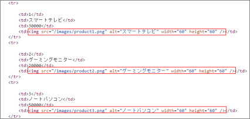{#p172-f06}

:::

::: {#page-173 .source-page}

::: {#p173-b01 .heading}

[動的URL のリンク挿入]{.s010}

:::

::: {#p173-b02 .paragraph}

[Web システムには、以下のようにデータごとに動的なリンクがかかっていることもよくあります。]{.s009}

:::

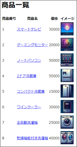{#p173-f07}

::: {#p173-b03 .paragraph}

[この場合、]{.s009}[a タグに同じくth:attr 属性値としてhref を指定すると、動的リンクを生成]{.s014}[することが]{.s009}\
[できます。]{.s009}

:::

::: {#p173-b04 .paragraph}

[…/resources/templates/product/list.html]{.s014}

:::

::: {#p173-b05 .code}

```xml
<tr th:each="product: ${products}">
   <td th:text="${product.id}"></td>
   <td>
       <a th:attr="href=@{/product/findById/} + ${product.id}"
       th:text="${product.name}"></a>
   </td>
   <td th:text="${product.price}"></td>
   <td>
  </td>
</tr>
```

:::

:::

::: {#page-174 .source-page}

::: {#p174-b01 .paragraph}

[…/controller/ProductController.java]{.s014}

:::

::: {#p174-b02 .code}

```java
@GetMapping("/findById/{id}")
public String showProductById(@PathVariable int id, Model model) {
        Product product = prodRepo..findById(id).orElse(null);
        model.addAttribute("product", product);
        return "product/detail";
}
```

:::

::: {#p174-b03 .paragraph}

[動的なURL リンクによる呼び出しの場合は、URL からid を受け取る処理が必要となりますの]{.s009}\
[で、2 章のupdate とdelete の場合と同様に、@PathVariable アノテーションを付与する必要が]{.s009}\
[あります。（その場合、フォームからのid 検索は無効になります）]{.s009}

:::

::: {#p174-b04 .heading}

[動作確認]{.s014}

:::

::: {#p174-b05 .paragraph}

[http://localhost:8080/product/findAll]{.s021}

:::

::: {#p174-b06 .paragraph}

[正しく指定した場合、以下のようなコードが生成されることを確認できます。]{.s009}

:::

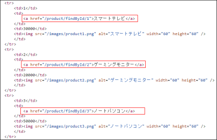{#p174-f08}

:::

::: {#page-175 .source-page}

::: {#p175-b01 .heading}

[5\.1.2.&#32;]{.s004}[条件式による表示制御(th:if)]{.s004}

:::

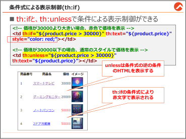{#p175-f09}

::: {#p175-b02 .heading}

[①th:if とth:unless]{.s010}

:::

::: {#p175-b03 .paragraph}

[Thymeleaf では、th:if や th:unless を活用して、条件に基づいたHTML の表示を制御する]{.s009}\
[ことができます。これにより、データベースから取得した]{.s009}[データに基づいて異なる表示を行う]{.s014}[こ]{.s009}\
[とが可能です。]{.s009}

:::

::: {#p175-b04 .paragraph}

[活用例は多岐にわたりますが、以下にその一例をご紹介します。]{.s009}

:::

::: {#p175-b05 .paragraph}

[…/resources/templates/product/list.html]{.s014}

:::

::: {#p175-b06 .code}

```xml
<tr th:each="product: ${products}">
<!--省略-->

<!-- 価格が30000 より大きい場合、赤色で価格を表示 -->
<td th:if="${product.price > 30000}" th:text="${product.price}"
style="color: red;"></td>

<!-- 価格が30000 以下の場合、通常のスタイルで価格を表示 -->
<td th:unless="${product.price > 30000}"
th:text="${product.price}"></td>
```

:::

:::

::: {#page-176 .source-page}

::: {#p176-b01 .paragraph}

[この例では、product.price の値が30000 を超えるかどうかで、スタイルが適用された価格と、]{.s009}\
[通常スタイルの価格を切り替えて表示しています。]{.s009}[HTML コードは2行ですが、条件に合うコー]{.s014}\
[ドだけが表示されるようになっています。]{.s014}

:::

::: {#p176-b02 .heading}

[②その他の条件式の例]{.s010}

:::

::: {#p176-b03 .paragraph}

[条件式による制御は、活用場面が無限に近いのですが、下記によく使われる例をご紹介しま]{.s009}\
[す。]{.s009}

:::

::: {#p176-b04 .paragraph}

[⑴ 削除フラグに基づくデータの表示：]{.s018}

:::

::: {#p176-b05 .paragraph}

[削除フラグが0 の場合はデータを表示し、1 の場合は表示しない。]{.s009}\
[(テーブルにdeleteFlag の列を追加する必要があります。)]{.s009}

:::

::: {#p176-b06 .code}

```xml
<div th:each="product : ${products}" th:if="${product.deleteFlag == 0}"
th:text="${product.name}"></div>
```

:::

::: {#p176-b07 .paragraph}

[⑵ 管理者権限に基づく機能の表示：]{.s018}

:::

::: {#p176-b08 .paragraph}

[特定のユーザー（例えば、管理者）にのみ特定の機能を表示する。]{.s009}

:::

::: {#p176-b09 .paragraph}

[(テーブルにrole の列を追加する必要があります。)]{.s009}

:::

::: {#p176-b10 .code}

```xml
<div th:if="${session.user.role == 'ADMIN'}">
    <!-- 管理者専用の機能やリンクをここに表示 -->
</div>
```

:::

::: {#p176-b11 .paragraph}

[⑶ リストの要素が空かどうかのチェック：]{.s018}

:::

::: {#p176-b12 .paragraph}

[リストが空の場合に、「情報がありません」というメッセージを表示する。]{.s009}

:::

::: {#p176-b13 .paragraph}

[（\#lists.isEmpty(products)]{.s014}[は、Thymeleaf で提供する変数式です。]{.s009}\
[簡単にリストの検索OK/NG を判定できる構文です。）]{.s009}

:::

::: {#p176-b14 .code}

```xml
<div th:if="${#lists.isEmpty(products)}">
    商品情報がありません。
</div>
<div th:unless="${#lists.isEmpty(products)}">
    <!-- 商品情報リストの内容(<table>～</table>)をここに記載 -->
</div>
```

:::

:::

::: {#page-177 .source-page}

::: {#p177-b01 .paragraph}

[⑷ 日付や時間に基づくコンテンツの表示：]{.s018}

:::

::: {#p177-b02 .paragraph}

[現在の日付や時間に基づいて、特定のメッセージやコンテンツを表示する。]{.s009}

:::

::: {#p177-b03 .paragraph}

[（\#dates.～～]{.s014}[は、Thymeleaf で提供する変数式です。]{.s009}\
[簡単に現在の日付関連のデータを取得できる構文です。）]{.s009}

:::

::: {#p177-b04 .code}

```xml
<div th:if="${#dates.dayOfWeek(...) == 2 }">
    今日は月曜特別セールです！
</div>
```

:::

::: {#p177-b05 .paragraph}

[⑸ Radio ボタンのチェックの切り替え：]{.s018}

:::

::: {#p177-b06 .paragraph}

[値が1 か2 かによって、ラジオボタンの checked 属性を動的に切り替える。]{.s009}

:::

::: {#p177-b07 .paragraph}

[Radio ボタン以外にも、checkbox でも活用できます。]{.s009}

:::

::: {#p177-b08 .paragraph}

[※if-unless でも書けますが、th:checked 属性を使うと、より簡略に記述できます。]{.s019}

:::

::: {#p177-b09 .code}

```xml
<input type="radio" name="gender" th:value="1" th:checked="${gender == 1}" />
<input type="radio" name="gender" th:value="2" th:checked="${gender == 2}" />
```

:::

:::

::: {#page-178 .source-page}

::: {#p178-b01 .heading}

[5\.2.&#32;]{.s004}[CSS とJavaScript の利用]{.s004}

:::

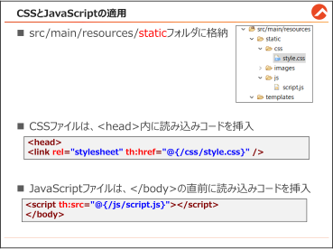{#p178-f10}

::: {#p178-b02 .paragraph}

[Thymeleaf 内でCSS ファイルと、JavaScript(JS)ファイルを適用するためには、通常の方法では]{.s009}\
[上手くいかないため、この節でご説明いたします。]{.s009}

:::

::: {#p178-b03 .paragraph}

[CSS ファイルとJS ファイルの格納場所]{.s014}

:::

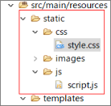{#p178-f11}

::: {#p178-b04 .paragraph}

[css ファイルとjs ファイルは、images と同様に&#32;]{.s009}[src/main/resources/static の中に格納しないと]{.s014}\
[Spring Boot プロジェクト内で認識されませんので、必ずこの場所に格納してください。]{.s014}

:::

:::

::: {#page-179 .source-page}

::: {#p179-b01 .heading}

[CSS ファイルの読み込み]{.s010}

:::

::: {#p179-b02 .paragraph}

[…/resources/templates/product2/list.html]{.s014}

:::

::: {#p179-b03 .code}

```xml
<head>
    <link rel="stylesheet" th:href="@{/css/style.css}" />
```

:::

::: {#p179-b04 .paragraph}

[head タグの中に、th:href でファイルパスを記述すれば読み込みできます。/static までのパス]{.s009}\
[は省略されます。]{.s009}

:::

::: {#p179-b05 .heading}

[JS ファイルの読み込み]{.s010}

:::

::: {#p179-b06 .paragraph}

[…/resources/templates/product2/list.html]{.s014}

:::

::: {#p179-b07 .code}

```xml
<script th:src="@{/js/script.js}"></script>
</body>
```

:::

::: {#p179-b08 .paragraph}

[body の終了タグの直前の場所に、th:src でjs ファイルの場所を記述すると、読み込みできま]{.s009}\
[す。]{.s009}

:::

::: {#p179-b09 .heading}

[サンプルのCSS・JS ファイルのコード]{.s010}

:::

::: {#p179-b10 .paragraph}

[…/resources/static/css/style.css]{.s014}

:::

::: {#p179-b11 .code}

```css
@charset "UTF-8";
body{background-color: black;
     color: white;}
h1{color: yellow;}
```

:::

::: {#p179-b12 .paragraph}

[単純に背景と文字色を反転させるスタイルが記載されています。]{.s009}

:::

::: {#p179-b13 .paragraph}

[…/resources/static/js/script.js]{.s014}

:::

::: {#p179-b14 .code}

```java
document.write("<p>このテキストはJavaScript が生成しました</p>");
```

:::

::: {#p179-b15 .paragraph}

[JavaScript でHTML を生成することもできます。]{.s009}

:::

:::

::: {#page-180 .source-page}

::: {#p180-b01 .heading}

[動作確認]{.s014}

:::

::: {#p180-b02 .paragraph}

[http://localhost:8080/product2/findAll]{.s023}

:::

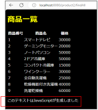{#p180-f12}

::: {#p180-b03 .paragraph}

[CSS とJavaScript を連携することで、より綺麗で使いやすい画面を作ることができます。]{.s009}

:::

::: {#p180-b04 .paragraph}

[この研修で詳細は割愛しますが、Spring Boot はREST API も簡単に作成することができますの]{.s009}\
[で、Ajax などで非同期処理を混ぜることで、アプリ感覚のSPA(Single Page Application)を作る]{.s009}\
[のも容易です。]{.s009}

:::

:::

::: {#page-181 .source-page}

::: {#p181-b01 .heading}

[5\.3.&#32;]{.s004}[レイアウト機能]{.s004}

:::

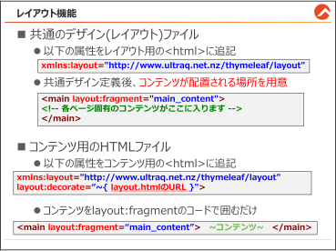{#p181-f13}

::: {#p181-b02 .heading}

[共通の要素を適用する課題について]{.s010}

:::

::: {#p181-b03 .paragraph}

[一般的に、Web サイトは画面ごとに共通のデザインテーマを持ち、統一されたヘッダー、サ]{.s009}\
[イドバー、フッターを採用しています。しかし、Web サイトは数多くのhtml ファイルで構成される]{.s009}\
[ものです。全てのhtml ファイルに、ヘッダー・サイドバー・フッターの要素をコピーすることを考]{.s009}\
[えると、作業量も多いですし、保守性も落ちてしまいます。]{.s009}

:::

::: {#p181-b04 .paragraph}

[Thymeleaf はこの問題を解決するための「レイアウト機能」を提供しています。]{.s009}[一度共通のレ]{.s014}\
[イアウトファイルを作成すれば、それを各ページに容易に適用することができる]{.s014}[ため、開発プ]{.s009}\
[ロセスが大いに効率化されます。]{.s009}

:::

::: {#p181-b05 .paragraph}

[それでは、Thymeleaf でのレイアウトの作成方法について詳しくご説明します。]{.s009}

:::

:::

::: {#page-182 .source-page}

::: {#p182-b01 .heading}

[目標画面]{.s010}

:::

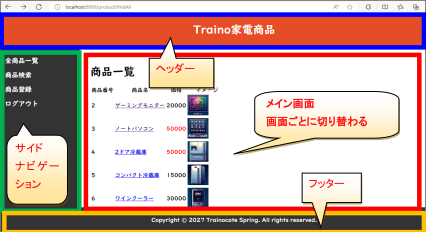{#p182-f14}

::: {#p182-b02 .paragraph}

[今回の研修では、]{.s009}[メイン画面]{.s024}[は画面ごと置き換えできるようにし、赤枠以外の部分を]{.s009}\
[layout.html に記述します。]{.s009}

:::

::: {#p182-b03 .heading}

[【事前準備】 ライブラリを導入]{.s010}

:::

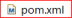{#p182-f15}

::: {#p182-b04 .code}

```xml
<dependency>
        <groupId>nz.net.ultraq.thymeleaf</groupId>
        <artifactId>thymeleaf-layout-dialect</artifactId>
</dependency>
```

:::

::: {#p182-b05 .paragraph}

[レイアウト機能を使うためには、関連のライブラリが必要です。追加して、maven install をしてお]{.s009}\
[きましょう。]{.s009}

:::

:::

::: {#page-183 .source-page}

::: {#p183-b01 .heading}

[【]{.s009}[作業手順①】 レイアウトファイルの作成]{.s014}

:::

::: {#p183-b02 .paragraph}

[…/resources/templates/layout.html]{.s014}

:::

::: {#p183-b03 .code}

```xml
 1:<!DOCTYPE html>
 2:<html xmlns:th="http://www.thymeleaf.org"
 3: xmlns:layout="http://www.ultraq.net.nz/thymeleaf/layout">
 4:
 5:<head>
 6:<meta charset="UTF-8" />
 7:<title>Traino 商品</title>
 8:<link rel="stylesheet" th:href="@{/css/layout.css}" />
 9:</head>
10:<body>
11:<!-- ヘッダー -->
12:<header>
13:<h1>Traino 家電商品</h1>
14:</header>
15:<div class="flex-container">
16:<!-- サイドバー -->
17:<nav>
18: <ul>
19: <li><a th:href="@{/product/findAll}">全商品一覧</a></li>
20: <li><a th:href="@{/product/}">商品検索</a></li>
21: <li><a th:href="@{/product/insert}">商品登録</a></li>
22: <li><a th:href="@{/5}">ログアウト</a></li>
23: </ul>
24:</nav>
25:
26:<!-- メインコンテンツ -->
27:<main layout:fragment="main_content">
28: <!-- 各ページ固有のコンテンツがここに入ります -->
29:</main>
30:</div>
31:<!-- フッター -->
32:<footer>
33:<p>Copyright © 2027 Trainocate Spring. All rights reserved.</p>
34:</footer>
35:</body>
36:</html>
```

:::

:::

::: {#page-184 .source-page}

::: {#p184-b01 .paragraph}

[このlayout.html には、Web サイトの共通要素であるヘッダー、ナビゲーションバー、フッターが]{.s009}\
[定義されています。注目すべき3 つの箇所をご説明します。]{.s009}

:::

::: {#p184-b02 .paragraph}

[・3 行目 xmlns:layout=”http://www.ultraq.net.nz/thymeleaf/layout”\>]{.s014}

:::

::: {#p184-b03 .paragraph}

[レイアウトファイルを定義するためには、既存のhtml 属性に、xmlns:layout 属性を追記する]{.s009}\
[必要があります。html 要素を2 回書いたわけではなく、html 要素に2 つの属性を追加している]{.s009}\
[ことに気をつけてください。]{.s009}

:::

::: {#p184-b04 .paragraph}

[・8 行目 \<link rel=”stylesheet” th:href=”@\{/css/layout.css\}” /\>]{.s014}

:::

::: {#p184-b05 .paragraph}

[&#32;レイアウト専用のcss ファイルを別途作成し、読み込ませました。css ファイルの詳細は、デザ]{.s009}\
[インの領域ですので、章末の【参考】の部分をご覧ください。]{.s009}

:::

::: {#p184-b06 .paragraph}

[・27-29 行 \<main&#32;]{.s014}[layout:fragment=”main\_content”]{.s020}[\>&#32;&#32;\</main\>]{.s014}

:::

::: {#p184-b07 .paragraph}

[&#32;この部分のコードは、]{.s025}[中身がありません]{.s014}[。その理由は、ここは]{.s009}[メインコンテンツが配置される]{.s014}\
[場所]{.s014}[だからです。]{.s009}\
[「layout:fragment=“識別名”」の属性をつけると、この部分に別のhtml ファイル(コンテンツ)の]{.s009}\
[fragment 識別名が一致しているコードがコピーされ、]{.s009}[置き換えられます]{.s014}[。]{.s009}

:::

::: {#p184-b08 .heading}

[【作業手順②】&#32;]{.s014}[コンテンツ用のHTML の修正]{.s010}

:::

::: {#p184-b09 .paragraph}

[…/resources/templates/product/insert.html]{.s014}

:::

::: {#p184-b10 .code}

```xml
 1:<!DOCTYPE html>
 2:<html xmlns:th="http://www.thymeleaf.org"
 3: xmlns:layout="http://www.ultraq.net.nz/thymeleaf/layout"
 4:       layout:decorate="~{/layout}">
 5:
 6:       <!--省略-->
 7:
 8:<body>
 9:<main layout:fragment="main_content">
10:
11:<!--既存のコンテンツのソースコード-->
12:
13:</main>
14:</body>
```
:::

::: {#p184-b11 .paragraph}

[修正するHTML ファイルは、商品関連のどのHTML ファイルでも構いません。]{.s009}

:::

:::

::: {#page-185 .source-page}

::: {#p185-b01 .paragraph}

[・3 行目 xmlns:layout=”http://www.ultraq.net.nz/thymeleaf/layout”]{.s014}

:::

::: {#p185-b02 .paragraph}

[&#32;レイアウトにコピーするコンテンツ側のHTML にも、同じくレイアウト関連のルールを宣言して]{.s025}\
[おきます。]{.s009}

:::

::: {#p185-b03 .paragraph}

[・4 行目 layout:decorate=”~\{/layout\}”\>]{.s014}

:::

::: {#p185-b04 .paragraph}

[&#32;\<html\>の属性の中にlayout:decorate 属性も追記します。この部分の属性値は、]{.s009}[layout.html]{.s020}\
[の場所をURL で指定]{.s020}[すればOK です。]{.s009}

:::

::: {#p185-b05 .paragraph}

[例えば、layout がproduct フォルダ内にあるなら、”~\{/product/layout\}” のように記述すれば]{.s009}\
[OK です。URL を間違えると、レイアウト機能が使えませんので、ご注意ください。]{.s009}

:::

::: {#p185-b06 .paragraph}

[・9-13 行目 \<main layout:fragment=”main\_content”\>]{.s014}

:::

::: {#p185-b07 .paragraph}

[既存の\<body\>内に書いていたソースコードを、全てこの要素で囲みます。先ほどの]{.s009}\
[layout.html のfragment 識別名が“main\_content”でしたので、同じ値を入れます]{.s014}[。そうすること]{.s009}\
[で、]{.s009}[9-13 行内の全てのHTML コードが、layout.html の28 行にコピーされ、レイアウト+コンテ]{.s014}\
[ンツの新しいHTML が生成されます。insert.html へreturn して一覧画面を開くと、自動で]{.s014}\
[layout.html の共通部分まで生成された画面が表示されます。]{.s014}

:::

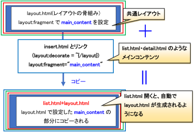{#p185-f16}

::: {#p185-b08 .paragraph}

[今回は、insert.html のみ修正しましたが、レイアウトを適用させたい全てのhtml ファイルを、同]{.s009}\
[じように修正すれば、以下のようにシステム全体に同じデザインが適用されます。]{.s009}

:::

:::

::: {#page-186 .source-page}

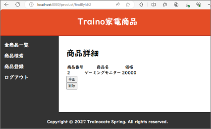{#p186-f17}

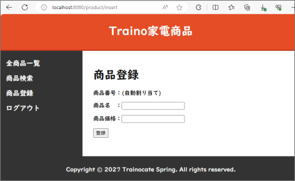{#p186-f18}

:::

::: {#page-187 .source-page}

::: {#p187-b01 .heading}

[【参考】 layout.css のソースコード]{.s010}

:::

::: {#p187-b02 .paragraph}

[…/resources/static/css/layout.css]{.s014}

:::

::: {#p187-b03 .code}

```css
/* 全体のベーススタイリング */
html, body {
    height: 100%;
    margin: 0;
    padding: 0;
    display: flex;
    flex-direction: column;
    font-family: UD デジタル 教科書体 NP-B, sans-serif;
}

/* ヘッダーのスタイリング */
header {
        background-color: #E44D26;
    color: white;
    padding: 10px 0;
    text-align: center;
    border-bottom: 3px solid #C1351D;
}

/* サイドバーのスタイリング */
nav {
    background-color: #333; /* 黒 */
    color: white;
    padding: 15px;
    width: 200px;
    flex-shrink: 0;
}

nav ul {
    list-style: none;
    padding: 0;
    margin: 0;
}

nav ul li a {
    color: white;
```

:::

:::

::: {#page-188 .source-page}

::: {#p188-b01 .code}

```css
    text-decoration: none;
    padding: 10px 0;
    display: block;
    font-size: 1.2em; /* テキストサイズを大きくする */
}

nav ul li a:hover {
    background-color: #555;
}

/* メインコンテンツのスタイリング */
main {
    background-color: #fff; /* 白色の背景 */
    padding: 30px;
    overflow-y: auto; /* 必要に応じてスクロールバーを表示 */
    flex-grow: 1;
}

/* フッターのスタイリング */
footer {
    background-color: #333; /* 黒 */
    color: white;
    text-align: center;
    padding: 10px 0;
    width: 100%;
}

/* フレックスボックスのレイアウト */
.flex-container {
    display: flex;
    flex: 1;
    flex-direction: row;
}

@media (max-width: 768px) {
    .flex-container {
        flex-direction: column;
    }
```

:::

:::

::: {#page-189 .source-page}

::: {#p189-b01 .code}

```java
    nav {
        width: 100%;
    }
}

/* フッターが常に画面の最下部に表示されるようにする */
.flex-container {
    min-height: 0; /* フレックスコンテナのmin-height をリセット */
}

body > footer {
    flex-shrink: 0;
}
```

:::

:::

::: {#page-190 .source-page}

::: {#p190-b01 .heading}

[章のまとめ]{.s008}

:::

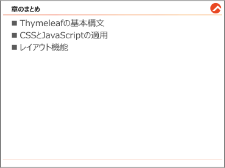{#p190-f19}

::: {#p190-b02 .paragraph}

[この章では、Spring Boot でシステムを実装する際に、追加で知っておくべき機能について]{.s009}\
[ご説明しました。本書で全て紹介できなかったSpring の便利な機能もまだまだありますが、一]{.s009}\
[番基本となる内容は網羅しましたので、これから皆様のSpring 開発知識の土台になると確信し]{.s009}\
[ます。是非マスターしてください。]{.s009}

:::

:::

::: {#page-191 .source-page}

:::
