<!-- 元PDF 192〜237ページ。Java 21・Spring Boot 4.0.2対応版。 -->

::: {#page-192 .source-page}

::: {#p192-b01 .heading}

[&#32;6]{.s005}

:::

::: {#p192-b02 .heading}

[第6章&#32;]{.s001}[外部参照と複雑なSQL 操作]{.s001}

:::

::: {#p192-b03 .heading}

[章の目標]{.s002}

:::

::: {#p192-b04 .heading}

[◼&#32;]{.s003}[外部参照を持つエンティティを利用し、データベース間のリレーション]{.s004}

:::

::: {#p192-b05 .heading}

[シップを設定できる]{.s004}

:::

::: {#p192-b06 .heading}

[◼&#32;]{.s003}[Spring Data JPA を用いた外部参照付きの検索や登録を実装で]{.s004}

:::

::: {#p192-b07 .heading}

[きる]{.s004}

:::

::: {#p192-b08 .heading}

[◼&#32;]{.s003}[複雑なSQL クエリを実行し、実践的なデータ操作ができる]{.s004}

:::

:::

::: {#page-193 .source-page}

:::

::: {#page-194 .source-page}

::: {#p194-b01 .heading}

[章の概要]{.s008}

:::

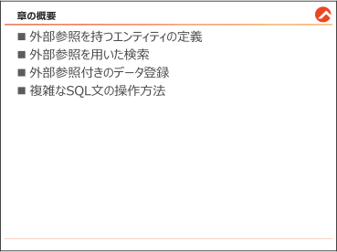{#p194-f01}

::: {#p194-b02 .paragraph}

[本章では、外部参照を持つエンティティの操作方法について学びます。複数のテーブル間]{.s009}\
[にリレーションシップがある場合のエンティティ定義や検索、登録、更新の方法を具体的に解]{.s009}\
[説し、さらに複雑な&#32;]{.s009}[SQL]{.s007}[&#32;クエリをネイティブクエリで実装する方法を紹介します。]{.s009}[Spring Data]{.s007}\
[JPA]{.s007}[&#32;の標準的な機能を基盤とし、実務に役立つデータ操作を学ぶことを目指します。]{.s009}

:::

:::

::: {#page-195 .source-page}

::: {#p195-b01 .heading}

[6\.1.&#32;]{.s004}[外部参照を持つエンティティの定義]{.s004}

:::

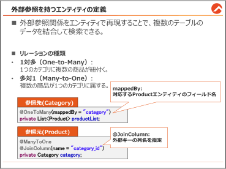{#p195-f02}

::: {#p195-b02 .paragraph}

[3 章では、1 つのテーブルに対応するエンティティを定義し、Spring Data JPA を用いた基本]{.s009}\
[的な操作方法を学びました。本節では、]{.s009}[複数のテーブル間に外部参照の関係がある場合]{.s010}\
[に、どのようにエンティティを設計し、リレーションシップを定義するのかを学びます。]{.s010}[具体的]{.s009}\
[には、「商品（Product）」テーブルと「カテゴリ（Category）」テーブルのリレーションシップをエン]{.s009}\
[ティティとしてどのように表現するかを解説します。]{.s009}

:::

:::

::: {#page-196 .source-page}

::: {#p196-b01 .heading}

[【作業手順①】 新たなテーブルと、データの準備]{.s011}

:::

::: {#p196-b02 .paragraph}

[以下のように、「カテゴリ（Category）」テーブルを新規作成し、既存の「商品（Product）」テー]{.s009}\
[ブルと外部参照で結合します。]{.s009}

:::

::: {#p196-b03 .paragraph}

[※本書では、学習のためにデータベースが事前に構築されています。実務では、必要に応]{.s012}\
[じてテーブルや外部キーの設定を行ってください。]{.s012}

:::

::: {#p196-b04 .heading}

[＜Category テーブル＞]{.s010}

:::

::: {#p196-table01 .table has-header="true"}

| No | 論理名称 | 物理名称 | データ型 | 制約 | 備考 |
| --- | --- | --- | --- | --- | --- |
| 1 | カテゴリID | id | INT | PRIMARY KEY | - |
| 2 | カテゴリ名 | name | VARCHAR(30) | NOT NULL | - |

:::

::: {#p196-b05 .heading}

[&#32;&#32;\<Category テーブルに格納されるデータ\>]{.s011}

:::

::: {#p196-table02 .table has-header="true"}

| カテゴリID | カテゴリ名 |
| --- | --- |
| 1 | テレビ・モニター |
| 2 | コンピュータ |
| 3 | 冷蔵庫 |
| 4 | 洗濯機 |

:::

::: {#p196-b06 .paragraph}

[このデータを基に、「Product」テーブルにも新たにcategory\_id 列を追加し、外部参照の関係を]{.s009}\
[持たせる必要があります。]{.s009}

:::

:::

::: {#page-197 .source-page}

::: {#p197-b01 .heading}

[\<既存のProduct テーブルへの変更\>]{.s011}

:::

::: {#p197-table01 .table has-header="true"}

| No | 論理名称 | 物理名称 | データ型 | 桁数 | 制約 | 備考 |
| --- | --- | --- | --- | --- | --- | --- |
| 1 | 商品番号 | id | INT | - | PRIMARY KEY<br>AUTO\_INCREMENT | 自動採番 |
| 2 | 商品名 | name | VARCHAR | 30 | - | - |
| 3 | 価格 | price | INT | - | - | - |
| 4 | カテゴリID | category\_id | INT |  | FOREIGN KEY | (Category テーブ<br>ルのid 列を参照) |

:::

::: {#p197-b02 .paragraph}

[この修正により、Product テーブルとCategory テーブルが外部キーで結びつきます。]{.s009}

:::

::: {#p197-table02 .table has-header="true"}

| 商品番号 | 商品名 | 価格 | カテゴリID |
| --- | --- | --- | --- |
| 1 | スマートテレビ | 30000 | 1 |
| 2 | ゲーミングモニター | 20000 | 1 |
| 3 | ノートパソコン | 50000 | 2 |
| 4 | 2 ドア冷蔵庫 | 50000 | 3 |
| 5 | コンパクト冷蔵庫 | 15000 | 3 |
| 6 | ワインクーラー | 30000 | 3 |
| 7 | 全自動洗濯機 | 25000 | 4 |
| 8 | 乾燥機能付き洗濯機 | 40000 | 4 |
| 9 | 洗濯乾燥機 | 60000 | 4 |

:::

::: {#p197-b03 .paragraph}

[カテゴリを管理する「Category」テーブルを追加し、外部参照を利用する形に拡張する準備]{.s009}\
[が整いました。]{.s009}

:::

:::

::: {#page-198 .source-page}

::: {#p198-b01 .heading}

[外部参照とは]{.s011}

:::

::: {#p198-b02 .paragraph}

[外部参照とは、1 つのテーブルが別のテーブルのデータを参照する関係を指します。データ]{.s009}\
[ベースでは外部キー（Foreign Key）を使用してこの関係を表現します。]{.s009}

:::

::: {#p198-b03 .paragraph}

[テーブル同士のリレーショナル(関係)が結ばれると、その関係性を表すために、以下の用語で]{.s009}\
[区別します。]{.s009}

:::

::: {#p198-b04 .paragraph}

[リレーションの種類]{.s020}

:::

::: {#p198-b05 .paragraph}

[⚫&#32;]{.s021}[1 対多（One-to-Many）]{.s014}

:::

::: {#p198-b06 .paragraph}

[&#32;1 つのカテゴリ（例: 冷蔵庫）に対して複数の商品（例: 2 ドア冷蔵庫、ワインクーラー）が]{.s009}\
[紐付く関係です。]{.s009}

:::

::: {#p198-b07 .paragraph}

[⚫&#32;]{.s021}[多対1（Many-to-One）]{.s014}

:::

::: {#p198-b08 .paragraph}

[複数の商品が1 つのカテゴリに紐付く関係です。全ての商品は必ずいずれかのカテゴリ]{.s009}\
[に属します。]{.s009}

:::

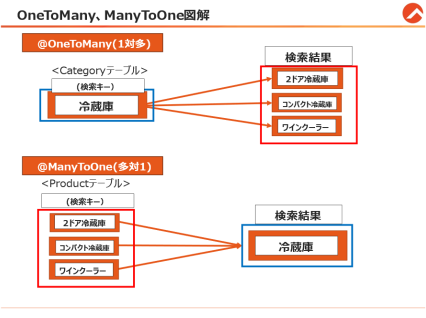{#p198-f03}

::: {#p198-b09 .paragraph}

[Category テーブルからの視点では、Product テーブルとの関係は、1 対多と表現できます。]{.s009}

:::

::: {#p198-b10 .paragraph}

[Product テーブルからの視点では、Category テーブルとの関係は、多対1 と表現できます。]{.s009}

:::

:::

::: {#page-199 .source-page}

::: {#p199-b01 .heading}

[【作業手順②】 参照先エンティティの作成]{.s011}

:::

::: {#p199-b02 .paragraph}

[では、テーブルとの関係性を、Java の世界にエンティティとして、忠実に再現しましょう。]{.s009}

[まずは、]{.s009}[category]{.s022}[&#32;テーブルに対応するエンティティ&#32;]{.s009}[Category]{.s022}[&#32;を作成します。]{.s009}

:::

::: {#p199-b03 .paragraph}

[…/entity/Category.java]{.s010}

:::

::: {#p199-b04 .code}

```java
package jp.co.trainocate.answer.entity;

import jakarta.persistence.OneToMany;

@Entity
@Data
@Table(name = "category")
public class Category {
    @Id
    @GeneratedValue(strategy = GenerationType.IDENTITY)
    private Integer id;

    @Column(length = 30)
    private String name;

    @OneToMany(mappedBy = "category")
    private List<Product> productList;
}
```

:::

::: {#p199-b05 .paragraph}

[上記の Category エンティティは、category テーブルに対応しています。各フィールドはテ]{.s009}\
[ーブル内の列に対応しており、特に id フィールドは主キーとして定義されています。]{.s009}

:::

::: {#p199-b06 .paragraph}

[また、]{.s009}[productList フィールド]{.s010}[は 後述するProduct エンティティを格納するリストで、]{.s009}[一対多]{.s010}\
[の関係を作るために複数のデータを格納する必要がある]{.s010}[ため、必須です。]{.s009}

:::

::: {#p199-b07 .paragraph}

[@OneToMany アノテーションは、1 つのカテゴリが複数の商品を持つ「1 対多」の関係を表]{.s010}\
[します。]{.s010}[たとえば、「冷蔵庫」というカテゴリに、「2 ドア冷蔵庫、コンパクト冷蔵庫、ワインクーラ]{.s009}\
[ー」が該当するパターンです。]{.s009}

:::

::: {#p199-b08 .paragraph}

[@OneToMany アノテーションには&#32;]{.s009}[mappedBy 属性]{.s010}[があります。この属性は、後述する]{.s009}\
[Product エンティティに定義されるフィール名を記載します。Product エンティティの説明の後]{.s009}\
[に、再度ご確認ください。]{.s009}

:::

:::

::: {#page-200 .source-page}

::: {#p200-b01 .heading}

[【作業手順③】 参照元エンティティの修正]{.s011}

:::

::: {#p200-b02 .paragraph}

[次に、Product テーブルに対応するエンティティ Product を修正します。Product テーブ]{.s009}\
[ルは category テーブルを外部参照しているため、Product エンティティには Category エン]{.s009}\
[ティティをフィールドとして含めます。]{.s009}

:::

::: {#p200-b03 .paragraph}

[…/entity/Product.java]{.s010}

:::

::: {#p200-b04 .code}

```java
import jakarta.persistence.JoinColumn;
import jakarta.persistence.ManyToOne;

@Entity
@Data
@Table(name = "product")

public class Product {

        @Id
        @GeneratedValue(strategy = GenerationType.IDENTITY)
        private Integer id;

        @Column(length = 30, nullable = false)
        private String name;

        @Column(nullable = false)
        private Integer price;

       @ManyToOne
       @JoinColumn(name = "category_id")
       private Category category;
}
```

:::

::: {#p200-b05 .paragraph}

[最後のcategory フィールドにご注目ください。今まではテーブル上の列名がエンティティのフ]{.s009}\
[ィールド名に合わせる必要がありました。よって、以下のようなテーブル構成なら、「Integer]{.s009}\
[categoryId」と定義するべきでしょう。]{.s009}

:::

::: {#p200-table01 .table has-header="false"}

|  |  |  |  |  |  |  |
| --- | --- | --- | --- | --- | --- | --- |
| 4 | カテゴリID | category\_id | INT |  | FOREIGN KEY | (Category テーブ<br>ルのid 列を参照) |

:::

::: {#p200-b06 .paragraph}

[しかし、category\_id ではなく、「Category category」 のフィールドを定義しています。]{.s009}

:::

:::

::: {#page-201 .source-page}

::: {#p201-b01 .paragraph}

[JPA では、外部キー（例: category\_id 列）を直接操作せず、リレーション先のエンティティ（例:]{.s009}\
[Category）をフィールドとして扱います。これにより、オブジェクト指向の設計とデータベース操]{.s009}\
[作を統一できます。]{.s009}

:::

::: {#p201-b02 .code}

```java
@ManyToOne
@JoinColumn(name = "category_id", nullable = false)
private Category category;
```

:::

::: {#p201-b03 .paragraph}

[このように、]{.s009}[外部参照の関係を持つテーブルのエンティティを作成する際には、列名ではな]{.s010}\
[く、参照先のエンティティをフィールドとして定義します。]{.s010}[Product テーブルは Category テー]{.s009}\
[ブルと外部参照の関係にあるため、Product エンティティ内に Category 型のフィールドを追]{.s009}\
[加しています。]{.s009}

:::

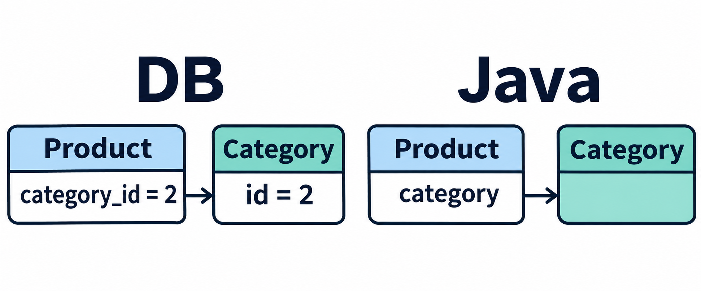{#illustration-2026-foreign-key-reference}

::: {#illustration-2026-foreign-key-reference-caption .paragraph}

DBではcategory_idの値で関連付け、JavaではProductのcategoryフィールドからCategoryを参照します。

:::

::: {#p201-b04 .paragraph}

[そして、]{.s009}[@ManyToOne アノテーションは、複数のアイテムが1つのカテゴリに属する「多対1」]{.s010}\
[の関係を表します]{.s010}[。Product エンティティの category フィールドに付与されています。]{.s009}

:::

::: {#p201-b05 .paragraph}

[たとえば、「2 ドア冷蔵庫、コンパクト冷蔵庫、ワインクーラー」のようなデータは、「冷蔵庫」のカ]{.s009}\
[テゴリに属しているということです。]{.s009}

:::

::: {#p201-b06 .paragraph}

[@JoinColumn アノテーション]{.s010}[は、参照元テーブルのどの列と参照先テーブルのどの列が外部]{.s009}\
[参照制約の関係にあるかを定義します。]{.s009}[&#32;name 属性には、外部キーとして使用するテーブル]{.s010}\
[列名（例: category\_id）を指定します。]{.s010}

:::

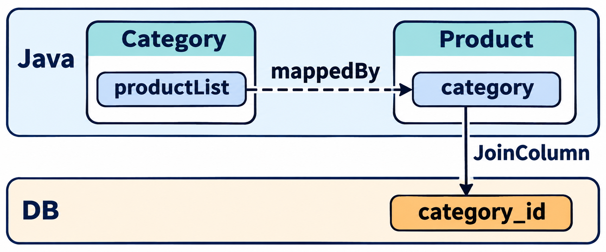{#illustration-expansion-2026-relationship-field-column}

::: {#illustration-expansion-2026-relationship-field-column-caption .paragraph}

mappedByは相手のJavaフィールド名、JoinColumnのnameはDBの列名を指定します。

:::

::: {#p201-b07 .paragraph}

[&#32;このアノテーションを記述すると、]{.s009}[検索時に参照関係にあるテーブルが内部結合され、自動]{.s012}\
[的にデータを取得]{.s012}[できます。つまり、]{.s009}[Product テーブルを対象に検索したら、Category テーブ]{.s010}\
[ルのデータも取得できるようになる]{.s010}[ということです。なお、参照関係にあるテーブルのレコード]{.s009}\
[はエンティティのフィールドに代入されます。]{.s009}

:::

::: {#p201-b08 .paragraph}

[これにより、テーブル間のリレーションシップがSpring上で明確に定義され、データベース操]{.s009}\
[作が容易になります。]{.s009}

:::

:::

::: {#page-202 .source-page}

::: {#p202-b01 .heading}

[【作業手順④】 CategoryRepository の作成]{.s011}

:::

::: {#p202-b02 .paragraph}

[…/repository/CategoryRepository.java]{.s010}

:::

::: {#p202-b03 .code}

```java
package jp.co.trainocate.answer.repository;

import org.springframework.data.jpa.repository.JpaRepository;
import jp.co.trainocate.answer.entity.Category;

public interface CategoryRepository extends JpaRepository<Category,
Integer> {

}
```

:::

::: {#p202-b04 .paragraph}

[Category の検索も後ほど必要となりますので、リポジトリを作成します。]{.s009}

:::

::: {#p202-b05 .paragraph}

[「Category」は、別API と名前が被ることがありますので、今後、Import の際は、注意]{.s010}[してくだ]{.s009}\
[さい。]{.s009}

:::

:::

::: {#page-203 .source-page}

::: {#p203-b01 .heading}

[6\.2.&#32;]{.s004}[外部参照を用いた検索]{.s004}

:::

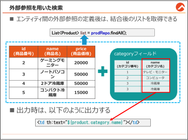{#p203-f04}

::: {#p203-b02 .paragraph}

[本節では、Spring Data JPA を用いて、外部参照を持つテーブル間の基本的な検索を実装]{.s009}\
[する方法を学びます。外部参照を定義したエンティティを活用し、関連データを簡単に取得す]{.s009}\
[る基礎的な操作に重点を置きます。]{.s009}

:::

:::

::: {#page-204 .source-page}

::: {#p204-b01 .heading}

[【作業手順①】 商品コントローラーの再確認]{.s011}

:::

::: {#p204-b02 .paragraph}

[以下は、3 章で作成したProductController とほぼ同じ内容です。ただし、外部参照をエンテ]{.s009}\
[ィティに定義したため、挙動に変化があります。]{.s009}

:::

::: {#p204-b03 .paragraph}

[…/controller/ProductController.java]{.s010}

:::

::: {#p204-b04 .code}

```java
@Controller
@RequestMapping("/product")
public class ProductController {
        @Autowired
        private ProductRepository prodRepo;

        @GetMapping("/findAll")
        public String showProductList(Model model) {
               List<Product> list = prodRepo.findAll();
         //System.out.println(list); //外部参照の定義後は、エラーになる
               model.addAttribute("products", list);
               return "product/list";
        }
```

:::

::: {#p204-b05 .paragraph}

[■ findAll メソッドの結果]{.s010}\
[外部参照を定義した後、findAll メソッドの実行結果には、]{.s009}[Product のデータに加えて、関連]{.s010}\
[するCategory のデータも含まれる]{.s010}[ようになります。]{.s009}

:::

::: {#p204-b06 .paragraph}

[一覧取得時に、関連するカテゴリ情報も自動的に取得されます。]{.s009}

:::

::: {#p204-b07 .paragraph}

[■&#32;]{.s010}[標準出力の注意点]{.s012}\
[外部参照を持つエンティティは構造が複雑になります。特に、エンティティ間の双方向参]{.s009}\
[照が設定されている場合、エンティティのインスタンスをSystem.out.println で出力すると、]{.s009}\
[スタックオーバーフローエラーが発生する可能性があります。]{.s009}\
[Product がCategory を参照し、Category がProduct を再参照するためです。]{.s009}

:::

:::

::: {#page-205 .source-page}

::: {#p205-b01 .heading}

[【作業手順②】 View にカテゴリ名を出力するよう修正]{.s011}

:::

::: {#p205-b02 .paragraph}

[商品データをリスト表示する際に、カテゴリ名も合わせて表示するようにlist.html を修正しま]{.s009}\
[す。以下のコードは、商品リストをHTML テーブルとして表示するサンプルです。]{.s009}\
[変更点として、]{.s009}[カテゴリ名を表示する列を追加し、product.category.name でカテゴリ名を取得]{.s010}\
[しました。]{.s009}

:::

::: {#p205-b03 .paragraph}

[…/resources/templates/product/list.html]{.s010}

:::

::: {#p205-b04 .code}

```xml
<h1>商品一覧</h1>
        <table>
               <tr>
                       <th>商品番号</th>
                       <th>商品名</th>
                       <th>価格</th>
                       <th>カテゴリ</th>
               </tr>
               <tr th:each="product: ${products}">
                       <td th:text="${product.id}"></td>
                       <td th:text="${product.name}"></td>
                       <td th:text="${product.price}"></td>
                       <td th:text="${product.category.name}"></td>
               </tr>
        </table>
```

:::

::: {#p205-b05 .paragraph}

[カテゴリ名の取得]{.s010}

:::

::: {#p205-b06 .paragraph}

[\<td th:text="$\{product.category.name\}"\>\</td\>の部分で、Product エンティティに紐付く]{.s009}\
[Category エンティティのname フィールドを表示できます。]{.s009}

:::

::: {#p205-b07 .paragraph}

[一覧取得時に、関連するカテゴリ情報も自動的に取得されます。product.category は]{.s009}\
[Product エンティティの@ManyToOne で定義されたリレーションを利用して、Category エンティ]{.s009}\
[ティを取得できます。]{.s009}

:::

::: {#p205-b08 .paragraph}

[このように、外部参照が正しく定義されていると、対象のエンティティだけではなく、紐づいて]{.s009}\
[いる別エンティティのデータ群も取得可能です。]{.s009}

:::

:::

::: {#page-206 .source-page}

::: {#p206-b01 .heading}

[【参考】 null データの参照時のエラー対策]{.s011}

:::

::: {#p206-b02 .paragraph}

[外部参照が定義されたエンティティでは、関連するデータ（ここではカテゴリ）が設定されて]{.s009}\
[いない場合に注意が必要です。具体的には、]{.s009}[product.category がnull の場合に]{.s010}\
[product.category.name を参照しようとすると、エラーが発生します。]{.s010}

:::

::: {#p206-b03 .paragraph}

[このような場合、カテゴリが未設定（null）でもエラーを回避し、適切に表示できるように処理]{.s009}\
[を追加します。]{.s009}

:::

::: {#p206-b04 .paragraph}

[①&#32;&#32;th:if 文を利用]{.s010}

:::

::: {#p206-b05 .paragraph}

[5章で学習したとおり、Thymeleafでは、th:if属性を利用して条件を設定することがで]{.s022}\
[きます。]{.s022}

:::

::: {#p206-b06 .code}

```xml
<td th:if="${product.category != null}" th:text="${product.category.name}"></td>
<td th:unless="${product.category != null}">未設定</td>
```

:::

::: {#p206-b07 .heading}

[■&#32;]{.s011}[th:if="$\{product.category \!= null\}"]{.s011}

:::

::: {#p206-b08 .paragraph}

[この部分は、「カテゴリが設定されている場合」に実行されます。カテゴリ名を表示]{.s022}\
[します。]{.s022}

:::

::: {#p206-b09 .heading}

[■&#32;]{.s011}[th:unless="$\{product.category \!= null\}"]{.s011}

:::

::: {#p206-b10 .paragraph}

[この部分は、「カテゴリが未設定の場合」に実行されます。「未設定」という文字列を]{.s022}\
[表示します。]{.s022}

:::

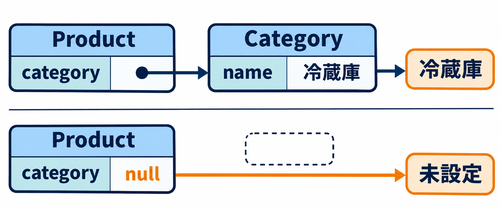{#illustration-expansion-2026-null-reference-guard}

::: {#illustration-expansion-2026-null-reference-guard-caption .paragraph}

product.categoryがあるときだけnameを読み、nullのときは「未設定」を表示します。

:::

::: {#p206-b11 .paragraph}

[②&#32;]{.s010}[&#32;条件式を1 行で記述する方法（三項演算子）]{.s010}

:::

::: {#p206-b12 .paragraph}

[上記のように複数行で条件を記述する代わりに、条件式を使って1 行で記述する方法]{.s022}\
[もあります。]{.s022}

:::

::: {#p206-b13 .code}

```xml
<td th:text="${product.category != null ? product.category.name : '未設定'}"></td>
```

:::

::: {#p206-b14 .paragraph}

[■&#32;]{.s014}[product.category \!= null:]{.s010}

:::

::: {#p206-b15 .paragraph}

[「カテゴリが設定されているか」をチェックします。]{.s009}

:::

::: {#p206-b16 .paragraph}

[■&#32;]{.s014}[?（三項演算子）:]{.s010}

:::

::: {#p206-b17 .paragraph}

[条件がtrue の場合に左側の値（product.category.name）を表示します。]{.s009}

:::

::: {#p206-b18 .paragraph}

[■&#32;]{.s014}[:（else 部分）:]{.s010}

:::

::: {#p206-b19 .paragraph}

[条件がfalse の場合に右側の値（'未設定'）を表示します。]{.s009}

:::

:::

::: {#page-207 .source-page}

::: {#p207-b01 .heading}

[動作確認]{.s011}

:::

::: {#p207-b02 .heading}

[http://localhost:8080/product/findAll]{.s034}

:::

::: {#p207-b03 .paragraph}

[3 章と同様に、Controller のURL マッピングが、\[/product\]]{.s009}\
[メソッドのURL マッピングが\[/findAll\] になっているため、このようなURL を指定します。]{.s009}

:::

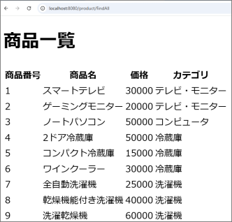{#p207-f05}

::: {#p207-b04 .paragraph}

[カテゴリ列に商品ごとのカテゴリ名が結合され表示されることを確認できます。]{.s022}

:::

:::

::: {#page-208 .source-page}

::: {#p208-b01 .heading}

[6\.2.1.&#32;]{.s004}[【参考】 検索結果のエラーハンドリング]{.s004}

:::

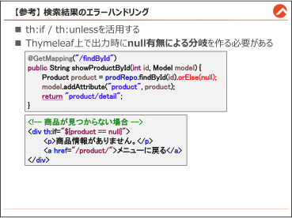{#p208-f06}

::: {#p208-b02 .paragraph}

[本節では、検索時のエラーハンドリングについて学びます。存在しないID で検索した場合]{.s009}\
[に発生するエラーを回避し、より安全にデータを取得する方法について学びます。また、カテ]{.s009}\
[ゴリ名を表示することで、リレーションの復習も行います。]{.s009}

:::

:::

::: {#page-209 .source-page}

::: {#p209-b01 .heading}

[【作業手順①】 findById(id).orElse(null)の確認]{.s011}

:::

::: {#p209-b02 .paragraph}

[…/controller/ProductController.java]{.s010}

:::

::: {#p209-b03 .code}

```java
//省略

@GetMapping("/findById")
        public String showProductById(int id, Model model) {
               Product product = prodRepo.findById(id).orElse(null);
               model.addAttribute("product", product);
               return "product/detail";
        }
```

:::

::: {#p209-b04 .paragraph}

[findById(id).orElse(null)]{.s010}[を使用すると、データが存在しない場合にnull が返され、安全に処理]{.s009}\
[を進めることができます。]{.s009}

:::

::: {#p209-b05 .paragraph}

[もちろん、エンティティ間の定義が完了しているので、]{.s009}[findById でも結合した結果を取得]{.s010}[でき]{.s009}\
[ます。]{.s009}

:::

:::

::: {#page-210 .source-page}

::: {#p210-b01 .heading}

[【作業手順②】 商品が見つからなかった際の表示の切り替え]{.s011}

:::

::: {#p210-b02 .paragraph}

[…/resources/templates/product/detail.html]{.s010}

:::

::: {#p210-b03 .code}

```xml
<h1>商品詳細</h1>

    <!-- 商品が見つからない場合 -->
    <div th:if="${product == null}">
        <p>商品情報がありません。</p>
        <a href="/product/">検索メニューに戻る</a>
    </div>

    <!-- 商品が見つかった場合 -->
    <div th:unless="${product == null}">
        <table>
            <tr>
                <th>商品番号</th>
                <th>商品名</th>
                <th>価格</th>
                <th>カテゴリ</th>
            </tr>
            <tr>
                <td th:text="${product.id}"></td>
                <td th:text="${product.name}"></td>
                <td th:text="${product.price}"></td>
                <td th:text="${product.category.name}"></td>
            </tr>
        </table>

    <!--...省略-->

    </div>
```

:::

::: {#p210-b04 .paragraph}

[\<div\>\</div\>で囲まれた部分は、Controller でModel に格納されたデータの有無に応じて、表]{.s009}\
[示内容を切り替える処理を行っています。]{.s009}

:::

::: {#p210-b05 .paragraph}

[このように、]{.s009}[複数行のThymeleaf 条件式は、視認性や保守性を高めるために\<div\>\</div\>を]{.s010}\
[使用することを推奨します。]{.s010}

:::

:::

::: {#page-211 .source-page}

::: {#p211-b01 .paragraph}

[※単体のデータの有無ではなく、リスト内の判定については、5.1.2 の➁を再度ご確認くださ]{.s009}\
[い。]{.s009}

:::

::: {#p211-b02 .code}

```xml
<div th:if="${#lists.isEmpty(products)}">
    商品情報がありません。
</div>
<div th:unless="${#lists.isEmpty(products)}">
    <!-- 商品情報リストの内容(<table>～</table>)をここに記載 -->
</div>
```

:::

:::

::: {#page-212 .source-page}

::: {#p212-b01 .heading}

[動作確認]{.s011}

:::

::: {#p212-b02 .heading}

[http://localhost:8080/product/]{.s034}

:::

::: {#p212-b03 .paragraph}

[➀ ID 検索フォームに、存在しない商品番号を入れ、検索します。]{.s010}

:::

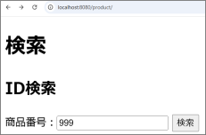{#p212-f07}

::: {#p212-b04 .heading}

[➁&#32;]{.s011}[例外のエラーページの代わりに、商品情報なしのメッセージが表示されることを確認して]{.s010}

:::

::: {#p212-b05 .paragraph}

[ください。]{.s010}

:::

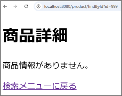{#p212-f08}

::: {#p212-b06 .paragraph}

[➂ 検索ページに戻り、今度は「1」で商品番号検索を行い、カテゴリ名を含めた商品データが]{.s010}\
[表示されるかを確認してください。]{.s010}

:::

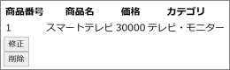{#p212-f09}

:::

::: {#page-213 .source-page}

::: {#p213-b01 .heading}

[6\.3.&#32;]{.s004}[外部参照付きのデータ登録]{.s004}

:::

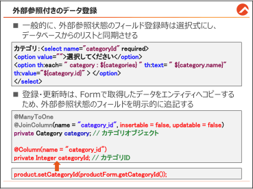{#p213-f10}

::: {#p213-b02 .paragraph}

[本節では、商品データとカテゴリデータのリレーションを考慮したデータ登録を実装します。]{.s009}\
[特に、商品情報を登録する際にカテゴリを選択する方法を学びます。]{.s009}

:::

::: {#p213-b03 .paragraph}

[また、フォームから送信されたカテゴリID を商品エンティティに関連付けて登録する際に直]{.s009}\
[面する課題を説明し、その解決方法を実装します。]{.s009}

:::

:::

::: {#page-214 .source-page}

::: {#p214-b01 .heading}

[商品登録に選択式のカテゴリを追加する時]{.s011}

:::

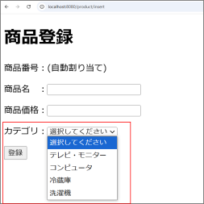{#p214-f11}

::: {#p214-b02 .paragraph}

[今回は、商品データにカテゴリを登録する機能を追加します。]{.s009}\
[カテゴリのように、多対1 の外部参照関係を持つデータは、Web 上では選択式（セレクトメニュ]{.s009}\
[ー）で登録するのが一般的です。]{.s009}

:::

::: {#p214-b03 .paragraph}

[以下は、固定値を用いたセレクトメニューの例です。]{.s009}

:::

::: {#p214-b04 .paragraph}

[…/resources/templates/product/insert.html]{.s010}

:::

::: {#p214-b05 .code}

```xml
<h1>商品登録</h1>
        <form th:action = "@{/product/insert}" method = "POST">
        <p>商品番号：(自動割り当て)</p>
        <p>商品名 ：<input type = "text" name = "name"></p>
        <p>商品価格：<input type = "number" name = "price"></p>
        <p>カテゴリ：
               <select name="categoryId" required>
                       <option value = "">選択してください</option>
                       <option value = "1">テレビ・モニター</option>
                       <option value = "2">コンピュータ</option>
                       <option value = "3">冷蔵庫</option>
                       <option value = "4">洗濯機</option>
               </select>
        </p>
```

:::

:::

::: {#page-215 .source-page}

::: {#p215-b01 .paragraph}

[このように固定値を記載する方法は簡単ですが、以下のような問題点があります。]{.s009}

:::

::: {#p215-b02 .paragraph}

[⚫&#32;]{.s021}[新しいカテゴリの追加や既存カテゴリの修正が手間]{.s010}\
[HTML コードを手動で変更する必要があるため、管理が煩雑になります。]{.s009}

:::

::: {#p215-b03 .paragraph}

[⚫&#32;]{.s021}[データベースとの不一致]{.s010}\
[UI とデータベースが同期しなくなる可能性があり、意図しない不具合が発生します。]{.s009}

:::

::: {#p215-b04 .paragraph}

[これらの問題を解決するために、データベースからカテゴリデータを取得し、動的にセレクト]{.s009}\
[メニューを生成する方法を採用します。]{.s009}

:::

::: {#p215-b05 .heading}

[【作業手順①】 登録処理の準備 - ProductForm の修正]{.s011}

:::

::: {#p215-b06 .paragraph}

[登録画面のフォームでは以下のデータが送信されます。]{.s009}

:::

::: {#p215-b07 .paragraph}

[•&#32;]{.s035}[商品名（name）]{.s009}

:::

::: {#p215-b08 .paragraph}

[•&#32;]{.s035}[商品価格（price）]{.s009}

:::

::: {#p215-b09 .paragraph}

[•&#32;]{.s035}[カテゴリID（categoryId）]{.s009}

:::

::: {#p215-b10 .paragraph}

[新たに追加されたcategoryId をコントローラで受け取るため、ProductForm クラスを修正しま]{.s009}\
[す。]{.s009}

:::

::: {#p215-b11 .paragraph}

[…/form/ProductForm.java]{.s010}

:::

::: {#p215-b12 .code}

```java
@Data
public class ProductForm {
        private Integer id; //商品番号
        private String name; //商品名
        private Integer price; //商品価格

        private Integer categoryId; //カテゴリID
}
```

:::

::: {#p215-b13 .paragraph}

[送信される際に、select 要素のname 属性値が、categoryId ですので、Integer categoryId と]{.s009}\
[定義します。]{.s009}

:::

:::

::: {#page-216 .source-page}

::: {#p216-b01 .heading}

[【作業手順②】 登録画面遷移用のコントローラーの修正]{.s010}

:::

::: {#p216-b02 .paragraph}

[…/controller/ProductController.java]{.s010}

:::

::: {#p216-b03 .code}

```java
import jp.co.trainocate.answer.entity.Category;
import jp.co.trainocate.answer.repository.CategoryRepository;

@Controller
@RequestMapping("/product")
public class ProductController {
     @Autowired
     private ProductRepository prodRepo;
     @Autowired
     private CategoryRepository cateRepo;

//検索系メソッドは省略

@GetMapping("/insert")
        public String showProductInsertView(Model model) {
              // カテゴリリストを取得
               List<Category> list = cateRepo.findAll();
               model.addAttribute("categories", list);
               return "product/insert"; // 登録入力画面へ
        }
```

:::

::: {#p216-b04 .paragraph}

[次は、Controller のハンドラメソッドを修正します。元々、@GetMapping(“/insert”)のメソッドは、]{.s009}\
[今まで単純に登録をする入力画面へ遷移するだけの単純なコードでした。]{.s009}

:::

::: {#p216-b05 .paragraph}

[ただ、\<option\>にカテゴリデータを動的に出力するには、コントローラで事前にモデルにカテゴ]{.s009}\
[リリストを格納して送信しておく必要があります。]{.s009}

:::

::: {#p216-b06 .paragraph}

[コードの解説:]{.s010}

:::

::: {#p216-b07 .paragraph}

[⚫&#32;]{.s021}[CategoryRepository の依存性注入:]{.s020}

:::

::: {#p216-b08 .paragraph}

[カテゴリデータをデータベースから取得するため、CategoryRepository を]{.s009}\
[@Autowired で注入します。]{.s009}

:::

::: {#p216-b09 .paragraph}

[⚫&#32;]{.s021}[findAll()による全件取得:]{.s020}

:::

::: {#p216-b10 .paragraph}

[カテゴリリストをfindAll()メソッドで取得します。]{.s009}

:::

:::

::: {#page-217 .source-page}

::: {#p217-b01 .paragraph}

[⚫&#32;]{.s021}[model.addAttribute:]{.s020}

:::

::: {#p217-b02 .paragraph}

[カテゴリリストを&#32;]{.s009}[categories]{.s012}[&#32;という名前でモデルに格納し、ビューで利用可能にしま]{.s009}\
[す。]{.s009}

:::

::: {#p217-b03 .paragraph}

[⚫&#32;]{.s021}[入力画面テンプレートへの遷移:]{.s020}

:::

::: {#p217-b04 .paragraph}

[return "product/insert";で商品登録画面へ遷移します。]{.s009}

:::

::: {#p217-b05 .paragraph}

[これで、登録画面へカテゴリのリストの送信ができましたので、登録画面のView を実装しま]{.s009}\
[しょう。]{.s009}

:::

:::

::: {#page-218 .source-page}

::: {#p218-b01 .heading}

[【作業手順③】 カテゴリのリストの動的表示]{.s011}

:::

::: {#p218-b02 .code}

```xml
<p>カテゴリ：<select name="categoryId" required>
        <option value="">選択してください</option>
        <option th:each="category : ${categories}"
                th:text="${category.name}"
                th:value="${category.id}" >
        </option>
    </select>
    </p>
```

:::

::: {#p218-b03 .paragraph}

[修正点の説明:]{.s010}

:::

::: {#p218-b04 .paragraph}

[⚫&#32;]{.s039}[th:each:]{.s020}\
[データベースから取得したカテゴリリスト（categories）をループ処理で展開します。]{.s009}

:::

::: {#p218-b05 .paragraph}

[⚫&#32;]{.s039}[th:text:]{.s020}\
[メニューに表示するカテゴリ名（category.name）を動的に設定します。]{.s009}

:::

::: {#p218-b06 .paragraph}

[⚫&#32;]{.s039}[th:value:]{.s020}\
[フォーム送信時にカテゴリID（category.id）をコントローラに渡します。登録処理ではこ]{.s009}\
[のID を使用します。]{.s009}

:::

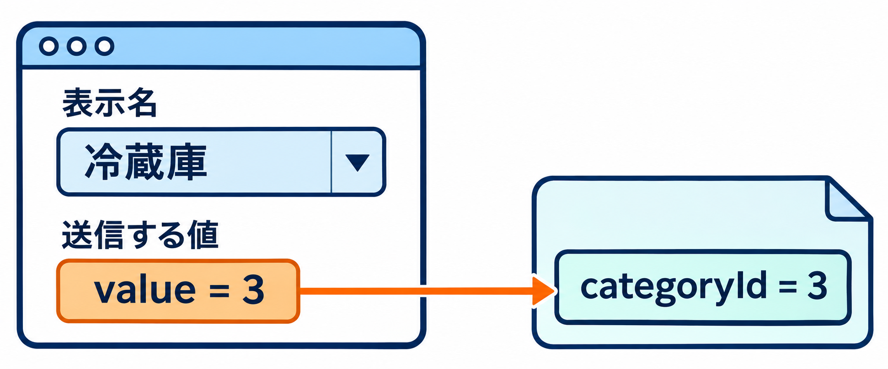{#illustration-expansion-2026-select-label-value}

::: {#illustration-expansion-2026-select-label-value-caption .paragraph}

選択メニューにはカテゴリ名を表示し、送信時には対応するカテゴリIDをcategoryIdとして渡します。

:::

::: {#p218-b07 .paragraph}

[ポイント:]{.s010}

:::

::: {#p218-b08 .paragraph}

[⚫&#32;]{.s039}[データベースのカテゴリデータに変更があっても、フォームは自動的に更新されます。]{.s009}

:::

::: {#p218-b09 .paragraph}

[⚫&#32;]{.s039}[セレクトメニューの\<option\>タグがデータベースの内容と常に同期します。]{.s009}

:::

:::

::: {#page-219 .source-page}

::: {#p219-b01 .heading}

[【作業手順④】 登録処理の実装 - 不具合の確認]{.s010}

:::

::: {#p219-b02 .paragraph}

[ProductForm にcategoryId フィールドを追加したことで、登録処理用のメソッドでカテゴリID を]{.s009}\
[受け取ることができるようになりました。次に、ProductFormのデータをProductエンティティにコ]{.s009}\
[ピーして保存する処理を実装します。]{.s009}

:::

::: {#p219-b03 .paragraph}

[…/controller/ProductController.java]{.s010}

:::

::: {#p219-b04 .code}

```java
@PostMapping("/insert")
public String insertProduct(ProductForm productForm) {
      Product product = new Product();
      product.setName(productForm.getName());
      product.setPrice(productForm.getPrice());

      // カテゴリID を設定する処理を追加しようとする
      product.setCategoryId(productForm.getCategoryId()); // エラー発生

      prodRepo.save(product);
      return "redirect:/product/findAll";
}
```

:::

::: {#p219-b05 .paragraph}

[3章で学習した通り、prodRepo.save(product)をする前には、ProductFormのデータをProduct]{.s009}\
[エンティティにコピーしておく必要がありました。]{.s009}

:::

::: {#p219-b06 .paragraph}

[しかし、いざproduct.setCategoryId( ) メソッドを呼び出そうとしたら、そもそも]{.s009}[Productエンティ]{.s010}\
[ティには、categoryId ではなく、Category category でフィールドを定義していたため、]{.s010}\
[setCategoryId メソッドが生成されていません。]{.s010}[よって、]{.s009}[エラー]{.s012}[になります。]{.s009}

:::

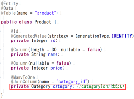{#p219-f12}

:::

::: {#page-220 .source-page}

::: {#p220-b01 .heading}

[【作業手順➄】 Product エンティティにcategoryId フィールドの追加]{.s010}

:::

::: {#p220-b02 .paragraph}

[作業手順④の不具合を解決するため、]{.s009}[Product エンティティにcategoryId フィールドを追加]{.s010}\
[します。]{.s009}\
[ただし、categoryId とcategory の2 つのフィールドが同じ列を参照するため、重複マッピングに]{.s009}\
[注意が必要です。]{.s009}

:::

::: {#p220-b03 .paragraph}

[…/entity/Product.java]{.s010}

:::

::: {#p220-b04 .code}

```java
// 上記省略
  @Column(nullable = false)
  private Integer price;

  @ManyToOne
  @JoinColumn(name = "category_id", insertable = false, updatable = false)
  private Category category; // カテゴリオブジェクト
```

:::

::: {#p220-b05 .code}

```java
  @Column(name = "category_id")
  private Integer categoryId; // カテゴリID
}
```

:::

::: {#p220-b06 .paragraph}

[フィールド追加のポイント]{.s010}

:::

::: {#p220-b07 .paragraph}

[⚫&#32;]{.s021}[@Column(name = "category\_id")を明示的に指定する理由:]{.s010}

:::

::: {#p220-b08 .paragraph}

[データベースのcategory\_id 列をcategoryId フィールドにマッピングするために必要で]{.s009}\
[す。]{.s009}\
[指定しないと、フィールド名を基に自動推論され、列重複によるエラーが出ます。]{.s009}

:::

::: {#p220-b09 .paragraph}

[⚫&#32;]{.s021}[insertable = false, updatable = false を設定する理由:]{.s010}

:::

::: {#p220-b10 .paragraph}

[@ManyToOne のcategory フィールドと@Column のcategoryId が同じカラムを参照して]{.s009}\
[いると、]{.s009}[登録や更新時にどちらを優先するかHibernate が判断できず]{.s010}[、以下のようなエ]{.s009}\
[ラーが発生します。]{.s009}

:::

::: {#p220-b11 .code}

```text
Repeated column in mapping for entity: Product column: category_id
(should be mapped with insert="false" update="false")
```

:::

::: {#p220-b12 .paragraph}

[insertable = false, updatable = false を設定することで、]{.s009}[category フィールドが登録や更]{.s010}\
[新に関与しないようにし、categoryId だけを使用するように制御]{.s010}[できます。]{.s009}

:::

::: {#p220-b13 .paragraph}

[&#32;Product エンティティの修正後、保存すると、登録処理用メソッドのエラーが消え、正常にカテ]{.s009}\
[ゴリID を登録できるようになります。]{.s009}

:::

:::

::: {#page-221 .source-page}

::: {#p221-b01 .heading}

[動作確認]{.s011}

:::

::: {#p221-b02 .heading}

[http://localhost:8080/product/insert]{.s034}

:::

::: {#p221-b03 .paragraph}

[➀ 任意のデータを入力・選択し、「登録」ボタンをクリックします。]{.s010}

:::

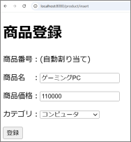{#p221-f13}

::: {#p221-b04 .paragraph}

[➁ 商品一覧に、カテゴリを含む新規データが追加されたらOK です。]{.s010}

:::

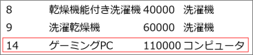{#p221-f14}

::: {#p221-b05 .paragraph}

[&#32;※この節では、登録処理のみ説明しましたが、更新処理も同様にcategoryId を受け取り、エ]{.s009}\
[ンティティにコピーする1 行さえ追記すれば、実装できますので参考にしてください。]{.s009}

:::

:::

::: {#page-222 .source-page}

::: {#p222-b01 .heading}

[6\.4.&#32;]{.s004}[複雑なSQL 文の操作方法]{.s004}

:::

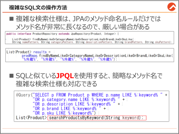{#p222-f15}

::: {#p222-b02 .paragraph}

[これまでの章では、Spring Data JPA のリポジトリメソッド名を利用してクエリを実行する方法を]{.s009}\
[学びました。しかし、複雑なSQL 文を作成する場合、リポジトリメソッド名が非常に長くなり、可]{.s009}\
[読性や保守性が低下するという問題があります。]{.s009}

:::

::: {#p222-b03 .paragraph}

[本節では、JPA のJPQL（Java Persistence Query Language）を使用して、クエリを記述する方]{.s009}\
[法を学びます。JPQL はSQL に似た構文を持ちつつ、Java のエンティティを操作するために最]{.s009}\
[適化されています。]{.s009}

:::

::: {#p222-b04 .paragraph}

[JPQL の基本構文を学び、簡単な例を通じて理解を深めます。最後に【参考】として、複雑な]{.s009}\
[仕様に基づいたJPQL の実装例を紹介します。]{.s009}

:::

:::

::: {#page-223 .source-page}

::: {#p223-b01 .heading}

[6\.4.1.&#32;]{.s004}[複雑な検索をメソッド名で定義する際のデメリット]{.s004}

:::

::: {#p223-b02 .paragraph}

[実務では、テーブル内の列が増えたり、複雑な仕様の検索をしないといけない場面がよくあ]{.s009}\
[ります。そのような状況で、Spring Data JPA のメソッド命名規則を使用して複雑な検索を実現し]{.s009}\
[ようとすると、いくつかのデメリットが発生します。]{.s009}

:::

::: {#p223-b03 .paragraph}

[以下の例を基に説明します。]{.s009}

:::

::: {#p223-b04 .heading}

[＜例: 拡張されたProduct テーブル＞]{.s010}

:::

::: {#p223-b05 .paragraph}

[以下のように、Product テーブルが拡張されている状態を仮定します。]{.s009}

:::

::: {#p223-table01 .table has-header="true"}

| 列の物理名 | 列の論理名 |
| --- | --- |
| id | 商品番号 |
| name | 商品名 |
| price | 価格 |
| description | 商品説明 |
| brand | ブランド名 |
| sku | SKU コード |
| category\_id | カテゴリID |
| price | 価格 |

:::

::: {#p223-b06 .paragraph}

[そして、以下のような検索機能を実装する必要があったと仮定します。]{.s009}

:::

::: {#p223-b07 .paragraph}

[⚫&#32;]{.s021}[例題: 商品とカテゴリを検索する仕様]{.s010}

:::

::: {#p223-b08 .paragraph}

[「商品名」「カテゴリ名」「商品説明」「ブランド名」「SKU コード」の]{.s009}[いずれかに部分一致]{.s010}\
[する商品を検索]{.s010}[し、該当する商品一覧を取得します。]{.s009}

:::

::: {#p223-b09 .paragraph}

[⚫&#32;]{.s021}[出力形式:]{.s010}

:::

::: {#p223-b10 .paragraph}

[商品番号、商品名、カテゴリ名、商品説明、ブランド名、SKU コード、価格]{.s009}

:::

:::

::: {#page-224 .source-page}

::: {#p224-b01 .heading}

[Spring Data JPA のメソッド命名規則で再現する場合]{.s011}

:::

::: {#p224-b02 .paragraph}

[3 章で学習した通り、Spring Data JPA ではfindBy メソッド名に条件を列挙してクエリを作成でき]{.s009}\
[ます。しかし、この仕様を満たすために適用すると、以下のような非常に長いメソッド名になっ]{.s009}\
[てしまいます。]{.s009}

:::

::: {#p224-b03 .heading}

[\<ProductRepository に定義\>]{.s010}

:::

::: {#p224-b04 .code}

```java
public interface ProductRepository extends JpaRepository<Product, Integer>{
```

:::

::: {#p224-b05 .code}

```java
List<Product> findByNameLikeOrCategoryNameLikeOrDescriptionLikeOrBrandLikeOrSkuLike(
  String namePattern, String categoryPattern, String descriptionPattern, String
brandPattern, String skuPattern);
```

:::

::: {#p224-b06 .paragraph}

[以下のように、全ての列に対して同じ検索キーワードを適用する場合でも、それぞれ個別のパ]{.s009}\
[ラメータを渡す必要があります。]{.s009}

:::

::: {#p224-b07 .heading}

[＜ProductController から、メソッドを呼び出す時＞]{.s010}

:::

::: {#p224-b08 .code}

```java
List<Product> results =
productRepository.findByNameLikeOrCategoryNameLikeOrDescriptionLikeOrBrandLikeOrSkuLike(
    "%冷蔵%", "%冷蔵%", "%冷蔵%", "%冷蔵%", "%冷蔵%");
```

:::

::: {#p224-b09 .paragraph}

[非常に長いメソッド名と、冗長なパラメータを渡す必要があるため、JPA のメソッド命名規則だ]{.s009}\
[と、厳しいです。このままだと、可読性はもちろん、保守性も低い実装になってしまいます。]{.s009}

:::

::: {#p224-b10 .paragraph}

[このような]{.s009}[複雑な検索条件を効率的に実装するには、SQL 文を直接記述する方法が適して]{.s010}\
[います。]{.s010}[次節では、Spring Data JPA のJPQL と、@Query アノテーションを使用してSQL 文を]{.s009}\
[直接記述する方法について説明します。]{.s009}

:::

:::

::: {#page-225 .source-page}

::: {#p225-b01 .heading}

[6\.4.2.&#32;]{.s004}[JPQL の基本構文]{.s004}

:::

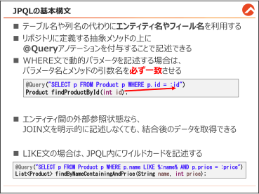{#p225-f16}

::: {#p225-b02 .heading}

[JPQL の特徴]{.s011}

:::

::: {#p225-b03 .paragraph}

[JPQL（Java Persistence Query Language）]{.s010}[は、JPA エンティティを基に操作を行うクエリ言語]{.s009}\
[です。]{.s009}

:::

::: {#p225-b04 .paragraph}

[SQLと似た構文ですが、]{.s009}[テーブル名や列名ではなく、エンティティ名やフィールド名を使用]{.s010}[し]{.s009}\
[ます。]{.s009}

:::

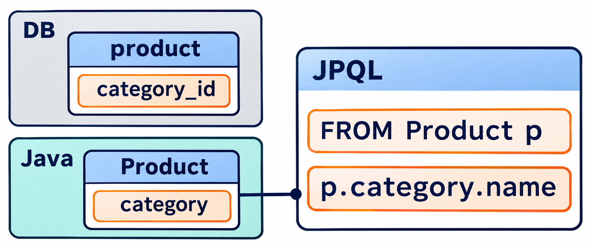{#illustration-expansion-2026-jpql-entity-names}

::: {#illustration-expansion-2026-jpql-entity-names-caption .paragraph}

JPQLは、テーブル名・列名ではなくエンティティ名・フィールド名で記述します。

:::

::: {#p225-b05 .paragraph}

[JPQL の主な特徴：]{.s009}

:::

::: {#p225-b06 .paragraph}

[•&#32;]{.s035}[エンティティモデルに基づいてクエリを記述]{.s014}\
[データベースのテーブル構造を意識することなく、Java のオブジェクト指向に沿ったク]{.s009}\
[エリが記述できます。]{.s009}

:::

::: {#p225-b07 .paragraph}

[•&#32;]{.s035}[リポジトリに直接記述可能]{.s014}\
[クエリはリポジトリインターフェースに記述しますので、以前の章で学んだ感覚のまま実]{.s009}\
[装できます。]{.s009}

:::

::: {#p225-b08 .paragraph}

[•&#32;]{.s035}[メソッド名の命名規則が不要]{.s014}\
[JPQL を使用する場合、自由にメソッド名を設定できます。]{.s009}

:::

:::

::: {#page-226 .source-page}

::: {#p226-b01 .heading}

[全件検索の実装]{.s011}

:::

::: {#p226-b02 .paragraph}

[JPQL の基本を学ぶため、すべての商品データを取得するクエリをJPQL で実装します。以下]{.s009}\
[のようにリポジトリインターフェースにクエリを記述します。]{.s009}

:::

::: {#p226-b03 .paragraph}

[…/repository/ProductRepository.java]{.s010}

:::

::: {#p226-b04 .code}

```java
public interface ProductRepository extends JpaRepository<Product, Integer>{
```

:::

::: {#p226-b05 .code}

```java
        @Query("SELECT p FROM Product p")
         List<Product> findAllProducts();

        //他の抽象メソッドは省略
}
```

:::

::: {#p226-b06 .paragraph}

[⚫&#32;]{.s021}[findAllProducts]{.s010}\
[メソッド名は自由に決められます。今回は分かりやすい名前にしています。引数と戻り値]{.s009}\
[を開発者が決めることは、前の章と同じです。全件検索ですので、引数無しで戻り値は]{.s009}\
[List\<Product\>で定義しています。]{.s009}

:::

::: {#p226-b07 .paragraph}

[⚫&#32;]{.s021}[@Query]{.s010}[&#32;アノテーションの付与]{.s009}\
[JPQL を直接文字列として、@Query アノテーションの引数に記述できます。]{.s009}

:::

::: {#p226-b08 .paragraph}

[⚫&#32;]{.s021}[SELECT p FROM Product p]{.s010}\
[エンティティ&#32;]{.s009}[Product]{.s014}[&#32;をすべて取得するクエリです。]{.s009}[p]{.s014}[&#32;は表別名で、エンティティを簡潔に]{.s009}\
[参照するために使用します。]{.s009}\
[SELECT \* FROM Product&#32;]{.s014}[の代わりに、このような記述方法を使います。]{.s009}

:::

::: {#p226-b09 .paragraph}

[JPQL]{.s014}[&#32;を記述する際、以下のルールを守る必要があります。]{.s009}

:::

::: {#p226-b10 .step}

[1\.&#32;]{.s014}[エンティティ名を使用]{.s010}

:::

::: {#p226-b11 .paragraph}

[Product（エンティティ名）を使用します。テーブル名（product）ではありません。]{.s009}

:::

::: {#p226-b12 .step}

[2\.&#32;]{.s014}[フィールド名を使用]{.s010}

:::

::: {#p226-b13 .paragraph}

[エンティティのフィールド名を指定します。列名（name やprice）ではなく、Java のフィ]{.s009}\
[ールド名をそのまま使います。]{.s009}

:::

::: {#p226-b14 .step}

[3\.&#32;]{.s014}[SQL と似ているが異なる点もある]{.s010}

:::

::: {#p226-b15 .paragraph}

[SQL とほぼ同じ構文ですが、SELECT 句やWHERE 句でテーブルではなくエンティ]{.s009}\
[ティを扱うことを意識しましょう。]{.s009}

:::

:::

::: {#page-227 .source-page}

::: {#p227-b01 .paragraph}

[次は、コントローラーの全件検索用メソッドで、呼び出すメソッドを「]{.s009}[findAll]{.s014}[」から、]{.s009}\
[「]{.s009}[findAllProducts]{.s014}[」に変更します。]{.s009}

:::

::: {#p227-b02 .paragraph}

[…/controller/ProductController.java]{.s010}

:::

::: {#p227-b03 .code}

```java
@GetMapping("/findAll")
        public String showProductList(Model model) {
               List<Product> list = prodRepo.findAllProducts();
               model.addAttribute("products", list);
               return "product/list";
        }
```

:::

::: {#p227-b04 .paragraph}

[http://localhost:8080/product/findAll]{.s049}[&#32;で動作確認を行うと、従来と同じように全件検索の結果]{.s009}\
[が表示されることを確認できます。]{.s009}

:::

::: {#p227-b05 .paragraph}

[JPQL の大きな利点は、エンティティ同士に外部参照（リレーション）が設定されている場合、]{.s009}\
[JOIN 文を明示的に記述しなくても、関連するエンティティ（例えばCategory）のデータも自動]{.s009}\
[的に取得できる点です。]{.s009}

:::

::: {#p227-b06 .heading}

[【参考】大量データを扱う場合の注意点]{.s010}

:::

::: {#p227-b07 .paragraph}

[大量のデータを扱う場合、関連する結合データが自動的に取得されることで、パフォーマン]{.s009}\
[スに影響を与えることがあります。]{.s009}\
[このような場合、関連データのロード方法を変更することでパフォーマンスを改善できます。]{.s009}

:::

::: {#p227-b08 .paragraph}

[以下のように@ManyToOne アノテーションのフェッチタイプをLAZY に変更します。]{.s009}

:::

::: {#p227-b09 .code}

```java
@ManyToOne(fetch = FetchType.LAZY)
@JoinColumn(name = "category_id")
private Category category;
```

:::

::: {#p227-b10 .paragraph}

[結合データ（Category）は、明示的にアクセスされるまでロードされません。結果的に、無駄な]{.s009}\
[データのロードを防ぎ、クエリの実行速度が向上します。]{.s009}

:::

:::

::: {#page-228 .source-page}

::: {#p228-b01 .heading}

[WHERE 文の基本構文]{.s011}

:::

::: {#p228-b02 .paragraph}

[これまでの章では、findById のようなリポジトリメソッドを使用し、検索条件をメソッドの引数で]{.s009}\
[渡すことでデータを取得していました。]{.s009}

:::

::: {#p228-b03 .paragraph}

[JPQL を使用した場合も同じように、検索条件を引数で渡してデータを検索できます。違いと]{.s009}\
[しては、]{.s009}[@Query を使用してWHERE 文を直接記述する]{.s010}[点です。]{.s009}

[以下は、指定された主キー（id）に一致する商品データを検索するJPQL の例です。]{.s009}

:::

::: {#p228-b04 .paragraph}

[…/repository/ProductRepository.java]{.s010}

:::

::: {#p228-b05 .code}

```java
public interface ProductRepository extends JpaRepository<Product, Integer>{
```

:::

::: {#p228-b06 .code}

```java
@Query("SELECT p FROM Product p")
 List<Product> findAllProducts();

@Query("SELECT p FROM Product p WHERE p.id = :id")
 Product findProductById(int id);
```

:::

::: {#p228-b07 .paragraph}

[⚫&#32;]{.s021}[WHERE p.id = :id]{.s010}

:::

::: {#p228-b08 .paragraph}

[Product エンティティの&#32;]{.s009}[id フィールドが指定された値（:id）と一致]{.s010}[するデータを検索します。]{.s009}

:::

::: {#p228-b09 .paragraph}

[⚫&#32;]{.s021}[:id]{.s010}

:::

::: {#p228-b10 .paragraph}

[プレースホルダとして使用されるパラメータ。実行時に引数id の値が挿入されます。]{.s009}

:::

::: {#p228-b11 .paragraph}

[Java データベースプログラミングとの比較]{.s010}

:::

::: {#p228-b12 .paragraph}

[理解のため、既存の知識であるJDBC で主キー検索を行う場合と比較します。]{.s009}

:::

::: {#p228-b13 .code}

```java
String sql = "SELECT * FROM product WHERE id = ?";
PreparedStatement pstm = connection.prepareStatement(sql);
pstm.setInt(1, id);
```

:::

::: {#p228-b14 .paragraph}

[⚫&#32;]{.s021}[JDBC でのプレースホルダ]{.s010}

:::

::: {#p228-b15 .paragraph}

[SQL 文中の「?」がプレースホルダとして動的に値を受け取ります。]{.s009}\
[パラメータの位置は、1 番目、2 番目と番号で指定します。]{.s009}

:::

::: {#p228-b16 .paragraph}

[⚫&#32;]{.s021}[JPQL でのプレースホルダ]{.s010}

:::

::: {#p228-b17 .paragraph}

[JPQL では、:id のような名前付きパラメータを使用します。番号ではなく、]{.s009}[パラメータ名と]{.s014}\
[引数名を一致させることで紐付け]{.s014}[されるため、直感的で扱いやすいのが特徴です。]{.s009}

:::

:::

::: {#page-229 .source-page}

::: {#p229-b01 .paragraph}

[…/controller/ProductController.java]{.s010}

:::

::: {#p229-b02 .code}

```java
@GetMapping("/findById")
        public String showProductById(int id, Model model) {
               //Product product = prodRepo.findById(id).orElse(null);
               Product product = prodRepo.findProductById(id);
               model.addAttribute("product", product);
               return "product/detail";
        }
```

:::

::: {#p229-b03 .paragraph}

[findById の代わりに、JPQL で定義したメソッドを呼び出します。]{.s009}

:::

::: {#p229-b04 .paragraph}

[http://localhost:8080/product/]{.s049}[&#32;でID 検索の動作確認をすると、同じ主キー検索ができるの]{.s009}\
[が確認できます。]{.s009}

:::

:::

::: {#page-230 .source-page}

::: {#p230-b01 .heading}

[名前のLIKE 検索と価格のAND 検索の実装]{.s011}

:::

::: {#p230-b02 .paragraph}

[商品名に特定のキーワードが含まれるデータを検索し、かつ、価格が指定された値と一致する]{.s009}\
[商品のみを取得するという条件は、既存のJDBC 式では、以下のような記述が必要でした。]{.s009}

:::

::: {#p230-b03 .code}

```java
String sql = "SELECT * FROM product WHERE name LIKE ? AND price = ?";
PreparedStatement pstmt = conn.prepareStatement(sql);
pstmt.setString(1, "%" + name + "%"); // 名前の部分一致
pstmt.setInt(2, price); // 価格の条件
```

:::

::: {#p230-b04 .paragraph}

[…/repository/ProductRepository.java]{.s010}

:::

::: {#p230-b05 .code}

```java
public interface ProductRepository extends JpaRepository<Product, Integer>{
        //他メソッドは省略

  @Query("SELECT p FROM Product p WHERE p.name LIKE %:name% AND p.price = :price")
    List<Product> findByNameContainingAndPrice(String name, int price);
}
```

:::

::: {#p230-b06 .paragraph}

[JPQL を使う場合、name を囲む]{.s009}[ワイルドカード(%など)も一緒に記述]{.s010}[します。]{.s009}

:::

::: {#p230-b07 .paragraph}

[…/controller/ProductController.java]{.s010}

:::

::: {#p230-b08 .code}

```java
@GetMapping("/findByNameAndPrice")
public String showProductListByNameAndPrice(String name, int price, Model model)
{
    //List<Product> list = prodRepo.findByNameAndPrice(name, price);
    List<Product> list = prodRepo.findByNameContainingAndPrice(name, price);
        model.addAttribute("products", list);
        return "product/list";
}
```

:::

::: {#p230-b09 .paragraph}

[コントローラーでは、既存のfindByNameAndPrice メソッドの代わりに、JPQL で新たに定義した]{.s009}\
[findByNameContainingAndPrice メソッドを呼び出すように修正します。]{.s009}

:::

:::

::: {#page-231 .source-page}

::: {#p231-b01 .heading}

[動作確認]{.s011}

:::

::: {#p231-b02 .heading}

[http://localhost:8080/product/insert]{.s034}

:::

::: {#p231-b03 .paragraph}

[➀ スマート冷蔵庫と、50000、冷蔵庫を入力し、新たな商品を登録します。]{.s014}

:::

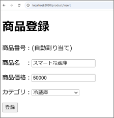{#p231-f17}

::: {#p231-b04 .paragraph}

[➁ 以下のURL から、検索画面に遷移します。]{.s010}

:::

::: {#p231-b05 .paragraph}

[http://localhost:8080/product/]{.s049}

:::

::: {#p231-b06 .paragraph}

[➂ 商品名+価格の検索欄に、「冷蔵庫」と、「50000」と検索します。]{.s014}

:::

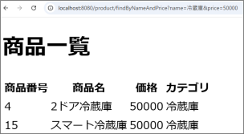{#p231-f18}

::: {#p231-b07 .paragraph}

[JPQL で定義した通り、「冷蔵庫」というキーワード検索と、価格のAND 検索が行われていると]{.s009}\
[正常です。]{.s009}

:::

:::

::: {#page-232 .source-page}

::: {#p232-b01 .heading}

[【参考】 6.4.1 の例題をJPQL で作成する例]{.s011}

:::

::: {#p232-b02 .paragraph}

[…/repository/ProductRepository.java]{.s010}

:::

::: {#p232-b03 .code}

```java
//【参考】複雑な仕様の例題のサンプル➀
        @Query("SELECT p FROM Product p LEFT JOIN p.category c " +
                       "WHERE p.name LIKE %:keyword% " +
                       "OR c.name LIKE %:keyword% " +
                       "OR p.description LIKE %:keyword% " +
                       "OR p.brand LIKE %:keyword% " +
                       "OR p.sku LIKE %:keyword%")
        List<Product> searchProductsByKeyword(String keyword);
```

:::

::: {#p232-b04 .code}

```java
//【参考】複雑な仕様の例題のサンプル➁
        @Query("SELECT p FROM Product p WHERE p.name LIKE %:keyword% " +
           "OR p.category.name LIKE %:keyword% " +
           "OR p.description LIKE %:keyword% " +
           "OR p.brand LIKE %:keyword% " +
           "OR p.sku LIKE %:keyword%")
        List<Product> searchProductsByKeyword(String keyword);
```

:::

::: {#p232-b05 .paragraph}

[サンプル➀は、より純粋なSQL 文に近い書き方で、]{.s009}[JOIN を利用した結合を明示的に記述]{.s010}[して]{.s009}\
[います。]{.s009}

:::

::: {#p232-b06 .paragraph}

[サンプル➁は、]{.s009}[JOIN を利用せずに、p.category.name という書き方でエンティティの外部参照]{.s010}\
[関係の定義を利用]{.s010}[する書き方です。]{.s009}

:::

::: {#p232-b07 .paragraph}

[どちらも同じ結果になりますが、②の方がオブジェクト指向ですので、推奨します。]{.s009}

:::

:::

::: {#page-233 .source-page}

::: {#p233-b01 .heading}

[【参考】 集計関数とGROUP BY の場合]{.s011}

:::

::: {#p233-b02 .paragraph}

[Product と Category を対象に、JPQL を使った 集計関数（SUM, COUNT）とGROUP BY の]{.s020}\
[リポジトリを作成する方法も参考として紹介します。]{.s009}

:::

::: {#p233-b03 .paragraph}

[◼&#32;]{.s039}[実装するリポジトリメソッド]{.s020}

:::

::: {#p233-b04 .step}

[1\.&#32;]{.s009}[カテゴリごとの商品の合計価格を取得する (SUM(price))]{.s020}

:::

::: {#p233-b05 .step}

[2\.&#32;]{.s009}[カテゴリごとの商品数を取得する (COUNT(\*))]{.s020}

:::

::: {#p233-b06 .step}

[3\.&#32;]{.s009}[指定した価格以上の商品があるカテゴリ一覧を取得する (HAVING を使用)]{.s020}

:::

::: {#p233-b07 .heading}

[【作業手順①】 DTO（集計結果を受け取るためのクラス）の作成]{.s010}

:::

::: {#p233-b08 .paragraph}

[JPQL では DTO（データ転送オブジェクト） を作成して、結果をオブジェクトとして受け取る]{.s009}\
[のが一般的です。]{.s009}

:::

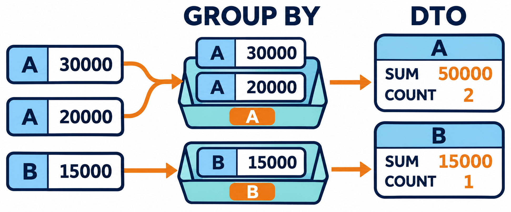{#illustration-expansion-2026-groupby-aggregate-dto}

::: {#illustration-expansion-2026-groupby-aggregate-dto-caption .paragraph}

図の例では、商品をカテゴリ別にまとめ、価格合計と件数をDTOで受け取ります。

:::

::: {#p233-b09 .paragraph}

[■カテゴリごとの合計価格を受け取るDTO]{.s010}

:::

::: {#p233-b10 .code}

```java
public class CategorySalesDTO {
    private String categoryName;
    private Long totalSales;

    public CategorySalesDTO(String categoryName, Long totalSales) {
        this.categoryName = categoryName;
        this.totalSales = totalSales;
    }

    public String getCategoryName() {
        return categoryName;
    }

    public Long getTotalSales() {
        return totalSales;
    }
}
```

:::

:::

::: {#page-234 .source-page}

::: {#p234-b01 .paragraph}

[■カテゴリごとの商品数を受け取るDTO]{.s010}

:::

::: {#p234-b02 .code}

```java
public class CategoryProductCountDTO {
    private String categoryName;
    private Long productCount;

    public CategoryProductCountDTO(String categoryName, Long
productCount) {
        this.categoryName = categoryName;
        this.productCount = productCount;
    }

    public String getCategoryName() {
        return categoryName;
    }

    public Long getProductCount() {
        return productCount;
    }
}
```

:::

:::

::: {#page-235 .source-page}

::: {#p235-b01 .heading}

[【作業手順➁】 リポジトリの作成]{.s010}

:::

::: {#p235-b02 .code}

```java
@Repository
public interface ProductRepository extends JpaRepository<Product, Integer> {
```

:::

::: {#p235-b03 .code}

```java
    /* 1. カテゴリごとの商品の合計価格を取得 */
    @Query("SELECT new jp.co.example.dto.CategorySalesDTO(p.category.name, "
            + "SUM(p.price)) FROM Product p GROUP BY p.category.name")
    List<CategorySalesDTO> findTotalSalesByCategory();

    /*  2. カテゴリごとの商品数を取得 */
    @Query("SELECT new "
            + "jp.co.example.dto.CategoryProductCountDTO(p.category.name, COUNT(p)) " +
           "FROM Product p GROUP BY p.category.name")
    List<CategoryProductCountDTO> findProductCountByCategory();
```
:::

::: {#p235-b04 .code}

```java
    /*  3. 指定した価格以上の商品があるカテゴリを取得（HAVING を使用） */
    @Query("SELECT new jp.co.example.dto.CategorySalesDTO(p.category.name, "
            + "SUM(p.price)) " +
     "FROM Product p GROUP BY p.category.name HAVING SUM(p.price) >= :minSales")
    List<CategorySalesDTO> findCategoriesByMinSales(@Param("minSales") Long
minSales);
}
```
:::

::: {#p235-b05 .paragraph}

[■まとめ]{.s010}

:::

::: {#p235-table01 .table has-header="true"}

| メソッド | 目的 | JPQL クエリ |
| --- | --- | --- |
| findTotalSalesByCategory() | カテゴリごとの売上合計を取得 | SUM(price) GROUP BY<br>category.name |
| findProductCountByCategory() | カテゴリごとの商品数を取得 | COUNT(\*) GROUP BY<br>category.name |
| findCategoriesByMinSales(Long<br>minSales) | 価格の合計が指定値以上のカテ<br>ゴリを取得 | HAVING SUM(price) \>=<br>minSales |

:::

:::

::: {#page-236 .source-page}

::: {#p236-b01 .heading}

[章のまとめ]{.s004}

:::

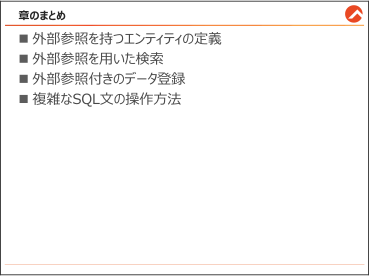{#p236-f19}

::: {#p236-b02 .paragraph}

[この章では、結合のための外部参照や&#32;]{.s009}[JPQL]{.s007}[&#32;について学習しました。]{.s009}

:::

:::

::: {#page-237 .source-page}

:::
