<!-- 元PDF 238〜281ページ。本文の改訂はまだ行っていません。 -->

::: {#page-238 .source-page}

::: {#p238-b01 .heading}

[&#32;7]{.s005}

:::

::: {#p238-b02 .heading}

[第7章&#32;]{.s001}[Bootstrap]{.s001}

:::

::: {#p238-b03 .heading}

[章の目標]{.s002}

:::

::: {#p238-b04 .heading}

[◼&#32;]{.s003}[Bootstrap の特徴と導入方法を習得する]{.s004}

:::

::: {#p238-b05 .heading}

[◼&#32;]{.s003}[Bootstrap でよく使うスタイルについて実装できる]{.s004}

:::

::: {#p238-b06 .heading}

[◼&#32;]{.s003}[Bootstrap でテーブルのカスタマイズができる]{.s004}

:::

::: {#p238-b07 .heading}

[◼&#32;]{.s003}[グリッドシステムとレスポンシブデザインについて理解できる]{.s004}

:::

::: {#p238-b08 .heading}

[◼&#32;]{.s003}[Bootstrap でフォームを実装できる]{.s004}

:::

:::

::: {#page-239 .source-page}

:::

::: {#page-240 .source-page}

::: {#p240-b01 .heading}

[章の概要]{.s008}

:::

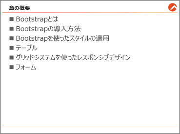{#p240-f01}

::: {#p240-b02 .paragraph}

[7 章では、Bootstrap の基本的な概要から導入方法、具体的な使い方までを学びます。]{.s009}

:::

::: {#p240-b03 .paragraph}

[•&#32;]{.s010}[Bootstrap の概要]{.s011}\
[Bootstrap とは、統一されたデザインとレスポンシブなUI を簡単に作成するためのフロ]{.s009}\
[ントエンドフレームワークです。]{.s009}

:::

::: {#p240-b04 .paragraph}

[•&#32;]{.s010}[導入方法]{.s011}\
[CDN を利用した簡単な導入方法と、ローカルから読み込む方法を説明します。]{.s009}

:::

::: {#p240-b05 .paragraph}

[•&#32;]{.s010}[具体的な使い方]{.s011}\
[グリッドシステム、ボタン、フォーム、テーブルなどの基本コンポーネントを用いた実践]{.s009}\
[的な例を学びます。]{.s009}

:::

::: {#p240-b06 .paragraph}

[この章を通じて、Bootstrap を効率よく活用するスキルを身に付けましょう。]{.s009}

:::

:::

::: {#page-241 .source-page}

::: {#p241-b01 .heading}

[7\.1.&#32;]{.s004}[Bootstrap とは]{.s004}

:::

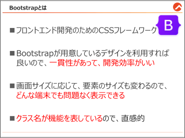{#p241-f02}

::: {#p241-b02 .heading}

[Bootstrap とは]{.s012}

:::

::: {#p241-b03 .paragraph}

[Bootstrap]{.s007}[は、]{.s009}[Web]{.s007}[サイトや]{.s009}[Web]{.s007}[アプリケーションのフロントエンド開発を簡単にするためのオ]{.s009}\
[ープンソースのフレームワークです。もともと]{.s009}[(]{.s007}[旧]{.s009}[)Twitter]{.s007}[&#32;社の社内プロジェクトとして始まり、現]{.s009}\
[在は多くの開発者に利用されています。]{.s009}

:::

::: {#p241-b04 .paragraph}

[特徴:]{.s013}

:::

::: {#p241-b05 .paragraph}

[⚫&#32;]{.s014}[モバイルファースト]{.s009}[:&#32;]{.s007}[最初からスマートフォンでの表示を意識して設計されています。]{.s009}

:::

::: {#p241-b06 .paragraph}

[⚫&#32;]{.s014}[統一されたデザイン]{.s009}[:&#32;]{.s007}[一貫性のある&#32;]{.s009}[UI]{.s007}[&#32;を素早く構築可能です。]{.s009}

:::

::: {#p241-b07 .paragraph}

[⚫&#32;]{.s014}[レスポンシブデザイン]{.s009}[:&#32;]{.s007}[さまざまな画面サイズに適応します。]{.s009}

:::

::: {#p241-b08 .paragraph}

[本書では、]{.s009}[(2024]{.s007}[&#32;年&#32;]{.s009}[7]{.s007}[&#32;月基準]{.s009}[)]{.s007}[最新バージョンである&#32;]{.s009}[5\.3]{.s007}[&#32;バージョンを利用します。]{.s009}

:::

:::

::: {#page-242 .source-page}

::: {#p242-b01 .heading}

[システム開発における外見の課題]{.s012}

:::

::: {#p242-b02 .paragraph}

[システム開発では、機能の実装だけでなく、ユーザが使いやすい見た目やデザインも重要で]{.s009}\
[す。しかし、既存の方法で外見を整えるのは、次のような課題があります。]{.s009}

:::

::: {#p242-b03 .paragraph}

[既存の方法: 手動でCSS 記述]{.s015}

:::

::: {#p242-b04 .paragraph}

[たとえば、以下のように「青いテキスト」を表示したい場合、CSS を手動で記述する必要がありま]{.s009}\
[す。]{.s009}

:::

::: {#p242-b05 .code}

```xml
<!-- CSS を直接記述 -->
<style>
    .blue-text {
        color: blue;
    }
</style>
<p class="blue-text">青いテキスト</p>
```

:::

::: {#p242-b06 .paragraph}

[もしくは、インラインスタイルを使う方法もあります。]{.s009}

:::

::: {#p242-b07 .code}

```xml
<!-- インラインスタイル -->
<p style="color: blue;">青いテキスト</p>
```

:::

::: {#p242-b08 .paragraph}

[この方法の課題]{.s011}

:::

::: {#p242-b09 .step}

[1\.&#32;]{.s009}[時間がかかる:]{.s011}\
[テキストの色やサイズを変更するたびにCSS を記述する必要があります。]{.s009}

:::

::: {#p242-b10 .step}

[2\.&#32;]{.s009}[保守性が低い:]{.s011}\
[クラス名やインラインスタイルが増えると、どこで定義されているか追跡するのが大変で]{.s009}\
[す。]{.s009}

:::

::: {#p242-b11 .step}

[3\.&#32;]{.s009}[知識が必要:]{.s011}\
[CSS の構文を理解していないと適切な記述ができません。]{.s009}

:::

::: {#p242-b12 .step}

[4\.&#32;]{.s009}[マルチデバイス対応が大変：]{.s011}

:::

::: {#p242-b13 .paragraph}

[スマホやタブレット、PC で異なるレイアウトを実装する必要があり、工数が増えます。]{.s009}

:::

:::

::: {#page-243 .source-page}

::: {#p243-b01 .paragraph}

[Bootstrap での解決]{.s015}

:::

::: {#p243-b02 .paragraph}

[Bootstrap を使えば、CSS を記述する手間が省けます。]{.s009}\
[HTML の]{.s009}[要素に特定のクラスを付与するだけ]{.s015}[で、スタイルが適用されます。]{.s009}

:::

::: {#p243-b03 .heading}

[＜同じ「青いテキスト」をBootstrap で実装する場合＞]{.s011}

:::

::: {#p243-b04 .code}

```xml
<p class="text-primary">青いテキスト</p>
```

:::

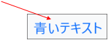{#p243-f03}

::: {#p243-b05 .paragraph}

[他の例（ボタンのデザイン）]{.s015}

:::

::: {#p243-b06 .paragraph}

[Bootstrap を使えば、以下のようなデザインも簡単に実装できます。]{.s009}

:::

::: {#p243-b07 .paragraph}

[従来の方法:]{.s011}

:::

::: {#p243-b08 .code}

```xml
<style>
    .custom-button {
        background-color: #007bff;
        color: white;
        padding: 10px 20px;
        border: none;
        border-radius: 5px;
    }
</style>
<button class="custom-button">送信</button>
```

:::

::: {#p243-b09 .paragraph}

[Bootstrap を使う方法:]{.s011}

:::

::: {#p243-b10 .code}

```xml
<button class="btn btn-primary">送信</button>
```

:::

{#p243-f04}

:::

::: {#page-244 .source-page}

::: {#p244-b01 .paragraph}

[Bootstrap を使うメリット]{.s015}

:::

::: {#p244-b02 .heading}

[1\.&#32;]{.s011}[短時間で実装可能:]{.s011}

:::

::: {#p244-b03 .paragraph}

[クラスを付与するだけで、すぐにデザインが適用されます。]{.s011}

:::

::: {#p244-b04 .heading}

[2\.&#32;]{.s011}[一貫性のあるデザイン:]{.s011}

:::

::: {#p244-b05 .paragraph}

[Bootstrap には統一されたスタイルが用意されているため、プロジェクト全体でデザイ]{.s009}\
[ンが統一されます。]{.s011}

:::

::: {#p244-b06 .heading}

[3\.&#32;]{.s011}[CSS の記述量の減少:]{.s011}

:::

::: {#p244-b07 .paragraph}

[CSS ファイルを記述する頻度が激減し、誰でも簡単にデザインを適用できます。]{.s009}

:::

::: {#p244-b08 .heading}

[4\.&#32;]{.s011}[直感的に使える：]{.s011}

:::

::: {#p244-b09 .paragraph}

[クラス名で機能を表しているため、初心者でも簡単に理解できます。]{.s011}

:::

::: {#p244-b10 .heading}

[5\.&#32;]{.s011}[レスポンシブデザインが簡単]{.s011}

:::

::: {#p244-b11 .paragraph}

[スマホやタブレット、PC、どの端末でも最適な表示ができます。]{.s009}

:::

:::

::: {#page-245 .source-page}

::: {#p245-b01 .heading}

[7\.2.&#32;]{.s004}[Bootstrap の導入方法]{.s004}

:::

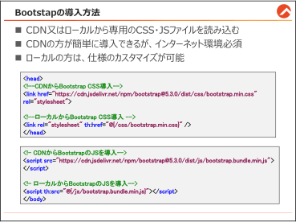{#p245-f05}

::: {#p245-b02 .paragraph}

[Bootstrap をプロジェクトに導入する方法は、次の2 つがあります：]{.s009}

:::

::: {#p245-b03 .step}

[1\.&#32;]{.s009}[CDN（Content Delivery Network）を利用する方法]{.s011}

:::

::: {#p245-b04 .step}

[2\.&#32;]{.s009}[ローカル（Spring プロジェクト内）に導入する方法]{.s011}

:::

::: {#p245-b05 .paragraph}

[※バージョンによって、詳細が変わる可能性がありますので、以下の公式ホームページのド]{.s009}\
[キュメントを参照してください。]{.s009}

:::

::: {#p245-b06 .paragraph}

[https://getbootstrap.jp/]{.s020}

:::

:::

::: {#page-246 .source-page}

::: {#p246-b01 .heading}

[CDN を利用した導入]{.s012}

:::

::: {#p246-b02 .paragraph}

[CDN（Content Delivery Network）を利用すると、簡単にBootstrap を導入できます。]{.s009}\
[CDN とは、世界中に配置されたサーバーのネットワークを利用して、コンテンツを配信する仕]{.s009}\
[組みです。Bootstrap の公式CDN を使うことで、ローカルにファイルをダウンロードする必要が]{.s009}\
[なく、すぐに使い始めることができます。手順は下記となります。]{.s009}

:::

::: {#p246-b03 .paragraph}

[➀ \<head\>要素内に、\<meta name="viewport"\>を記載]{.s021}

:::

::: {#p246-b04 .code}

```xml
<meta name="viewport" content="width=device-width, initial-scale=1.0">
```

:::

::: {#p246-b05 .paragraph}

[モバイルデバイスでの適切なレスポンシブ動作のために記載する必要があります。]{.s009}

:::

::: {#p246-b06 .heading}

[➁ Bootstrap のcss ファイルの読み込む]{.s022}

:::

::: {#p246-b07 .code}

```xml
<link href="https://cdn.jsdelivr.net/npm/bootstrap@5.3.0/dist/css/bootstrap.min.css"
rel="stylesheet">
```

:::

::: {#p246-b08 .paragraph}

[\<head\>内に上記のURL を記載します。]{.s009}

:::

::: {#p246-b09 .paragraph}

[➂ Bootstrap のｊｓファイルを読み込む]{.s021}

:::

::: {#p246-b10 .code}

```xml
<script
src="https://cdn.jsdelivr.net/npm/bootstrap@5.3.0/dist/js/bootstrap.bundle.min.js">
</script>
```

:::

::: {#p246-b11 .paragraph}

[\<body\>の末尾に上記のURL を記載します。]{.s009}

:::

::: {#p246-b12 .paragraph}

[Bootstrap をWeb サイト内で利用したいなら、上記のコードは必須です。]{.s009}\
[URL は、公式ホームページからお勧めのURL を参照することができます。]{.s015}

:::

:::

::: {#page-247 .source-page}

::: {#p247-b01 .heading}

[ローカル(Spring プロジェクト内) からの導入]{.s012}

:::

::: {#p247-b02 .paragraph}

[5 章で学習した通り、Thymeleaf 上でCSS・JS ファイルを読み込むことができます。]{.s009}\
[事前にBootstrap のCSS・JS ファイルをダウンロードし、「static」フォルダ内に格納しておくと、]{.s009}\
[格納場所を指定して、読み込むことができます。]{.s009}

:::

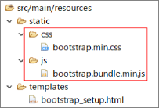{#p247-f06}

::: {#p247-b03 .heading}

[① 以下のコードを\<head\>に記入]{.s022}

:::

::: {#p247-b04 .code}

```xml
<link rel="stylesheet" th:href="@{/css/bootstrap.min.css}" />
```

:::

::: {#p247-b05 .paragraph}

[② 以下のコードを\<body\>の末尾に記入]{.s021}

:::

::: {#p247-b06 .code}

```xml
<script th:src="@{/js/bootstrap.bundle.min.js}"></script>
```

:::

::: {#p247-b07 .paragraph}

[下記は、Bootstrap を導入したシンプルなHTML の例です。]{.s009}

:::

::: {#p247-b08 .paragraph}

[…/controller/ProductController.java]{.s015}

:::

::: {#p247-b09 .code}

```java
//省略

@GetMapping("/7-2-1")
        public String showBootStrapSetup() {
               return "bootstrap_setup";
        }
```

:::

::: {#p247-b10 .paragraph}

[html ファイルに遷移させるために、遷移用メソッドを定義します。]{.s009}

:::

:::

::: {#page-248 .source-page}

::: {#p248-b01 .paragraph}

[…/resources/templates/bootstrap\_setup.html]{.s015}

:::

::: {#p248-b02 .code}

```xml
<!DOCTYPE html>
<html xmlns:th="http://www.thymeleaf.org">

<head>
<meta charset="UTF-8" />
<!-- ➀以下のコードを記入することで、モバイル端末での表示を最適化できます。-->
<meta name="viewport" content="width=device-width, initial-scale=1.0" />
<title>Bootstrap Example</title>

<!-- ➁ Bootstrap CSS をローカルから読み込む -->
<link rel="stylesheet" th:href="@{/css/bootstrap.min.css}" />

<!-- ➁ Bootstrap CSS をCDN から読み込む -->
<link href=
"https://cdn.jsdelivr.net/npm/bootstrap@5.3.0/dist/css/bootstrap.min.css"
rel="stylesheet">
</head>

<body>
<!-- コンテンツ -->
<div class="container">
    <h1>Hello, Bootstrap!</h1>
    <button class="btn btn-primary">ボタン</button>
</div>

<!-- ➂ <body>の末尾に、Bootstrap のJS をローカルから読み込む-->
<script th:src="@{/js/bootstrap.bundle.min.js}"></script>

<!-- ➂ <body>の末尾に、Bootstrap のJS をCDN から読み込む -->
<script src=
"https://cdn.jsdelivr.net/npm/bootstrap@5.3.0/dist/js/bootstrap.bundle.min.js">
</script>
</body>
</html>
```

:::

:::

::: {#page-249 .source-page}

::: {#p249-b01 .paragraph}

[サンプルコードには、両方の方法を記述していますが、実際は&#32;]{.s009}[CDN とローカルのうち、どちら]{.s015}\
[かのみ記述]{.s015}[してください。]{.s009}[本研修では、ローカルからの読み込みを採用]{.s015}[します。]{.s009}

:::

::: {#p249-b02 .paragraph}

[動作確認]{.s015}

:::

::: {#p249-b03 .paragraph}

[http://localhost:8080/7-2]{.s031}

:::

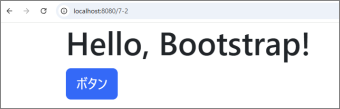{#p249-f07}

::: {#p249-b04 .paragraph}

[青いボタンが表示されたら、問題なく導入ができているということです。]{.s009}

:::

::: {#p249-b05 .paragraph}

[最新情報は公式サイト（]{.s009}[https://getbootstrap.jp/]{.s032}[）で確認してください。]{.s009}

:::

:::

::: {#page-250 .source-page}

::: {#p250-b01 .heading}

[7\.3.&#32;]{.s004}[Bootstrap を使ったスタイルの適用]{.s004}

:::

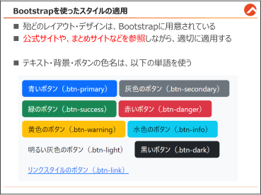{#p250-f08}

::: {#p250-b02 .paragraph}

[Bootstrap は、Web サイトでよく使われるデザインや機能があらかじめ用意されています。特]{.s009}\
[に、クラスをHTML に付与するだけで簡単にスタイルを適用できる点が大きな特徴です。]{.s009}

:::

::: {#p250-b03 .paragraph}

[すべてのスタイルを一度に学ぶことは難しいですが、この節では特によく使うスタイルをいく]{.s009}\
[つか紹介します。また、詳細な情報は以下の公式サイトや参考サイトで確認できます。]{.s009}

:::

::: {#p250-b04 .paragraph}

[•&#32;]{.s010}[Bootstrap 公式サイト]{.s032}[(https://getbootstrap.jp/)]{.s009}

:::

::: {#p250-b05 .paragraph}

[•&#32;]{.s010}[とほほのBootstrap 5 入門]{.s032}[(]{.s009}[https://www.tohoho-web.com/bootstrap5/index.html]{.s032}[)]{.s009}

:::

:::

::: {#page-251 .source-page}

::: {#p251-b01 .heading}

[7\.3.1.&#32;]{.s004}[テキスト]{.s004}

:::

::: {#p251-b02 .paragraph}

[Bootstrap では、テキストの配置を簡単に変更できます。]{.s009}\
[⚫&#32;]{.s014}[左揃え]{.s011}[: .text-start]{.s007}\
[⚫&#32;]{.s014}[中央揃え]{.s011}[: .text-center]{.s007}\
[⚫&#32;]{.s014}[右揃え]{.s011}[: .text-end]{.s007}\
[…/resources/templates/style\_sample.html]{.s015}

:::

::: {#p251-b03 .code}

```xml
<h2 class="text-center">配置（Alignment）</h2>

    <p class="text-start">左揃え（.text-start）</p>
    <p class="text-center">中央揃え（.text-center）</p>
    <p class="text-end">右揃え（.text-end）</p>
```

:::

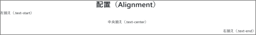{#p251-f09}

::: {#p251-b04 .paragraph}

[※]{.s009}[CSS&#32;]{.s007}[の&#32;]{.s009}[text-align&#32;]{.s007}[プロパティと同じく、ブロック内のインライン要素]{.s009}[(]{.s007}[テキスト、イメージ]{.s009}[)]{.s007}[の位置]{.s009}\
[を調整できます。ブロック要素を動かすことはできません。]{.s009}

:::

:::

::: {#page-252 .source-page}

::: {#p252-b01 .heading}

[7\.3.2.&#32;]{.s004}[色]{.s004}

:::

::: {#p252-b02 .paragraph}

[色のスタイルは、テキスト、背景、ボーダーなどに簡単に適用できます。まずは、色を変更する]{.s009}\
[基本を学びましょう。]{.s009}

:::

::: {#p252-b03 .paragraph}

[◼&#32;]{.s014}[テキストの色]{.s015}\
[Bootstrap]{.s007}[&#32;の色クラスは「色名」ではなく、]{.s009}[「その色がよく使われる用途」に基づいています]{.s015}[。]{.s009}

:::

::: {#p252-b04 .paragraph}

[…/resources/templates/style\_sample.html]{.s015}

:::

::: {#p252-b05 .code}

```xml
<p class="text-primary">青いテキスト（.text-primary）</p>
     <p class="text-secondary">灰色のテキスト（.text-secondary）</p>
     <p class="text-success">緑のテキスト（.text-success）</p>
     <p class="text-danger">赤いテキスト（.text-danger）</p>
     <p class="text-warning">黄色のテキスト（.text-warning）</p>
     <p class="text-info">水色のテキスト（.text-info）</p>
     <p class="text-light bg-dark">明るい灰色のテキスト（.text-light）</p>
     <p class="text-dark">黒いテキスト（.text-dark）</p>
     <p class="text-white bg-dark">白いテキスト（.text-white）</p>
```

:::

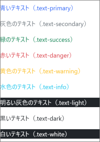{#p252-f10}

:::

::: {#page-253 .source-page}

::: {#p253-b01 .paragraph}

[◼&#32;]{.s014}[背景色]{.s015}

:::

::: {#p253-b02 .paragraph}

[背景色のクラスは、テキストの色クラスと同じ命名ルールです。]{.s009}[text-がbg-に変わるだけ]{.s015}[です。]{.s009}\
[薄い色は、「-subtle」を追記することで表現できます。（Bootstrap 5.3 以降の機能）]{.s009}

:::

::: {#p253-b03 .paragraph}

[…/resources/templates/style\_sample.html]{.s015}

:::

::: {#p253-b04 .code}

```xml
<div class="bg-primary text-white">青い背景（.bg-primary）</div>
<div class="bg-secondary text-white">灰色の背景（.bg-secondary）</div>
<div class="bg-success text-white">緑の背景（.bg-success）</div>
<div class="bg-danger text-white">赤い背景（.bg-danger）</div>
<div class="bg-warning text-dark">黄色の背景（.bg-warning）</div>
<div class="bg-info text-white">水色の背景（.bg-info）</div>
<div class="bg-light text-dark">明るい灰色の背景（.bg-light）</div>
<div class="bg-dark text-white">黒い背景（.bg-dark）</div>
<div class="bg-white text-dark">白い背景（.bg-white）</div>
<div class="bg-primary-subtle">薄い青い背景（.bg-primary-subtle）</div>
<div class="bg-secondary-subtle">薄い灰色（.bg-secondary-subtle）</div>
<div class="bg-success-subtle">薄い緑の背景（.bg-success-subtle）</div>
<div class="bg-danger-subtle">薄い赤い背景（.bg-danger-subtle）</div>
<div class="bg-warning-subtle">薄い黄色の背景（.bg-warning-subtle）</div>
<div class="bg-info-subtle">薄い水色の背景（.bg-info-subtle）</div>
<div class="bg-light-subtle">薄い明るい灰色（.bg-light-subtle）</div>
<div class="bg-dark-subtle">薄い黒い背景（.bg-dark-subtle）</div>
```

:::

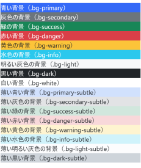{#p253-f11}

:::

::: {#page-254 .source-page}

::: {#p254-b01 .heading}

[7\.3.3.&#32;]{.s004}[ボタン]{.s004}

:::

::: {#p254-b02 .paragraph}

[Bootstrap&#32;]{.s007}[を使えば、]{.s009}[HTML&#32;]{.s007}[のボタン要素にクラスを追加するだけで、簡単にデザインを適用]{.s009}\
[できます。ここでは、基本的なボタンの色やサイズ、状態について解説します。]{.s009}

:::

::: {#p254-b03 .paragraph}

[◼&#32;]{.s014}[ボタンの色]{.s015}\
[Bootstrap&#32;]{.s009}[では、]{.s009}[btn&#32;]{.s015}[クラスを基礎として、さらに色を指定するクラスを追加]{.s015}[することで、簡]{.s009}\
[単にさまざまな色のボタンを作成できます。]{.s009}

:::

::: {#p254-b04 .paragraph}

[…/resources/templates/style\_sample.html]{.s015}

:::

::: {#p254-b05 .code}

```xml
<button class="btn btn-primary">青いボタン（.btn-primary）</button>
<button class="btn btn-secondary">灰色のボタン（.btn-secondary）
</button>
<button class="btn btn-success">緑のボタン（.btn-success）</button>
<button class="btn btn-danger">赤いボタン（.btn-danger）</button>
<button class="btn btn-warning">黄色のボタン（.btn-warning）</button>
<button class="btn btn-info">水色のボタン（.btn-info）</button>
<button class="btn btn-light">明るい灰色のボタン（.btn-light）
</button>
<button class="btn btn-dark">黒いボタン（.btn-dark）</button>
<button class="btn btn-link">リンクスタイルのボタン（.btn-link）
</button>
```

:::

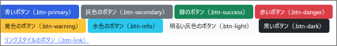{#p254-f12}

::: {#p254-b06 .paragraph}

[※btn-link は見た目がリンクのようになります。]{.s011}\
[※\<button\>だけでなく、\<input\>や\<a\>タグにも適用可能です。]{.s011}

:::

:::

::: {#page-255 .source-page}

::: {#p255-b01 .paragraph}

[◼&#32;]{.s014}[ボタンのサイズ]{.s015}\
[btn クラスに加えて、サイズを指定するクラスを追加することで、大きなボタンや小さなボタ]{.s009}\
[ンを作成できます。]{.s009}

:::

::: {#p255-b02 .paragraph}

[…/resources/templates/style\_sample.html]{.s015}

:::

::: {#p255-b03 .code}

```xml
<button class="btn btn-dark btn-lg">大きなボタン（.btn-lg）</button>
<button class="btn btn-dark">普通サイズボタン</button>
<button class="btn btn-dark btn-sm">小さなボタン（.btn-sm）</button>
```

:::

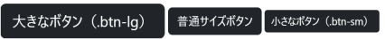{#p255-f13}

::: {#p255-b04 .paragraph}

[◼&#32;]{.s014}[無効化されたボタン]{.s015}\
[Bootstrap では、ボタンを無効化（クリックできない状態に）するためのクラスが用意されて]{.s009}\
[います。条件によって、無効化・有効化を切り替えする実装の時使われます。]{.s009}

:::

::: {#p255-b05 .paragraph}

[…/resources/templates/style\_sample.html]{.s015}

:::

::: {#p255-b06 .code}

```xml
<button class="btn btn-secondary disabled">無効化されたボタン
</button>
```

:::

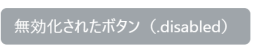{#p255-f14}

::: {#p255-b07 .paragraph}

[※マウスで当ててみると、クリックアニメーションが発生しないことがわかります。]{.s009}

:::

:::

::: {#page-256 .source-page}

::: {#p256-b01 .heading}

[7\.3.4.&#32;]{.s004}[ボーダー(Border)]{.s004}

:::

::: {#p256-b02 .paragraph}

[ボーダーは、要素に枠線を追加するためのクラスです。]{.s009}[Bootstrap]{.s007}[&#32;では、枠線の追加、削]{.s009}\
[除、色の指定、角の丸みなどを簡単に設定できます。]{.s009}

:::

::: {#p256-b03 .code}

```xml
<h2 class="text-center mb-4">ボーダー（Border）</h2>
<div class="border p-2 mb-2">全方向にボーダー（.border）</div>
<div class="border-bottom p-2 mb-2">下にボーダー（.border-bottom）</div>
<div class="border-0 p-2 mb-2">ボーダーを削除（.border-0）</div>
<div class="border border-primary p-2 mb-2">青いボーダー
（.border-primary）</div>
<div class="border border-success p-2 mb-2">緑のボーダー
（.border-success）</div>
<div class="border rounded p-2 mb-2">角を丸くする（.rounded）</div>
```

:::

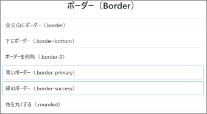{#p256-f15}

::: {#p256-b04 .paragraph}

[※]{.s009}[p]{.s007}[&#32;や&#32;]{.s009}[mb]{.s007}[&#32;のクラスは、次のページで説明します]{.s009}

:::

::: {#p256-b05 .paragraph}

[※border-0 は条件によって、枠線の有無を決める実装の時使われます。]{.s009}

:::

:::

::: {#page-257 .source-page}

::: {#p257-b01 .heading}

[7\.3.5.&#32;]{.s004}[余白]{.s004}

:::

::: {#p257-b02 .paragraph}

[◼&#32;]{.s014}[マージン（Margin）]{.s015}\
[マージンは、要素の]{.s009}[外側の余白]{.s015}[を調整するために使用します。]{.s009}

:::

::: {#p257-b03 .paragraph}

[クラスの命名ルール]{.s011}\
[•&#32;]{.s010}[m-0&#32;]{.s007}[～]{.s009}[&#32;m-5:&#32;]{.s007}[全方向のマージンを設定]{.s009}\
[•&#32;]{.s010}[mt-]{.s007}[（上）、]{.s009}[mb-]{.s007}[（下）、]{.s009}[ms-]{.s007}[（左]{.s009}[/]{.s007}[スタート）、]{.s009}[me-]{.s007}[（右]{.s009}[/]{.s007}[エンド）で特定の方向に設定]{.s009}\
[•&#32;]{.s010}[mx-]{.s007}[（左右）、]{.s009}[my-]{.s007}[（上下）でまとめて設定]{.s009}

:::

::: {#p257-b04 .code}

```xml
<hr>
<div class="m-0 bg-info">マージンなし（.m-0）</div>
<hr>
<div class="m-3 bg-info">全方向にマージン（.m-3）</div>
<hr>
<div class="mt-5 bg-info">上に大きなマージン（.mt-5）</div>
<hr>
<div class="my-4 bg-info">上下に中程度のマージン（.my-4）</div>
<hr>
<div class="ms-3 bg-info">左にマージン（.ms-3）</div>
<hr>
<div class="me-5 bg-info">右に大きなマージン（.me-5）</div>
<hr>
<div class="ms-3 me-5 bg-info">左に小さなマージン（.ms-3）と右に大きな
マージン（.me-5）</div>
<hr>
<div class="mx-auto bg-info" style="width: 50%;">左右中央揃え（.mx-auto）
</div>
<hr>
```

:::

::: {#p257-b05 .paragraph}

[※]{.s009}[\<hr\>]{.s007}[は、水平線を引く要素です。余白の範囲の参考のため記述されています。]{.s009}\
[（デフォルトで少しの上下の余白が生成されます）]{.s009}

:::

:::

::: {#page-258 .source-page}

::: {#p258-b01 .paragraph}

[要素の余白を簡単に調べられる方法についてご紹介します。]{.s009}

:::

::: {#p258-b02 .paragraph}

[➀ 「]{.s009}[F12]{.s007}[」で「開発者ツール」を開きます]{.s009}\
[➁ 以下の赤枠のボタンをクリックします。（又は&#32;]{.s009}[Ctrl+Shift+C]{.s007}[）]{.s009}\
[➂ 「要素」タブの調べたい&#32;]{.s009}[HTML]{.s007}[&#32;コードにマウスを当てます。]{.s009}\
[※&#32;]{.s009}[マウスを]{.s009}[\<div class = “my-4 bg-info”\>]{.s007}[上下に中程度のマージン]{.s009}[(.my-4)\</div\>]{.s007}[に当てたの]{.s009}\
[で、余白の範囲が表示されました。]{.s009}

:::

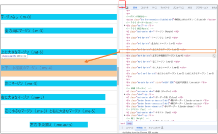{#p258-f16}

:::

::: {#page-259 .source-page}

::: {#p259-b01 .paragraph}

[◼&#32;]{.s014}[パディング（Padding）]{.s015}

:::

::: {#p259-b02 .paragraph}

[パディングは、]{.s009}[要素の内側の余白]{.s015}[を調整するために使います。]{.s009}\
[Bootstrap では、p-を使ったクラス名を指定するだけで簡単に設定できます。]{.s009}

:::

::: {#p259-b03 .paragraph}

[⚫&#32;]{.s014}[p-0&#32;&#32;～ p-5&#32;&#32;&#32;&#32;&#32;&#32;&#32;&#32;&#32;全方向のパディングを設定]{.s011}\
[⚫&#32;]{.s014}[pt-0 ～ pt-5&#32;]{.s011}[上のパディングを設定]{.s011}\
[⚫&#32;]{.s014}[pb-0 ～ pb-5&#32;]{.s011}[下のパディングを設定]{.s011}\
[⚫&#32;]{.s014}[ps-0 ～ ps-5&#32;]{.s011}[左のパディングを設定（start）]{.s011}\
[⚫&#32;]{.s014}[pe-0 ～ pe-5&#32;]{.s011}[右のパディングを設定（end）]{.s011}\
[⚫&#32;]{.s014}[px-0 ～ px-5&#32;]{.s011}[左右のパディングを設定]{.s011}\
[⚫&#32;]{.s014}[py-0 ～ py-5&#32;]{.s011}[上下のパディングを設定]{.s011}

:::

::: {#p259-b04 .code}

```xml
<hr>
<div class="bg-warning p-0">パディングなし（.p-0）</div>
<hr>
<div class="bg-warning p-3">全方向に中程度のパディング（.p-3）</div>
<hr>
<div class="bg-warning ps-4">左に適度なパディング（.ps-4）</div>
<hr>
<div class="bg-warning py-4">上下に中程度のパディング（.py-4）</div>
<hr>
```

:::

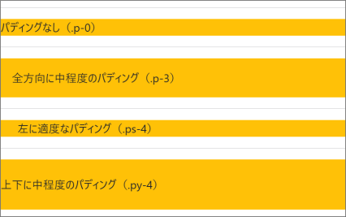{#p259-f17}

:::

::: {#page-260 .source-page}

::: {#p260-b01 .heading}

[7\.3.6.&#32;]{.s004}[ブロック要素の幅の調整(高さと横幅)]{.s004}

:::

::: {#p260-b02 .paragraph}

[Web&#32;]{.s007}[ページのデザインでは、ブロック要素の高さや横幅を適切に調整することが重要です。]{.s009}\
[Bootstrap&#32;]{.s007}[では、簡単にこれらを設定するクラスが用意されています。この節では、「高さ」と「横]{.s009}\
[幅」の調整方法を説明します。]{.s009}

:::

::: {#p260-b03 .paragraph}

[◼&#32;]{.s014}[高さ(Height)の調整]{.s015}

:::

::: {#p260-b04 .paragraph}

[⚫&#32;]{.s014}[h-25&#32;]{.s007}[親要素の高さの&#32;]{.s009}[25%]{.s007}[を設定]{.s009}\
[⚫&#32;]{.s014}[h-50&#32;]{.s007}[親要素の高さの&#32;]{.s009}[50%]{.s007}[を設定]{.s009}\
[⚫&#32;]{.s014}[h-75&#32;]{.s007}[親要素の高さの&#32;]{.s009}[75%]{.s007}[を設定]{.s009}\
[⚫&#32;]{.s014}[h-100&#32;]{.s007}[親要素の高さの&#32;]{.s009}[100%]{.s007}[を設定]{.s009}\
[⚫&#32;]{.s014}[h-auto&#32;]{.s007}[コンテンツに応じた自動調整]{.s009}\
[※]{.s009}[h-35]{.s007}[&#32;のような微調整は別途カスタマイズが必要です。]{.s009}

:::

::: {#p260-b05 .paragraph}

[ブロック要素の高さを設定する場合、]{.s009}[親要素の高さ]{.s015}[が重要です。子要素の高さは、親要素の]{.s009}\
[高さに依存して計算されます。]{.s009}

:::

::: {#p260-b06 .code}

```xml
<!-- 親要素 -->
<div class="bg-danger" style="height: 200px;">
        <hr>
        <!-- 子要素 -->
        <div class="bg-info h-25">高さ25%（子要素: .h-25）</div>
        <div class="bg-warning h-50">高さ50%（子要素: .h-50）</div>

</div>
```

:::

::: {#p260-b07 .paragraph}

[高さ&#32;]{.s009}[200px]{.s007}[&#32;固定の親要素]{.s009}[(]{.s007}[赤いブロック]{.s009}[)]{.s007}[がある場合、]{.s009}\
[子要素に&#32;]{.s009}[h-25]{.s007}[&#32;と&#32;]{.s009}[h-50]{.s007}[&#32;と指定すると、]{.s009}[200px]{.s007}[&#32;の&#32;]{.s009}[25%]{.s007}[と&#32;]{.s009}[50%]{.s007}[の高さが適用されます。]{.s009}

:::

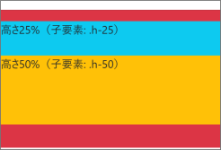{#p260-f18}

:::

::: {#page-261 .source-page}

::: {#p261-b01 .paragraph}

[◼&#32;]{.s014}[横幅(Width)の調整]{.s015}

:::

::: {#p261-b02 .paragraph}

[高さと同様に、ブロック要素の横幅もBootstrap 上で調整できます。]{.s009}

:::

::: {#p261-b03 .paragraph}

[⚫&#32;]{.s014}[w-25&#32;]{.s009}[親要素の幅の25%]{.s009}\
[⚫&#32;]{.s014}[w-50&#32;]{.s009}[親要素の幅の50%]{.s009}\
[⚫&#32;]{.s014}[w-75&#32;]{.s009}[親要素の幅の75%]{.s009}\
[⚫&#32;]{.s014}[w-100&#32;]{.s009}[親要素の幅の100%（全幅）]{.s009}\
[⚫&#32;]{.s014}[w-auto&#32;]{.s009}[コンテンツに応じた自動幅]{.s009}

:::

::: {#p261-b04 .code}

```xml
<div class="bg-info text-white w-25">幅25%（.w-25）</div>
<div class="bg-success text-white w-50">幅50%（.w-50）</div>
<div class="bg-warning text-dark w-75">幅75%（.w-75）</div>
<div class="bg-danger text-white w-100">幅100%（.w-100）</div>
```

:::

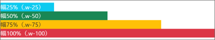{#p261-f19}

::: {#p261-b05 .paragraph}

[動作確認]{.s015}

:::

::: {#p261-b06 .paragraph}

[http://localhost:8080/7-3]{.s031}

:::

::: {#p261-b07 .paragraph}

[是非実行して、実際の動きを確認してください。]{.s009}

:::

::: {#p261-b08 .paragraph}

[今回のサンプルは、あくまでよく使うクラスの一例ですので、紹介できていないクラスがたくさ]{.s009}\
[ん残っています。他の節で、少しずつ新しいクラスを紹介していきますが、それでも全てを網羅]{.s009}\
[することが難しいので、公式サイトや、まとめサイトで必要なクラスを調査して適用させるのが、]{.s009}\
[Bootstrap を極める第一歩です。]{.s009}

:::

:::

::: {#page-262 .source-page}

::: {#p262-b01 .heading}

[7\.4.&#32;]{.s004}[テーブル]{.s004}

:::

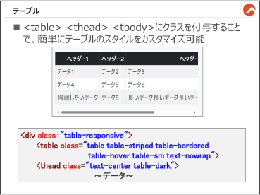{#p262-f20}

::: {#p262-b02 .heading}

[Bootstrap のテーブルクラス]{.s012}

:::

::: {#p262-b03 .paragraph}

[Bootstrap を使用することで、テーブルのスタイルを簡単にカスタマイズすることができます。]{.s009}\
[基本的なクラスは以下の通りです。]{.s009}

:::

::: {#p262-b04 .paragraph}

[•&#32;]{.s010}[table]{.s033}[:&#32;]{.s007}[基本的なテーブルスタイルを適用します。]{.s009}\
[•&#32;]{.s010}[table-striped]{.s033}[:&#32;]{.s007}[各行を交互に色付けして、視認性を向上させます。]{.s009}\
[•&#32;]{.s010}[table-bordered]{.s033}[:&#32;]{.s007}[テーブルに枠線を追加します。]{.s009}\
[•&#32;]{.s010}[table-hover]{.s033}[:&#32;]{.s007}[行にカーソルを合わせたときに強調表示します。]{.s009}\
[•&#32;]{.s010}[table-dark]{.s033}[:&#32;]{.s007}[テーブル全体に暗いテーマを適用します。]{.s009}\
[•&#32;]{.s010}[table-sm]{.s033}[:&#32;]{.s007}[コンパクトなテーブルスタイルを適用します。]{.s009}\
[•&#32;]{.s010}[table-responsive]{.s033}[:&#32;]{.s007}[テーブルを狭い画面でもスクロール可能にします。]{.s009}[table]{.s007}[&#32;要素を]{.s009}\
[別途の&#32;]{.s009}[div]{.s007}[&#32;で囲う必要があります。]{.s009}\
[•&#32;]{.s010}[table-active]{.s033}[:&#32;]{.s007}[アクティブな行やセルを強調するためのクラス。]{.s009}\
[•&#32;]{.s010}[table-primary(色名):]{.s033}[状態に応じた行やセルの背景色を設定するためのクラス。]{.s009}\
[text-nowrap:&#32;]{.s033}[テキストの折り返しを防ぎ、一行で表示します。このクラスをテーブル]{.s009}\
[のヘッダーやセルに適用することで、テキストが縦に表示されるのを防ぎます。]{.s009}

:::

::: {#p262-b05 .paragraph}

[※その他に、テーブルの]{.s009}[ヘッダーとデータ行のスタイルを個別]{.s015}[で行うことができるように、]{.s009}\
[通常は、\<table\>の中に]{.s009}[\<thead\>と\<tbody\>要素]{.s015}[を分けて実装します。]{.s009}

:::

:::

::: {#page-263 .source-page}

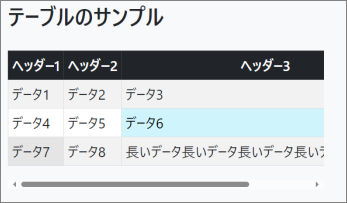{#p263-f21}

::: {#p263-b01 .paragraph}

[…/resources/templates/table\_sample.html]{.s015}

:::

::: {#p263-b02 .code}

```xml
 <h2 class="mb-4">テーブルのサンプル</h2>

<div class="table-responsive">
    <table class="table table-striped table-bordered table-hover table-sm
                    text-nowrap">
        <thead class="text-center table-dark">
            <tr>
                <th>ヘッダー1</th>
                <th>ヘッダー2</th>
                <th>ヘッダー3</th>
            </tr>
        </thead>
        <tbody>
            <tr class="table-info">
                <td>データ1</td>
                <td>データ2</td>
                <td>データ3</td>
            </tr>
            <tr >
                <td>データ4</td>
                <td>データ5</td>
                <td>データ6</td>
            </tr>
```

:::

:::

::: {#page-264 .source-page}

::: {#p264-b01 .code}

```xml
            <tr>
                <td class = "table-active">強調したいデータ</td>
                <td>データ8</td>
                <td>長いデータ長いデータ長いデータ長いデータ長いデータ</td>
            </tr>
        </tbody> <!-- END table body -->
    </table> <!-- END table -->
</div> <!-- END responsive table wrapper -->
</div> <!-- END container -->
```

:::

::: {#p264-b02 .heading}

[■動作確認]{.s012}

:::

::: {#p264-b03 .paragraph}

[http://localhost:8080/7-4]{.s021}

:::

::: {#p264-b04 .paragraph}

[class]{.s007}[&#32;属性を一つ消す度に、どう変わっていくのかを確認すると、よりわかりやすいです。]{.s009}

:::

:::

::: {#page-265 .source-page}

::: {#p265-b01 .heading}

[7\.5.&#32;]{.s004}[グリッドシステムを使ったレスポンシブデザイン]{.s004}

:::

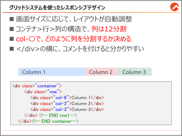{#p265-f22}

::: {#p265-b02 .heading}

[グリッドシステムの基本概念]{.s012}

:::

::: {#p265-b03 .paragraph}

[Bootstrap のグリッドシステムを使うと、画面サイズに応じて自動的にレイアウトが調整される]{.s009}\
[Web ページを簡単に作成できます。従来のCSS レイアウトで苦労していた、]{.s009}[ブロック要素の縦]{.s015}\
[積みや横方向への配置が非常に簡単になります。]{.s015}

:::

::: {#p265-b04 .paragraph}

[Bootstrap の]{.s009}[グリッドシステムは、12 列]{.s015}[のシステムを採用しています。]{.s009}\
[1 行（row）が最大で12 の列（column）に分割できるということです。このシステムを使って、柔軟]{.s009}\
[でレスポンシブなレイアウトを作成できます。]{.s009}

:::

::: {#p265-b05 .paragraph}

[グリッドシステムでは、以下の3 つの基本要素を使います。]{.s009}

:::

::: {#p265-b06 .paragraph}

[①&#32;]{.s009}[コンテナ（Container）:&#32;]{.s009}[ページの中央に配置]{.s015}[され、内容を適切に配置するための基]{.s009}\
[本的なレイアウト要素です。全体の幅を制御します。]{.s009}

:::

::: {#p265-b07 .paragraph}

[②&#32;]{.s009}[行（Row）:カラム（列）を含む水平のレイアウト要素です。コンテナ要素の中に記述し]{.s009}\
[ます。]{.s009}

:::

::: {#p265-b08 .paragraph}

[③&#32;]{.s009}[カラム（Column）:列のことを「カラム」と言います。カラムは、コンテンツを配置するため]{.s009}\
[の垂直のレイアウト要素です。最大12 カラムまで使用できます。]{.s009}

:::

::: {#p265-b09 .paragraph}

[これらの要素は入れ子構造で、HTML 要素のclass 属性を使って指定します。]{.s015}

:::

::: {#p265-b10 .paragraph}

[入れ子構造は、\<table\>\<tr\>\<td\>の関係と似ています。]{.s015}

:::

:::

::: {#page-266 .source-page}

::: {#p266-b01 .heading}

[基本的なグリッドレイアウト]{.s012}

:::

::: {#p266-b02 .paragraph}

[①&#32;]{.s015}[コンテナ（Container）]{.s015}

:::

::: {#p266-b03 .paragraph}

[\<div class="container"\>]{.s015}[は、ページの中央にコンテンツを配置し、左右に適切な余白を]{.s009}\
[追加するための基本的なレイアウト要素です。container を使用すると、幅が固定されてお]{.s009}\
[り、]{.s009}[デバイスの画面サイズに応じて最大幅が変わります]{.s015}[。コンテンツが常に中央に配置され]{.s011}\
[ますので、読みやすさが向上します。]{.s009}

:::

::: {#p266-b04 .paragraph}

[一方、]{.s009}[\<div class="container-fluid"\>]{.s015}[は、画面全体に広がるコンテナを作成します。余白]{.s009}\
[なしで、親要素の]{.s009}[幅いっぱい]{.s015}[にコンテンツを広げたい場合に使用します。例えば、全幅のヘ]{.s009}\
[ッダーやフッターを作成する場合に便利です。]{.s009}

:::

::: {#p266-b05 .paragraph}

[②&#32;]{.s015}[行（Row）]{.s015}

:::

::: {#p266-b06 .paragraph}

[\<div class="row"\>]{.s015}[は、水平に配置される行です。row の中にカラム（列）が入ります。]{.s009}\
[row を使用することで、カラムが適切に並び、縦方向のスペースを均等に分けることができま]{.s009}\
[す。]{.s009}

:::

::: {#p266-b07 .paragraph}

[③&#32;]{.s015}[カラム（Column）]{.s015}

:::

::: {#p266-b08 .paragraph}

[\<div class="col-6"\>]{.s015}[のように、カラム（列）は、コンテンツを配置するための垂直のレイアウ]{.s009}\
[ト要素です。カラムは、グリッドシステムの基礎となり、1 行を最大12 のカラムに分割すること]{.s009}\
[ができます。以下に具体的な例を示します。]{.s009}

:::

::: {#p266-b09 .paragraph}

[…/resources/templates/grid\_sample.html]{.s015}

:::

::: {#p266-b10 .code}

```xml
1:<div class="container">
2:    <div class="row">
3:        <div class="col-6 bg-primary-subtle">Column 1</div>
4:        <div class="col-3 bg-danger-subtle">Column 2</div>
5:        <div class="col-3 bg-success-subtle">Column 3</div>
6:    </div> <!-- END row1-->
7:</div><!-- END container-->
```

:::

::: {#p266-b11 .paragraph}

[・1 行目 \<div class="container"\>]{.s031}\
[今回のサンプルでは、外側を&#32;]{.s009}[container&#32;]{.s007}[でコンテナを作っています。画面の中央にコンテン]{.s009}\
[ツが配置されます。もし、]{.s009}[container-fluid]{.s007}[&#32;にすると、横幅いっぱいに変わります。]{.s009}

:::

:::

::: {#page-267 .source-page}

::: {#p267-b01 .paragraph}

[・2 行目 \<div class="row"\>]{.s031}\
[&#32;コンテナの中に、row&#32;]{.s009}[をclass&#32;]{.s009}[属性として持つdiv 要素を入れます。後述のカラムを配置する]{.s009}\
[ためにも、必ずrow&#32;]{.s009}[が必要です。まるでtable&#32;]{.s009}[要素に、\<tr\>がないと、\<td\>も書けないのと同じ]{.s009}\
[です。]{.s009}

:::

::: {#p267-b02 .paragraph}

[・3 行目～5 行目 \<div class="col-6～]{.s031}

:::

::: {#p267-b03 .paragraph}

[1 つのrow の中に、複数のカラムを配置できます。このサンプル通りだと、以下のように表示]{.s009}\
[されます。]{.s009}

:::

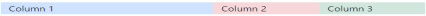{#p267-f23}

::: {#p267-b04 .paragraph}

[\<div class="col-6"\>: このカラムは、12 分の6、つまり全幅の50%を占めます。]{.s015}

:::

::: {#p267-b05 .paragraph}

[\<div class="col-3"\>: このカラムは、12 分の3、つまり全幅の25%を占めます。]{.s015}

:::

::: {#p267-b06 .paragraph}

[Bootstrap のグリッドは12 列構成で、合計12 未満なら空白、12 超なら折り返し]{.s035}[、均等配分に]{.s009}\
[は番号なしのcol を使います。]{.s009}

:::

::: {#p267-b07 .paragraph}

[今回のサンプルの場合は、6 + 3 + 3 = 12 でした。]{.s009}

:::

::: {#p267-b08 .paragraph}

[背景色はカラムの視覚的な区別を付けるために使用しています。]{.s009}

:::

::: {#p267-b09 .paragraph}

[・6 行目～7 行目 \</div\> \<\!--コメント--\>]{.s031}

:::

::: {#p267-b10 .paragraph}

[グリッドシステムでは、\<div\>要素を使うことが多いので、閉じタグだけでは、どの要素の閉じ]{.s009}\
[タグなのか、区別がつきません。そのため、]{.s009}[どの要素の閉じタグなのかを明確にするため、コ]{.s015}\
[メントを記載することが多いです。]{.s015}[特に、row が複数ある場合は「END row1」や、「END row2」と]{.s009}\
[かでコメントを残すことで実際の範囲も読みやすくなるので、重要です。]{.s009}

:::

::: {#p267-b11 .heading}

[【参考】 知っておくと便利になるカラムのコツ]{.s031}

:::

::: {#p267-b12 .paragraph}

[・]{.s009}[12 未満]{.s035}[なら、残りのスペースは]{.s009}[自動的に分配]{.s035}[されます。]{.s009}

:::

::: {#p267-b13 .paragraph}

[・]{.s009}[col-auto]{.s035}[&#32;と設定すると、コンテンツの長さによって、]{.s009}[横幅が自動]{.s035}[的に計算されます。]{.s009}

:::

::: {#p267-b14 .paragraph}

[・カラムを画面の]{.s009}[中央寄せ]{.s035}[したい時は、row クラスに加えて、「]{.s009}[justify-content-center]{.s035}[」クラス]{.s009}\
[も適用します。]{.s009}

:::

::: {#p267-b15 .paragraph}

[・]{.s009}[g-1]{.s035}[&#32;(g-5 まである) をrow クラスに加えると、]{.s009}[カラム同士の間隔を調整できます]{.s035}[。]{.s009}\
[微調整することが多いので、覚えておいてください。]{.s009}

:::

:::

::: {#page-268 .source-page}

::: {#p268-b01 .paragraph}

[■動作確認]{.s015}

:::

::: {#p268-b02 .paragraph}

[http://localhost:8080/7-5]{.s031}

:::

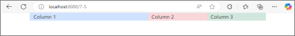{#p268-f24}

::: {#p268-b03 .paragraph}

[※画面の横幅を調整しても、同じ割合で要素のサイズが調整されることを確認してください。]{.s036}

:::

::: {#p268-b04 .paragraph}

[※より詳しい構文は、]{.s013}[https://getbootstrap.jp/docs/5.3/layout/grid/]{.s021}[&#32;を参照]{.s013}

:::

:::

::: {#page-269 .source-page}

::: {#p269-b01 .heading}

[【参考】 グリッドシステムの応用]{.s012}

:::

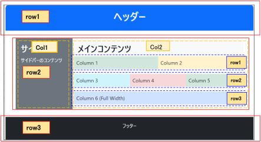{#p269-f25}

::: {#p269-b02 .paragraph}

[今まで学習した内容を応用すると、上のような画面を作成できます。]{.s009}

:::

::: {#p269-b03 .paragraph}

[ポイントは、3 つです。]{.s009}

:::

::: {#p269-b04 .step}

[1\.&#32;]{.s013}[ヘッダーとフッターは、全幅に広がるようにするために「container-fluid」を使用し、]{.s013}\
[サイドバーとメインコンテンツは中央に配置するために「container」を使用しています。]{.s013}

:::

::: {#p269-b05 .step}

[2\.&#32;]{.s013}[各要素にはマージンとパディングを指定して、内部と外部に余白を入れています。]{.s013}

:::

::: {#p269-b06 .step}

[3\.&#32;]{.s013}[サイドバーとメインコンテンツは列(Column)を2 つで分けて1 つの行（row）に配置し、メイ]{.s013}\
[ンコンテンツの中にはさらに3 つの行（row）を入れ子にして配置しています。]{.s013}

:::

::: {#p269-b07 .step}

[4\.&#32;]{.s013}[col-md-3 とcol-md-9 のmd の意味について説明します。]{.s013}

:::

::: {#p269-b08 .paragraph}

[横幅が長いPC 画面の場合は3:9 の割合が維持されますが、]{.s013}[タブレット端末以下の端末に]{.s037}\
[なった際は3:9 のレイアウトではなく、より最適なレイアウトに調整される]{.s037}[という意味です。]{.s013}\
[sm にすると、スマホ以下の端末で調整されます。]{.s013}

:::

:::

::: {#page-270 .source-page}

::: {#p270-b01 .paragraph}

[…/resources/templates/grid\_sample2.html]{.s015}

:::

::: {#p270-b02 .code}

```xml
<!-- ヘッダー -->
<div class="container-fluid bg-primary text-white text-center py-3">
    <h1>ヘッダー</h1>
</div> <!-- END container1-->

<!-- メインコンテンツとサイドバー -->
<div class="container my-4">
    <div class="row">
        <div class="col-md-3 bg-secondary text-white p-3 mb-3 mb-md-0">
            <h2>サイドバー</h2>
            <p>サイドバーのコンテンツ</p>
        </div> <!-- END sidebar col-->
        <div class="col-md-9 bg-light p-3">
            <h2>メインコンテンツ</h2>
            <div class="row">
                <div class="col-6 p-2 bg-success-subtle">Column 1</div>
                <div class="col-6 p-2 bg-warning-subtle">Column 2</div>
            </div> <!-- END main col row1-->
            <div class="row mt-3">
                <div class="col-4 p-2 bg-info-subtle">Column 3</div>
                <div class="col-4 p-2 bg-danger-subtle">Column 4</div>
                <div class="col-4 p-2 bg-success-subtle">Column 5</div>
            </div> <!-- END main col row2-->
            <div class="row mt-3">
                <div class="col-12 p-2 bg-primary-subtle">Column 6 (Full Width)</div>
            </div> <!-- END main col row3-->
        </div> <!-- END main col-->
    </div> <!-- END row1-->
</div> <!-- END container2-->

<!-- フッター -->
<div class="container-fluid bg-dark text-white text-center py-3">
    <p>フッター</p>
</div> <!-- END container3-->
```

:::

:::

::: {#page-271 .source-page}

::: {#p271-b01 .paragraph}

[■動作確認]{.s015}

:::

::: {#p271-b02 .paragraph}

[http://localhost:8080/7-5-2]{.s031}

:::

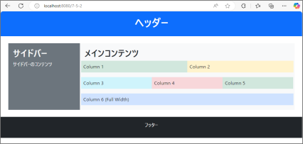{#p271-f26}

::: {#p271-b03 .paragraph}

[※画面の横幅を調整しても、同じ割合で要素のサイズが調整されることを確認してください。]{.s036}\
[※より詳しい構文は、&#32;]{.s036}[https://getbootstrap.jp/docs/5.3/layout/columns/]{.s042}[&#32;を参照]{.s036}

:::

:::

::: {#page-272 .source-page}

::: {#p272-b01 .heading}

[7\.6.&#32;]{.s004}[フォーム]{.s004}

:::

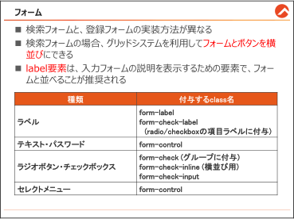{#p272-f27}

::: {#p272-b02 .paragraph}

[Bootstrap は、フォームのスタイルを簡単に整えるための豊富なクラスを提供しています。こ]{.s009}\
[のクラスを使うことで、デザインが統一され、モダンなWeb ページを手軽に作成できます。]{.s009}

:::

::: {#p272-b03 .heading}

[フォームの種類について]{.s012}

:::

::: {#p272-b04 .paragraph}

[フォームには、検索バーのようなシンプルなフォームと、登録ページのように複数の入力フィー]{.s009}\
[ルドを連続して配置する垂直フォームの2 種類のスタイルがあります。]{.s009}

:::

::: {#p272-b05 .heading}

[検索フォーム]{.s012}

:::

::: {#p272-b06 .paragraph}

[検索フォームは、ユーザが少量の情報を入力できるように設計されています。このフォーム]{.s009}\
[は、ページの一部として目立たせる必要があるため、シンプルかつ機能的なデザインが求めら]{.s009}\
[れます。]{.s009}

:::

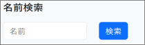{#p272-f28}

:::

::: {#page-273 .source-page}

::: {#p273-b01 .paragraph}

[…/resources/templates/form\_sample.html]{.s015}

:::

::: {#p273-b02 .code}

```xml
 1:<body class="bg-light p-4">
 2:<div class="container"> <!-- START container -->
 3:
 4:    <div class="row"> <!-- START row1 -->
 5:        <div class="col-md-3"> <!-- START sidebar -->
 6:            <div class="fs-5 fw-bold mb-3">名前検索</div>
 7:
 8:            <form class="row">
 9:                <div class="col-8">
10:                    <input type="text" class="form-control"
11:                        placeholder="名前">
12:                </div>
13:                <div class="col-4">
14:                    <button type="submit"
15:                        class="btn btn-primary">検索</button>
16:                </div>
17:            </form>
18:
19:        </div> <!-- END sidebar -->
20:    </div> <!-- END row1 -->
21:</div> <!-- END container -->
```

:::

::: {#p273-b03 .paragraph}

[検索フォームは、前の節で学習した、グリッドシステムを利用します。]{.s009}

:::

::: {#p273-b04 .paragraph}

[・5 行目 \<div class="col-md-3"\>]{.s031}

:::

::: {#p273-b05 .paragraph}

[&#32;フォームとは直接関係がないコードですが、横幅の3 割のみ占めるように、限定をさせること]{.s009}\
[で、左サイドバーのようなレイアウトを作ることができます。検索バーは、サイドバーに配置させ]{.s009}\
[ることが多いので、予めカラムを生成しました。]{.s009}

:::

::: {#p273-b06 .paragraph}

[・8 行目 \<form class="row"\>]{.s031}

:::

::: {#p273-b07 .paragraph}

[\<div\>ではなく、\<form\>要素をrow として生成すると、フォームを別途の行として扱えることが]{.s009}\
[できます。]{.s009}

:::

::: {#p273-b08 .paragraph}

[・9 行目・13 行目 \<div class="col-8"\> \<div class="col-4"\>]{.s031}

:::

::: {#p273-b09 .paragraph}

[入力フォームに8、ボタンに4 の割合でカラムを生成しています。]{.s009}

:::

::: {#p273-b10 .paragraph}

[・10 行目 \<input type="text" class="form-control"～]{.s031}

:::

:::

::: {#page-274 .source-page}

::: {#p274-b01 .paragraph}

[&#32;&#32;Bootstrap のフォーム関連クラスの中で、一番大事なクラスです。テキストフォームにこのクラ]{.s009}\
[スを付与することで、]{.s009}[Bootstrap 式のテキストフォームのデザインを適用]{.s015}[することができます。]{.s009}

:::

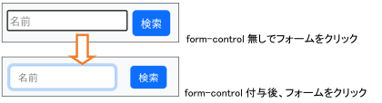{#p274-f29}

::: {#p274-b02 .paragraph}

[他にも、form-control を付与することで、できることが色々ありますので、公式サイトを参照して]{.s009}\
[ください。]{.s009}

:::

::: {#p274-b03 .paragraph}

[https://getbootstrap.jp/docs/5.3/forms/form-control/]{.s032}

:::

:::

::: {#page-275 .source-page}

::: {#p275-b01 .heading}

[登録ページのフォーム]{.s012}

:::

::: {#p275-b02 .paragraph}

[登録ページでは、複数の入力フィールドを連続して配置する垂直フォームを使用します。以]{.s009}\
[下に、よく使われるパターンの入力フィールドを1 つずつ紹介し、構文の説明とサンプルコード]{.s009}\
[をご説明します。]{.s009}

:::

::: {#p275-b03 .heading}

[1\.&#32;]{.s015}[テキストフォーム（input type = text、password）]{.s015}

:::

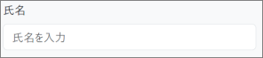{#p275-f30}

::: {#p275-b04 .code}

```xml
<label for="inputName" class="form-label">氏名</label>
<input type="text" class="form-control" id="inputName"
  placeholder="氏名を入力">
```

:::

::: {#p275-b05 .paragraph}

[&#32;フォームには、]{.s009}[「ラベル」]{.s015}[という要素があります。ラベルとは、入力フォームの説明を表示する]{.s009}\
[ための要素です。ラベルを使わず、普通にテキストを配置してもいいですが、通常は、ラベル]{.s009}\
[を使って説明する実装が推奨されます。]{.s009}

:::

::: {#p275-b06 .paragraph}

[for 属性]{.s015}[を使って、]{.s009}[関連付けたい入力フィールドのid を指定]{.s015}[すると、]{.s009}[ラベルをクリックした]{.s015}\
[時、関連する入力フィールドが自動的にフォーカス]{.s015}[されます。]{.s009}

:::

::: {#p275-b07 .paragraph}

[•&#32;]{.s010}[form-label クラス:]{.s015}\
[label 要素に適用されるクラスで、ラベルを適切にスタイルし、フォーム全体の見た目を]{.s009}\
[整えます。]{.s009}

:::

::: {#p275-b08 .paragraph}

[•&#32;]{.s010}[form-control クラス:]{.s015}\
[入力フィールドに適用されるクラスで、テキスト入力フィールドがBootstrap のスタイル]{.s009}\
[で適用されます。]{.s009}

:::

:::

::: {#page-276 .source-page}

::: {#p276-b01 .heading}

[2\.&#32;]{.s015}[ラジオボタン、チェックボックス（input type = radio、checkbox）]{.s015}

:::

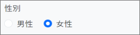{#p276-f31}

::: {#p276-b02 .code}

```xml
<label class="form-label">性別</label><br>
<div class="form-check form-check-inline">
      <input type="radio" class="form-check-input" id="genderMale"
      name="gender" value="male">
      <label for="genderMale" class="form-check-label">男性</label>
</div>

<div class="form-check form-check-inline">
      <input type="radio" class="form-check-input" id="genderFemale"
      name="gender" value="female">
      <label for="genderFemale" class="form-check-label">女性</label>
</div>
```

:::

::: {#p276-b03 .paragraph}

[ラジオボタンをBootstrap実装する際は、2つの種類のラベルが必要です。「性別」というラベ]{.s009}\
[ルと、「男性・女性」という個別のラベルを実装する必要があります。]{.s009}

:::

::: {#p276-b04 .paragraph}

[ラジオボタンと、チェックボックスは必要に応じて、以下のクラスを適用します。]{.s009}

:::

::: {#p276-b05 .paragraph}

[•]{.s043}[&#32;&#32;form-check クラス:]{.s013}\
[チェックボックスやラジオボタンのグループに適用されるクラスで、適切な間隔とスタ]{.s009}\
[イルを設定します。]{.s009}

:::

::: {#p276-b06 .paragraph}

[•&#32;]{.s010}[form-check-inline クラス:]{.s015}\
[form-check クラスに加えてform-check-inline クラスを使用することで、ラジオボタンを]{.s009}\
[インラインブロック要素にし、]{.s009}[横並びに配置]{.s015}[します。削除したら、改行されます。]{.s009}

:::

::: {#p276-b07 .paragraph}

[•]{.s043}[&#32;&#32;form-check-input クラス:]{.s013}\
[チェックボックスやラジオボタンに共通のデザインを適用できます。]{.s009}

:::

::: {#p276-b08 .paragraph}

[•]{.s043}[&#32;&#32;form-check-label クラス:]{.s013}\
[チェックボックスやラジオボタンのラベルに適用します。for 属性と連携するので、]{.s009}[レベ]{.s015}\
[ルをクリックするだけでも、ラジオボタンがチェックされる]{.s015}[便利なUI を作ります。]{.s009}

:::

:::

::: {#page-277 .source-page}

::: {#p277-b01 .heading}

[3\.&#32;]{.s015}[セレクトメニュー(select-option）:]{.s015}

:::

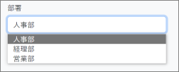{#p277-f32}

::: {#p277-b02 .code}

```xml
<label for="department" class="form-label">部署</label>
<select class="form-select" id="department">
        <option value="hr">人事部</option>
        <option value="finance">経理部</option>
        <option value="sales">営業部</option>
</select>
```

:::

::: {#p277-b03 .paragraph}

[セレクトメニューは、\<select\>要素に、「form-select」クラスを適用するくらいです。]{.s044}

:::

::: {#p277-b04 .heading}

[登録フォームのサンプルコード]{.s012}

:::

::: {#p277-b05 .paragraph}

[…/resources/templates/form\_sample2.html]{.s015}

:::

::: {#p277-b06 .code}

```xml
<body class="bg-light p-4">

<div class="container"> <!-- START container -->
    <form class="row justify-content-center"> <!-- START form row -->
        <div class="col-md-4"> <!-- START form column -->
            <h2 class="mb-4">登録フォーム</h2>

            <div class="mb-3"> <!--テキストフォーム-->
                <label for="inputName" class="form-label">氏名</label>
                <input type="text" class="form-control" id="inputName"
                    placeholder="氏名を入力">
            </div>
            <div class="mb-3"> <!--パスワードフォーム-->
                <label for="inputPassword"
                    class="form-label">パスワード</label>
                <input type="password" class="form-control"
                    id="inputPassword" placeholder="パスワードを入力">
```

:::

:::

::: {#page-278 .source-page}

::: {#p278-b01 .code}

```xml
            </div>
            <div class="mb-3"> <!--ラジオボタン-->
                <label class="form-label">性別</label><br>
                <div class="form-check form-check-inline">
                    <input type="radio" class="form-check-input"
                        id="genderMale" name="gender" value="male">
                    <label for="genderMale"
                        class="form-check-label">男性</label>
                </div>
                <div class="form-check form-check-inline">
                    <input type="radio" class="form-check-input"
                        id="genderFemale" name="gender" value="female">
                    <label for="genderFemale"
                        class="form-check-label">女性</label>
                </div>
            </div>
            <div class="mb-3"> <!--チェックボックス-->
                <div class="form-check">
                    <input type="checkbox" class="form-check-input"
                        id="subscribeNewsletter">
                    <label for="subscribeNewsletter"
                       class="form-check-label">ニュースレターを購読する</label>
                </div>
            </div>
            <div class="mb-3"> <!--セレクトメニュー-->
                <label for="department" class="form-label">部署</label>
                <select class="form-select" id="department">
                    <option value="hr">人事部</option>
                    <option value="finance">経理部</option>
                    <option value="sales">営業部</option>
                </select>
            </div>
            <button type="submit" class="btn btn-primary">登録</button>
        </div> <!-- END form column -->
    </form> <!-- END form row -->
</div> <!-- END container -->
```

:::

:::

::: {#page-279 .source-page}

::: {#p279-b01 .heading}

[■動作確認]{.s012}

:::

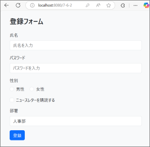{#p279-f33}

::: {#p279-b02 .paragraph}

[・画面のサイズを変えても、配置が維持されることを確認してください。]{.s044}

:::

::: {#p279-b03 .paragraph}

[・各フォームが統一されたデザインになっていることを確認してください。]{.s044}

:::

::: {#p279-b04 .paragraph}

[・ラジオボタンと、セレクトメニューが正常動作することを確認してください。]{.s044}

:::

:::

::: {#page-280 .source-page}

::: {#p280-b01 .heading}

[章のまとめ]{.s004}

:::

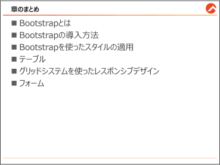{#p280-f34}

::: {#p280-b02 .paragraph}

[この章では、]{.s009}[Bootstrap]{.s007}[&#32;についてご説明しました。本書で説明した内容は、全てを網羅してい]{.s009}\
[るわけではありませんので、今回学習した知識を基に、必要に応じて公式サイトなどを調べな]{.s009}\
[がら実装する習慣をつけてください。]{.s009}

:::

:::

::: {#page-281 .source-page}

:::
