<!-- 元PDF 282〜289ページ。本文は原本の内容を保持し、バージョン表記のみ更新。 -->

::: {#page-282 .source-page}

::: {#p282-b01 .heading}

[&#32;A]{.s003}

:::

::: {#p282-b02 .heading}

[付録&#32;]{.s001}[A&#32;]{.s002}[環境構築手順]{.s001}

:::

:::

::: {#page-283 .source-page}

::: {#p283-b01 .heading}

[Import]{.s006}[&#32;手順]{.s007}

:::

::: {#p283-b02 .step}

[1\.&#32;]{.s008}[エクスポート済みのSpring プロジェクトのzip ファイルを用意します。]{.s008}

:::

::: {#p283-b03 .step}

[2\.&#32;]{.s008}[Zip ファイルの圧縮を解凍してください。]{.s008}

:::

::: {#p283-b04 .step}

[3\.&#32;]{.s008}[Eclipse の\[ファイル\]→\[インポート\]→\[Maven\]→\[既存Maven プロジェクト\]をクリックします。]{.s008}

:::

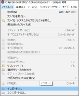{#p283-f01}

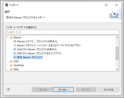{#p283-f02}

::: {#p283-b05 .step}

[4\.&#32;]{.s008}[\[参照\]→「圧縮解凍後のフォルダ」を選択し、\[フォルダの選択\]をクリックします。]{.s008}

:::

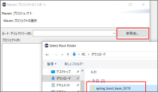{#p283-f03}

:::

::: {#page-284 .source-page}

::: {#p284-b01 .step}

[5\.&#32;]{.s008}[インポートの準備が終わったことを確認できれば、\[完了\]をクリックします。]{.s008}

:::

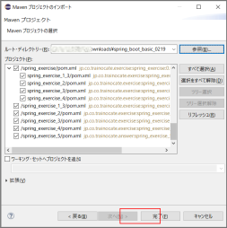{#p284-f04}

::: {#p284-b02 .step}

[6\.&#32;]{.s008}[プロジェクトエラーがなくなるまで待ちます。]{.s008}

:::

::: {#p284-b03 .step}

[7\.&#32;]{.s008}[本書で扱うSpring のプロジェクトは、親プロジェクトと子プロジェクトに分かれています。]{.s008}\
[赤枠で表示している、]{.s008}[後ろに番号がないプロジェクトが親プロジェクトです。]{.s009}

:::

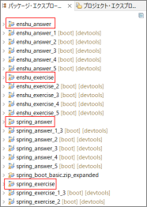{#p284-f05}

::: {#p284-b04 .heading}

[enshu\_answer : 演習ガイド解答]{.s010}

:::

::: {#p284-b05 .heading}

[enshu\_exercise : 演習ガイド問題]{.s010}

:::

::: {#p284-b06 .heading}

[spring\_answer : テキスト内のサンプル]{.s010}

:::

::: {#p284-b07 .heading}

[spring\_exercise : テキスト内の穴埋め問題]{.s010}

:::

:::

::: {#page-285 .source-page}

::: {#p285-b01 .heading}

[8\.&#32;]{.s009}[実行したいプロジェクトは、実行する前に必ず先に親プロジェクトを]{.s009}

:::

::: {#p285-b02 .paragraph}

[右クリック→\[実行\]→\[maven install\]をしてください。]{.s009}

:::

::: {#p285-b03 .paragraph}

[&#32;例）\[spring\_exercise\_2\]プロジェクトを実行したいなら、まず親プロジェクトである、]{.s008}\
[\[spring\_exercise\]プロジェクトを右クリック→\[Maven install\]をクリック]{.s008}

:::

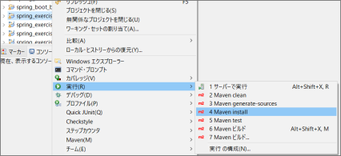{#p285-f06}

::: {#p285-b04 .step}

[9\.&#32;]{.s008}[以下のようにコンソール画面に「BUILD SUCCESS」という結果が表示されたら、子プロジ]{.s008}\
[ェクトも実行できるようになります。]{.s008}

:::

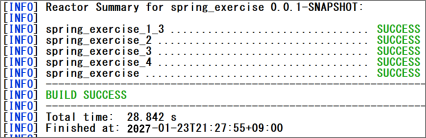{#p285-f07}

:::

::: {#page-286 .source-page}

::: {#p286-b01 .heading}

[新規プロジェクト作成方法]{.s011}

:::

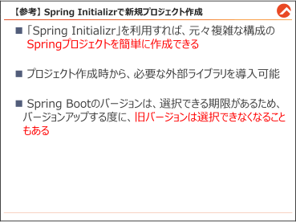{#p286-f08}

::: {#p286-b02 .heading}

[Spring Initializr でSpring Boot プロジェクト作成]{.s012}

:::

::: {#p286-b03 .paragraph}

[元々Spring プロジェクトの初期環境構築は複雑ですが、Spring Boot の「Spring Initializr」を]{.s008}\
[利用すると、初期環境構築を自動化できます。その特徴をご説明します。]{.s008}

:::

::: {#p286-b04 .paragraph}

[①&#32;]{.s008}[簡単なセットアップ]{.s008}\
[&#32;Spring Initializr を使用すると、必要なライブラリや設定ファイルが最初から揃っているプ]{.s008}\
[ロジェクトを簡単に作成できます。おかげで、初心者でもプロジェクトの基本的な構造を理]{.s008}\
[解しやすくなります。]{.s008}

:::

::: {#p286-b05 .paragraph}

[②&#32;]{.s008}[カスタマイズ可能]{.s008}\
[プロジェクトを作成する時に、必要なライブラリ（例えば、Spring Web, JPA など）を自分で]{.s008}\
[選択できます。必要な機能だけを含む、スリムで効率的なプロジェクトを作成することがで]{.s008}\
[きます。]{.s008}

:::

::: {#p286-b06 .paragraph}

[③&#32;]{.s008}[時間の節約]{.s008}\
[一から設定を行う必要がないため、開発を始めるまでの時間を大幅に短縮できます。]{.s008}

:::

::: {#p286-b07 .paragraph}

[④&#32;]{.s008}[常に最新のバージョン]{.s008}\
[Spring Initializr は、Java やEclipseとは関係なく、「]{.s008}[https://start.spring.io]{.s013}[」で管理していま]{.s008}\
[すので、常に最新のSpring Boot のバージョンと互換性があります。]{.s008}\
[その分、]{.s008}[新規プロジェクト作成時は、過去のバージョンは選択できなくなりますので、注]{.s014}\
[意が必要です。]{.s014}

:::

:::

::: {#page-287 .source-page}

::: {#p287-b01 .paragraph}

[Spring Boot の「Spring Initializr」で新規Spring プロジェクトを作成する方法をご説明します。]{.s008}

:::

::: {#p287-b02 .step}

[1\.&#32;]{.s008}[2020 年以降のEclipse(pleiades) 又は、Spring Tool Suite を起動します。]{.s008}

:::

::: {#p287-b03 .paragraph}

[※本書では、Pleiades 2025を使用します。]{.s008}

:::

::: {#p287-b04 .step}

[2\.&#32;]{.s008}[\[ファイル\]→\[新規\]→\[Spring スターター・プロジェクト(Spring Initializr)\]をクリックします。]{.s008}

:::

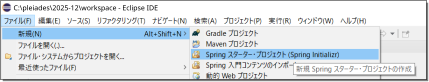{#p287-f09}

::: {#p287-b05 .step}

[3\.&#32;]{.s008}[\[タイプ\]は、]{.s008}[\[Maven\]に変更]{.s015}[し、\[名前\]・\[グループ\]・\[成果物\]・\[パッケージ\]は適切な文字]{.s008}\
[列を入れ、\[次へ\]をクリックします。]{.s008}

:::

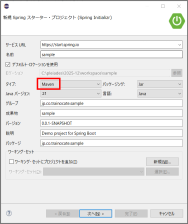{#p287-f10}

::: {#p287-b06 .step}

[4\.&#32;]{.s008}[プロジェクト立上げの際に、最初からインストールしたい外部ライブラリを選択できます。]{.s008}

:::

::: {#p287-b07 .paragraph}

[初期のインストールライブラリとして一般的なライブラリは、以下の4 つですので、チェック]{.s008}\
[を入れて\[完了\]をクリックしてください。]{.s008}

:::

::: {#p287-b08 .paragraph}

[・Spring Web]{.s008}\
[・Spring Boot DevTools]{.s008}\
[・Thymeleaf]{.s008}\
[・Lombok]{.s008}

:::

:::

::: {#page-288 .source-page}

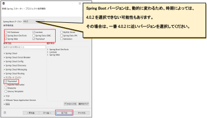{#p288-f11}

::: {#p288-b01 .step}

[5\.&#32;]{.s008}[プロジェクト作成には、時間がかかりますので、Eclipse の右下の状態バーが100%になる]{.s008}\
[までお待ちください。]{.s008}

:::

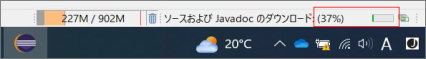{#p288-f12}

::: {#p288-b02 .heading}

[セキュリティ問題で、Eclipse 上で新規プロジェクト作成ができない場合]{.s016}

:::

::: {#p288-b03 .paragraph}

[※もし、セキュリティの問題で、Eclipe からSpring Initializr を開くことができない場合は、]{.s008}\
[ブラウザから、]{.s008}[https://start.spring.io&#32;]{.s013}[にアクセスしてください。]{.s008}

:::

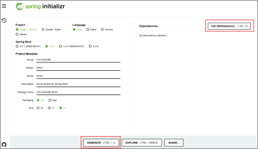{#p288-f13}

:::

::: {#page-289 .source-page}

::: {#p289-b01 .paragraph}

[「ADD DEPENDENCIES」をクリックし、]{.s008}

:::

::: {#p289-b02 .paragraph}

[・Spring Web]{.s008}\
[・Spring Boot DevTools]{.s008}\
[・Thymeleaf]{.s008}\
[・Lombok]{.s008}

:::

::: {#p289-b03 .paragraph}

[などのライブラリを選択してください。]{.s008}

:::

::: {#p289-b04 .paragraph}

[記載完了後、「GENERATE」ボタンをクリックすると、zip ファイルとしてExport されます。]{.s008}

:::

::: {#p289-b05 .paragraph}

[前の節の、Import 手順に従って、Import してください。]{.s008}

:::

:::
