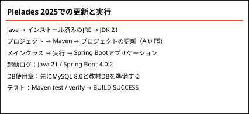
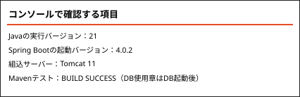
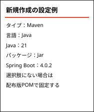
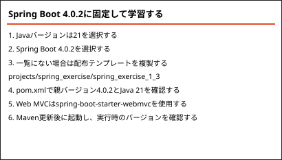
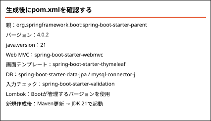

<!-- 元PDF 282〜289ページ。Java 21・Spring Boot 4.0.2・Pleiades 2025向けに改訂。 -->

::: {#page-282 .source-page}

::: {#p282-b01 .heading}

[&#32;A]{.s003}

:::

::: {#p282-b02 .heading}

[付録&#32;]{.s001}[A&#32;]{.s002}[環境構築手順]{.s001}

:::

:::

::: {#page-283 .source-page}

::: {#p283-b01 .heading}

[Import]{.s006}[&#32;手順]{.s007}

:::

::: {#p283-b02 .step}

1\. Pleiades 2025のJava Full Editionを用意し、配布教材の更新版 `projects` フォルダーを展開します。各アプリのSpring Bootは4.0.2、Javaは21に固定しています。

:::

::: {#p283-b03 .step}

2\. [ウィンドウ]→[設定]→[Java]→[インストール済みのJRE]でJDK 21を選び、[実行環境]のJavaSE-21も同じJDKへ対応付けます。Mavenの実行構成でもJRE 21を選びます。

:::

::: {#p283-b04 .step}

3\. [ファイル]→[インポート]→[Maven]→[既存Mavenプロジェクト]を選択します。

:::

{#p283-f01}

{#p283-f02}

::: {#p283-b05 .step}

4\. [参照]で更新版の `projects` フォルダーを選択します。4グループと、その配下の27個のアプリを読み込みます。同じ名前の旧版を別途インポートする必要はありません。

:::

{#p283-f03}

:::

::: {#page-284 .source-page}

::: {#p284-b01 .step}

5\. 選択したMavenプロジェクトを確認し、[完了]をクリックします。配布版は集約用POMとアプリ用POMで構成されています。

:::

{#p284-f04}

::: {#p284-b02 .step}

6\. 依存関係のダウンロード完了を待ちます。プロジェクトを選び、[Maven]→[プロジェクトの更新]（Alt+F5）を実行します。必要に応じて強制更新を選択します。

:::

::: {#p284-b03 .step}

7\. `spring_answer`・`spring_exercise`・`enshu_answer`・`enshu_exercise` は、グループごとにビルドする4つの集約プロジェクトです。このほか、27アプリをまとめる全体集約 `spring-boot-basic` があります。各アプリはSpring Bootの親POM 4.0.2を参照します。

:::

{#p284-f05}

::: {#p284-b04 .heading}

[enshu\_answer : 演習ガイド解答]{.s010}

:::

::: {#p284-b05 .heading}

[enshu\_exercise : 演習ガイド問題]{.s010}

:::

::: {#p284-b06 .heading}

[spring\_answer : テキスト内のサンプル]{.s010}

:::

::: {#p284-b07 .heading}

[spring\_exercise : テキスト内の穴埋め問題]{.s010}

:::

:::

::: {#page-285 .source-page}

::: {#p285-b01 .heading}

[8\. Java 21とデータベースの接続を確認する]{.s009}

:::

::: {#p285-b02 .paragraph}

アプリの[プロパティ]→[Javaコンパイラー]が21であることを確認します。MySQL 8.0の教材DBは `projects/database/sample.sql` と `exercise.sql` から作成します。通常のポートは3306です。

:::

::: {#p285-b03 .paragraph}

集約用プロジェクトのMaven installは、アプリ単独実行の必須条件ではありません。実行するアプリのメインクラスを右クリックし、[実行]→[Spring Bootアプリケーション]を選びます。

:::

{#p285-f06}

::: {#p285-b04 .step}

9\. コンソールでJava 21、Spring Boot 4.0.2、起動完了を確認します。テストする場合はMavenの `test` または `verify` を実行し、BUILD SUCCESSを確認します。DBを使う章ではMySQLを先に起動します。

:::

{#p285-f07}

:::

::: {#page-286 .source-page}

::: {#p286-b01 .heading}

[新規プロジェクト作成方法]{.s011}

:::

{#p286-f08}

::: {#p286-b02 .heading}

[Spring Initializr でSpring Boot プロジェクト作成]{.s012}

:::

::: {#p286-b03 .paragraph}

[元々Spring プロジェクトの初期環境構築は複雑ですが、Spring Boot の「Spring Initializr」を]{.s008}\
[利用すると、初期環境構築を自動化できます。その特徴をご説明します。]{.s008}

:::

::: {#p286-b04 .paragraph}

[①&#32;]{.s008}[簡単なセットアップ]{.s008}\
[&#32;Spring Initializr を使用すると、必要なライブラリや設定ファイルが最初から揃っているプ]{.s008}\
[ロジェクトを簡単に作成できます。おかげで、初心者でもプロジェクトの基本的な構造を理]{.s008}\
[解しやすくなります。]{.s008}

:::

::: {#p286-b05 .paragraph}

[②&#32;]{.s008}[カスタマイズ可能]{.s008}\
[プロジェクトを作成する時に、必要なライブラリ（例えば、Spring Web, JPA など）を自分で]{.s008}\
[選択できます。必要な機能だけを含む、スリムで効率的なプロジェクトを作成することがで]{.s008}\
[きます。]{.s008}

:::

::: {#p286-b06 .paragraph}

[③&#32;]{.s008}[時間の節約]{.s008}\
[一から設定を行う必要がないため、開発を始めるまでの時間を大幅に短縮できます。]{.s008}

:::

::: {#p286-b07 .paragraph}

④ バージョンを指定したプロジェクト作成

Spring Initializrの選択肢は時期によって変わります。本教材はJava 21・Spring Boot 4.0.2で検証しています。一覧に4.0.2がない場合は、配布版の `spring_exercise_1_3` を複製するか、生成後のPOMで親バージョンを4.0.2へ揃えます。

:::

:::

::: {#page-287 .source-page}

::: {#p287-b01 .paragraph}

Pleiades 2025で新規アプリを作成する方法を説明します。Javaの選択とSpring Bootのバージョンは、それぞれ21と4.0.2に揃えます。

:::

::: {#p287-b02 .step}

1\. Pleiades 2025のJava版を起動し、開発用JDKとMavenの実行JREが21であることを確認します。

:::

::: {#p287-b03 .paragraph}

本書の基準環境はPleiades 2025、Java 21、Maven、Spring Boot 4.0.2です。Eclipse自体の実行用JDKと、アプリの開発用JDKは別の設定です。

:::

::: {#p287-b04 .step}

2\. [ファイル]→[新規]→[Springスターター・プロジェクト]を選択します。

:::

{#p287-f09}

::: {#p287-b05 .step}

3\. [タイプ]はMaven、[言語]はJava、[Javaバージョン]は21、[パッケージング]はJarを指定します。[名前]・[グループ]・[成果物]・[パッケージ]を設定して[次へ]をクリックします。

:::

{#p287-f10}

::: {#p287-b06 .step}

4\. Spring Boot 4.0.2と、章で使用する依存関係を確認します。Web MVCでは `spring-boot-starter-webmvc` を使います。

:::

::: {#p287-b07 .paragraph}

基本の選択肢は次の4つです。DBを使う章ではSpring Data JPAとMySQL Driver、入力チェックではValidationを追加します。生成後にpom.xmlを確認してください。

:::

::: {#p287-b08 .paragraph}

・Spring Web（MVC）
・Spring Boot DevTools
・Thymeleaf
・Lombok

:::

:::

::: {#page-288 .source-page}

{#p288-f11}

::: {#p288-b01 .step}

5\. ダウンロードと構成の更新が終わるまで待ちます。pom.xmlの親バージョンが4.0.2、java.versionが21であることを確認し、Mavenのプロジェクト更新を実行します。

:::

{#p288-f12}

::: {#p288-b02 .heading}

[セキュリティ問題で、Eclipse 上で新規プロジェクト作成ができない場合]{.s016}

:::

::: {#p288-b03 .paragraph}

EclipseからSpring Initializrへ接続できない場合はブラウザーで https://start.spring.io を開きます。4.0.2が表示されないときは、配布した固定版のPOMと依存関係を使います。

:::

{#p288-f13}

:::

::: {#page-289 .source-page}

::: {#p289-b01 .paragraph}

[ADD DEPENDENCIES]をクリックし、章で必要な依存関係を選択します。

:::

::: {#p289-b02 .paragraph}

・Spring Web（MVC）
・Spring Boot DevTools
・Thymeleaf
・Lombok

:::

::: {#p289-b03 .paragraph}

登録した依存関係とJava 21を確認します。4.0.2を直接選べなかった場合も、完成後のPOMを本教材の固定版に揃えます。

:::

::: {#p289-b04 .paragraph}

[GENERATE]でダウンロードしたzipを展開します。親POM 4.0.2、java.version 21、Web MVCスターターを確認してください。

:::

::: {#p289-b05 .paragraph}

前の節のインポート手順で読み込み、Maven更新とアプリの起動を確認します。

:::

:::
