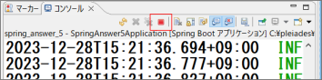
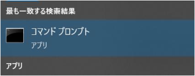
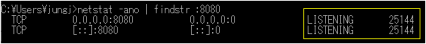
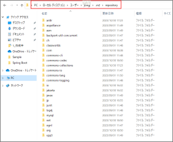

<!-- 元PDF 290〜296ページ。本文は原本の内容を保持し、バージョン表記のみ更新。 -->

::: {#page-290 .source-page}

::: {#p290-b01 .heading}

[&#32;B]{.s002}

:::

::: {#p290-b02 .heading}

[付録B よく起きるエラーまとめ]{.s001}

:::

:::

::: {#page-291 .source-page}

::: {#p291-b01 .heading}

[404]{.s005}[&#32;エラーが出る場合：]{.s006}

:::

::: {#p291-b02 .step}

[1\.&#32;]{.s007}[@Controller を書き忘れていませんか？]{.s007}

:::

::: {#p291-b03 .step}

[2\.&#32;]{.s007}[@GetMapping や@PostMapping のURL は正しいですか？]{.s007}

:::

::: {#p291-b04 .step}

[3\.&#32;]{.s007}[Controller に@RequestMapping をしているか確認しましたか？]{.s007}

:::

::: {#p291-b05 .step}

[4\.&#32;]{.s007}[Get 方式で送信して、@PostMapping で受け取っていませんか？またはその逆ではありま]{.s007}\
[せんか？]{.s007}

:::

::: {#p291-b06 .step}

[5\.&#32;]{.s007}[Controller のクラスファイルを一回以上実行していますか？Eclipse で実行をしないと、そ]{.s007}\
[もそもクラスファイルがコンパイルされませんので、Java が認識できず、404 エラーになりま]{.s007}\
[す。]{.s007}

:::

::: {#p291-b07 .step}

[6\.&#32;]{.s007}[テンプレートファイルの配置は正しいですか？]{.s007}\
[Thymeleaf テンプレートファイルは、通常src/main/resources/templates ディレクトリに配]{.s007}\
[置されるべきです。誤ったディレクトリにファイルがあると、Spring Boot はテンプレートを見]{.s007}\
[つけることができず、404 エラーを引き起こします。]{.s007}

:::

::: {#p291-b08 .step}

[7\.&#32;]{.s007}[テンプレートファイルの拡張子は正しいですか？]{.s007}\
[Thymeleaf テンプレートのファイル名は.html で終わる必要があります。間違った拡張子を]{.s007}\
[使用していると、Spring Boot がテンプレートを認識できずに404 エラーが発生します。]{.s007}

:::

::: {#p291-b09 .heading}

[500 Thymeleaf]{.s005}[&#32;エラー]{.s006}

:::

::: {#p291-b10 .paragraph}

[500 エラーは、基本的にエラーメッセージの中に、どの行で問題発生したかの情報が表示さ]{.s008}\
[れますので、慌てずエラーメッセージを確認しましょう。]{.s008}

:::

::: {#p291-b11 .step}

[1\.&#32;]{.s007}[Thymeleaf の閉じタグ忘れはありませんか？]{.s007}

:::

::: {#p291-b12 .step}

[2\.&#32;]{.s007}[メソッドの引数を書き忘れていませんか？]{.s007}

:::

::: {#p291-b13 .step}

[3\.&#32;]{.s007}[属性値の誤りはありませんか？]{.s007}\
[&#32;Thymeleaf では、特定の属性を使ってデータを表示したり操作したりします。例えば、]{.s007}\
[th:text やth:each などです。]{.s007}

:::

::: {#p291-b14 .step}

[4\.&#32;]{.s007}[モデル属性は一致していますか？]{.s007}\
[&#32;Controller からビューに渡されるモデル属性（例えば、model.addAttribute("data",]{.s007}\
[dataObject)）と、Thymeleaf テンプレート内で参照している属性名が一致しているかを確認]{.s007}\
[します。]{.s007}

:::

::: {#p291-b15 .step}

[5\.&#32;]{.s007}[Thymeleaf の式に誤りはありませんか？]{.s007}\
[&#32;Thymeleaf では、$\{...\}や\*\{...\}などの式を使ってオブジェクトのプロパティにアクセスしま]{.s007}

:::

:::

::: {#page-292 .source-page}

::: {#p292-b01 .paragraph}

[す。これらの式に誤った構文や存在しないプロパティを参照していると、エラーが発生しま]{.s007}\
[す。]{.s007}

:::

::: {#p292-b02 .heading}

[8080]{.s005}[&#32;ポート衝突エラー]{.s006}

:::

::: {#p292-b03 .paragraph}

[Eclipse]{.s004}[&#32;で&#32;]{.s007}[Spring Boot]{.s004}[&#32;アプリケーションを実行する際は、必ず動いているサーバーを止めて]{.s007}\
[から実行しないといけません。]{.s007}

:::

{#p292-f01}

::: {#p292-b04 .paragraph}

[止めずに何回も実行を続けていると、]{.s007}[8080]{.s004}[&#32;ポートの衝突が発生する可能性があります。]{.s007}

:::

::: {#p292-b05 .paragraph}

[\*\*\*\*\*\*\*\*\*\*\*\*\*\*\*\*\*\*\*\*\*\*\*\*\*\*\*]{.s009}

:::

::: {#p292-b06 .paragraph}

[APPLICATION FAILED TO START]{.s009}

:::

::: {#p292-b07 .paragraph}

[\*\*\*\*\*\*\*\*\*\*\*\*\*\*\*\*\*\*\*\*\*\*\*\*\*\*\*]{.s009}

:::

::: {#p292-b08 .paragraph}

[Description:]{.s009}

:::

::: {#p292-b09 .paragraph}

[Web server failed to start. Port 8080 was already in use.]{.s009}

:::

::: {#p292-b10 .paragraph}

[Action:]{.s009}

:::

::: {#p292-b11 .paragraph}

[Identify and stop the process that's listening on port 8080 or configure this]{.s009}\
[application to listen on another port.]{.s009}

:::

::: {#p292-b12 .paragraph}

[上記のようなエラーが出た際は、以下の手順を試してください。]{.s007}

:::

::: {#p292-b13 .step}

[1\.&#32;]{.s004}[Window]{.s004}[&#32;キーを入力し、]{.s007}[\[cod\]]{.s004}[と入力してコマンドプロンプトを起動します。]{.s007}

:::

:::

::: {#page-293 .source-page}

{#p293-f02}

::: {#p293-b01 .step}

[2\.&#32;]{.s004}[以下のコマンドを入力してください。]{.s007}[8080]{.s004}[&#32;以外のポート番号で実行している場合は、そ]{.s007}\
[の番号に変えてください。]{.s007}

:::

::: {#p293-b02 .paragraph}

[netstat -ano | findstr :]{.s004}[8080]{.s010}

:::

::: {#p293-b03 .step}

[3\.&#32;]{.s004}[LISTENING]{.s004}[&#32;の後ろに、番号が表示されます。]{.s007}

:::

{#p293-f03}

::: {#p293-b04 .step}

[4\.&#32;]{.s011}[以下のコマンドを入力してください。]{.s007}[/PID の後ろには、各自のLISTENING の番号を入]{.s012}\
[れてください。(25144 ではありません)]{.s012}

:::

::: {#p293-b05 .paragraph}

[taskkill /PID&#32;]{.s004}[25144]{.s010}[&#32;/F]{.s004}

:::

::: {#p293-b06 .step}

[5\.&#32;]{.s004}[プロセスを強制終了できましたので、]{.s007}[Eclipse]{.s004}[&#32;から再実行できるようになりました。]{.s007}

:::

{#p293-f04}

::: {#p293-b07 .heading}

[Eclipse 上で赤線が発生したり、呼び出したいメソッドが候補から出ない]{.s013}

:::

::: {#p293-b08 .step}

[1\.&#32;]{.s004}[Import]{.s004}[&#32;先が間違っている可能性が高いです。テキストを改めて確認し、]{.s007}[import]{.s004}[&#32;先が現]{.s007}\
[在の&#32;]{.s007}[Import]{.s004}[&#32;先と合っているのかを確認してください。]{.s007}

:::

::: {#p293-b09 .step}

[2\.&#32;]{.s004}[大文字・小文字は正しいのか、確認してください。]{.s007}

:::

:::

::: {#page-294 .source-page}

::: {#p294-b01 .heading}

[設定ファイル・イメージ・CSS・JavaScript などを修正しても反映されない]{.s013}

:::

::: {#p294-b02 .step}

[1\.&#32;]{.s004}[修正したファイルは、全て保存しましたか？]{.s007}

:::

::: {#p294-b03 .step}

[2\.&#32;]{.s004}[Maven install&#32;]{.s004}[と、]{.s007}[Spring Boot]{.s004}[&#32;アプリケーションの再起動はしましたか？]{.s007}

:::

::: {#p294-b04 .step}

[3\.&#32;]{.s007}[html ファイルを修正して保存しても、html コードが反映されない場合は、pom.xml の以下]{.s007}\
[のコードを消してmaven install 後、再度貼り付けてmaven install してください。]{.s007}

:::

::: {#p294-b05 .code}

```java
4. <dependency>
5. <groupId>org.springframework.boot</groupId>
6. <artifactId>spring-boot-devtools</artifactId>
7. <scope>runtime</scope>
8. <optional>true</optional>
9. </dependency>
```

:::

::: {#p294-b06 .step}

[10\.&#32;]{.s004}[キャッシュが残っていたりしませんか？]{.s007}\
[この場合、キャッシュの削除、または異なるブラウザで実行してください。]{.s007}

:::

::: {#p294-b07 .step}

[11\.&#32;]{.s004}[JavaScript]{.s004}[&#32;にエラーはないのか、開発者モードのコンソール上で確認しましたか？]{.s007}

:::

::: {#p294-b08 .heading}

[インポート時にエラーが発生する時]{.s013}

:::

::: {#p294-b09 .paragraph}

[pom.xml]{.s004}[&#32;によって、ダウンロードされたライブラリのファイルは、以下のパスに保存されます。]{.s007}

:::

::: {#p294-b10 .paragraph}

[PC¥]{.s010}[ローカル&#32;]{.s016}[ディスク]{.s016}[(C:)¥]{.s010}[ユーザ]{.s016}[¥\[]{.s010}[ユーザ名]{.s016}[\]¥.m2¥repository]{.s010}

:::

{#p294-f05}

:::

::: {#page-295 .source-page}

::: {#p295-b01 .paragraph}

[インポートエラーが出る場合は、ここにあるファイルがエラーの原因になる可能性がありますの]{.s007}\
[で、]{.s007}[repository]{.s004}[&#32;フォルダを削除してください。その後、インポートし直してください。]{.s007}

:::

::: {#p295-b02 .paragraph}

[※セキュリティ上、Maven Repository へのインターネット接続ができないPC 環境では、インポ]{.s017}\
[ートする前に、講師の方から研修中に使用するライブラリが入っているrepository フォルダを]{.s017}\
[まとめて配布しますので、こちらのrepository フォルダにコピーを行ってからインポートを行っ]{.s017}\
[てください。]{.s017}

:::

:::

::: {#page-296 .source-page}

::: {#p296-b01 .paragraph}

[無断複写・複製の禁止]{.s018}\
[本書は著作権法上の保護を受けています。]{.s019}\
[Spring Boot 入門]{.s018}\
[本書の全部または一部を無断で複写複製することは]{.s019}\
[~サーブレット&JSP からのステップアップ~]{.s018}\
[禁じられています。]{.s019}

:::

::: {#p296-b02 .paragraph}

[2024 年02 月06 日&#32;]{.s019}[第1 版&#32;]{.s019}[発行]{.s019}\
[2024 年03 月15 日&#32;]{.s019}[第2 版&#32;]{.s019}[改訂&#32;]{.s019}[著&#32;&#32;者]{.s019}\
[トレノケート株式会社]{.s019}\
[2024 年12 月20 日&#32;]{.s019}[第3 版&#32;]{.s019}[改訂]{.s019}\
[発行者]{.s019}\
[2026 年03 月13 日&#32;]{.s019}[第4 版&#32;]{.s019}[改訂&#32;]{.s019}[〒 163-6027]{.s019}\
[東京都新宿区西新宿6 丁目8 番1 号]{.s019}\
[住友不動産新宿オークタワー 27 階]{.s019}\
[電話 03-3347-9686]{.s019}

:::

::: {#p296-b03 .paragraph}

[http://www.trainocate.co.jp/]{.s019}

:::

::: {#p296-b04 .paragraph}

[落丁本、乱丁本はお取り替えいたします。]{.s019}\
[JAC0177G-T1-04]{.s019}\
[© 2027 Trainocate Japan, Ltd.]{.s019}

:::

:::
