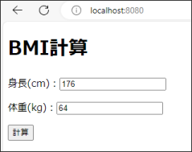
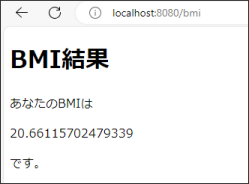

<!-- 元PDF 11〜16ページ。Java 21・Spring Boot 4.0.2対応版。 -->

::: {#page-11 .source-page}

::: {#p011-b01 .heading}

[&#32;2]{.s003}

:::

::: {#p011-b02 .heading}

[演習]{.s001}[&#32;2&#32;]{.s002}[&#32;Spring Web アプリケーション]{.s001}

:::

:::

::: {#page-12 .source-page}

::: {#p012-b01 .heading}

[演習の目標]{.s006}

:::

::: {#p012-b02 .paragraph}

[◼&#32;]{.s007}[Web アプリケーションの基本的な流れを理解できる]{.s008}

:::

::: {#p012-b03 .paragraph}

[◼&#32;]{.s007}[Controller を作成し、利用できる]{.s008}

:::

::: {#p012-b04 .paragraph}

[◼&#32;]{.s007}[View からController へのリクエストパラメータを取得できる]{.s008}

:::

::: {#p012-b05 .paragraph}

[◼&#32;]{.s007}[Form クラスを使用してリクエストパラメータを取得できる]{.s008}

:::

::: {#p012-b06 .paragraph}

[◼&#32;]{.s007}[Model を通じてController からView にデータを表示できる]{.s008}

:::

::: {#p012-b07 .heading}

[演習の概要]{.s006}

:::

::: {#p012-b08 .paragraph}

[第2 章で学習したSpring アプリケーションの基本文法を確認し、実際にプ]{.s008}

:::

::: {#p012-b09 .paragraph}

[ログラムを作成します。]{.s008}

:::

::: {#p012-b10 .paragraph}

[◼&#32;]{.s007}[身長と体重を入力する画面作成BMI 計算のツールを作成]{.s008}

:::

::: {#p012-b11 .paragraph}

[◼&#32;]{.s007}[入力されたデータを基に、BMI 計算を行うController を作成]{.s008}

:::

::: {#p012-b12 .paragraph}

[◼&#32;]{.s007}[計算結果を表示する画面を作成]{.s008}

:::

::: {#p012-b13 .heading}

[予想所要時間]{.s006}

:::

::: {#p012-b14 .paragraph}

[演習2.1 10 分]{.s009}

:::

::: {#p012-b15 .paragraph}

[演習2.2 25 分]{.s009}

:::

::: {#p012-b16 .paragraph}

[演習2.3 15 分]{.s009}

:::

:::

::: {#page-13 .source-page}

::: {#p013-b01 .heading}

[演習]{.s010}[2\.1.&#32;]{.s011}[入力画面へ遷移するメソッド作成]{.s010}

:::

{#p013-f01}

::: {#p013-b02 .paragraph}

[a. BMIController に、適切なアノテーションを付けてください。]{.s012}

:::

::: {#p013-b03 .paragraph}

[⚫&#32;]{.s013}[テキスト2.2 の【作業手順①】を参考にしてください。]{.s014}

:::

::: {#p013-b04 .heading}

[b. BMIController に、入力画面(index.html)へ遷移するメソッドを作成してください。]{.s015}

:::

::: {#p013-b05 .paragraph}

[⚫&#32;]{.s013}[テキスト2.2 の【Index メソッドの解説】を参考にしてください。]{.s014}

:::

::: {#p013-b06 .paragraph}

[⚫&#32;]{.s013}[index.html は、作成済みです。ソースコードを確認してください。]{.s014}

:::

::: {#p013-b07 .paragraph}

[⚫&#32;]{.s013}[Get マッピングするURL は、“/” にしてください。]{.s014}

:::

::: {#p013-b08 .paragraph}

[※return には、「.html」を省略可能です。]{.s014}

:::

:::

::: {#page-14 .source-page}

::: {#p014-b01 .heading}

[演習]{.s010}[2\.2. BMI]{.s011}[&#32;計算用のメソッド作成]{.s016}

:::

::: {#p014-b02 .paragraph}

[a. 計算用のメソッドに、Post 形式のマッピングをしてください。]{.s012}

:::

::: {#p014-b03 .paragraph}

[⚫&#32;]{.s013}[テキスト2.3 の【作業手順③】を参考にしてください。]{.s014}

:::

::: {#p014-b04 .paragraph}

[⚫&#32;]{.s013}[マッピングするURL は、“/bmi”にしてください。]{.s014}

:::

::: {#p014-b05 .paragraph}

[b. index.html のname 属性を参考にして、身長と体重のパラメータを取得するように引数を]{.s012}\
[設定してください。（Form クラス未使用）]{.s012}

:::

::: {#p014-b06 .paragraph}

[⚫&#32;]{.s013}[テキスト2.3 の【作業手順③】を参考にしてください。]{.s014}

:::

::: {#p014-b07 .paragraph}

[⚫&#32;]{.s013}[小数点でも受け取れるように、型はdouble にしてください。]{.s014}

:::

::: {#p014-b08 .paragraph}

[c. 取得した身長と体重を利用し、bmi 計算を行ってください。]{.s012}

:::

::: {#p014-b09 .paragraph}

[⚫&#32;]{.s013}[テキストは参照せずに、以下の手順通りに、コーディングをしましょう。]{.s014}

:::

::: {#p014-b10 .paragraph}

[⚫&#32;]{.s013}[身長はメートルの単位に変換(身長÷100)して、別途の変数に代入してください。]{.s014}

:::

::: {#p014-b11 .paragraph}

[⚫&#32;]{.s013}[bmi 計算を行い、double bmi 変数に代入してください。]{.s014}\
[※BMI 計算式 ： 体重÷(メートル変換済みの身長 × メートル変換済みの身長 )]{.s014}

:::

:::

::: {#page-15 .source-page}

::: {#p015-b01 .heading}

[演習]{.s010}[2\.3.&#32;]{.s011}[計算済みの&#32;]{.s010}[BMI]{.s011}[&#32;数値を結果ページへ表示]{.s016}

:::

{#p015-f02}

::: {#p015-b02 .paragraph}

[a. 計算用メソッドの引数に、Model model を追加してください。]{.s012}

:::

::: {#p015-b03 .paragraph}

[⚫&#32;]{.s013}[テキスト&#32;]{.s014}[2\.5]{.s005}[&#32;の【作業手順③】を参考にしてください。]{.s014}

:::

::: {#p015-b04 .paragraph}

[Model]{.s005}[&#32;は、インポートも忘れないで下さい。]{.s014}[(import org.springframework.ui.Model;)]{.s005}

:::

::: {#p015-b05 .paragraph}

[b. bmi 結果の変数を、model の中に格納してください。]{.s012}

:::

::: {#p015-b06 .paragraph}

[⚫&#32;]{.s013}[テキスト&#32;]{.s014}[2\.5]{.s005}[&#32;の【作業手順③】を参考にしてください。]{.s014}

:::

::: {#p015-b07 .paragraph}

[⚫&#32;]{.s013}[model.addAttribute を使ってください。]{.s014}[キー名は、”bmi”]{.s017}[にしてください。]{.s014}

:::

::: {#p015-b08 .paragraph}

[c. result.html へ遷移させてください。]{.s012}

:::

::: {#p015-b09 .paragraph}

[d. result.html に「あなたのBMI は ～ です」と表示するように実装してください。]{.s012}

:::

::: {#p015-b10 .paragraph}

[⚫&#32;]{.s013}[テキスト&#32;]{.s014}[2\.5]{.s005}[&#32;の【作業手順④】を参考にしてください。]{.s014}

:::

::: {#p015-b11 .paragraph}

[⚫&#32;]{.s013}[p タグの中に、th:text 属性を追加してください。]{.s014}

:::

::: {#p015-b12 .paragraph}

[※&#32;]{.s014}[th:text = “$\{ model に格納されている]{.s014}[キー名]{.s018}[&#32;\} ”]{.s014}

:::

::: {#p015-b13 .paragraph}

[※&#32;]{.s014}[form データを受け取るわけではありませんので、「.」で繋げずbmi 単体を指定し]{.s014}\
[ます。]{.s014}

:::

::: {#p015-b14 .paragraph}

[◼&#32;]{.s013}[動作確認：]{.s012}[http://localhost:8080/]{.s019}

:::

::: {#p015-b15 .paragraph}

[⚫&#32;]{.s013}[身長と体重を入力し、正しくBMI 値が出力されるかを確認。]{.s014}

:::

:::

::: {#page-16 .source-page}

::: {#p016-b01 .heading}

[演習]{.s010}[2\.4.&#32;]{.s011}[【オプション】&#32;]{.s010}[Form]{.s011}[&#32;クラスを利用]{.s016}

:::

::: {#p016-b02 .paragraph}

[Form クラスを利用するように、修正してください。]{.s012}

:::

::: {#p016-b03 .paragraph}

[⚫&#32;]{.s013}[テキスト&#32;]{.s014}[2\.4]{.s005}[&#32;を参考にしてください。]{.s014}

:::

::: {#p016-b04 .paragraph}

[a. form パッケージのBMIForm クラスに追記してください。]{.s012}

:::

::: {#p016-b05 .paragraph}

[⚫&#32;]{.s013}[double 型で、身長(height)、体重(weight)、bmi のフィールドを追加してください。]{.s014}

:::

::: {#p016-b06 .paragraph}

[⚫&#32;]{.s013}[Getter & Setter を追加してください。]{.s014}

:::

::: {#p016-b07 .paragraph}

[b. BMIController に戻り、メソッドの引数にBMIForm を加えるように、修正してください。]{.s012}

:::

::: {#p016-b08 .paragraph}

[c. get メソッドを使い、値を計算してください。計算後は、setBmi メソッドでbmi をセットしてく]{.s012}\
[ださい。]{.s012}

:::

::: {#p016-b09 .paragraph}

[d. model にbmiForm を格納するよう、修正してください。]{.s012}

:::

::: {#p016-b10 .paragraph}

[e. ｒesult2.html へ遷移するよう、修正してください。]{.s012}

:::

::: {#p016-b11 .paragraph}

[f. result2.html の方で、model 格納したForm データからbmi を表示してください。]{.s012}

:::

::: {#p016-b12 .paragraph}

[◼&#32;]{.s013}[動作確認：]{.s012}[http://localhost:8080/]{.s019}

:::

::: {#p016-b13 .paragraph}

[⚫&#32;]{.s013}[身長と体重を入力し、正しくBMI 値が出力されるかを確認。]{.s014}

:::

:::
