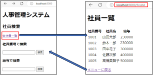
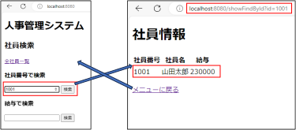
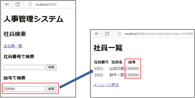
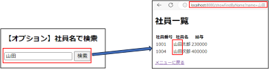
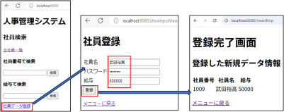
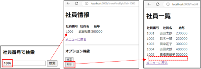

<!-- 元PDF 17〜28ページ。Java 21・Spring Boot 4.0.2対応版。 -->

::: {#page-17 .source-page}

::: {#p017-b01 .heading}

[&#32;3]{.s003}

:::

::: {#p017-b02 .heading}

[演習]{.s001}[&#32;3&#32;]{.s002}[&#32;Spring Data JPA]{.s001}

:::

:::

::: {#page-18 .source-page}

::: {#p018-b01 .heading}

[演習の目標]{.s006}

:::

::: {#migration-ex03-environment .paragraph}

本演習は、Java 21・Spring Boot 4.0.2・Pleiades 2025で進めます。作業用は `projects/enshu_exercise/enshu_exercise_3`、答え合わせ用は `projects/enshu_answer/enshu_answer_3` です。作業用には演習で実装する箇所が残っています。

:::

::: {#p018-b02 .paragraph}

[◼&#32;]{.s007}[Spring Data JPA の基本概念を理解できる]{.s008}

:::

::: {#p018-b03 .paragraph}

[◼&#32;]{.s007}[Controller を作成し、利用できる]{.s008}

:::

::: {#p018-b04 .paragraph}

[◼&#32;]{.s007}[エンティティとレポジトリーを実装できる]{.s008}

:::

::: {#p018-b05 .paragraph}

[◼&#32;]{.s007}[全件検索・条件検索ができる]{.s008}

:::

::: {#p018-b06 .paragraph}

[◼&#32;]{.s007}[登録・更新・削除ができる(オプション)]{.s008}

:::

::: {#p018-b07 .heading}

[演習の概要]{.s006}

:::

::: {#p018-b08 .paragraph}

[第3 章で学習したSpring Data JPA の基本文法を確認し、実際にデータベースと連動]{.s009}\
[する人事管理プログラムを作成します。]{.s009}

:::

::: {#p018-b09 .paragraph}

[◼&#32;]{.s010}[全社員検索機能を持つメソッドと、「全社員一覧」画面の作成]{.s009}\
[◼&#32;]{.s010}[社員番号で社員を検索する機能を持つメソッドと、画面の作成]{.s009}\
[◼&#32;]{.s010}[給与データで社員を検索する機能を持つメソッドと、画面の作成]{.s009}\
[◼&#32;]{.s010}[社員データを登録する機能を持つメソッドと、画面の作成]{.s009}

:::

::: {#p018-b10 .heading}

[予想所要時間]{.s006}

:::

::: {#p018-b11 .paragraph}

[演習3.1 10 分]{.s011}

:::

::: {#p018-b12 .paragraph}

[演習3.2 20 分]{.s011}

:::

::: {#p018-b13 .paragraph}

[演習3.3 15 分]{.s011}

:::

::: {#p018-b14 .paragraph}

[演習3.4 10 分]{.s011}

:::

::: {#p018-b15 .paragraph}

[演習3.5 25 分]{.s011}

:::

:::

::: {#page-19 .source-page}

::: {#p019-b01 .heading}

[■データベース情報]{.s012}

:::

::: {#p019-b02 .paragraph}

付録の手順で演習用データベースを準備し、MySQLを起動してください。接続先は `src/main/resources/application.properties` で確認します。演習用は `spring_exercise`、本文用は `spring_sample` なので、混同しないでください。
:::

::: {#p019-b03 .heading}

[＜接続情報＞]{.s012}

:::

::: {#p019-table01 .table has-header="false"}

|  |  |
| --- | --- |
| RDBMS 名 | MySQL8.0 |
| データベース名 | spring\_exercise |
| ユーザ名 | spring\_exercise\_user |
| パスワード | password |

:::

::: {#p019-b04 .heading}

[＜employee テーブル＞]{.s012}

:::

::: {#p019-table02 .table has-header="true"}

| No | 論理名称 | 物理名 称 | データ型 | 桁数 | 制約 | 備考 |
| --- | --- | --- | --- | --- | --- | --- |
| 1 | 社員番号 | id | INT | - | PRIMARY KEY AUTO\_INCREMENT | 自動採番 |
| 2 | パスワード | password | VARCHAR | - | - | - |
| 3 | 社員名 | name | VARCHAR | - | - | - |
| 4 | 給与 | salary | INT | - | - |  |

:::

::: {#p019-b05 .heading}

[\<Employee テーブルの初期データ一\>]{.s012}

:::

::: {#p019-table03 .table has-header="true"}

| id | password | name | salary |
| --- | --- | --- | --- |
| 1001 | password | 山田太郎 | 230000 |
| 1002 | password | 鈴木一郎 | 230000 |
| 1003 | password | 田中花子 | 300000 |
| 1004 | password | 山田次郎 | 400000 |
| 1005 | password | 高橋美智子 | 500000 |
| 1006 | password | 平恵 | 270000 |
| 1007 | password | 佐々木舞 | 330000 |
| 1008 | password | 中村翔 | 350000 |

:::

:::

::: {#page-20 .source-page}

::: {#p020-b01 .heading}

[演習]{.s018}[3\.1. Entity]{.s019}[&#32;と&#32;]{.s020}[Repository]{.s019}[&#32;の定義]{.s020}

:::

::: {#p020-b02 .paragraph}

[a. entity.Employee クラスのクラス名の上に適切なアノテーションを付けてください。]{.s017}

:::

::: {#p020-b03 .paragraph}

[⚫&#32;]{.s021}[テーブル情報と、テキスト3.2 の【作業手順①～②】を参考にしてください。]{.s022}

:::

::: {#p020-b04 .paragraph}

[⚫&#32;]{.s021}[Lombok のライブラリを活用してください。]{.s022}

:::

::: {#p020-b05 .paragraph}

[b. 4 つのフィールドの上に適切なアノテーションを付けてください。]{.s017}

:::

::: {#p020-b06 .paragraph}

[⚫&#32;]{.s021}[テーブル情報と、テキスト3.2 の【作業手順③】を参考にしてください。]{.s022}

:::

::: {#p020-b07 .paragraph}

[⚫&#32;]{.s021}[id(社員番号)には、@GeneratedValue アノテーションを付けてください。]{.s022}

:::

::: {#p020-b08 .paragraph}

[⚫&#32;]{.s021}[id 以外の列は、制約がありませんので、@Column の引数は今回不要です。]{.s022}

:::

::: {#p020-b09 .paragraph}

[c. repository.EmpRepository にJpaRepository を適切に継承してください。]{.s017}

:::

::: {#p020-b10 .paragraph}

[⚫&#32;]{.s021}[テキスト3.3 の【作業手順④】を参考にしてください。]{.s022}

:::

::: {#p020-b11 .paragraph}

[⚫&#32;]{.s021}[\<紐づけたいEntity 名, Entity の主キーの型名\>]{.s022}

:::

:::

::: {#page-21 .source-page}

::: {#p021-b01 .heading}

[演習]{.s018}[3\.2.&#32;]{.s019}[全社員一覧機能の実装]{.s018}

:::

{#p021-f01}

::: {#p021-b02 .paragraph}

[a. この演習では、初期画面として「社員検索」画面を利用します。]{.s017}\
[この画面から、それぞれのController メソッドを呼び出します。]{.s017}

:::

::: {#p021-b03 .paragraph}

[⚫&#32;]{.s021}[src/main/resources/templates/index.html のソースコードを確認してください。]{.s022}

:::

::: {#p021-b04 .paragraph}

[b. データベースからデータを取得したいため、Employee テーブルを操作できる]{.s017}\
[EmpRepository の「依存性の注入」を行ってください。]{.s017}

:::

::: {#p021-b05 .paragraph}

[⚫&#32;]{.s021}[EmpController に戻り、EmpRepository の依存性の注入を行ってください。]{.s022}

:::

::: {#p021-b06 .paragraph}

[⚫&#32;]{.s021}[テキスト3.3.1 を参考にしてください。]{.s022}

:::

::: {#p021-b07 .paragraph}

[c. EmpRepository を利用して、全件検索を行ってください。]{.s017}

:::

::: {#p021-b08 .paragraph}

[⚫&#32;]{.s021}[テキスト3.4 の【作業手順①】を参考にしてください。]{.s022}

:::

::: {#p021-b09 .paragraph}

[⚫&#32;]{.s021}[b.で指定したEmpRepository の変数を利用して、findAll メソッドを呼び出してくださ]{.s022}\
[い。]{.s022}

:::

::: {#p021-b10 .paragraph}

[⚫&#32;]{.s021}[複数の行を取得するため、戻り値型はList\<Employee\>です。]{.s022}

:::

::: {#p021-b11 .paragraph}

[d. 取得したリストをHTML に出力させるため、model にリストを格納してください。]{.s017}

:::

::: {#p021-b12 .paragraph}

[⚫&#32;]{.s021}[Model のキー名は、「“empList”」にしてください。]{.s022}

:::

::: {#p021-b13 .paragraph}

[⚫&#32;]{.s021}[遷移先は、「emp\_list.html」です。]{.s022}

:::

:::

::: {#page-22 .source-page}

::: {#p022-b01 .paragraph}

[e. emp\_list.html にmodel 内のデータを出力してください。]{.s017}

:::

::: {#p022-b02 .paragraph}

[⚫&#32;]{.s021}[テキスト3.4 の【作業手順②】を参考にしてください。]{.s022}

:::

::: {#p022-b03 .paragraph}

[⚫&#32;]{.s021}[パスワード以外の列を全て出力してください。]{.s022}

:::

::: {#p022-b04 .paragraph}

[⚫&#32;]{.s021}[「：」を境に右はModel のキー名の「empList」、左はModel の中に入っているものを意]{.s022}\
[味する任意の変数名にしてください。(emp など)]{.s022}

:::

::: {#p022-b05 .paragraph}

[◼&#32;]{.s021}[動作確認：]{.s017}[http://localhost:8080/]{.s023}

:::

::: {#p022-b06 .paragraph}

[⚫&#32;]{.s021}[「全社員一覧」リンクをクリックし、社員リストが表示されるか確認してください。]{.s022}

:::

:::

::: {#page-23 .source-page}

::: {#p023-b01 .heading}

[演習]{.s018}[3\.3.&#32;]{.s019}[社員番号検索機能の実装]{.s018}

:::

{#p023-f02}

::: {#p023-b02 .paragraph}

[a. src/main/resources/templates/index.html の「社員番号で検索」のソースコードを確認]{.s017}\
[してください。]{.s017}

:::

::: {#p023-b03 .paragraph}

[⚫&#32;]{.s021}[テキスト3.5 の【作業手順①～②】が該当する内容です。]{.s022}

:::

::: {#p023-b04 .paragraph}

[⚫&#32;]{.s021}[input type = number は、整数のみ入力できるテキストフォームを生成します。]{.s022}

:::

::: {#p023-b05 .paragraph}

[⚫&#32;]{.s021}[name 属性の値を覚えてください。]{.s022}

:::

::: {#p023-b06 .paragraph}

[b. EmpController クラスのshowFindById メソッドの引数に、a.のname 属性値を追記してく]{.s017}\
[ださい。]{.s017}

:::

::: {#p023-b07 .paragraph}

[⚫&#32;]{.s021}[テキスト3.5 の【作業手順③】を参考にしてください。]{.s022}

:::

::: {#p023-b08 .paragraph}

[c. EmpRepository を利用して、主キー検索を行ってください。]{.s017}

:::

::: {#p023-b09 .paragraph}

[⚫&#32;]{.s021}[テキスト3.5 の【作業手順③】を参考にしてください。]{.s022}

:::

::: {#p023-b10 .paragraph}

[⚫&#32;]{.s021}[EmpRepository の変数を利用して、findBｙId メソッドを呼び出してください。]{.s022}

:::

::: {#p023-b11 .paragraph}

[※.orElse(null)は必ず付けてください。]{.s022}

:::

::: {#p023-b12 .paragraph}

[⚫&#32;]{.s021}[1 行のデータを取得するため、戻り値型はエンティティ名のEmployee です。]{.s022}

:::

::: {#p023-b13 .paragraph}

[d. 取得したリストをHTML に出力させるため、model にリストを格納してください。]{.s017}

:::

::: {#p023-b14 .paragraph}

[⚫&#32;]{.s021}[Model のキー名は、「“emp”」にしてください。]{.s022}

:::

::: {#p023-b15 .paragraph}

[⚫&#32;]{.s021}[遷移先は、「emp.html」です。]{.s022}

:::

:::

::: {#page-24 .source-page}

::: {#p024-b01 .paragraph}

[e. emp.html にmodel 内のデータを出力してください。]{.s017}

:::

::: {#p024-b02 .paragraph}

[⚫&#32;]{.s021}[パスワード以外の列を全て出力してください。]{.s022}

:::

::: {#p024-b03 .paragraph}

[⚫&#32;]{.s021}[テキスト3.5 の【作業手順④】を参考にしてください。]{.s022}

:::

::: {#p024-b04 .paragraph}

[◼&#32;]{.s021}[動作確認：]{.s017}[http://localhost:8080/]{.s023}

:::

::: {#p024-b05 .paragraph}

[⚫&#32;]{.s021}[「社員番号で検索」フォームに「1001」と入力し、\[検索\]ボタンをクリックすると、]{.s022}\
[正しく社員情報ページが表示されるか確認してください。]{.s022}

:::

::: {#p024-b06 .heading}

[演習]{.s018}[3\.4.&#32;]{.s019}[&#32;給与による社員検索機能の実装]{.s018}

:::

{#p024-f03}

::: {#p024-b07 .paragraph}

[a. src/main/resources/templates/index.html の「給与で検索」のソースコードを確認してく]{.s017}\
[ださい。]{.s017}

:::

::: {#p024-b08 .paragraph}

[⚫&#32;]{.s021}[テキスト3.5.1 の【作業手順①】の内容が該当します。]{.s022}

:::

::: {#p024-b09 .paragraph}

[⚫&#32;]{.s021}[name 属性の値を覚えてください。]{.s022}

:::

::: {#p024-b10 .paragraph}

[&#32;b. EmpRepository にsalary 列検索用のメソッドを定義してください。]{.s017}

:::

::: {#p024-b11 .paragraph}

[⚫&#32;]{.s021}[テキスト&#32;]{.s022}[3\.5.1]{.s005}[&#32;の【作業手順②】を参考にしてください。]{.s022}

:::

::: {#p024-b12 .paragraph}

[⚫&#32;]{.s021}[複数行の検索結果を取得する可能性があるため、戻り値型を&#32;]{.s022}[List\<Employee\>]{.s005}[にしま]{.s022}\
[す。]{.s022}

:::

:::

::: {#page-25 .source-page}

::: {#p025-b01 .paragraph}

[c. EmpController クラスのshowFindBySalary メソッドの引数に、a.のname 属性値を追記し]{.s017}\
[てください。]{.s017}

:::

::: {#p025-b02 .paragraph}

[⚫&#32;]{.s021}[テキスト3.5.1 の【作業手順③】を参考にしてください。]{.s022}

:::

::: {#p025-b03 .paragraph}

[d. EmpRepository を利用して、主キーではない列(salary)検索を行ってください。]{.s017}

:::

::: {#p025-b04 .paragraph}

[⚫&#32;]{.s021}[テキスト3.5.1 の【作業手順③】を参考にしてください。]{.s022}

:::

::: {#p025-b05 .paragraph}

[⚫&#32;]{.s021}[b.で定義したメソッドを呼び出してください。]{.s022}

:::

::: {#p025-b06 .paragraph}

[⚫&#32;]{.s021}[複数の行を取得するため、戻り値型はList\<Employee\>です。]{.s022}

:::

::: {#p025-b07 .paragraph}

[e. 取得したリストをHTML に出力させるため、model にリストを格納してください。]{.s017}

:::

::: {#p025-b08 .paragraph}

[⚫&#32;]{.s021}[Model のキー名は、「“empList”」にしてください。]{.s022}

:::

::: {#p025-b09 .paragraph}

[⚫&#32;]{.s021}[遷移先は、「emp\_list.html」です。]{.s022}

:::

::: {#p025-b10 .paragraph}

[⚫&#32;]{.s021}[emp\_list.html は、演習3.2 で定義済みですので、修正事項はありません。]{.s022}

:::

::: {#p025-b11 .paragraph}

[◼&#32;]{.s021}[動作確認：]{.s017}[http://localhost:8080/]{.s023}

:::

::: {#p025-b12 .paragraph}

[⚫&#32;]{.s021}[「給与で検索」フォームに「230000」と入力し、\[検索\]ボタンをクリックすると、]{.s022}\
[2 件の社員リストが表示されるかを確認してください。]{.s022}

:::

:::

::: {#page-26 .source-page}

::: {#p026-b01 .heading}

[演習]{.s018}[3\.5.&#32;]{.s019}[【オプション】&#32;]{.s018}[名前検索機能の実装]{.s018}

:::

::: {#p026-b02 .paragraph}

[時間内に&#32;]{.s024}[3\.4]{.s025}[&#32;まで完了できた方は、オプション問題に挑戦してください。]{.s022}

:::

::: {#p026-b03 .paragraph}

[細かい修正箇所の案内はありませんので、学習した内容を基に実装してください。]{.s024}

:::

{#p026-f04}

::: {#p026-b04 .paragraph}

[a. EmpRepository に、新たにname のLike 検索を行うメソッドを定義してください。]{.s017}

:::

::: {#p026-b05 .paragraph}

[⚫&#32;]{.s026}[テキスト&#32;]{.s027}[3\.5.3]{.s028}[&#32;を参考にしてください。]{.s029}

:::

::: {#p026-b06 .paragraph}

[⚫&#32;]{.s021}[複数の行を取得するため、戻り値型はList\<Employee\>です。]{.s022}

:::

::: {#p026-b07 .paragraph}

[⚫&#32;]{.s021}[emp\_list.html]{.s005}[&#32;へ遷移させてください。]{.s022}

:::

::: {#p026-b08 .heading}

[演習]{.s018}[3\.6.&#32;]{.s019}[社員データ登録機能の実装]{.s018}

:::

{#p026-f05}

::: {#p026-b09 .paragraph}

[a. EmpController のshowInputView メソッドのソースコードを確認してください。]{.s017}

:::

::: {#p026-b10 .paragraph}

[b. src/main/resources/templates/emp\_input.html のソースコードを確認してください。]{.s017}

:::

::: {#p026-b11 .paragraph}

[⚫&#32;]{.s021}[テキスト3.6 の【作業手順②】の内容が該当します。]{.s022}

:::

::: {#p026-b12 .paragraph}

[⚫&#32;]{.s021}[action 属性値が\[“insertEmp”\]、method 属性値が\[“post”\]だということを覚えてくださ]{.s022}\
[い。]{.s022}

:::

:::

::: {#page-27 .source-page}

::: {#p027-b01 .paragraph}

[⚫&#32;]{.s021}[3 つのテキストフォームがあり、それぞれname、password、salary のname 属性値が]{.s022}\
[入っていることを覚えてください。]{.s022}

:::

::: {#p027-b02 .paragraph}

[c. form.EmpForm.java を確認してください。]{.s017}

:::

::: {#p027-b03 .paragraph}

[⚫&#32;]{.s021}[テキスト3.6 の【作業手順③】の内容が該当します。]{.s022}

:::

::: {#p027-b04 .paragraph}

[d. EmpController に戻り、メソッドの引数に、EmpForm とModel を入れてください。]{.s017}

:::

::: {#p027-b05 .paragraph}

[⚫&#32;]{.s021}[テキスト3.6 の【作業手順④】を参考にしてください。]{.s022}

:::

::: {#p027-b06 .paragraph}

[e. Employee のエンティティをnew で生成し、]{.s017}\
[Form からのデータを空っぽのEntity にコピーしてください。]{.s017}

:::

::: {#p027-b07 .paragraph}

[⚫&#32;]{.s021}[テキスト3.6 の【作業手順④】を参考にしてください。]{.s022}

:::

::: {#p027-b08 .paragraph}

[f. EmpRepository の変数を利用して、save メソッドを呼び出してください。]{.s017}

:::

::: {#p027-b09 .paragraph}

[⚫&#32;]{.s021}[引数には、データのコピー済みのエンティティを入れます。]{.s022}

:::

::: {#p027-b10 .paragraph}

[⚫&#32;]{.s021}[登録処理の後は、戻り値をmodel に格納し、登録データを確認するために、]{.s022}\
[result.html へ遷移させます。]{.s022}

:::

::: {#p027-b11 .paragraph}

[◼&#32;]{.s021}[動作確認：]{.s017}[http://localhost:8080/]{.s023}

:::

::: {#p027-b12 .paragraph}

[⚫&#32;]{.s021}[\[社員データ登録\]リンクをクリック]{.s022}

:::

::: {#p027-b13 .paragraph}

[⚫&#32;]{.s021}[登録する社員データを入力し、\[登録\]ボタンをクリック]{.s022}

:::

::: {#p027-b14 .paragraph}

[⚫&#32;]{.s021}[入力したデータ通りに、新規データが登録されているかを確認]{.s022}

:::

:::

::: {#page-28 .source-page}

::: {#p028-b01 .heading}

[演習]{.s018}[3\.7.&#32;]{.s019}[【オプション】 削除機能の実装]{.s018}

:::

{#p028-f06}

::: {#p028-b02 .paragraph}

[社員情報ページの削除ボタンをクリックすると、その社員のデータを削除する機能を実装し]{.s022}\
[てください。]{.s022}

:::

::: {#p028-b03 .paragraph}

[a. emp.html の削除ボタンのコメントを外してください。]{.s017}

:::

::: {#p028-b04 .paragraph}

[b. delete 処理をするメソッドを実装してください。]{.s017}

:::

::: {#p028-b05 .paragraph}

[⚫&#32;]{.s021}[テキスト&#32;]{.s022}[3\.8]{.s005}[&#32;を参考にしてください。]{.s022}

:::

::: {#p028-b06 .paragraph}

[⚫&#32;]{.s021}[削除処理後、全件検索の&#32;]{.s022}[URL]{.s005}[&#32;へリダイレクトしてください。]{.s022}

:::

::: {#p028-b07 .heading}

[演習]{.s018}[3\.8.&#32;]{.s019}[【オプション】]{.s018}[Service]{.s019}[&#32;クラスの利用]{.s020}

:::

::: {#p028-b08 .paragraph}

[テキスト&#32;]{.s022}[3\.9]{.s005}[&#32;を参考にして、今回実装したメソッドのビジネスロジックを&#32;]{.s022}[Service]{.s005}[&#32;クラスに分離]{.s022}\
[する実装に変えてください。]{.s022}

:::

::: {#p028-b09 .paragraph}

[URL]{.s005}[&#32;は、]{.s022}[localhost:8080/emp2/&#32;]{.s005}[で実装してください。]{.s022}

:::

:::
