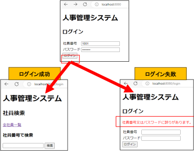
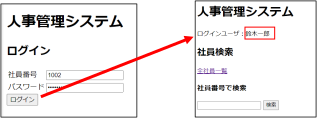
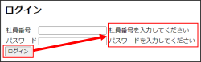
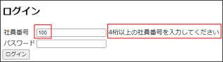
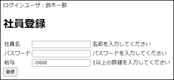

<!-- 元PDF 29〜36ページ。Java 21・Spring Boot 4.0.2対応版。 -->

::: {#page-29 .source-page}

::: {#p029-b01 .heading}

[&#32;4]{.s003}

:::

::: {#p029-b02 .heading}

[演習]{.s001}[&#32;4&#32;]{.s002}[&#32;セッションと入力チェック]{.s001}

:::

:::

::: {#page-30 .source-page}

::: {#p030-b01 .heading}

[演習の目標]{.s006}

:::

::: {#migration-ex04-environment .paragraph}

本演習は、Java 21・Spring Boot 4.0.2・Pleiades 2025で進めます。作業用は `projects/enshu_exercise/enshu_exercise_4`、答え合わせ用は `projects/enshu_answer/enshu_answer_4` です。作業用には演習で実装する箇所が残っています。

:::

::: {#p030-b02 .paragraph}

[◼&#32;]{.s007}[ID とパスワードによる認証処理を実装できる]{.s008}

:::

::: {#p030-b03 .paragraph}

[◼&#32;]{.s007}[セッションへのデータ保持と、活用方法について理解できる]{.s008}

:::

::: {#p030-b04 .paragraph}

[◼&#32;]{.s007}[入力チェックとエラーハンドリングを理解し、実装できる]{.s008}

:::

::: {#p030-b05 .heading}

[演習の概要]{.s006}

:::

::: {#p030-b06 .paragraph}

[第4 章で学習したセッションと入力チェックの基本文法を確認し、実際にデータベース]{.s009}\
[と連動するログインプログラムを作成します。]{.s009}

:::

::: {#p030-b07 .paragraph}

[◼&#32;]{.s010}[ID とパスワードの整合性をチェックする機能を持つメソッドの作成]{.s009}\
[◼&#32;]{.s010}[ログイン成功時、ユーザ情報をセッションに格納する機能を持つメソッドの作成]{.s009}\
[◼&#32;]{.s010}[入力値の整合性をチェックする機能を持つメソッドと画面の作成]{.s009}

:::

::: {#p030-b08 .heading}

[予想所要時間]{.s006}

:::

::: {#p030-b09 .paragraph}

[演習4.1 10 分]{.s011}

:::

::: {#p030-b10 .paragraph}

[演習4.2 20 分]{.s011}

:::

::: {#p030-b11 .paragraph}

[演習4.3 20 分]{.s011}

:::

:::

::: {#page-31 .source-page}

::: {#p031-b01 .heading}

[演習]{.s012}[4\.1. ID]{.s013}[&#32;とパスワードからのログイン機能の実装]{.s014}

:::

{#p031-f01}

::: {#p031-b02 .paragraph}

[◼&#32;]{.s015}[社員番号とパスワードを入力してもらうログインフォームを作成します。]{.s016}

:::

::: {#p031-b03 .paragraph}

[⚫&#32;]{.s015}[入力値に誤りがない場合は検索画面へ遷移]{.s017}

:::

::: {#p031-b04 .paragraph}

[⚫&#32;]{.s015}[入力値に誤りがある場合は、ログイン失敗画面へ遷移し、再入力を促します。]{.s017}

:::

::: {#p031-b05 .paragraph}

[a. src/main/resources/templates/index.html のソースコードを確認してください。]{.s016}

:::

::: {#p031-b06 .paragraph}

[⚫&#32;]{.s015}[テキスト4.1 の【作業手順②】の内容が該当します。]{.s017}

:::

::: {#p031-b07 .paragraph}

[⚫&#32;]{.s015}[name 属性の値を覚えてください。]{.s017}

:::

::: {#p031-b08 .paragraph}

[⚫&#32;]{.s015}[form タグのaction 属性値を確認してください。]{.s017}

:::

::: {#p031-b09 .paragraph}

[b. EmpRepository に、id とpassword のAND 検索を行う抽象メソッドを追加してください。]{.s016}

:::

::: {#p031-b10 .paragraph}

[⚫&#32;]{.s015}[テキスト4.1 の【作業手順③】の内容を参考にしてください。]{.s017}

:::

::: {#p031-b11 .paragraph}

[⚫&#32;]{.s015}[主キーとのAND 検索ですので、必ず1 行のデータを取得します。よって、戻り値型]{.s017}\
[はエンティティのEmployee です。]{.s017}

:::

::: {#p031-b12 .paragraph}

[⚫&#32;]{.s018}[この演習では、「empId」ではなく、「Id」です。間違えるとエラーが出ます。注意]{.s019}

:::

:::

::: {#page-32 .source-page}

::: {#p032-b01 .paragraph}

[c. LoginController のlogin メソッドの引数を入れてください。]{.s016}

:::

::: {#p032-b02 .paragraph}

[⚫&#32;]{.s015}[テキスト4.1 の【作業手順④】を参考にしてください。]{.s017}

:::

::: {#p032-b03 .paragraph}

[⚫&#32;]{.s015}[a.で送信したデータを受け取るメソッドです。]{.s017}\
[(POST で送信しているので、@PostMapping です)]{.s017}

:::

::: {#p032-b04 .paragraph}

[⚫&#32;]{.s015}[ｌ]{.s017}[ogin]{.s005}[&#32;メソッドの引数は、]{.s017}[id]{.s005}[&#32;と&#32;]{.s017}[password]{.s005}[&#32;の変数で受け取っても良いですし、]{.s017}[empForm]{.s005}\
[を使って受け取っても大丈夫です。]{.s017}

:::

::: {#p032-b05 .paragraph}

[d. ID とパスワードのAND 検索を行い、ユーザデータを取得してください。]{.s016}

:::

::: {#p032-b06 .paragraph}

[⚫&#32;]{.s015}[b.]{.s005}[で追加したメソッドを呼び出します。]{.s017}

:::

::: {#p032-b07 .paragraph}

[⚫&#32;]{.s015}[引数には、入力された&#32;]{.s017}[id]{.s005}[&#32;と&#32;]{.s017}[password]{.s005}[&#32;を入れてください。]{.s017}

:::

::: {#p032-b08 .paragraph}

[e. 取得したデータがnull なら、“login\_fail.html”へ遷移させる条件文を書いてください。]{.s016}

:::

::: {#p032-b09 .paragraph}

[⚫&#32;]{.s015}[redirect]{.s005}[&#32;を使わず、普通に&#32;]{.s017}[login\_fail.html]{.s005}[&#32;へ&#32;]{.s017}[return]{.s005}[&#32;するようにしてください。]{.s017}

:::

::: {#p032-b10 .paragraph}

[⚫&#32;]{.s015}[null]{.s005}[&#32;以外なら、正しい入力ということなので、演習&#32;]{.s017}[2]{.s005}[&#32;で実装した「検索画面」の]{.s017}\
[“]{.s017}[emp/index.html]{.s005}[”へ遷移させます。]{.s017}

:::

::: {#p032-b11 .paragraph}

[f. src/main/resources/templates/login\_fail.html のソースコードを確認してください。]{.s016}

:::

::: {#p032-b12 .paragraph}

[⚫&#32;]{.s015}[既存のログインページ]{.s017}[(index.html)]{.s005}[の]{.s017}[\<form\>]{.s005}[要素と同じコードが書かれていることを]{.s017}\
[確認してください。]{.s017}[action]{.s005}[&#32;属性が同じですので、同じメソッドを呼び出します。]{.s017}

:::

::: {#p032-b13 .paragraph}

[⚫&#32;]{.s015}[「社員番号又はパスワードに誤りがあります。」が記入されていることを確認してくださ]{.s017}\
[い。]{.s017}

:::

::: {#p032-b14 .paragraph}

[◼&#32;]{.s015}[動作確認：]{.s016}[http://localhost:8080/]{.s020}

:::

::: {#p032-b15 .paragraph}

[⚫&#32;]{.s015}[＜正しいアカウント情報入力＞]{.s016}

:::

::: {#p032-b16 .paragraph}

[社員番号：]{.s017}[1001]{.s005}\
[パスワード：]{.s017}[password&#32;&#32;&#32;]{.s005}[を入力し、]{.s017}[\[]{.s005}[ログイン]{.s017}[\]]{.s005}[ボタンをクリックしてください。]{.s017}

:::

::: {#p032-b17 .paragraph}

[→ 正常に検索画面へ遷移できたら、]{.s017}[OK]{.s005}[&#32;です。]{.s017}

:::

::: {#p032-b18 .paragraph}

[⚫&#32;]{.s015}[＜正しくないアカウント情報入力＞]{.s016}

:::

::: {#p032-b19 .paragraph}

[社員番号：]{.s017}[1001]{.s005}\
[パスワード：]{.s017}[pass]{.s005}[&#32;&#32;を入力し、]{.s017}[\[]{.s005}[ログイン]{.s017}[\]]{.s005}[ボタンをクリックしてください。]{.s017}\
[→ ログインに失敗し、再入力を促すメッセージが表示されたら、]{.s017}[OK]{.s005}[&#32;です。]{.s017}

:::

:::

::: {#page-33 .source-page}

::: {#p033-b01 .heading}

[演習]{.s012}[4\.2.&#32;]{.s013}[セッションデータの取得と利用]{.s012}

:::

::: {#p033-b02 .paragraph}

[◼&#32;]{.s015}[正しい&#32;]{.s017}[ID]{.s005}[&#32;とパスワードが入力されたことが確認できたら、システム全域で使いまわしで]{.s017}\
[きるように、ログインユーザのデータをセッションに格納しておきましょう。]{.s017}

:::

::: {#p033-b03 .paragraph}

[◼&#32;]{.s018}[演習4.1 のソースコードに、追記してください。]{.s021}

:::

{#p033-f02}

::: {#p033-b04 .paragraph}

[a. LoginController のlogin メソッドの引数に、セッションオブジェクトを追記してください。]{.s016}

:::

::: {#p033-b05 .paragraph}

[⚫&#32;]{.s015}[テキスト4.2 の【作業手順①】を参考にしてください。]{.s017}

:::

::: {#p033-b06 .paragraph}

[b. id とパスワードのAnd 検索から取得したユーザデータをセッションに格納してください。]{.s016}

:::

::: {#p033-b07 .paragraph}

[⚫&#32;]{.s015}[正しいID とパスワードを入力したら、実行される箇所に追記してください。]{.s017}

:::

::: {#p033-b08 .paragraph}

[⚫&#32;]{.s015}[セッションに格納する際のキー名は、「“user”」にしてください。]{.s017}

:::

::: {#p033-b09 .paragraph}

[c. /resources/templates/emp/index.html にログインユーザ名を表示してください。]{.s016}

:::

::: {#p033-b10 .paragraph}

[⚫&#32;]{.s015}[テキスト4.2 の【作業手順②】を参考にしてください。]{.s017}

:::

::: {#p033-b11 .paragraph}

[⚫&#32;]{.s015}[\</hr\>の前の\<span\>\</span\>にth:text 属性を入れてください。]{.s017}

:::

::: {#p033-b12 .paragraph}

[⚫&#32;]{.s015}[セッションに格納していた、“user”を使ってください。]{.s017}

:::

::: {#p033-b13 .paragraph}

[⚫&#32;]{.s018}[ログイン画面のindex.html ではなく、/emp/index.html ですので、注意しましょう。]{.s019}

:::

::: {#p033-b14 .paragraph}

[d. c.と同じコードを、emp フォルダ内の全てのhtml ファイルに追記してください。]{.s016}

:::

::: {#p033-b15 .paragraph}

[◼&#32;]{.s015}[動作確認：]{.s016}[http://localhost:8080/]{.s020}

:::

::: {#p033-b16 .paragraph}

[⚫&#32;]{.s015}[社員番号：]{.s017}[1001]{.s005}\
[パスワード：]{.s017}[password&#32;&#32;&#32;]{.s005}[を入力し、]{.s017}[\[]{.s005}[ログイン]{.s017}[\]]{.s005}[ボタンをクリックしてください。]{.s017}

:::

::: {#p033-b17 .paragraph}

[⚫&#32;]{.s015}[社員検索画面に、ログインユーザ名が表示されるかを確認してください。]{.s017}

:::

::: {#p033-b18 .paragraph}

[⚫&#32;]{.s015}[画面を遷移しても、ユーザ名が表示されていることを確認してください。]{.s017}

:::

:::

::: {#page-34 .source-page}

::: {#p034-b01 .heading}

[演習]{.s012}[4\.3.&#32;]{.s013}[入力チェック機能の実装]{.s012}

:::

::: {#p034-b02 .paragraph}

[◼&#32;]{.s015}[演習&#32;]{.s017}[4\.1]{.s005}[&#32;では、入力に誤りがある際には、予め用意した&#32;]{.s017}[login\_fail.html]{.s005}[&#32;へ遷移させる]{.s017}\
[方法を使いました。今度は、]{.s017}[index.html]{.s005}[&#32;内に入力チェック機能を実装することで、より柔]{.s017}\
[軟で保守性を高めるプログラミングに挑戦しましょう。]{.s017}

:::

{#p034-f03}

{#p034-f04}

::: {#p034-b03 .paragraph}

[a. EmpForm に、以下のような入力チェックができるように、アノテーションを追記してくださ]{.s016}\
[い。]{.s016}

:::

::: {#p034-table01 .table has-header="true"}

| 対象 | チェック内容 | 出力メッセージ |
| --- | --- | --- |
| 社員番号 | ①未入力時 ②4 桁未満の社員番号入力時 | 社員番号を入力してください 4 桁以上の社員番号を入力してください |
| パスワード | ①未入力時 | パスワードを入力してください |

:::

::: {#p034-b04 .paragraph}

[⚫&#32;]{.s015}[テキスト&#32;]{.s017}[4\.3]{.s005}[&#32;の【作業手順①】を参考にしてください。]{.s017}\
[⚫&#32;]{.s015}[「未満」については、「]{.s017}[4\.3.1&#32;]{.s005}[その他の&#32;]{.s017}[validation]{.s005}[&#32;アノテーション」の]{.s017}[@Min]{.s005}[&#32;を参考にしてく]{.s017}\
[ださい。（文字ではなく、数字の文字数チェックはなく、数値の大きさで判定）]{.s017}

:::

::: {#p034-b05 .paragraph}

[⚫&#32;]{.s015}[@Min(value = 1000, message = “”)]{.s021}[のように使います。]{.s017}

:::

::: {#p034-b06 .paragraph}

[⚫&#32;]{.s015}[複数のオプションは、,（カンマ）で並べることができます。]{.s017}

:::

::: {#p034-b07 .paragraph}

[b. LoginController のshowLoginView メソッドの引数に、Form クラスを入れてください。]{.s016}

:::

::: {#p034-b08 .paragraph}

[⚫&#32;]{.s015}[テキスト&#32;]{.s017}[4\.3]{.s005}[&#32;の【作業手順②】を参考にしてください。]{.s017}

:::

::: {#p034-b09 .paragraph}

[⚫&#32;]{.s015}[この手順を書き忘れると、エラーが出ます。]{.s017}

:::

:::

::: {#page-35 .source-page}

::: {#p035-b01 .paragraph}

[c. LoginController のlogin メソッドの引数の部分を、入力チェックができるように修正してくだ]{.s016}\
[さい。]{.s016}

:::

::: {#p035-b02 .paragraph}

[⚫&#32;]{.s015}[テキスト&#32;]{.s017}[4\.3]{.s005}[&#32;の【作業手順③】を参考にしてください。]{.s017}

:::

::: {#p035-b03 .paragraph}

[⚫&#32;]{.s015}[セッション関連は、そのまま残してください。]{.s017}

:::

::: {#p035-b04 .paragraph}

[d. 入力にエラーがある場合は、ログイン画面へ戻すように条件文を入れてください。]{.s016}

:::

::: {#p035-b05 .paragraph}

[⚫&#32;]{.s015}[And 検索を行うコードの前に、記入してください。]{.s017}

:::

::: {#p035-b06 .paragraph}

[⚫&#32;]{.s015}[入力エラーがある場合は、“index”へreturn してください。]{.s017}

:::

::: {#p035-b07 .paragraph}

[⚫&#32;]{.s015}[And 検索を行う時のlogin\_fail.html へ遷移する条件文は、残しても大丈夫です。]{.s017}

:::

::: {#p035-b08 .paragraph}

[e. /resources/templates/index.html のコードを修正してください。]{.s016}

:::

::: {#p035-b09 .paragraph}

[⚫&#32;]{.s015}[テキスト&#32;]{.s017}[4\.3]{.s005}[&#32;の【作業手順④】を参考にしてください。]{.s017}

:::

::: {#p035-b10 .paragraph}

[⚫&#32;]{.s015}[form の属性に、th:object を追記してください。login メソッドのform の変数名と一致させ]{.s017}\
[る必要があります。]{.s017}

:::

::: {#p035-b11 .paragraph}

[⚫&#32;]{.s015}[テキストフォームのname 属性の代わりに、th:field 属性に修正してください。]{.s017}

:::

::: {#p035-b12 .paragraph}

[⚫&#32;]{.s015}[エラーがある場合、メッセージを出力できるように、\<td\>\</td\>の間に\<span\>\</span\>を入]{.s017}\
[れて、th:errors 属性を付与してください。]{.s017}

:::

::: {#p035-b13 .paragraph}

[◼&#32;]{.s015}[動作確認：]{.s016}[http://localhost:8080/]{.s020}

:::

::: {#p035-b14 .paragraph}

[⚫&#32;]{.s015}[＜正しいアカウント情報入力＞]{.s016}

:::

::: {#p035-b15 .paragraph}

[社員番号：]{.s017}[1001]{.s005}\
[パスワード：]{.s017}[password&#32;&#32;&#32;]{.s005}[を入力し、]{.s017}[\[]{.s005}[ログイン]{.s017}[\]]{.s005}[ボタンをクリックしてください。]{.s017}\
[→ 正常に検索画面へ遷移でき、ユーザ名が表示されたら、]{.s017}[OK]{.s005}[&#32;です。]{.s017}

:::

::: {#p035-b16 .paragraph}

[⚫&#32;]{.s015}[＜何も入力しない＞]{.s016}

:::

::: {#p035-b17 .paragraph}

[社員番号：【空欄】]{.s017}\
[パスワード：【空欄】&#32;&#32;の状態で]{.s017}[&#32;\[]{.s005}[ログイン]{.s017}[\]]{.s005}[ボタンをクリックしてください。]{.s017}\
[→ ログインに失敗し、再入力を促すメッセージが表示されたら、]{.s017}[OK]{.s005}[&#32;です。]{.s017}

:::

::: {#p035-b18 .paragraph}

[⚫&#32;]{.s015}[\<社員番号を4 桁未満入力\>]{.s016}

:::

::: {#p035-b19 .paragraph}

[社員番号：]{.s017}[100]{.s005}\
[パスワード：任意&#32;&#32;の状態で]{.s017}[&#32;\[]{.s005}[ログイン]{.s017}[\]]{.s005}[ボタンをクリックしてください。]{.s017}\
[→ ログインに失敗し、桁数についてのメッセージが表示されたら、]{.s017}[OK]{.s005}[&#32;です。]{.s017}

:::

:::

::: {#page-36 .source-page}

::: {#p036-b01 .heading}

[演習]{.s012}[4\.4.&#32;]{.s013}[【オプション】&#32;]{.s012}[登録画面に入力チェック機能の実装]{.s012}

:::

{#p036-f05}

::: {#p036-b02 .paragraph}

[ログイン画面以外にも、登録画面にも入力チェックは必要ですので、以下のような仕様で入]{.s017}\
[力チェック機能を実装してください。社員番号のアノテーションは削除してください。]{.s017}

:::

::: {#p036-table01 .table has-header="true"}

| 対象 | チェック内容 | 出力メッセージ |
| --- | --- | --- |
| 社員番号 | ①未入力時 | 社員番号を入力してください |
| （アノテーシ | ②4 桁未満の社員番号入力時 | 4 桁以上の社員番号を入力してください |
| ョン削除） |  |  |
| パスワード | ①未入力時 | パスワードを入力してください |
| 社員名 | ①未入力時 | 名前を入力してください |
| 給与 | ①未入力時 ②入力値が1 未満の場合 | 給与を入力してください 1 以上の数値を入力してください |

:::

::: {#p036-b03 .paragraph}

[a. 既存のempForm をコピーし、EmpForm2.java をform パッケージ内に作成します。]{.s016}

:::

::: {#p036-b04 .paragraph}

[⚫&#32;]{.s015}[社員番号に付与していたアノテーションは、削除してください。]{.s017}

:::

::: {#p036-b05 .paragraph}

[b. EmpController のshowInputView メソッドを修正してください。]{.s016}

:::

::: {#p036-b06 .paragraph}

[⚫&#32;]{.s015}[引数に入れるForm の名前は、a で追加したForm にしてください。]{.s017}

:::

::: {#p036-b07 .paragraph}

[c. EmpController のinsertEmp メソッドを修正してください。]{.s016}

:::

::: {#p036-b08 .paragraph}

[⚫&#32;]{.s015}[引数に入れるForm の名前は、a で追加したForm にしてください。]{.s017}

:::

::: {#p036-b09 .paragraph}

[d. emp/emp\_input.html を修正してください。]{.s016}

:::

::: {#p036-b10 .paragraph}

[th:object に指定するForm の変数名は、c で指定したform の変数名に一致させてくださ]{.s017}\
[い。]{.s017}

:::

:::
