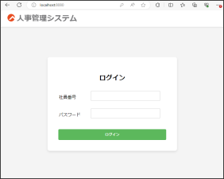
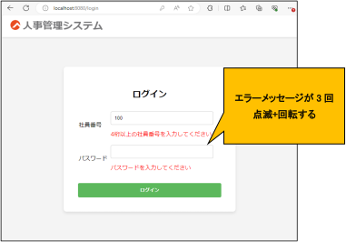
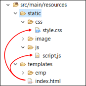
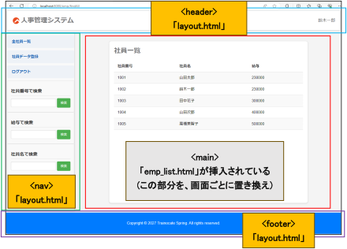
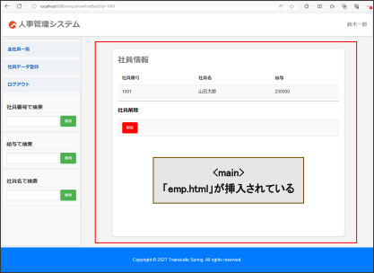
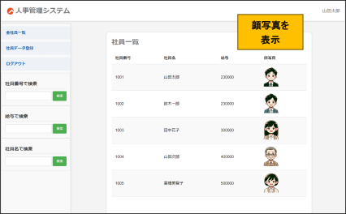
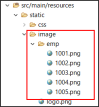
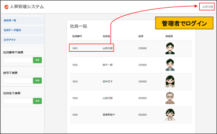
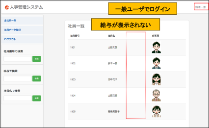

<!-- 元PDF 37〜46ページ。Java 21・Spring Boot 4.0.2対応版。 -->

::: {#page-37 .source-page}

::: {#p037-b01 .heading}

[&#32;5]{.s003}

:::

::: {#p037-b02 .heading}

[演習]{.s001}[&#32;5&#32;]{.s002}[&#32;Thymeleaf とWeb デザイン]{.s001}

:::

:::

::: {#page-38 .source-page}

::: {#p038-b01 .heading}

[演習の目標]{.s006}

:::

::: {#p038-b02 .paragraph}

[◼&#32;]{.s007}[CSS やJavaScript を適用できる]{.s008}

:::

::: {#p038-b03 .paragraph}

[◼&#32;]{.s007}[Thymeleaf の属性を利用し、条件によるHTML を生成できる]{.s008}

:::

::: {#p038-b04 .paragraph}

[◼&#32;]{.s007}[レイアウト機能を理解し、実装できる]{.s008}

:::

::: {#p038-b05 .heading}

[演習の概要]{.s006}

:::

::: {#p038-b06 .paragraph}

[第5 章で学習したThymeleaf の基礎文法を確認し、第4 章で実装したプログラムのデ]{.s009}\
[ザインの適用や動的出力を体験します。]{.s009}

:::

::: {#p038-b07 .paragraph}

[◼&#32;]{.s010}[ログインページのデザイン適用]{.s009}\
[◼&#32;]{.s010}[共通レイアウトを作成し、全画面に適用]{.s009}\
[◼&#32;]{.s010}[イメージの動的挿入と、権限による動的表示]{.s009}

:::

::: {#p038-b08 .heading}

[予想所要時間]{.s006}

:::

::: {#p038-b09 .paragraph}

[演習5.1 5 分]{.s011}

:::

::: {#p038-b10 .paragraph}

[演習5.2 20 分]{.s011}

:::

::: {#p038-b11 .paragraph}

[演習5.3 20 分]{.s011}

:::

:::

::: {#page-39 .source-page}

::: {#p039-b01 .heading}

[演習]{.s012}[5\.1. CSS]{.s013}[&#32;と&#32;]{.s014}[JavaScript]{.s013}[&#32;の適用]{.s014}

:::

::: {#p039-b02 .paragraph}

[4]{.s005}[&#32;章までのログイン画面に&#32;]{.s015}[CSS]{.s005}[&#32;と&#32;]{.s015}[JavaScript]{.s005}[&#32;を適用しましょう。]{.s015}

:::

::: {#p039-b03 .paragraph}

[css]{.s005}[&#32;ファイルと&#32;]{.s015}[js]{.s005}[&#32;ファイルは定義済みです。]{.s015}

:::

::: {#p039-b04 .paragraph}

[◼&#32;]{.s016}[ログイン画面(初期画面)]{.s017}

:::

{#p039-f01}

::: {#p039-b05 .paragraph}

[◼&#32;]{.s016}[ログイン画面(入力エラーがある場合)]{.s017}

:::

{#p039-f02}

:::

::: {#page-40 .source-page}

::: {#p040-b01 .paragraph}

[a. 以下のファイルのフォルダ構成と、ソースコードを確認してください。]{.s017}

:::

{#p040-f03}

::: {#p040-b02 .paragraph}

[⚫&#32;]{.s016}[style.css]{.s005}[&#32;と、]{.s015}[script.js]{.s005}[&#32;のソースコードの詳細は、コメントを参考にしてください。]{.s015}

:::

::: {#p040-b03 .paragraph}

[⚫&#32;]{.s016}[/resources/static]{.s005}[&#32;の中のファイル構成になっていることを確認してください。]{.s015}

:::

::: {#p040-b04 .paragraph}

[b. /resources/templates/index.html から、上のファイルを読み込んでください。]{.s017}

:::

::: {#p040-b05 .paragraph}

[⚫&#32;]{.s016}[テキスト5.2 を参考にしてください。]{.s015}

:::

::: {#p040-b06 .paragraph}

[⚫&#32;]{.s016}[\<head\>の中にstyle.css を読み込むコードを書いてください。]{.s015}

:::

::: {#p040-b07 .paragraph}

[⚫&#32;]{.s016}[\</body\>の直前にscript.js を読み込むコードを書いてください。]{.s015}

:::

::: {#p040-b08 .paragraph}

[◼&#32;]{.s016}[動作確認：]{.s017}[http://localhost:8080/]{.s018}

:::

::: {#p040-b09 .paragraph}

[⚫&#32;]{.s016}[新たなデザインが適用されているか確認してください。]{.s015}[(css]{.s005}[&#32;チェック]{.s015}[)]{.s005}

:::

::: {#p040-b10 .paragraph}

[⚫&#32;]{.s016}[何も入力せずに、ログインボタンをクリックしてください。(JavaScript チェック)]{.s015}

:::

::: {#p040-b11 .paragraph}

[→ エラーメッセージが点滅しながら回転するのか確認してください。]{.s015}

:::

:::

::: {#page-41 .source-page}

::: {#p041-b01 .heading}

[演習]{.s012}[5\.2.&#32;]{.s013}[共通レイアウトを作成し、全画面に適用]{.s012}

:::

::: {#p041-b02 .paragraph}

[◼&#32;]{.s016}[共通レイアウトを作成し、\<main\>の部分にコンテンツhtml を挿入しましょう。]{.s017}

:::

{#p041-f04}

{#p041-f05}

:::

::: {#page-42 .source-page}

::: {#p042-b01 .paragraph}

[◼&#32;]{.s016}[4 章までのソースコードからの変更点]{.s017}

:::

::: {#p042-b02 .paragraph}

[⚫&#32;]{.s016}[/emp/index.html が削除され、layout.html に統合されました。]{.s015}

:::

::: {#p042-b03 .paragraph}

[⚫&#32;]{.s016}[ログイン成功時の遷移先は、findAll(全社員一覧)になりました。]{.s015}

:::

::: {#p042-b04 .paragraph}

[⚫&#32;]{.s016}[実装済みの「layout.css」と、「main\_style.css」が追加され、新しいデザインが適用され]{.s015}\
[ました。]{.s015}

:::

::: {#p042-b05 .paragraph}

[⚫&#32;]{.s016}[サイドバーの存在により、「メニューに戻る」が削除され、ログインページに戻る「ログア]{.s015}\
[ウト」リンクが追加されました。]{.s015}

:::

::: {#p042-b06 .paragraph}

[a. pom.xml の\<dependency\>リストに「thymeleaf-layout-dialect」ライブラリが記載されてい]{.s017}\
[るか、確認してください。]{.s017}

:::

::: {#p042-b07 .paragraph}

[⚫&#32;]{.s016}[テキスト5.3 の「【事前準備】 ライブラリを導入」を参考にしてください。]{.s015}

:::

::: {#p042-b08 .paragraph}

[b. /resources/templates/layout.html の\<html\>をレイアウト機能が使えるように修正してく]{.s017}\
[ださい。]{.s017}

:::

::: {#p042-b09 .paragraph}

[⚫&#32;]{.s016}[テキスト5.3 の【作業手順①】を参考にしてください。]{.s015}

:::

::: {#p042-b10 .paragraph}

[⚫&#32;]{.s016}[\<html\>の属性にthymeleaf-layout-dialect ライブラリを適用してください。]{.s015}

:::

::: {#p042-b11 .paragraph}

[c. /css/layout.css を適用させるソースコードと、css ファイルも確認してください。]{.s017}

:::

::: {#p042-b12 .paragraph}

[d. \<header\>\<nav\>\<main\>\<footer\>の構成になっていることを確認してください。]{.s017}

:::

::: {#p042-b13 .paragraph}

[e. \<main\>の属性に、fragment 属性を追記してください。]{.s017}

:::

::: {#p042-b14 .paragraph}

[⚫&#32;]{.s016}[属性値は、“main\_content”にしてください。]{.s015}

:::

::: {#p042-b15 .paragraph}

[f. templates/emp フォルダの中の全てのhtml ファイルの\<html\>の属性を修正してくださ]{.s017}\
[い。]{.s017}

:::

::: {#p042-b16 .paragraph}

[⚫&#32;]{.s016}[テキスト&#32;]{.s015}[5\.3]{.s005}[&#32;の【作業手順②】を参考にしてください。]{.s015}

:::

::: {#p042-b17 .paragraph}

[⚫&#32;]{.s016}[layout:decorate]{.s005}[&#32;の属性値は、]{.s015}[~\{layout\}]{.s005}[にしてください。]{.s015}

:::

::: {#p042-b18 .paragraph}

[&#32;※コンテンツになる&#32;]{.s015}[html]{.s005}[&#32;のデザインは、]{.s015}[/css/main\_style.css]{.s005}[&#32;で担当しています。]{.s015}

:::

:::

::: {#page-43 .source-page}

::: {#p043-b01 .paragraph}

[g. templates/emp フォルダの中の全てのhtml ファイルの\<body\>以下のコードを]{.s017}\
[\<main\>要素で囲って、layout:fragment 属性を付与してください。]{.s017}

:::

::: {#p043-b02 .paragraph}

[⚫&#32;]{.s016}[テキスト&#32;]{.s015}[5\.3]{.s005}[&#32;の【作業手順②】を参考にしてください。]{.s015}

:::

::: {#p043-b03 .paragraph}

[⚫&#32;]{.s016}[属性値は、演習&#32;]{.s015}[e.]{.s005}[で指定した属性値と一致させてください。]{.s015}

:::

::: {#p043-b04 .paragraph}

[◼&#32;]{.s016}[動作確認：]{.s017}[http://localhost:8080/]{.s018}

:::

::: {#p043-b05 .paragraph}

[⚫&#32;]{.s016}[正しい社員情報を入力し、ログインしてください。]{.s015}

:::

::: {#p043-b06 .paragraph}

[社員番号：1001]{.s015}

:::

::: {#p043-b07 .paragraph}

[パスワード：password]{.s015}

:::

::: {#p043-b08 .paragraph}

[⚫&#32;]{.s016}[正常にヘッダー・サイドバー・フッターと、社員一覧が表示されるのか確認してくだ]{.s015}\
[さい。]{.s015}

:::

::: {#p043-b09 .paragraph}

[⚫&#32;]{.s016}[サイドバーから、他の機能も正常に表示されるかテストしてください。]{.s015}

:::

:::

::: {#page-44 .source-page}

::: {#p044-b01 .heading}

[演習]{.s012}[5\.3.&#32;]{.s013}[イメージの動的挿入]{.s012}

:::

::: {#p044-b02 .paragraph}

[◼&#32;]{.s016}[社員番号に紐づいているイメージを挿入しましょう。]{.s015}

:::

{#p044-f06}

{#p044-f07}

::: {#p044-b03 .paragraph}

[※イメージのファイル名は、社員番号に対応しています。]{.s019}

:::

::: {#p044-b04 .paragraph}

[a. /resources/templates/emp/emp\_list.html]{.s005}[&#32;のテーブル内に顔写真の列を追加し、社員番号]{.s015}\
[に該当するイメージを出力してください。]{.s015}

:::

::: {#p044-b05 .paragraph}

[⚫&#32;]{.s016}[テキスト&#32;]{.s015}[5\.1.1]{.s005}[&#32;の【イメージの動的挿入】を参考にしてください。]{.s015}

:::

::: {#p044-b06 .paragraph}

[⚫&#32;]{.s016}[テーブルの]{.s015}[\<th\>]{.s005}[に、「顔写真」列を追加してください。]{.s015}

:::

::: {#p044-b07 .paragraph}

[⚫&#32;]{.s016}[/image/emp/]{.s005}[&#32;の後ろに、「]{.s015}[emp.id]{.s005}[」と「]{.s015}[.png]{.s005}[」を繋げてください。]{.s015}

:::

::: {#p044-b08 .paragraph}

[⚫&#32;]{.s016}[横幅&#32;]{.s015}[60px]{.s005}[、高さ&#32;]{.s015}[80px]{.s005}[&#32;のイメージを挿入してください。]{.s015}

:::

:::

::: {#page-45 .source-page}

::: {#p045-b01 .heading}

[演習]{.s012}[5\.4.&#32;]{.s013}[【オプション】&#32;]{.s012}[権限による給与データの動的表示]{.s012}

:::

::: {#p045-b02 .paragraph}

[◼&#32;]{.s016}[管理者]{.s015}[(]{.s005}[社員番号&#32;]{.s015}[1001)]{.s005}[権限のアカウントでログインしないと、給与データをできないよ]{.s015}\
[うに動的表示機能を実装させましょう。]{.s015}

:::

{#p045-f08}

{#p045-f09}

::: {#p045-b03 .paragraph}

[a. emp\_list.html]{.s005}[&#32;の給与列は、ログインユーザの社員番号が&#32;]{.s015}[1001]{.s005}[&#32;の場合のみ表示するよう]{.s015}\
[に修正してください。]{.s015}

:::

:::

::: {#page-46 .source-page}

::: {#p046-b01 .paragraph}

[⚫&#32;]{.s016}[テキスト&#32;]{.s015}[5\.1.2]{.s005}[&#32;と、「②その他の条件式」の「⑵ 管理者権限に基づく機能の表示」を参]{.s015}\
[考にしてください。]{.s015}

:::

::: {#p046-b02 .paragraph}

[⚫&#32;]{.s016}[ログインユーザの特定は、ログイン時に格納した、セッションデータを利用すると便利]{.s015}\
[です。]{.s015}[LoginController]{.s005}[&#32;の&#32;]{.s015}[login]{.s005}[&#32;メソッドを確認し、]{.s015}[session]{.s005}[&#32;のキーが「]{.s015}[user]{.s005}[」だということを]{.s015}\
[考慮してください。]{.s015}

:::

::: {#p046-b03 .paragraph}

[⚫&#32;]{.s016}[給与列の]{.s015}[\<th\>]{.s005}[の部分に&#32;]{.s015}[th:if]{.s005}[&#32;属性を追加してください。]{.s015}

:::

::: {#p046-b04 .paragraph}

[⚫&#32;]{.s016}[給与列のデータ出力の部分も&#32;]{.s015}[th:if]{.s005}[&#32;属性を追加してください。]{.s015}

:::

::: {#p046-b05 .heading}

[演習]{.s012}[5\.5.&#32;]{.s013}[【オプション】顔写真の全画面適用]{.s012}

:::

::: {#p046-b06 .paragraph}

[◼&#32;]{.s016}[演習&#32;]{.s015}[5\.3]{.s005}[&#32;では、]{.s015}[emp\_list.html]{.s005}[&#32;のみ顔写真を挿入しましたが、]{.s015}[emp.html]{.s005}[&#32;にも同じ機能を]{.s015}\
[追加してください。]{.s015}

:::

::: {#p046-b07 .heading}

[演習]{.s012}[5\.6.&#32;]{.s013}[【オプション】権限による「給与検索」の動的表示]{.s012}

:::

::: {#p046-b08 .paragraph}

[◼&#32;]{.s016}[管理者でログインしたユーザのみ、「給与検索」を表示する実装をしてください。]{.s015}

:::

:::
