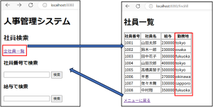
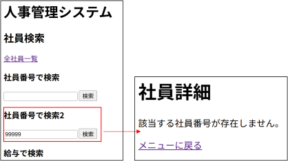
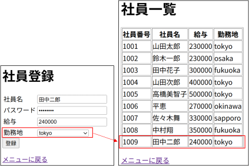
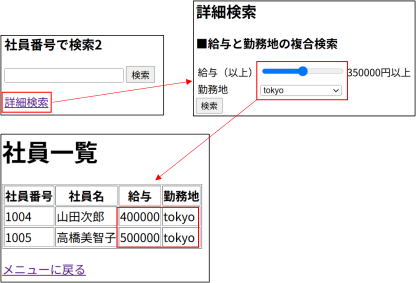

<!-- 元PDF 47〜62ページ。Java 21・Spring Boot 4.0.2対応版。 -->

::: {#page-47 .source-page}

::: {#p047-b01 .heading}

[&#32;6]{.s003}

:::

::: {#p047-b02 .heading}

[演習]{.s001}[&#32;6&#32;]{.s002}[&#32;外部参照と複雑な SQL 操作]{.s001}

:::

:::

::: {#page-48 .source-page}

::: {#p048-b01 .heading}

[演習の目標]{.s006}

:::

::: {#p048-b02 .paragraph}

[◼&#32;]{.s007}[外部参照を持つエンティティを定義し、テーブル間のリレーション]{.s008}

:::

::: {#p048-b03 .paragraph}

[（1 対多、多対1）を正しく設定できる]{.s008}

:::

::: {#p048-b04 .paragraph}

[◼&#32;]{.s007}[Spring Data JPA を用いて、外部参照先のデータを含む検索・登]{.s008}

:::

::: {#p048-b05 .paragraph}

[録処理を実装できる]{.s008}

:::

::: {#p048-b06 .paragraph}

[◼&#32;]{.s007}[JPQL を使って柔軟な検索条件を指定し、実務に近い形の複雑]{.s008}

:::

::: {#p048-b07 .paragraph}

[な検索を行える]{.s008}

:::

::: {#p048-b08 .heading}

[演習の概要]{.s006}

:::

::: {#p048-b09 .paragraph}

[この章では、第6 章で学習した「外部参照のあるエンティティの構成方法」]{.s008}

:::

::: {#p048-b10 .paragraph}

[や「JPQL による実践的な検索処理」を確認します。]{.s008}

:::

::: {#p048-b11 .paragraph}

[•&#32;]{.s009}[location テーブルを新たに作成し、employee テーブルと外部参照]{.s008}

:::

::: {#p048-b12 .paragraph}

[で紐付ける]{.s008}

:::

::: {#p048-b13 .paragraph}

[•&#32;]{.s009}[Employee エンティティと Location エンティティのリレーションを構]{.s008}

:::

::: {#p048-b14 .paragraph}

[築]{.s008}

:::

::: {#p048-b15 .paragraph}

[•&#32;]{.s009}[外部参照を持つ状態での全件検索・主キー検索・登録処理の実装]{.s008}

:::

::: {#p048-b16 .paragraph}

[•&#32;]{.s009}[JPQL を用いた条件検索（給与と勤務地）を実装]{.s008}

:::

:::

::: {#page-49 .source-page}

::: {#p049-b01 .heading}

[予想所要時間]{.s006}

:::

::: {#p049-b02 .paragraph}

[演習6.1 外部参照を定義したエンティティの修正：10 分]{.s010}

:::

::: {#p049-b03 .paragraph}

[演習6.2 全件検索で外部参照の内容を表示：10 分]{.s010}

:::

::: {#p049-b04 .paragraph}

[演習6.3 主キー検索で外部参照の内容を表示：10 分]{.s010}

:::

::: {#p049-b05 .paragraph}

[演習6.4 外部参照付きの登録処理の実装：15 分]{.s010}

:::

::: {#p049-b06 .paragraph}

[演習6.5 登録画面の作成（セレクトメニュー）：15 分]{.s010}

:::

::: {#p049-b07 .paragraph}

[演習6.6 JPQL による条件検索（給与＋勤務地）：20 分]{.s010}

:::

::: {#p049-b08 .heading}

[■追加データベース情報]{.s011}

:::

::: {#p049-b09 .paragraph}

付録の手順で演習用データベースを準備し、MySQLを起動してください。接続先は `src/main/resources/application.properties` で確認します。演習用は `spring_exercise`、本文用は `spring_sample` なので、混同しないでください。
:::

::: {#p049-b10 .heading}

[＜接続情報＞]{.s011}

:::

::: {#p049-table01 .table has-header="false"}

|  |  |
| --- | --- |
| RDBMS 名 | MySQL8.0 |
| データベース名 | spring\_exercise |
| ユーザ名 | spring\_exercise\_user |
| パスワード | password |

:::

::: {#p049-b11 .heading}

[＜employee テーブル＞]{.s011}

:::

::: {#p049-table02 .table has-header="true"}

| No | 論理名称 | 物理名称 | データ型 | 桁数 | 制約 | 備考 |
| --- | --- | --- | --- | --- | --- | --- |
| 1 | 社員番号 | id | INT | - | PRIMARY KEY AUTO\_INCREMENT | 自動採番 |
| 2 | パスワード | password | VARCHAR | - | - | - |
| 3 | 社員名 | name | VARCHAR | - | - | - |

:::

:::

::: {#page-50 .source-page}

::: {#p050-table01 .table has-header="false"}

|  |  |  |  |  |  |  |
| --- | --- | --- | --- | --- | --- | --- |
| 4 | 給与 | salary | INT | - | - |  |
| 5 | 勤務地番号 | location\_id | INT |  | FOREIGN KEY | 外部キー |

:::

::: {#p050-b01 .heading}

[\<Employee テーブルの初期データ一\>]{.s011}

:::

::: {#p050-table02 .table has-header="true"}

| ID | password | name | salary | location\_id |
| --- | --- | --- | --- | --- |
| 1001 | password | 山田太郎 | 230000 | 1 |
| 1002 | password | 鈴木一郎 | 230000 | 2 |
| 1003 | password | 田中花子 | 300000 | 3 |
| 1004 | password | 山田次郎 | 400000 | 1 |
| 1005 | password | 高橋美智子 | 500000 | 1 |
| 1006 | password | 平恵 | 270000 | 5 |
| 1007 | password | 佐々木舞 | 330000 | 4 |
| 1008 | password | 中村翔 | 350000 | 3 |

:::

::: {#p050-b02 .heading}

[＜location テーブル＞]{.s011}

:::

::: {#p050-table03 .table has-header="true"}

| No | 論理名称 | 物理名 称 | データ型 | 桁数 | 制約 | 備考 |
| --- | --- | --- | --- | --- | --- | --- |
| 1 | 勤務地番号 | id | INT | - | PRIMARY KEY AUTO\_INCREMENT | 自動採番 |
| 2 | 勤務地名 | name | VARCHAR | - | - | - |

:::

::: {#p050-b03 .heading}

[\< location テーブルの初期データ\>]{.s011}

:::

::: {#p050-table04 .table has-header="true"}

| id | name |
| --- | --- |
| 1 | tokyo |
| 2 | osaka |
| 3 | fukuoka |
| 4 | sapporo |
| 5 | okinawa |

:::

:::

::: {#page-51 .source-page}

::: {#p051-b01 .heading}

[演習]{.s017}[6\.1.&#32;]{.s018}[エンティティ・リポジトリの追加と修正]{.s017}

:::

::: {#p051-b02 .heading}

[a. Location エンティティを確認してください。]{.s011}

:::

::: {#p051-b03 .paragraph}

[•&#32;]{.s009}[jp.co.trainocate.enshu.entity パッケージに、Location.java はすでに作成済みです。]{.s019}

:::

::: {#p051-b04 .paragraph}

[•&#32;]{.s009}[以下の内容を確認してください。]{.s019}

:::

::: {#p051-b05 .paragraph}

[o&#32;]{.s020}[クラスに@Entity、@Table アノテーションを付けること。]{.s019}

:::

::: {#p051-b06 .paragraph}

[o&#32;]{.s020}[id フィールドを主キー（@Id）に設定し、自動採番（@GeneratedValue）にするこ]{.s019}\
[と。]{.s019}

:::

::: {#p051-b07 .paragraph}

[【ヒント】]{.s019}

:::

::: {#p051-b08 .paragraph}

[•&#32;]{.s009}[テキスト6.1 の【作業手順②】を参考にしてください。]{.s019}

:::

::: {#p051-b09 .paragraph}

[•&#32;]{.s009}[参照関係の定義は、後ほど行いますので、不要です。]{.s019}

:::

::: {#p051-b10 .heading}

[b. Employee エンティティを修正してください。]{.s011}

:::

::: {#p051-b11 .paragraph}

[•&#32;]{.s009}[jp.co.trainocate.enshu.entity パッケージに、Employee.java はすでに作成済みです。]{.s019}\
[•&#32;]{.s009}[以下の内容を追記してください。]{.s019}\
[o&#32;]{.s020}[Location 型のlocation フィールドを追加すること。]{.s019}\
[o&#32;]{.s020}[@ManyToOne と @JoinColumn を使い、location\_id カラムと外部参照の関連]{.s019}\
[付けを行うこと。]{.s019}\
[▪&#32;]{.s021}[@JoinColumn(name = "location\_id")と指定してください。]{.s019}

:::

::: {#p051-b12 .paragraph}

[【ヒント】]{.s019}

:::

::: {#p051-b13 .paragraph}

[•&#32;]{.s009}[テキスト6.1 の【作業手順③】を参考にしてください。]{.s019}

:::

::: {#p051-b14 .heading}

[c. Location エンティティに参照元（Employee）を持たせましょう。]{.s011}

:::

::: {#p051-b15 .paragraph}

[•&#32;]{.s009}[jp.co.trainocate.enshu.entity パッケージの Location.java を修正してください。]{.s019}\
[•&#32;]{.s009}[以下の内容を追記してください。]{.s019}\
[o&#32;]{.s020}[Employee エンティティを格納するリストフィールドを作成すること。]{.s019}\
[o&#32;]{.s020}[@OneToMany(mappedBy = "location") アノテーションを付けること。]{.s019}\
[▪&#32;]{.s021}[mappedBy には、Employee エンティティ側で定義したフィールド名]{.s019}\
[（"location"）を指定してください。]{.s019}

:::

:::

::: {#page-52 .source-page}

::: {#p052-b01 .paragraph}

[•&#32;]{.s009}[フィールド名は、employeeList としてください。]{.s019}

:::

::: {#p052-b02 .paragraph}

[【ヒント】]{.s019}

:::

::: {#p052-b03 .paragraph}

[•&#32;]{.s009}[テキスト6.1 の【作業手順➁】を参考にしてください。]{.s019}\
[•&#32;]{.s009}[「1 つの勤務地に複数の社員が所属する」関係を表現します。]{.s019}\
[•&#32;]{.s009}[リスト型はjava.util.List をインポートしてください。]{.s019}

:::

::: {#p052-b04 .heading}

[d. Location エンティティ用の Repository インタフェースを確認してください。]{.s011}

:::

::: {#p052-b05 .paragraph}

[•&#32;]{.s009}[jp.co.trainocate.enshu.repository パッケージ内に、LocationRepository.java が作成]{.s019}\
[されています。確認してください。]{.s019}\
[•&#32;]{.s009}[Location エンティティを対象とした Repository です。]{.s019}

:::

::: {#p052-b06 .paragraph}

[【ヒント】]{.s019}

:::

::: {#p052-b07 .paragraph}

[•&#32;]{.s009}[JpaRepository を継承することで、findAll(), findById(), save() などが自動的に使えるよ]{.s019}\
[うになります。]{.s019}

:::

:::

::: {#page-53 .source-page}

::: {#p053-b01 .heading}

[演習]{.s017}[6\.2.&#32;]{.s018}[外部参照を持つデータの全件検索]{.s017}

:::

::: {#p053-b02 .paragraph}

[■]{.s019}[Employee]{.s005}[&#32;と&#32;]{.s019}[Location]{.s005}[&#32;のリレーションを利用して、全件検索（]{.s019}[findAll]{.s005}[）を行います。]{.s019}

:::

::: {#p053-b03 .paragraph}

[■取得したリストデータを、一覧表示ページに出力できるようにします。]{.s019}

:::

::: {#p053-b04 .paragraph}

[■]{.s019}[Controller]{.s005}[&#32;側と&#32;]{.s019}[HTML]{.s005}[&#32;側で、役割に応じた修正を行います。]{.s019}

:::

{#p053-f01}

::: {#p053-b05 .heading}

[a. Controller クラスの全件検索処理(findAll メソッド)を完成してください。]{.s011}

:::

::: {#p053-b06 .paragraph}

[•&#32;]{.s009}[jp.co.trainocate.enshu.controller.EmpController クラスに追記してください。]{.s019}\
[•&#32;]{.s009}[Repository を使って全社員データを取得し、Model に格納してください。]{.s019}\
[•&#32;]{.s009}[Model には、リストを"empList"という名前で格納してください。]{.s019}\
[•&#32;]{.s009}[遷移先のHTML ファイルは、emp\_list.html としてください。]{.s019}

:::

::: {#p053-b07 .paragraph}

[【ヒント】]{.s019}

:::

::: {#p053-b08 .paragraph}

[•&#32;]{.s009}[Repository のfindAll()メソッドを利用します。]{.s019}\
[•&#32;]{.s009}[location のname も一覧で表示できるようにデータを準備します。]{.s019}

:::

::: {#p053-b09 .heading}

[b. employee\_list.html に一覧出力する処理を追加してください。]{.s011}

:::

::: {#p053-b10 .paragraph}

[•&#32;]{.s009}[すでに用意されているemp\_list.html ファイルを修正してください。]{.s019}\
[•&#32;]{.s009}[empList リストから、社員番号、社員名、給与、]{.s019}[勤務地名]{.s022}[を表示してください。]{.s019}\
[•&#32;]{.s009}[Thymeleaf のth:each 構文を利用してください。]{.s019}

:::

:::

::: {#page-54 .source-page}

::: {#p054-b01 .paragraph}

[【ヒント】]{.s019}

:::

::: {#p054-b02 .paragraph}

[•&#32;]{.s009}[テキスト6.2 の【作業手順➁】を参考にしてください。]{.s019}

:::

::: {#p054-b03 .paragraph}

[動作確認：]{.s022}[http://localhost:8080/]{.s023}\
[「全社員一覧」リンクをクリックし、社員リストが表示されるか確認してください。]{.s012}

:::

::: {#p054-b04 .heading}

[演習]{.s017}[6\.3.&#32;]{.s018}[社員番号を使った個別検索]{.s017}

:::

::: {#p054-b05 .paragraph}

[■社員番号（]{.s019}[id]{.s005}[）で&#32;]{.s019}[1]{.s005}[&#32;件検索できる機能を作ります。]{.s019}

:::

::: {#p054-b06 .paragraph}

[■検索結果を画面に正しく出力できるようにします。]{.s019}

:::

::: {#p054-b07 .heading}

[a. Controller クラスの主キー検索処理(findById メソッド)を完成してください。]{.s011}

:::

::: {#p054-b08 .paragraph}

[•&#32;]{.s009}[jp.co.trainocate.enshu.controller.EmpController クラスに追記してください。]{.s019}\
[•&#32;]{.s009}[Repository を使って、指定されたid の社員データを取得してください。]{.s019}\
[•&#32;]{.s009}[取得したEmployee オブジェクトを"emp"という名前でModel に格納してください。]{.s019}\
[•&#32;]{.s009}[遷移先は emp.html にしてください。]{.s019}

:::

::: {#p054-b09 .paragraph}

[【ヒント】]{.s019}

:::

::: {#p054-b10 .paragraph}

[•&#32;]{.s009}[URL マッピングは /showFindById としてください（3 章と同じ形式）。]{.s019}

:::

::: {#p054-b11 .heading}

[b. emp.html に1 件分のデータを出力するコードを追加してください。]{.s011}

:::

::: {#p054-b12 .paragraph}

[•&#32;]{.s009}[すでに用意されているemp.html ファイルを修正してください。]{.s019}\
[•&#32;]{.s009}[社員番号、社員名、給与、]{.s019}[勤務地名]{.s022}[を表示するようにしてください。]{.s019}

:::

::: {#p054-b13 .paragraph}

[【ヒント】]{.s019}

:::

::: {#p054-b14 .paragraph}

[•&#32;]{.s009}[データ1 件だけなので、th:each は不要です。]{.s019}

:::

::: {#p054-b15 .paragraph}

[動作確認：]{.s022}[http://localhost:8080/]{.s023}\
[「社員番号で検索」に、「1001」を入力し、検索します。社員が表示されるか確認してくださ]{.s012}\
[い。]{.s012}

:::

:::

::: {#page-55 .source-page}

::: {#p055-b01 .heading}

[演習]{.s017}[6\.4.&#32;]{.s018}[【オプション】存在しない社員番号を考慮する個別検索]{.s017}

:::

{#p055-f02}

::: {#p055-b02 .paragraph}

[■findById(id).orElse(null) を使って、存在しない値でも安全な主キー検索を実装します。]{.s019}

:::

::: {#p055-b03 .paragraph}

[■社員が見つからない場合、エラーメッセージを表示する処理を実装します。]{.s019}

:::

::: {#p055-b04 .heading}

[a. Controller クラスに存在しない値でも安全な主キー検索メソッドを完成してくださ]{.s011}

:::

::: {#p055-b05 .heading}

[い。]{.s011}

:::

::: {#p055-b06 .paragraph}

[•&#32;]{.s009}[jp.co.trainocate.enshu.controller.EmpController に新しくメソッドを追加してください。]{.s019}\
[•&#32;]{.s009}[Repository のfindById(id).orElse(null) を使って検索してください。]{.s019}\
[•&#32;]{.s009}[取得できたEmployee オブジェクトを "emp" という名前でModel に格納してください。]{.s019}\
[•&#32;]{.s009}[遷移先は&#32;]{.s019}[emp2.html]{.s022}[&#32;にしてください。]{.s019}

:::

::: {#p055-b07 .paragraph}

[【ヒント】]{.s019}

:::

::: {#p055-b08 .paragraph}

[•&#32;]{.s009}[if 文などでnull 判定は不要です。orElse(null)により、null かオブジェクトかが自動で取]{.s019}\
[得できます。]{.s019}\
[•&#32;]{.s009}[テキスト6.2.1 の【作業手順①】を参考にしてください。]{.s019}

:::

:::

::: {#page-56 .source-page}

::: {#p056-b01 .heading}

[b. emp.html でデータ存在チェックを追加してください。]{.s011}

:::

::: {#p056-b02 .paragraph}

[•&#32;]{.s009}[すでにある&#32;]{.s019}[emp2.html]{.s022}[&#32;ファイルに、表示切り替えの処理を追記してください。]{.s019}\
[•&#32;]{.s009}[社員データが存在しない場合は、「該当する社員番号は存在しません。」と表示してく]{.s019}\
[ださい。]{.s019}\
[•&#32;]{.s009}[th:if と th:unless を使いましょう。]{.s019}

:::

::: {#p056-b03 .paragraph}

[【ヒント】]{.s019}

:::

::: {#p056-b04 .paragraph}

[•&#32;]{.s009}[th:if="$\{emp == null\}" と th:unless="$\{emp == null\}" を使い、切り替えます。]{.s019}\
[•&#32;]{.s009}[テキスト6.2.1 の【作業手順➁】を参考にしてください。]{.s019}

:::

::: {#p056-b05 .paragraph}

[動作確認：]{.s022}[http://localhost:8080/]{.s023}\
[「社員番号で検索2」に、「9999」を入力し、検索します。]{.s012}\
[「該当する社員情報は存在しません。」が表示されることを確認します。]{.s012}

:::

:::

::: {#page-57 .source-page}

::: {#p057-b01 .heading}

[演習]{.s017}[6\.5.&#32;]{.s018}[社員情報の登録]{.s017}

:::

{#p057-f03}

::: {#p057-b02 .heading}

[■問題構成]{.s011}

:::

::: {#p057-table01 .table has-header="true"}

| 小問 | 内容 |
| --- | --- |
| a | 入力画面へ遷移するController メソッドの作成 |
| b | location テーブルのリストを使って、\<select\> メニューを表示 |
| c | EmpForm にlocationId を追加 |
| d | 登録処理の実装（save 処理） |
| e | 外部キーの登録時に必要なエンティティ側の設定を確認 |

:::

::: {#p057-b03 .heading}

[a. 入力画面に遷移するためのメソッドをEmpController に追加してください。]{.s011}

:::

::: {#p057-b04 .paragraph}

[•&#32;]{.s009}[遷移先のHTML ファイルは emp\_input.html にしてください。]{.s019}\
[•&#32;]{.s009}[URL マッピングは /showInputView にしてください。]{.s019}\
[•&#32;]{.s009}[画面に \<select\> を表示するために、Location の全件を取得し、"locations" という名]{.s019}\
[前でModel に格納してください。]{.s019}

:::

:::

::: {#page-58 .source-page}

::: {#p058-b01 .paragraph}

[【ヒント】]{.s019}

:::

::: {#p058-b02 .paragraph}

[•&#32;]{.s009}[LocationRepository から findAll() を使って、Location のリストを取得できます。]{.s019}

:::

::: {#p058-b03 .heading}

[b. emp\_input.html に、location を選択できるセレクトボックスを作成してください。]{.s011}

:::

::: {#p058-b04 .paragraph}

[•&#32;]{.s009}[Form 内で、社員名、給与、パスワード、勤務地（location）を入力できるようにしてくださ]{.s019}\
[い。]{.s019}\
[•&#32;]{.s009}[Location の選択肢は、locations というリストを th:each でループさせて出力してくださ]{.s019}\
[い。]{.s019}\
[•&#32;]{.s009}[選択された勤務地は、]{.s019}[name="locationId"]{.s022}[&#32;でサーバーへ送信してください。]{.s019}

:::

::: {#p058-b05 .paragraph}

[【ヒント】]{.s019}

:::

::: {#p058-b06 .paragraph}

[•&#32;]{.s009}[テキスト6.5 の【作業手順①】を参考にしてください。]{.s019}

:::

::: {#p058-b07 .paragraph}

[動作確認：]{.s022}[http://localhost:8080/]{.s023}\
[「社員データ登録」リンクをクリックします。勤務地の選択肢が正しく表示されるのかを確認し]{.s012}\
[ます。]{.s012}

:::

::: {#p058-b08 .heading}

[c. EmpForm に locationId フィールドを追加してください。]{.s011}

:::

::: {#p058-b09 .paragraph}

[•&#32;]{.s009}[登録画面で選択された勤務地（locationId）を受け取るために、EmpForm にフィールド]{.s019}\
[を追加してください。]{.s019}\
[•&#32;]{.s009}[データ型は Integer としてください。]{.s019}\
[•&#32;]{.s009}[name 属性は "locationId" ですので、フォームのフィールド名と一致させてください。]{.s019}\
[•&#32;]{.s009}[@Data アノテーションがすでに付いているため、getter/setter は不要です。]{.s019}

:::

::: {#p058-b10 .paragraph}

[【ヒント】]{.s019}

:::

::: {#p058-b11 .paragraph}

[•&#32;]{.s009}[select タグの name="locationId" に合わせたフィールド名にしてください。]{.s019}\
[•&#32;]{.s009}[salary と同じように、Integer 型で定義すればOK です。]{.s019}

:::

:::

::: {#page-59 .source-page}

::: {#p059-b01 .heading}

[d. EmpController に登録処理メソッド insertEmp を実装してください。]{.s011}

:::

::: {#p059-b02 .paragraph}

[•&#32;]{.s009}[EmpForm から受け取った値を使って、Employee エンティティを生成してください。]{.s019}\
[•&#32;]{.s009}[Employee エンティティには Location location という参照フィールドがあるため、]{.s019}\
[locationId の値をそのまま setLocation() することはできません。]{.s019}\
[•&#32;]{.s009}[そのため、]{.s019}[Employee エンティティを開いて、 locationId を別フィールドとして追加し、]{.s022}\
[登録時はそちらを利用してください。]{.s022}\
[•&#32;]{.s009}[リポジトリのsave() メソッドでDB に登録してください。]{.s019}\
[•&#32;]{.s009}[登録後は、 /findAll にリダイレクトしてください。]{.s019}

:::

::: {#p059-b03 .paragraph}

[【ヒント】]{.s019}

:::

::: {#p059-b04 .paragraph}

[•&#32;]{.s009}[Employee エンティティ内の location フィールドは Location 型です。一方、Form か]{.s019}\
[らは Integer 型の locationId が送られてくるため、直接代入はできません。]{.s019}\
[代わりに locationId を登録用に持たせておき、 location フィールドには insertable =]{.s019}\
[false, updatable = false を指定しておく必要があります。]{.s019}\
[•&#32;]{.s009}[テキスト6.5 の【作業手順④・⑤】を参考にしてください。]{.s024}

:::

::: {#p059-table01 .table has-header="true"}

| フィールド | 説明 |
| --- | --- |
| location（Location 型） | 外部テーブルと結びつけるためのオブジェクト。 SELECT では自動でJOIN してくれるが、登録・ 更新には使わない。 |
| locationId（Integer 型） | フォームから渡された実際の整数値を使って登録・ 更新を行うためのフィールド。DB のカラムに直 接反映される。 |
| insertable = false, updatable = false | location（参照オブジェクト）を登録や更新に使わな いようにHibernate に明示するための設定。 |

:::

::: {#p059-b05 .paragraph}

[動作確認：]{.s022}[http://localhost:8080/]{.s023}\
[「社員データ登録」リンクをクリックし、任意のデータを入れ、登録します。正しく登録されるの]{.s012}\
[かを確認してください。]{.s012}

:::

:::

::: {#page-60 .source-page}

::: {#p060-b01 .heading}

[演習]{.s017}[6\.6. JPQL]{.s018}[&#32;を使った検索]{.s025}[(]{.s018}[給与]{.s017}[+]{.s018}[勤務地]{.s017}[)]{.s018}

:::

::: {#p060-b02 .paragraph}

[給与と勤務地の&#32;]{.s019}[AND]{.s005}[&#32;検索は、]{.s019}[SQL]{.s005}[&#32;文にすると以下のようになります。]{.s019}\
[「SELECT \*]{.s012}\
[FROM employee e JOIN location l]{.s012}\
[ON e.location\_id = l.id]{.s012}\
[WHERE e.salary \>= ? AND l.name = ?」]{.s012}

:::

::: {#p060-b03 .paragraph}

[複雑な検索条件を&#32;]{.s019}[JPQL]{.s005}[&#32;で柔軟な検索条件を記述し、給与と勤務地に一致する社員を検索]{.s019}\
[できるようにしましょう。]{.s019}

:::

{#p060-f04}

:::

::: {#page-61 .source-page}

::: {#p061-b01 .paragraph}

[a. EmpController のshowSearchForm メソッドのソースコードを確認してください。]{.s022}

:::

::: {#p061-b02 .paragraph}

[&#32;&#32;１．演習6.5 と同様に、検索画面の表示のためにも勤務地リストの取得が必要です。]{.s022}

:::

::: {#p061-b03 .paragraph}

[b. 入力画面（emp\_search.html）が、以下の内容で作成されていることを確認してください。]{.s022}

:::

::: {#p061-b04 .step}

[1\.&#32;]{.s005}[「]{.s019}[/showSearchForm]{.s005}[」でアクセスすると検索入力画面が表示される。]{.s019}

:::

::: {#p061-b05 .step}

[2\.&#32;]{.s005}[入力画面には以下の構成がある：]{.s019}

:::

::: {#p061-table01 .table has-header="true"}

| 入力項目 | 内容 |
| --- | --- |
| 給与 | type="range" で、給与を 200,000～500,000 の範囲から選べるよう にしている |
| 勤務地 | DB のLocation テーブルから name を取得し、セレクトメニューに表 示している |

:::

::: {#p061-b06 .paragraph}

[【ヒント】]{.s019}

:::

::: {#p061-b07 .paragraph}

[•&#32;]{.s009}[range&#32;]{.s005}[を使うとスライダー式で給与を選べます。]{.s019}

:::

::: {#p061-b08 .paragraph}

[•&#32;]{.s009}[th:each="loc : $\{locationList\}"&#32;]{.s005}[を使って、セレクトメニューに&#32;]{.s019}[DB]{.s005}[&#32;の勤務地一覧を表]{.s019}\
[示できます。]{.s019}

:::

::: {#p061-b09 .paragraph}

[•&#32;]{.s009}[今いくらに設定されているのかの確認のため、一部&#32;]{.s019}[JavaScript]{.s005}[&#32;のコードが混ざってい]{.s019}\
[ます。]{.s019}

:::

::: {#p061-b10 .heading}

[c. EmpRepository に、給与と勤務地を条件にしたJPQL を使った検索メソッドを実装]{.s011}

:::

::: {#p061-b11 .heading}

[してください。]{.s011}

:::

::: {#p061-b12 .paragraph}

[•&#32;]{.s009}[戻り値は List\<Employee\> としてください。]{.s019}\
[•&#32;]{.s009}[メソッド名は findHighSalaryByLocation としてください。]{.s019}\
[•&#32;]{.s009}[@Query アノテーションを使って、JPQL を記述してください。]{.s019}\
[•&#32;]{.s009}[引数は int salary、String locationName の2 つを受け取れるようにしてください。]{.s019}

:::

::: {#p061-b13 .paragraph}

[【ヒント】]{.s019}

:::

::: {#p061-b14 .paragraph}

[•&#32;]{.s009}[エンティティ名は Employee(JPQL では、テーブル名ではなくエンティティ名を使いま]{.s019}\
[す。)]{.s019}\
[•&#32;]{.s009}[location テーブルは @ManyToOne で結ばれているため、e.location.name のように]{.s019}\
[書くことができます。]{.s019}

:::

:::

::: {#page-62 .source-page}

::: {#p062-b01 .paragraph}

[•&#32;]{.s009}[WHERE 句には e.salary \>= :salary AND e.location.name = :locationName のように]{.s019}\
[書きます。]{.s019}\
[•&#32;]{.s009}[テキストの6.4.2 の部分を参考にしてください。]{.s019}

:::

::: {#p062-b02 .heading}

[d. EmpController に、以下の条件でJPQL による検索を実行するメソッドを追加してく]{.s011}

:::

::: {#p062-b03 .heading}

[ださい。]{.s011}

:::

::: {#p062-table01 .table has-header="true"}

| 内容 | 詳細 |
| --- | --- |
| URL | /findHighSalary |
| HTTP メソッド | GET |
| 引数 | int salary, String locationName, Model model |
| 使用するリポジトリメソッド | findHighSalaryByLocation()（演習6.6.c で実装済み） |
| HTML ファイル | 検索結果は emp\_list.html に表示 |
| Model への追加 | 取得したリストを "empList" のキー名で格納 |

:::

::: {#p062-b04 .paragraph}

[動作確認：]{.s022}[http://localhost:8080/]{.s023}\
[「詳細検索」リンクをクリックし、給与を「400000 円」以上、勤務地は「tokyo」に設定し、検索し]{.s012}\
[てください。2 件のデータが表示されるかを確認してください。]{.s012}

:::

:::
