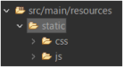
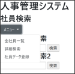
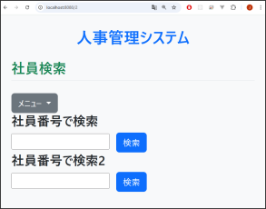
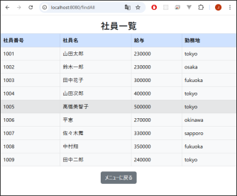
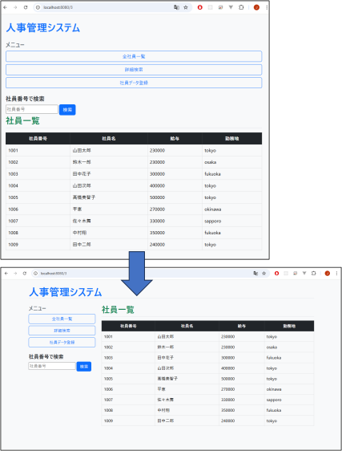
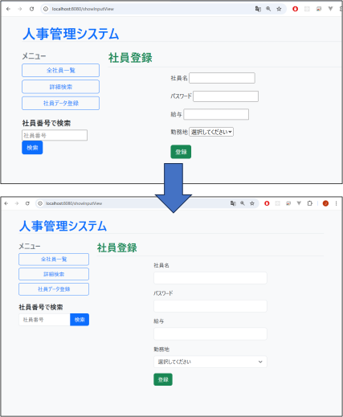

<!-- 元PDF 63〜76ページ。Java 21・Spring Boot 4.0.2対応版。 -->

::: {#page-63 .source-page}

::: {#p063-b01 .heading}

[7]{.s003}

:::

::: {#p063-b02 .heading}

[演習]{.s001}[&#32;7&#32;]{.s002}[&#32;Bootstrap]{.s001}

:::

:::

::: {#page-64 .source-page}

::: {#p064-b01 .heading}

[演習の目標]{.s006}

:::

::: {#p064-b02 .paragraph}

[◼&#32;]{.s007}[Bootstrap の導入方法（CSS・JS の読み込み）を理解し、導入前]{.s008}

:::

::: {#p064-b03 .paragraph}

[後の画面の変化を体感できる]{.s008}

:::

::: {#p064-b04 .paragraph}

[◼&#32;]{.s007}[Bootstrap の基本クラス（色・テキスト・配置・ボタン・枠線・余白・]{.s008}

:::

::: {#p064-b05 .paragraph}

[フォーム）を適切に使い、Web ページの外観を整えられる]{.s008}

:::

::: {#p064-b06 .paragraph}

[◼&#32;]{.s007}[グリッドシステムを使って、レイアウト（ヘッダー・サイドバー・メイン]{.s008}

:::

::: {#p064-b07 .paragraph}

[画面）の構成を柔軟に設計できる]{.s008}

:::

::: {#p064-b08 .paragraph}

[◼&#32;]{.s007}[共通レイアウト機能（テンプレート化）を使って、コードの再利用]{.s008}

:::

::: {#p064-b09 .paragraph}

[性・保守性を向上できる]{.s008}

:::

::: {#p064-b10 .heading}

[演習の概要]{.s006}

:::

::: {#p064-b11 .paragraph}

[この章では、第7&#32;]{.s009}[章で学習した Bootstrap の基礎知識を踏まえ、実際に]{.s009}

:::

::: {#p064-b12 .paragraph}

[システム画面のスタイルを改善します。]{.s009}

:::

::: {#p064-b13 .paragraph}

[•&#32;]{.s010}[Bootstrap の CSS・JS ファイルを読み込んだ状態と、読み込まない]{.s009}

:::

::: {#p064-b14 .paragraph}

[状態を比較]{.s009}

:::

::: {#p064-b15 .paragraph}

[•&#32;]{.s010}[Bootstrap のスタイルクラス（色・文字サイズ・ボタン・配置など）をフ]{.s009}

:::

::: {#p064-b16 .paragraph}

[ォームやテーブルに適用]{.s009}

:::

:::

::: {#page-65 .source-page}

::: {#p065-b01 .heading}

[•&#32;]{.s010}[グリッドシステムを活用し、メニューとメインコンテンツを左右に分け]{.s009}

:::

::: {#p065-b02 .heading}

[て表示]{.s009}

:::

::: {#p065-b03 .heading}

[•&#32;]{.s010}[共通レイアウト（layout.html）を作成し、ヘッダーやサイドバーをすべ]{.s009}

:::

::: {#p065-b04 .heading}

[ての画面で共通化]{.s009}

:::

::: {#p065-b05 .paragraph}

[•]{.s010}

:::

::: {#p065-b06 .heading}

[予想所要時間]{.s006}

:::

::: {#p065-b07 .paragraph}

[演習7.1 Bootstrap 導入前後の変化を確認：5 分]{.s011}

:::

::: {#p065-b08 .paragraph}

[演習7.2 Bootstrap の基本スタイルの適用：15 分]{.s011}

:::

::: {#p065-b09 .paragraph}

[演習7.3 Bootstrap のテーブルデザインの適用：10 分]{.s011}

:::

::: {#p065-b10 .paragraph}

[演習7.4 グリッドシステムで画面レイアウトを整える：15 分]{.s011}

:::

::: {#p065-b11 .paragraph}

[演習7.5 フォームの改善：10 分]{.s011}

:::

::: {#p065-b12 .paragraph}

[演習7.6 演習7.6. 【オプション】 共通レイアウト画面に変更：20 分]{.s011}

:::

:::

::: {#page-66 .source-page}

::: {#p066-b01 .heading}

[■事前準備（※操作不要）]{.s012}

:::

::: {#p066-b02 .paragraph}

[次のフォルダに Bootstrap の CSS / JS ファイルが事前に格納されています。]{.s013}\
[特にファイルをダウンロードしたり、CDN を使って読み込んだりする必要はありません。]{.s013}

:::

{#p066-f01}

::: {#p066-table01 .table has-header="true"}

| ファイル名 | 格納場所 |
| --- | --- |
| bootstrap.min.css | src/main/resources/static/css/ |
| bootstrap.bundle.min.js | src/main/resources/static/js/ |

:::

:::

::: {#page-67 .source-page}

::: {#p067-b01 .heading}

[演習]{.s015}[7\.1. Bootstrap]{.s016}[&#32;導入前後の変化を確認]{.s017}

:::

{#p067-f02}

::: {#p067-b02 .paragraph}

[•]{.s018}[&#32;&#32;Bootstrap のCSS とJS ファイルを読み込むことで、Web ページの見た目や動作]{.s019}

:::

::: {#p067-b03 .heading}

[がどう変わるかを体感しましょう。]{.s019}

:::

::: {#p067-b04 .paragraph}

[•]{.s018}[&#32;&#32;特に、ドロップダウンメニューの動作に注目してください。]{.s019}

:::

::: {#p067-b05 .heading}

[a. index.html に記載されているソースコードを確認してください。]{.s012}

:::

::: {#p067-b06 .paragraph}

[•&#32;]{.s010}[CSS]{.s005}[&#32;と&#32;]{.s020}[JS]{.s005}[&#32;の読み込み部分がコメントアウトされています。]{.s020}

:::

::: {#p067-b07 .heading}

[b. そのままブラウザで 「localhost:8080」 にアクセスして、ページの見た目と動作を]{.s012}

:::

::: {#p067-b08 .heading}

[確認してください。]{.s012}

:::

::: {#p067-b09 .paragraph}

[•&#32;]{.s010}[ページは正常に表示されますか？]{.s020}

:::

::: {#p067-b10 .paragraph}

[•&#32;]{.s010}[「メニュー」ボタンを押しても反応がありますか？]{.s020}

:::

::: {#p067-b11 .heading}

[c. コメントアウトされていたcss とjs の2 か所のコメントを解除して、再度ブラウザで]{.s012}

:::

::: {#p067-b12 .heading}

[表示を確認してください。]{.s012}

:::

::: {#p067-b13 .heading}

[d. 再読み込み後、「メニュー」ボタンを押して、表示に変化があるか確認してくださ]{.s012}

:::

::: {#p067-b14 .heading}

[い。]{.s012}

:::

::: {#p067-b15 .paragraph}

[ヒント]{.s021}\
[•&#32;]{.s010}[Bootstrap は、class 属性だけでデザインが適用される仕組みですが、そのためには]{.s020}\
[CSS の読み込みが必須です。]{.s020}\
[•&#32;]{.s010}[また、メニューの展開やモーダルの表示など、動きのある要素にはJavaScript の読み]{.s020}\
[込みも必要です。]{.s020}\
[•&#32;]{.s010}[JS]{.s005}[&#32;が読み込まれていないと、ドロップダウンボタンを押しても何も起きません。]{.s020}

:::

:::

::: {#page-68 .source-page}

::: {#p068-b01 .heading}

[演習]{.s015}[7\.2. Bootstrap]{.s016}[&#32;の基本スタイルの適用]{.s017}

:::

{#p068-f03}

::: {#p068-b02 .heading}

[■&#32;]{.s019}[ブラウザから、「localhost:8080/2」を開いて、修正していく演習です]{.s012}

:::

::: {#p068-b03 .heading}

[■&#32;]{.s019}[index2.html に Bootstrap のクラスを適用して、画面全体の見た目を整えてくだ]{.s012}

:::

::: {#p068-b04 .heading}

[さい。]{.s012}

:::

::: {#p068-b05 .paragraph}

[以下の指示に従って、既存のHTML にクラスを追加・修正してください。]{.s021}\
[（※クラスの追加のみで構いません。HTML の構造は変えなくてOK です）]{.s021}

:::

::: {#p068-b06 .heading}

[■&#32;]{.s019}[適用されたことが確認できたら、テキストを参照し、class を変え、変化を確認して]{.s012}

:::

::: {#p068-b07 .heading}

[ください。]{.s012}

:::

::: {#p068-b08 .paragraph}

[&#32;ヒント]{.s014}

:::

::: {#p068-b09 .paragraph}

[•&#32;]{.s010}[色に関するクラスは .text-\*（文字色）と .bg-\*（背景色）を使い分けましょう。]{.s020}

:::

::: {#p068-b10 .paragraph}

[•&#32;]{.s010}[ボタンには btn と btn-\* をセットで使います。]{.s020}

:::

::: {#p068-b11 .paragraph}

[•&#32;]{.s010}[.m-（margin）、.p-（padding）は -start, -end, -top, -bottom など方向を指定できま]{.s020}\
[す。]{.s020}

:::

::: {#p068-b12 .heading}

[a. 全体の背景と本文余白の追加]{.s012}

:::

::: {#p068-b13 .code}

```xml
<!-- body タグを修正してください -->
<body class="bg-light p-4">
```

:::

::: {#p068-b14 .paragraph}

[•&#32;]{.s010}[bg-light：全体を淡い灰色の背景色に]{.s026}\
[•&#32;]{.s010}[p-4：ページ内に十分な余白を追加]{.s026}

:::

:::

::: {#page-69 .source-page}

::: {#p069-b01 .heading}

[b. タイトル部分に装飾を加えてください]{.s012}

:::

::: {#p069-b02 .code}

```xml
<h1 class="text-center text-primary fw-bold mb-4">人事管理システム
</h1>
```

:::

::: {#p069-b03 .paragraph}

[•&#32;]{.s010}[中央揃え ＋ 青色 ＋ 太字 ＋ 下に余白]{.s020}

:::

::: {#p069-b04 .heading}

[c. 各セクションタイトルの見た目を整えてください]{.s012}

:::

::: {#p069-b05 .code}

```xml
<h2 class="text-success border-bottom pb-2 mb-4">社員検索</h2>
```

:::

::: {#p069-b06 .paragraph}

[•&#32;]{.s010}[緑色]{.s020}[&#32;+&#32;]{.s005}[下線風のボーダー]{.s020}[&#32;+&#32;]{.s005}[下に余白]{.s020}

:::

::: {#p069-b07 .heading}

[d. フォームの検索ボタンを以下のように修正してください]{.s012}

:::

::: {#p069-b08 .code}

```xml
<input type="submit" value="検索" class="btn btn-primary ms-2">
```

:::

::: {#p069-b09 .paragraph}

[•&#32;]{.s010}[btn とbtn-primary でデザイン済みボタンに]{.s020}\
[•&#32;]{.s010}[ms-2 で左側に少し余白（margin-start）]{.s020}

:::

:::

::: {#page-70 .source-page}

::: {#p070-b01 .heading}

[演習]{.s015}[7\.3. Bootstrap]{.s016}[&#32;のテーブルデザインの適用]{.s017}

:::

{#p070-f04}

::: {#p070-b02 .paragraph}

[■&#32;]{.s013}[Bootstrap のクラスを使って、社員一覧テーブルを見やすく整える方法を学びます。]{.s014}\
[■&#32;]{.s013}[ブラウザから、「localhost:8080/findAll」を開いて、メニュー修正していく演習です]{.s014}

:::

::: {#p070-b03 .heading}

[a. emp\_list.html に記載されている現在のテーブル構造を確認してください。]{.s012}

:::

::: {#p070-b04 .paragraph}

[•&#32;]{.s010}[\<table\> に border="1" が直接指定されています。]{.s020}

:::

::: {#p070-b05 .paragraph}

[•&#32;]{.s010}[\<tr\> と \<td\> だけで構成されており、Bootstrap のクラスは一切使われていません。]{.s020}

:::

::: {#p070-b06 .heading}

[b. テーブル構造をBootstrap に合わせて書き換えましょう。]{.s012}

:::

::: {#p070-b07 .paragraph}

[以下のように、HTML の構造を改善してください。]{.s020}

:::

::: {#p070-table01 .table has-header="true"}

| 修正ポイント | 内容 |
| --- | --- |
| \<table\> | border="1" を削除し、Bootstrap の .table クラスを追加する |
| \<thead\> | ヘッダー行（見出し）を囲むタグとして追加する |
| \<tbody\> | データ行（繰り返し部分）を囲むタグとして追加する |

:::

::: {#p070-b08 .paragraph}

[ヒント]{.s020}

:::

::: {#p070-b09 .paragraph}

[&#32;]{.s027}[.table クラスは、Bootstrap で最も基本的な装飾クラスです。]{.s020}

:::

::: {#p070-b10 .paragraph}

[&#32;]{.s027}[今回の演習では、まず .table だけを付け、見た目の変化に注目します。]{.s020}

:::

:::

::: {#page-71 .source-page}

::: {#p071-b01 .paragraph}

[&#32;]{.s027}[補助的に .table-hover や .table-striped を後の演習で追加します。]{.s020}

:::

::: {#p071-b02 .heading}

[c. \<thead\> に .table-primary クラスを追加してください。]{.s012}

:::

::: {#p071-b03 .paragraph}

[&#32;]{.s027}[見出し行（ヘッダー行）が薄青色の背景になります。]{.s020}

:::

::: {#p071-b04 .paragraph}

[&#32;]{.s027}[ユーザが表の構造をひと目で理解しやすくなります。]{.s020}

:::

::: {#p071-b05 .heading}

[d. \<table\>に以下のBootstrap のクラスを適用してください。]{.s012}

:::

::: {#p071-table01 .table has-header="true"}

| クラス名 | 効果 |
| --- | --- |
| table | Bootstrap 標準のテーブルデザイン |
| table-bordered | 枠線をつける |
| table-hover | ホバー時に行の背景色が変わる |

:::

::: {#p071-b06 .heading}

[e. \<tbody\>に、.table-light を追加してください。]{.s012}

:::

::: {#p071-b07 .paragraph}

[&#32;]{.s027}[テーブルの本文の部分の背景色が、薄いグレーになります。]{.s020}

:::

:::

::: {#page-72 .source-page}

::: {#p072-b01 .heading}

[演習]{.s015}[7\.4.&#32;]{.s016}[グリッドシステムで画面レイアウトを整える]{.s015}

:::

{#p072-f05}

::: {#p072-b02 .paragraph}

[社員検索ページを、]{.s020}[Bootstrap]{.s005}[&#32;の「グリッドシステム」を使って、左にサイドメニュー、右にメイ]{.s020}\
[ン画面を表示する形式に変更していきます。]{.s021}

:::

::: {#p072-b03 .heading}

[a. 上記の完成後の画面を見て、どのような分割がされているのか確認してくださ]{.s012}

:::

::: {#p072-b04 .heading}

[い。]{.s012}

:::

:::

::: {#page-73 .source-page}

::: {#p073-b01 .paragraph}

[•&#32;]{.s010}[「全社員一覧」「詳細検索」「社員データ登録」のボタンが左側の縦方向に並ぶメニュ]{.s013}\
[ーとして表示されています。]{.s014}\
[•&#32;]{.s010}[その右側には、社員情報のテーブル一覧が表示されています。]{.s013}\
[•&#32;]{.s010}[上記2 つのエリアが横に並んでいることを確認しましょう。]{.s013}\
[•&#32;]{.s010}[演習URL は、localhost:8080/3 です。]{.s014}

:::

::: {#p073-b02 .paragraph}

[【ヒント】]{.s020}

:::

::: {#p073-b03 .paragraph}

[•&#32;]{.s010}[Bootstrap]{.s005}[&#32;のグリッドシステムでは、]{.s020}[1]{.s005}[&#32;行（]{.s020}[row]{.s005}[）を&#32;]{.s020}[12]{.s005}[&#32;のカラム（列）に分割できます。]{.s020}

:::

::: {#p073-b04 .paragraph}

[•&#32;]{.s010}[今回は]{.s020}[「左が3 カラム」「右が9 カラム」]{.s014}[で構成されているようです。]{.s020}

:::

::: {#p073-b05 .heading}

[b. emp\_list2.html を開き、\<div class="container"\>と\<div class="row"\>で画面全体]{.s012}

:::

::: {#p073-b06 .heading}

[を囲んでください。]{.s012}

:::

::: {#p073-b07 .paragraph}

[•&#32;]{.s010}[「画面全体」とは、]{.s020}[\<body\>]{.s005}[から、]{.s020}[\</body\>]{.s005}[直前までを意味します。]{.s020}

:::

::: {#p073-b08 .paragraph}

[•&#32;]{.s010}[「]{.s020}[container]{.s005}[」クラスは、ページの横幅を制御し、中央に配置させる役割を持ちます。]{.s020}

:::

::: {#p073-b09 .paragraph}

[•&#32;]{.s010}[「]{.s020}[row]{.s005}[」クラスは、グリッドシステムでカラム（列）を並べる土台になります。]{.s020}

:::

::: {#p073-b10 .heading}

[c. 左を \<div class="col-md-3"\>、右を \<div class="col-md-9"\> に分けてくださ]{.s012}

:::

::: {#p073-b11 .heading}

[い。]{.s012}

:::

::: {#p073-b12 .paragraph}

[•&#32;]{.s010}[「]{.s020}[col-md-3]{.s005}[」：左側のメニューや検索フォームを入れる枠です（横幅&#32;]{.s020}[3/12]{.s005}[＝]{.s020}[25%]{.s005}[）]{.s020}

:::

::: {#p073-b13 .paragraph}

[•&#32;]{.s010}[「]{.s020}[col-md-9]{.s005}[」：右側のメインコンテンツ（社員一覧）を表示する枠です（横幅&#32;]{.s020}[9/12]{.s005}[＝]{.s020}[75%]{.s005}[）]{.s020}

:::

::: {#p073-b14 .paragraph}

[【ヒント】]{.s020}

:::

::: {#p073-b15 .paragraph}

[•&#32;]{.s010}[col-md-\*&#32;]{.s005}[という記法は、「中サイズ以上の画面ではこの比率にする」という意味です。]{.s020}

:::

::: {#p073-b16 .paragraph}

[•&#32;]{.s010}[md&#32;]{.s005}[を使えば、スマホ画面では縦並び、]{.s020}[PC]{.s005}[&#32;画面では横並びのように、画面サイズによ]{.s020}\
[って自動で切り替わる「レスポンシブデザイン」が実現できます。]{.s020}

:::

:::

::: {#page-74 .source-page}

::: {#p074-b01 .heading}

[演習]{.s015}[7\.5.&#32;]{.s016}[フォームの改善]{.s015}

:::

{#p074-f06}

::: {#p074-b02 .paragraph}

[Bootstrap]{.s005}[&#32;の&#32;]{.s020}[form]{.s005}[&#32;関連のクラスを適用し、レイアウトを整える演習を行いましょう。]{.s020}

:::

::: {#p074-b03 .paragraph}

[サイドバーの検索フォームの修正と、社員登録フォームを修正します。]{.s020}

:::

:::

::: {#page-75 .source-page}

::: {#p075-b01 .heading}

[a. emp\_input.html を開き、サイドバーの検索フォームを確認してください。]{.s012}

:::

::: {#p075-b02 .paragraph}

[現在のコード（修正前）では、]{.s020}[\<input\>&#32;]{.s005}[と]{.s020}[&#32;\<button\>&#32;]{.s005}[が縦並びで配置されており、見た目に]{.s020}\
[一体感がありません。]{.s020}

:::

::: {#p075-b03 .heading}

[b. Bootstrap 式のフォームのデザインを適用し、ボタンを横並びにしてください。]{.s012}

:::

::: {#p075-b04 .paragraph}

[&#32;]{.s028}[カラムを、8:2 で分けて配置する方法もありますが、今回は、input を囲っているdiv 要]{.s020}\
[素に「.input-group」を付与してください。]{.s020}

:::

::: {#p075-b05 .paragraph}

[ヒント]{.s021}

:::

::: {#p075-b06 .paragraph}

[•&#32;]{.s010}[form-control&#32;]{.s005}[は入力欄に付ける]{.s020}

:::

::: {#p075-b07 .paragraph}

[•&#32;]{.s010}[親要素に]{.s020}[&#32;input-group&#32;]{.s005}[を付けることで横並びになる]{.s020}

:::

::: {#p075-b08 .heading}

[c. メイン画面の登録フォームのデザインを整えます。\<input\>や\<select\>に適切なクラ]{.s012}

:::

::: {#p075-b09 .heading}

[スを付与してください。]{.s012}

:::

::: {#p075-b10 .paragraph}

[&#32;]{.s028}[入力フォームの名称のため、]{.s020}[label]{.s005}[&#32;を使っているコードを確認してください。]{.s020}

:::

::: {#p075-b11 .paragraph}

[&#32;]{.s028}[各入力欄には、]{.s020}[Bootstrap]{.s005}[&#32;のフォーム用クラス]{.s020}[&#32;form-control&#32;]{.s005}[を指定します。]{.s020}

:::

::: {#p075-b12 .paragraph}

[&#32;]{.s028}[セレクトメニューには、]{.s020}[form-select&#32;]{.s005}[を適用します。]{.s020}

:::

:::

::: {#page-76 .source-page}

::: {#p076-b01 .heading}

[演習]{.s015}[7\.6.&#32;]{.s016}[【オプション】&#32;]{.s015}[共通レイアウト画面に変更]{.s015}

:::

::: {#p076-b02 .paragraph}

[5]{.s005}[&#32;章のレイアウトの部分を参考し、画面ごとに繰り返し記述されていた&#32;]{.s020}[ヘッダーやメニュー]{.s021}\
[（サイドバー）&#32;]{.s021}[を共通化し、保守性と再利用性の高いレイアウト構造を構築しましょう。]{.s020}

:::

::: {#p076-b03 .heading}

[a. pom.xml に、レイアウト関連のdependency が導入されているか確認します。]{.s012}

:::

::: {#p076-b04 .heading}

[b. templates/layout フォルダのlayout.html を開いて、コードを確認してください。]{.s012}

:::

::: {#p076-b05 .heading}

[c. ヘッダやサイドバーなどの、共通のコードを貼り付けします。メイン画面の部分は、]{.s012}

:::

::: {#p076-b06 .heading}

[以下のようにしてください。]{.s012}

:::

::: {#p076-b07 .code}

```xml
<div class="col-md-9" layout:fragment="main_content">
        <!-- ここに各画面固有のコンテンツが表示されます -->
</div>
```

:::

::: {#p076-b08 .heading}

[d. emp\_list3.html の\<div layout:fragment="main\_content"\> \</div\> の中には、一覧画]{.s012}

:::

::: {#p076-b09 .heading}

[面のコードを入れてください。]{.s012}

:::

::: {#p076-b10 .heading}

[e. emp\_input2.html にも同様に、社員登録のコードを入れてください。]{.s012}

:::

::: {#p076-b11 .heading}

[f. その他の画面も、Bootstrap のデザインを適用してください。]{.s012}

:::

::: {#p076-b12 .paragraph}

[■動作確認]{.s014}\
[http://localhost:8080/4]{.s029}

:::

:::
