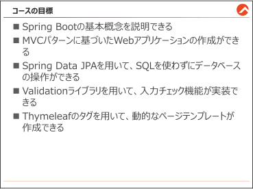
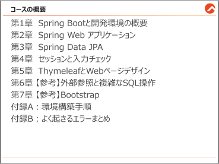
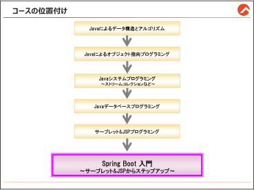

<!-- 元PDF 1〜14ページ。Java 21・Spring Boot 4.0.2・Pleiades 2025向け改訂。 -->

::: {#page-1 .source-page}

::: {#p001-b01 .heading}

[Spring Boot 入門]{.s001}

:::

::: {#p001-b02 .paragraph}

[JAC0177G-T1-04]{.s002}

:::

::: {#p001-b03 .heading}

[~サーブレット&JSP からのステップアップ~]{.s003}

:::

:::

::: {#page-2 .source-page}

::: {#p002-b01 .heading}

[商標]{.s003}

:::

::: {#p002-b02 .paragraph}

[&#32;]{.s004}[アマゾン&#32;]{.s005}[ウェブ&#32;]{.s005}[サービス、]{.s005}[AWS]{.s006}[&#32;および&#32;]{.s005}[Amazon Web Services]{.s006}[&#32;ロゴは、米国その他の諸国におけ]{.s005}\
[る、]{.s005}[Amazon.com, Inc.]{.s006}[またはその関連会社の商標です。]{.s005}\
[&#32;]{.s004}[Cisco]{.s006}[、]{.s005}[Cisco Systems]{.s006}[、]{.s005}[Cisco Systems]{.s006}[ロゴは、]{.s005}[Cisco Systems, Inc.]{.s006}[および関連会社の米国ならびに他]{.s005}\
[の国における商標もしくは登録商標です。]{.s005}\
[&#32;]{.s004}[IIBA]{.s006}[®]{.s007}[、]{.s005}[BABOK]{.s006}[®&#32;]{.s007}[は、]{.s005}[IIBA]{.s006}[®]{.s007}[&#32;(International Institute of Business Analysis]{.s006}[™]{.s005}[)&#32;]{.s006}[の登録商標です。]{.s005}\
[&#32;]{.s004}[Intel]{.s006}[、インテルは、米国およびその他の国における&#32;]{.s005}[Intel Corporation]{.s006}[&#32;の商標です。]{.s005}\
[&#32;]{.s004}[ITIL]{.s006}[®]{.s007}[は、]{.s005}[PeopleCert group&#32;]{.s006}[の登録商標であり、]{.s005}[PeopleCert Group&#32;]{.s006}[の許可のもとに使用されていま]{.s005}\
[す。すべての権利は留保されています。]{.s005}\
[&#32;]{.s004}[Microsoft]{.s006}[、]{.s005}[Windows]{.s006}[&#32;は、米国&#32;]{.s005}[Microsoft Corporation]{.s006}[&#32;の、米国およびその他の国における登録商標]{.s005}\
[または商標です。]{.s005}\
[&#32;]{.s004}[Oracle]{.s006}[&#32;と]{.s005}[Java]{.s006}[&#32;は、]{.s005}[Oracle Corporation]{.s006}[&#32;およびその子会社、関連会社の米国およびその他の国におけ]{.s005}\
[る登録商標です。]{.s005}\
[&#32;]{.s004}[PMI]{.s006}[、]{.s005}[PMP]{.s006}[、]{.s005}[PMBOK]{.s006}[&#32;は、プロジェクトマネジメント協会]{.s005}[(Project Management Institute, Inc.)]{.s006}[の登録商]{.s005}\
[標です。]{.s005}\
[&#32;]{.s004}[VMware]{.s006}[、]{.s005}[VMware]{.s006}[&#32;ロゴは、]{.s005}[VMware, Inc.]{.s006}[の米国および各国での商標または登録商標です。]{.s005}\
[&#32;]{.s004}[BOOT CAMP]{.s006}[、]{.s005}[NEW TRAIN]{.s006}[、]{.s005}[MIX TRAIN]{.s006}[、]{.s005}[TRAINOCAMP]{.s006}[&#32;は、トレノケート株式会社の登録商標]{.s005}\
[です。]{.s005}\
[その他の会社名、製品名およびサービス名は、それぞれ各社の商標または登録商標です。]{.s005}

:::

:::

::: {#page-3 .source-page}

::: {#p003-b01 .heading}

[目&#32;]{.s009}[次]{.s009}

:::

::: {#p003-b02 .paragraph}

[はじめに]{.s010}[&#32;................................................................................................................ 7]{.s011}

:::

::: {#p003-b03 .paragraph}

[第1 章&#32;]{.s010}[Spring Boot と開発環境の概要]{.s010}[&#32;........................................................ 15]{.s011}

:::

::: {#p003-b04 .step}

[1\.1.&#32;]{.s012}[フレームワークとは]{.s013}[&#32;......................................................................................................... 18]{.s012}\
[1\.2. Spring Framework ......................................................................................................... 19]{.s012}\
[1\.3. Spring Boot]{.s012}[&#32;とは]{.s013}[&#32;............................................................................................................ 21]{.s012}\
[1\.4. Maven]{.s012}[&#32;でライブラリ管理]{.s013}[&#32;.................................................................................................. 24]{.s012}\
[章のまとめ]{.s013}[&#32;............................................................................................................................. 29]{.s012}

:::

::: {#p003-b05 .paragraph}

[第2 章&#32;]{.s010}[Spring Web アプリケーション]{.s010}[&#32;............................................................ 31]{.s011}

:::

::: {#p003-b06 .step}

[2\.1. Web]{.s012}[&#32;アプリケーションの概要]{.s013}[&#32;........................................................................................... 34]{.s012}\
[2\.1.1.&#32;]{.s012}[【参考】サーブレットについて]{.s013}[&#32;........................................................................................ 36]{.s012}\
[2\.1.2.&#32;]{.s012}[【参考】]{.s013}[MVC]{.s012}[&#32;パターンと&#32;]{.s013}[Spring]{.s012}[&#32;アプリケーションの流れ]{.s013}[&#32;............................................... 38]{.s012}\
[2\.2. Controller]{.s012}[&#32;の基本]{.s013}[&#32;........................................................................................................... 39]{.s012}\
[2\.3.&#32;]{.s012}[データ送信とパラメータの取得]{.s013}[&#32;........................................................................................ 47]{.s012}\
[2\.4. Form]{.s012}[&#32;クラスでパラメータ取得]{.s013}[&#32;.......................................................................................... 53]{.s012}\
[2\.5. Controller]{.s012}[&#32;から&#32;]{.s013}[View]{.s012}[&#32;へのデータ処理]{.s013}[&#32;.............................................................................. 57]{.s012}\
[章のまとめ]{.s013}[&#32;............................................................................................................................. 62]{.s012}

:::

::: {#p003-b07 .paragraph}

[第3 章&#32;]{.s010}[Spring Data JPA]{.s010}[&#32;............................................................................ 63]{.s011}

:::

::: {#p003-b08 .step}

[3\.1. Spring Data JPA]{.s012}[&#32;の利用]{.s013}[&#32;................................................................................................ 66]{.s012}\
[3\.2.&#32;]{.s012}[エンティティの定義]{.s013}[&#32;......................................................................................................... 72]{.s012}\
[3\.3.&#32;]{.s012}[リポジトリの定義]{.s013}[............................................................................................................. 77]{.s012}\
[3\.3.1.&#32;]{.s012}[依存性の注入]{.s013}[&#32;............................................................................................................. 79]{.s012}\
[3\.3.2.&#32;]{.s012}[コントローラーの基本&#32;]{.s013}[URL]{.s012}[&#32;設定]{.s013}[&#32;.................................................................................. 81]{.s012}

:::

::: {#p003-b09 .heading}

[【参考】既存の全件検索方法]{.s013}[&#32;.................................................................................................. 82]{.s012}

:::

::: {#p003-b10 .step}

[3\.4.&#32;]{.s012}[全件検索]{.s013}[&#32;....................................................................................................................... 85]{.s012}\
[3\.5.&#32;]{.s012}[主キーによる条件検索]{.s013}[&#32;................................................................................................... 90]{.s012}\
[3\.5.1.&#32;]{.s012}[主キーではない列による条件検索]{.s013}[&#32;............................................................................... 95]{.s012}\
[3\.5.2.&#32;]{.s012}[複数の列による条件検索]{.s013}[&#32;............................................................................................ 99]{.s012}

:::

:::

::: {#page-4 .source-page}

::: {#p004-b01 .step}

[3\.5.3.&#32;]{.s012}[その他の条件検索]{.s013}[&#32;.................................................................................................... 103]{.s012}\
[3\.6.&#32;]{.s012}[登録処理]{.s013}[&#32;..................................................................................................................... 105]{.s012}\
[3\.7.&#32;]{.s012}[更新処理]{.s013}[&#32;..................................................................................................................... 114]{.s012}\
[3\.8.&#32;]{.s012}[削除処理]{.s013}[&#32;..................................................................................................................... 122]{.s012}\
[3\.9.&#32;]{.s012}[【参考】]{.s013}[&#32;Service]{.s012}[&#32;クラスでビジネスロジックを分離]{.s013}[&#32;.......................................................... 125]{.s012}\
[章のまとめ]{.s013}[&#32;........................................................................................................................... 132]{.s012}

:::

::: {#p004-b02 .paragraph}

[第4 章&#32;]{.s010}[セッションと入力チェック]{.s010}[&#32;....................................................................... 133]{.s011}

:::

::: {#p004-b03 .step}

[4\.1.&#32;]{.s012}[基礎的なログイン機能の実装]{.s013}[&#32;....................................................................................... 136]{.s012}\
[4\.2.&#32;]{.s012}[セッションによるユーザ情報の保持]{.s013}[&#32;............................................................................... 142]{.s012}\
[4\.3.&#32;]{.s012}[ログイン時の入力チェック]{.s013}[&#32;............................................................................................. 148]{.s012}\
[4\.3.1.&#32;]{.s012}[【参考】その他の&#32;]{.s013}[Validation]{.s012}[&#32;アノテーション]{.s013}[&#32;................................................................. 157]{.s012}\
[4\.3.2.&#32;]{.s012}[【参考】メッセージのカスタマイズ]{.s013}[&#32;................................................................................ 159]{.s012}

:::

::: {#p004-b04 .paragraph}

[第5 章&#32;]{.s010}[Thymeleaf とWeb ページデザイン]{.s010}[&#32;.................................................. 164]{.s011}

:::

::: {#p004-b05 .step}

[5\.1. Thymeleaf]{.s012}[&#32;の基本構文]{.s013}[&#32;................................................................................................. 167]{.s012}\
[5\.1.1.&#32;]{.s012}[動的にイメージとリンク生成]{.s013}[(th:attr) ........................................................................... 170]{.s012}\
[5\.1.2.&#32;]{.s012}[条件式による表示制御]{.s013}[(th:if)...................................................................................... 175]{.s012}\
[5\.2. CSS]{.s012}[&#32;と&#32;]{.s013}[JavaScript]{.s012}[&#32;の利用]{.s013}[&#32;............................................................................................ 178]{.s012}\
[5\.3.&#32;]{.s012}[レイアウト機能]{.s013}[.............................................................................................................. 181]{.s012}

:::

::: {#p004-b06 .paragraph}

[第6 章&#32;]{.s010}[外部参照と複雑なSQL 操作]{.s010}[&#32;............................................................. 192]{.s011}

:::

::: {#p004-b07 .step}

[6\.1.&#32;]{.s012}[外部参照を持つエンティティの定義]{.s013}[&#32;............................................................................... 195]{.s012}\
[6\.2.&#32;]{.s012}[外部参照を用いた検索]{.s013}[&#32;................................................................................................. 203]{.s012}\
[6\.2.1.&#32;]{.s012}[【参考】&#32;]{.s013}[検索結果のエラーハンドリング]{.s013}[&#32;...................................................................... 208]{.s012}\
[6\.3.&#32;]{.s012}[外部参照付きのデータ登録]{.s013}[&#32;.......................................................................................... 213]{.s012}\
[6\.4.&#32;]{.s012}[複雑な&#32;]{.s013}[SQL]{.s012}[&#32;文の操作方法]{.s013}[........................................................................................... 222]{.s012}\
[6\.4.1.&#32;]{.s012}[複雑な検索をメソッド名で定義する際のデメリット]{.s013}[&#32;....................................................... 223]{.s012}\
[6\.4.2. JPQL]{.s012}[&#32;の基本構文]{.s013}[...................................................................................................... 225]{.s012}\
[章のまとめ]{.s013}[&#32;........................................................................................................................... 236]{.s012}

:::

::: {#p004-b08 .paragraph}

[第7 章&#32;]{.s010}[Bootstrap]{.s010}[&#32;...................................................................................... 238]{.s011}

:::

::: {#p004-b09 .step}

[7\.1. Bootstrap]{.s012}[&#32;とは]{.s013}[&#32;.............................................................................................................. 241]{.s012}\
[7\.2. Bootstrap]{.s012}[&#32;の導入方法]{.s013}[&#32;.................................................................................................. 245]{.s012}\
[7\.3. Bootstrap]{.s012}[&#32;を使ったスタイルの適用]{.s013}[&#32;................................................................................ 250]{.s012}

:::

:::

::: {#page-5 .source-page}

::: {#p005-b01 .step}

[7\.3.1.&#32;]{.s012}[テキスト]{.s013}[..................................................................................................................... 251]{.s012}\
[7\.3.2.&#32;]{.s012}[色]{.s013}[&#32;............................................................................................................................. 252]{.s012}\
[7\.3.3.&#32;]{.s012}[ボタン]{.s013}[&#32;....................................................................................................................... 254]{.s012}\
[7\.3.4.&#32;]{.s012}[ボーダー]{.s013}[(Border) ...................................................................................................... 256]{.s012}\
[7\.3.5.&#32;]{.s012}[余白]{.s013}[&#32;.......................................................................................................................... 257]{.s012}\
[7\.3.6.&#32;]{.s012}[ブロック要素の幅の調整]{.s013}[(]{.s012}[高さと横幅]{.s013}[) ......................................................................... 260]{.s012}\
[7\.4.&#32;]{.s012}[テーブル]{.s013}[&#32;...................................................................................................................... 262]{.s012}\
[7\.5.&#32;]{.s012}[グリッドシステムを使ったレスポンシブデザイン]{.s013}[&#32;.............................................................. 265]{.s012}\
[7\.6.&#32;]{.s012}[フォーム]{.s013}[&#32;....................................................................................................................... 272]{.s012}\
[章のまとめ]{.s013}[&#32;........................................................................................................................... 280]{.s012}

:::

::: {#p005-b02 .paragraph}

[付録&#32;]{.s015}[A&#32;]{.s011}[環境構築手順]{.s015}[&#32;...................................................................................... 282]{.s011}

:::

::: {#p005-b03 .paragraph}

[Import]{.s016}[&#32;手順]{.s013}[&#32;............................................................................................................................ 283]{.s016}

:::

::: {#p005-b04 .paragraph}

[新規プロジェクト作成方法]{.s017}[&#32;........................................................................................................ 286]{.s016}\
[セキュリティ問題で、]{.s013}[Eclipse]{.s012}[&#32;上で新規プロジェクト作成ができない場合]{.s013}[&#32;................................. 288]{.s012}

:::

::: {#p005-b05 .paragraph}

[付録B よく起きるエラーまとめ]{.s010}[&#32;............................................................................ 290]{.s011}

:::

::: {#p005-b06 .paragraph}

[404]{.s016}[&#32;エラーが出る場合：]{.s013}[............................................................................................................ 291]{.s016}

:::

::: {#p005-b07 .paragraph}

[500 Thymeleaf]{.s016}[&#32;エラー]{.s013}[&#32;............................................................................................................ 291]{.s016}

:::

::: {#p005-b08 .paragraph}

[8080]{.s016}[&#32;ポート衝突エラー]{.s013}[&#32;............................................................................................................ 292]{.s016}\
[Eclipse]{.s012}[&#32;上で赤線が発生したり、呼び出したいメソッドが候補から出ない]{.s013}[&#32;................................ 293]{.s012}\
[設定ファイル・イメージ・]{.s013}[CSS]{.s012}[・]{.s013}[JavaScript]{.s012}[&#32;などを修正しても反映されない]{.s013}[&#32;............................... 294]{.s012}\
[インポート時にエラーが発生する時]{.s013}[....................................................................................... 294]{.s012}

:::

:::

::: {#page-6 .source-page}

:::

::: {#page-7 .source-page}

::: {#p007-b01 .heading}

[はじめに]{.s009}

:::

:::

::: {#page-8 .source-page}

:::

::: {#page-9 .source-page}

::: {#p009-b01 .heading}

[コースの目標]{.s003}

:::

::: {#revision-environment .paragraph}

本書の実習環境はPleiades 2025、Java 21、Spring Boot 4.0.2、MySQL 8.0です。配布プロジェクトは `projects` 配下の4グループに整理しています。付録Aの手順でJDK 21とMavenを確認してから学習してください。

:::

{#p009-f01}

::: {#p009-b02 .paragraph}

[本コースを修了することで、以下のことができるようになります。]{.s018}

:::

::: {#p009-b03 .paragraph}

[◼&#32;]{.s019}[Spring Boot の基本概念を説明できる]{.s018}

:::

::: {#p009-b04 .paragraph}

[◼&#32;]{.s019}[MVC パターンに基づいたWeb アプリケーションの作成ができる]{.s018}

:::

::: {#p009-b05 .paragraph}

[◼&#32;]{.s019}[Spring Data JPA を用いて、効率的なデータベースの操作ができる]{.s018}

:::

::: {#p009-b06 .paragraph}

[◼&#32;]{.s019}[Validation ライブラリを用いて、入力チェック機能が実装できる]{.s018}

:::

::: {#p009-b07 .paragraph}

[◼&#32;]{.s019}[Thymeleaf のタグを用いて、動的なページテンプレートが作成できる]{.s018}

:::

:::

::: {#page-10 .source-page}

::: {#p010-b01 .heading}

[コースの概要]{.s003}

:::

{#p010-f02}

::: {#p010-b02 .paragraph}

[目標を達成するため、以下の章で構成されています。]{.s018}

:::

::: {#p010-b03 .step}

[1\.&#32;]{.s018}[Spring Boot と開発環境の概要]{.s018}

:::

::: {#p010-b04 .step}

[2\.&#32;]{.s018}[Spring Web アプリケーション]{.s018}

:::

::: {#p010-b05 .step}

[3\.&#32;]{.s018}[Spring Data JPA]{.s018}

:::

::: {#p010-b06 .step}

[4\.&#32;]{.s018}[セッションと入力チェック]{.s018}

:::

::: {#p010-b07 .step}

[5\.&#32;]{.s018}[Thymeleaf とWeb ページデザイン]{.s018}

:::

::: {#p010-b08 .paragraph}

[なお、参考として、以下の章の内容も学習すると良いです。]{.s018}

:::

::: {#p010-b09 .step}

[6\.&#32;]{.s018}[外部参照と複雑なSQL 操作]{.s018}

:::

::: {#p010-b10 .step}

[7\.&#32;]{.s018}[Bootstrap]{.s018}

:::

:::

::: {#page-11 .source-page}

::: {#p011-b01 .heading}

[コースの位置付け]{.s003}

:::

{#p011-f03}

::: {#p011-b02 .paragraph}

[本コースでは、サーブレット&JSP を用いた、クラシックなWeb アプリケーション開発からステッ]{.s018}\
[プアップして、より効率よくWeb 開発ができる「Spring Boot」の習得を目指します。]{.s018}

:::

::: {#p011-b03 .paragraph}

[このコースでは、以下の条件を満たしていることを前提としています。]{.s018}

:::

::: {#p011-b04 .paragraph}

[⚫&#32;]{.s019}[Windows の基本操作（ファイルの作成、コピー、移動、削除など）ができる。]{.s018}

:::

::: {#p011-b05 .paragraph}

[⚫&#32;]{.s019}[「Java によるオブジェクト指向プログラミング」を受講しているか、]{.s018}

:::

::: {#p011-b06 .paragraph}

[基本的なJava プログラミングが記述できる（基本文法・クラス・インスタンス・継承）]{.s018}

:::

::: {#p011-b07 .paragraph}

[⚫&#32;]{.s019}[JavaAPI(例:ArrayList)の使い方を知っている]{.s018}

:::

::: {#p011-b08 .paragraph}

[⚫&#32;]{.s019}[「データベース入門」を受講しているか、]{.s018}

:::

::: {#p011-b09 .paragraph}

[SQL(SELECT/INSERT/UPDATE/DELETE)の基本構文を知っている]{.s018}

:::

::: {#p011-b10 .paragraph}

[⚫&#32;]{.s019}[「基礎から学べるHTML」を受講しているか、]{.s018}

:::

::: {#p011-b11 .paragraph}

[HTML を使って簡単なWeb ページを作成できる]{.s018}

:::

::: {#p011-b12 .paragraph}

[⚫&#32;]{.s019}[Eclipse の基本的な操作ができる]{.s018}

:::

:::

::: {#page-12 .source-page}

::: {#p012-b01 .heading}

[テキストの表記]{.s003}

:::

::: {#p012-b02 .paragraph}

[◼&#32;]{.s019}[画面に表示される文字とキーボードキー]{.s020}

:::

::: {#p012-b03 .paragraph}

[メニュー・コマンド・ダイアログボックス等画面に表示される文字とキーボードキーは、]{.s018}\
[\[&#32;&#32;\]で囲んで表記しています。]{.s018}

:::

::: {#p012-b04 .paragraph}

[表記例]{.s002}

:::

::: {#p012-b05 .paragraph}

[画面に表示される文字&#32;]{.s018}[\[プロパティ\]を選択します]{.s018}\
[キーボードキー&#32;]{.s018}[\[Ctrl\]・\[Tab\]・\[Caps Lock\]・\[↑\]・\[→\]]{.s018}

:::

::: {#p012-b06 .paragraph}

[◼&#32;]{.s019}[コンソール上の英字やコード・コマンド・パラメータ]{.s020}

:::

::: {#p012-b07 .paragraph}

[コンソール上の英字やコード・コマンド・パラメータは、Courier New のフォントで表記]{.s018}\
[しています。]{.s018}

:::

::: {#p012-b08 .paragraph}

[表記例]{.s002}

:::

::: {#p012-b09 .paragraph}

[Vlan Name&#32;]{.s018}[Status&#32;]{.s018}[Ports]{.s018}\
[----------------------------------]{.s018}\
[1&#32;]{.s018}[default Enabled 3-12,AUI,A]{.s018}\
[10&#32;]{.s018}[test1&#32;]{.s018}[Enabled 1]{.s018}

:::

::: {#p012-b10 .paragraph}

[◼&#32;]{.s019}[ユーザが任意に指定する値(コード・コマンド・パラメータ)]{.s020}

:::

::: {#p012-b11 .paragraph}

[ユーザが任意に指定する値は、Courier New Bold italic のフォントで表記していま]{.s018}\
[す。]{.s018}

:::

::: {#p012-b12 .paragraph}

[表記例]{.s002}

:::

::: {#p012-b13 .paragraph}

[C:\\AppSource\> csc /debug+ /out: MyApp.exe MyApp.cs]{.s018}

:::

::: {#p012-b14 .paragraph}

[If command1 returns success, command2 runs]{.s018}\
[$ ls –l sample.txt]{.s018}

:::

:::

::: {#page-13 .source-page}

::: {#p013-b01 .paragraph}

[◼&#32;]{.s019}[UNIX とLinux 関連のテキストでの表記]{.s020}

:::

::: {#p013-b02 .paragraph}

[ユーザが任意に指定する値]{.s020}

:::

::: {#p013-b03 .paragraph}

[ユーザが任意に指定する値はTimes New Roman Italic のフォントで表示しています。]{.s018}

:::

::: {#p013-b04 .paragraph}

[表記例]{.s002}

:::

::: {#p013-b05 .paragraph}

[more \[file1\[file2…\]\]]{.s018}\
[ls –l file]{.s018}

:::

::: {#p013-b06 .paragraph}

[◼&#32;]{.s019}[重要な語句や強調]{.s020}

:::

::: {#p013-b07 .paragraph}

[本文中の重要な語句や強調は太字で表示しています。]{.s018}

:::

::: {#p013-b08 .paragraph}

[表記例]{.s002}

:::

::: {#p013-b09 .paragraph}

[この認証プロセスのことをログオンといいます。]{.s018}

:::

:::

::: {#page-14 .source-page}

:::
